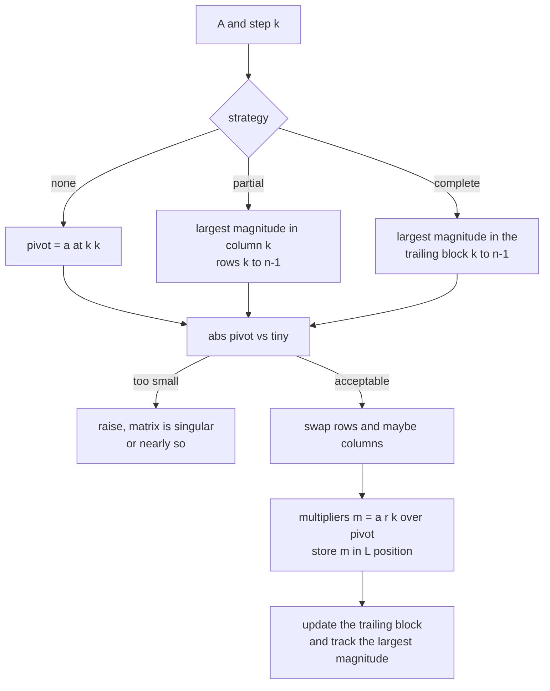
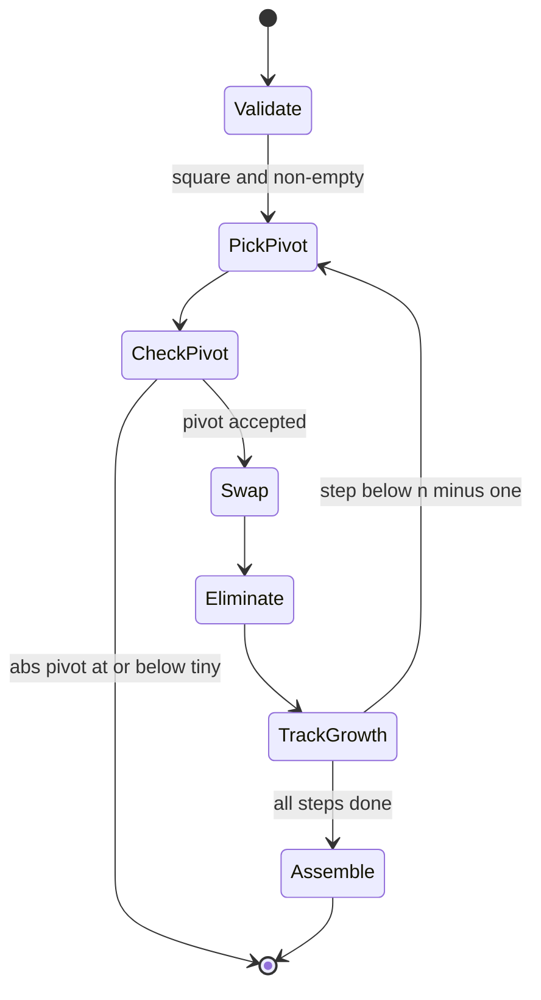
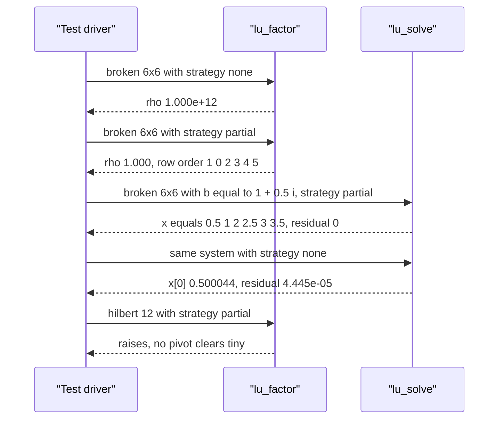

# 729 — Implement numeric stability tests for pivot strategies in LU

> **Tier:** Expert · **CTCI chapter:** Beyond — Numerical & Scientific Computing
> **Task spec:** [729-implement-numeric-stability-tests-for-pivot-strategies-in-lu.md](../../../tasks/expert/729-implement-numeric-stability-tests-for-pivot-strategies-in-lu.md)
> **Solutions:** [Python](../../../solutions/python/expert/729-implement-numeric-stability-tests-for-pivot-strategies-in-lu/solution.py) ·
> [Java](../../../solutions/java/expert/729-implement-numeric-stability-tests-for-pivot-strategies-in-lu/Solution.java) ·
> [JavaScript](../../../solutions/javascript/expert/729-implement-numeric-stability-tests-for-pivot-strategies-in-lu/solution.js) ·
> [C#](../../../solutions/csharp/expert/729-implement-numeric-stability-tests-for-pivot-strategies-in-lu/Solution.cs)

## 1. Problem restatement

Gaussian elimination factors `P A Q = L U` with `L` unit lower triangular and `U` upper
triangular. *Which* entry is used as the pivot is a numerical decision, so this task asks for a
hand-rolled factorisation that supports three strategies **and** for the tests that make the
difference between them measurable rather than rhetorical:

| Strategy | Pivot choice at step `k` | Permutations |
| --- | --- | --- |
| `none` | `a[k][k]` as it stands | none |
| `partial` | largest `|a[r][k]|` for `r >= k` | row permutation `P` only |
| `complete` | largest `|a[r][c]|` over the whole trailing block | rows `P` and columns `Q` |

Inputs: a square dense matrix of doubles, a strategy name, and the pivot threshold
`tiny = 1e-14`. Output of `lu_factor`: the pair `(L, U)`, the two permutations, and the **growth
factor**

```text
rho = max magnitude seen anywhere during elimination (input included) / ||A||_inf
```

plus `lu_solve` (forward/backward substitution through the permuted factors) and `residual`, the
infinity norm of `A x - b`. Three concrete results the solutions assert:

- the 6x6 adversarial matrix with a `1e-12` leading pivot gives
  `rho(none) = 1.000e+12`, `rho(partial) = 1.000`, `rho(complete) = 1.000`, while the Wilkinson
  bound for `n = 6` is `2^(n-1) = 32`;
- on `hilbert(10)` with `rhs = H * [1, ..., 1]` the pivoted solve has forward error
  `5.417e-04` but residual `2.220e-16` — small residual does **not** imply small forward error;
- `lu_factor(hilbert(12), "partial")` must raise, because the matrix is numerically singular in
  double precision.

## 2. Intuition

The naive factorisation just divides by the diagonal entry. On the classic killer
`A = [[1e-12, 1], [1, 1]]` that produces the multiplier `1 / 1e-12 = 1e12`, and the updated entry
`a[1][1] - 1e12 * a[0][1]` swallows the original `1` completely: information that was present in
`A` is gone. The reason is not a bug in the arithmetic — it is that elimination *propagates*
whatever magnitude the pivot introduces, so a small pivot is a licence for large multipliers.

Two structural facts drive the fix:

1. **Row exchanges are free (numerically).** Swapping rows changes the order of the elimination
   but not the solution, so a factorisation may ship a permutation `P`. Choosing the largest
   column entry bounds every multiplier by `1` — that is partial pivoting, and its worst-case
   growth is the classical `2^(n-1)`.
2. **Column exchanges are free too, but cost comparisons.** Complete pivoting searches the whole
   trailing submatrix, which bounds growth even more tightly at the price of a quadratic scan per
   step and a second permutation `Q` that has to be undone when the solution vector is
   reassembled.

The two quantities the tests measure are different things and must not be confused:

- the **growth factor** `rho` is a property of the factorisation alone (a potential
  error-amplification), and
- the **residual** `||A x - b||_inf` is a property of a computed solution (the backward error),
  while the **forward error** `max |x_i - x_i*|` needs the exact solution to be known.



## 3. Algorithm

1. Reject a strategy that is not one of `none`, `partial`, `complete`; reject an empty matrix or
   a non-square one.
2. Copy `A` (the caller's matrix is never mutated) and start `rows = columns = [0, 1, ..., n-1]`.
   Seed `peaked` with `||A||_inf` so the growth ratio can never fall below `1`.
3. For `step = 0 .. n-1`, select the pivot according to the strategy (diagonal, column argmax,
   whole trailing block argmax).
4. If `|pivot| <= tiny`, raise: the matrix is singular or numerically singular. This is the only
   guard against returning garbage.
5. Apply the row swap (recording it in `rows`) and, for complete pivoting, the column swap
   (recording it in `columns`).
6. Eliminate below the pivot: `m = a[r][step] / a[step][step]`, store `m` into `a[r][step]`
   (that slot becomes `L[r][step]`), then `a[r][c] -= m * a[step][c]` for `c > step`, updating
   `peaked` with every updated entry and with `|a[step][step]|` itself.
7. Split the in-place array: `L` gets the unit diagonal plus the stored multipliers below it, `U`
   gets the upper triangle. Return both with the permutations and `rho = peaked / ||A||_inf`.
8. `lu_solve` permutes the right-hand side with `rows`, forward-substitutes through `L` to get
   `y`, back-substitutes through `U` to get `z`, and finally scatters `z` back with
   `x[columns[i]] = z[i]`.

```text
procedure lu_factor(matrix, strategy, tiny)
    if strategy not in {none, partial, complete} then raise "unknown pivot strategy"
    n ← number of rows of matrix
    if n = 0 or any row of matrix has length ≠ n then raise "the matrix must be square and non-empty"
    a ← copy of matrix
    rows ← [0 .. n-1]
    columns ← [0 .. n-1]
    scale ← inf_norm(matrix)
    peaked ← scale
    for step ← 0 to n - 1 do
        if strategy = none then
            pivot_row ← step, pivot_col ← step
        else if strategy = partial then
            pivot_row ← argmax over r ≥ step of abs(a[r][step]), pivot_col ← step
        else
            (pivot_row, pivot_col) ← argmax over r ≥ step, c ≥ step of abs(a[r][c])
        if abs(a[pivot_row][pivot_col]) ≤ tiny then raise "singular matrix: no acceptable pivot"
        if pivot_row ≠ step then swap rows a[step] and a[pivot_row], swap rows[step] and rows[pivot_row]
        if pivot_col ≠ step then swap columns a[..][step] and a[..][pivot_col],
            swap columns[step] and columns[pivot_col]
        for r ← step + 1 to n - 1 do
            factor ← a[r][step] / a[step][step]
            a[r][step] ← factor
            for c ← step + 1 to n - 1 do
                a[r][c] ← a[r][c] - factor * a[step][c]
                peaked ← max(peaked, abs(a[r][c]))
        peaked ← max(peaked, abs(a[step][step]))
    build lower and upper from a
    return lower, upper, rows, columns, peaked / scale

procedure lu_solve(matrix, rhs, strategy)
    lower, upper, rows, columns, growth ← lu_factor(matrix, strategy)
    permuted ← [rhs[rows[i]] for i in 0 .. n-1]
    y ← forward substitution through the unit lower triangle lower
    z ← back substitution through upper
    x[columns[i]] ← z[i] for i in 0 .. n-1
    return x, growth
```



The awkward detail is step 6: the multiplier is written **into** the eliminated slot, which is
what makes the factorisation in-place and lets `L` and `U` be read out of the same array
afterwards.

## 4. Worked example

The adversarial matrix of the tests, `tiny_pivot_matrix(6)` — the identity with the leading
`1e-12` and two extra entries `a[0][1] = a[1][0] = 1`, so `||A||_inf = 1`:

```text
1e-12  1  0  0  0  0
    1  1  0  0  0  0
    0  0  1  0  0  0
    0  0  0  1  0  0
    0  0  0  0  1  0
    0  0  0  0  0  1
```

| Step | Strategy | Pivot found | Action | Largest magnitude so far | `rho` at the end |
| --- | --- | --- | --- | --- | --- |
| 0 | `none` | `1e-12` at `(0,0)` | multiplier `1/1e-12 = 1e12`, `a[1][1] ← 1 - 1e12*1 = -999999999999` | `1e12` | `1.000e+12` |
| 1..5 | `none` | `a[k][k] = 1` | nothing to eliminate below the diagonal | `1e12` | — |
| 0 | `partial` | `1` at `(1,0)`, step 0 | swap rows 0 and 1, multiplier `1e-12`, `a[1][1] ← 1 - 1e-12` | `1` | `1.000` |
| 0 | `complete` | `1` at `(1,0)`, step 0 | row order `(0,2,3,4,5,1)`, column order `(1,2,3,4,5,0)` | `1` | `1.000` |

What the `U` factors show:

| Strategy | `U[0]` | `U[1]` |
| --- | --- | --- |
| `none` | `[1e-12, 1, 0, 0, 0, 0]` | `[0, -999999999999, 0, 0, 0, 0]` |
| `partial` | `[1, 1, 0, 0, 0, 0]` | `[0, 0.999999999999, 0, 0, 0, 0]` |

Solving `A x = b` with `b = [1, 1.5, 2, 2.5, 3, 3.5]` (the tests use `1 + 0.5i`) gives the exact
solution `x = [0.5, 1, 2, 2.5, 3, 3.5]` under both pivoting strategies:

| Solve | `x[0]` | residual `||A x - b||_inf` |
| --- | --- | --- |
| `partial` | `0.5` | `0.0` |
| `complete` | `0.5` | `0.0` |
| `none` | `0.500044` | `4.445e-05` |

The unpivoted drift `4.4e-05` is what the assertion `drift > 1e-6` looks for, and it is
consistent with `rho = 1e12` times unit roundoff. On `hilbert(10)` the same solver is
*backward* stable but not accurate: `residual = 2.220e-16` while
`forward error = 5.417e-04`, a ratio of more than `1e6` — which is exactly the assertion
`forward > 1e6 * rounding`. `hilbert(12)` is worse still: no pivot clears `tiny = 1e-14`, so the
factorisation raises instead of producing a plausible-looking wrong answer.



## 5. Complexity

| Phase | Time | Space | Why |
| --- | --- | --- | --- |
| Elimination, best/average/worst | `O(n^3)` | `O(n^2)` | the inner update touches every entry of the trailing block |
| Pivot search, `partial` | `O(n)` per step, `O(n^2)` overall | `O(1)` | one column scan |
| Pivot search, `complete` | `O((n-k)^2)` per step, `O(n^3)` overall | `O(1)` | the scan dominates the `O(n^3)` work but does not change it |
| Growth tracking | `O(1)` per updated entry | `O(1)` | a running maximum |
| Solve | `O(n^2)` | `O(n)` | one forward and one backward substitution |
| Reference (LAPACK-style blocked LU) | `O(n^3)` with a smaller constant | `O(n^2)` | panel factorisation and BLAS-3 updates, which the solutions deliberately omit |

The three strategies therefore have the **same asymptotic cost** — the difference is the constant
of the pivot search and the numerical quality of the result, which is why a tutorial about
pivoting has to be a tutorial about measurement.

## 6. Pitfalls and edge cases

- **A small pivot is not a zero pivot.** The check is `|pivot| <= tiny` with `tiny = 1e-14`; a
  true zero pivot must be swapped away (the tests factor `[[0, 1], [1, 1]]` and demand a residual
  below `1e-12`) and only a genuinely singular matrix — `[[1, 2], [2, 4]]`, the zero matrix — may
  raise.
- **`hilbert(12)` is the interesting boundary.** It is invertible in exact arithmetic but
  numerically singular in double precision, so a factorisation that "succeeds" is lying.
- **Unknown strategy strings must raise**, not silently fall back to no pivoting; the tests pass
  `"magic"` and expect a `ValueError`.
- **Non-square and empty inputs** raise before any arithmetic happens: `lu_factor([])` and
  `lu_factor([[1, 2, 3]])`.
- **`n = 1` is degenerate but not special-cased**: `lu_factor([[4.0]])` returns `L = [[1]]`,
  growth exactly `1.0`.
- **The identity needs no pivoting** and must come back unchanged with `rho == 1.0` under
  complete pivoting, and a diagonal matrix must not trigger a row exchange for `none`/`partial`
  (`rows == [0, 1, 2, 3]`); complete pivoting may reorder, but the result must still be a
  permutation.
- **Growth is at least one by definition** (`peaked` starts from `||A||_inf`), so
  `rho >= 1 - 1e-12` is asserted for every matrix and strategy.
- **Forward and backward error are not interchangeable** — the Hilbert case is the counterexample
  the tests encode.
- **Determinism**: the same matrix and strategy must produce the same permutations and the same
  growth, which forbids hash-order-dependent argmax ties.
- **Documented simplifications**: scalar doubles with a flat `1e-14`/`1e-10` tolerance, no
  equilibration or row scaling, no blocked or panel factorisation, no iterative refinement, no
  sparse or banded handling, and growth measured as a scalar inf-norm ratio rather than a matrix
  norm bound.

## 7. Variants and follow-ups

- **Blocked/panel LU** is what a real library does: factor a narrow panel, then apply the update
  as a matrix multiply. That reframing is developed in
  [726 — sparse/dense block matmul](../../../tasks/expert/726-implement-sparse-dense-matrix-multiply-block-algorithm-optimizat.md)
  and [728 — cache-oblivious matmul](../../../tasks/expert/728-implement-cache-oblivious-matrix-multiplication-idea-demo.md).
- **Iterative refinement** turns any pivoted factorisation into a more accurate solve by
  computing the residual in higher precision and correcting — the natural next experiment after
  the Hilbert measurement.
- **Rank-revealing ideas** replace the pivot threshold with a decomposition that orders the
  spectrum itself;
  [730 — randomized low-rank approximation](../../../tasks/expert/730-implement-randomized-numerical-linear-algebra-low-rank-approx-de.md)
  attacks the same "which subspace matters" question from the randomized side.
- **Exactness instead of tolerance** is the other escape route: see
  [745 — robust predicates for computational geometry](../../../tasks/expert/745-implement-robust-predicates-for-computational-geometry-exact-ari.md)
  for the orientation/incircle analogue where a tolerance would be unacceptable.

## 8. Check yourself

<details><summary>Show answer</summary>
**Why is growth defined as a ratio to `||A||_inf`?**
Because the backward-error bound multiplies the growth of the *computed* entries by the scale of
the *input*; a large `U` on a large matrix is not alarming. The solutions seed `peaked` with
`||A||_inf` so `rho >= 1` always — the tests assert exactly that.

</details>

<details><summary>Show answer</summary>
**The 6x6 adversarial matrix has `||A||_inf = 1`. What `rho` does no pivoting reach, and what bound
do partial and complete pivoting respect?**
`rho = 1.000e+12` for `none` (the multiplier `1/1e-12`), and `1.000` for both pivoting strategies.
Partial pivoting is guaranteed `rho <= 2^(n-1)`, which is `2^5 = 32` for `n = 6` — the value the
run prints as `bound=32`.

</details>

<details><summary>Show answer</summary>
**On `hilbert(10)` the residual is `2.220e-16` but the forward error is `5.417e-04`. Is the solver
broken?**
No. That is the definition of backward stability: the computed `x` is the exact solution of a
slightly perturbed system, so the residual is at rounding level. The forward error is amplified by
the condition number of the Hilbert matrix, which is why the demonstration insists on both numbers.

</details>

<details><summary>Show answer</summary>
**Complete pivoting is strictly safer than partial. Why not always use it?**
It costs an `O((n-k)^2)` search at every step instead of `O(n-k)`, and it adds a column
permutation that must be undone in the solve. On the tests it never wins by a factor of two
(`growth_complete <= growth_partial * 2.0`), so partial pivoting is the usual default.

</details>

<details><summary>Show answer</summary>
**What does the factorisation do with a matrix whose first pivot is exactly zero, for example
`[[0, 1], [1, 1]]`?**
With `partial` or `complete` the pivot search finds the `1` below and swaps rows, so the
factorisation proceeds and the solved system has a residual below `1e-12`. With `none` no swap is
allowed and the factorisation must raise — this is the difference between "zero pivot" (fixable)
and "singular matrix" (not).

</details>
