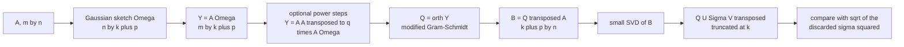
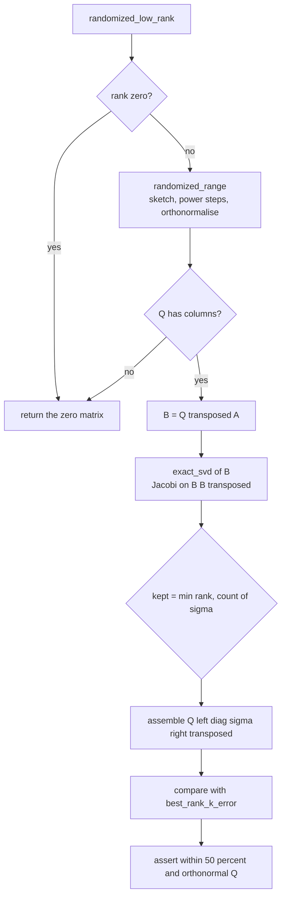
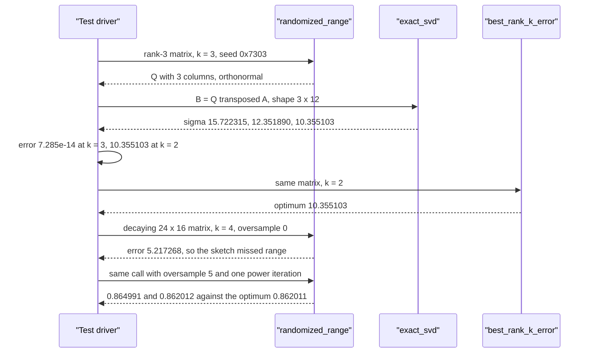

# 730 — Implement randomized numerical linear algebra low-rank approx demo

> **Tier:** Expert · **CTCI chapter:** Beyond — Numerical & Scientific Computing
> **Task spec:** [730-implement-randomized-numerical-linear-algebra-low-rank-approx-de.md](../../../tasks/expert/730-implement-randomized-numerical-linear-algebra-low-rank-approx-de.md)
> **Solutions:** [Python](../../../solutions/python/expert/730-implement-randomized-numerical-linear-algebra-low-rank-approx-de/solution.py) ·
> [Java](../../../solutions/java/expert/730-implement-randomized-numerical-linear-algebra-low-rank-approx-de/Solution.java) ·
> [JavaScript](../../../solutions/javascript/expert/730-implement-randomized-numerical-linear-algebra-low-rank-approx-de/solution.js) ·
> [C#](../../../solutions/csharp/expert/730-implement-randomized-numerical-linear-algebra-low-rank-approx-de/Solution.cs)

## 1. Problem restatement

Compute a near-optimal rank-`k` approximation of an `m x n` matrix **without** a full SVD, and then
prove the approximation is near-optimal by comparing it against the exact optimum. The four
solutions expose the same pipeline:

| Piece | Signature | Meaning |
| --- | --- | --- |
| `randomized_range(A, k, seed, oversample=5, power_iterations=0)` | `m x w` | orthonormal basis `Q` of a random sketch of the range of `A`, `w = min(k + oversample, min(m, n))` |
| `randomized_low_rank(A, k, seed, oversample=5, power_iterations=0)` | `m x n` | `Q (Q^T A)` truncated to `k` terms, via the SVD of the small matrix `B = Q^T A` |
| `exact_svd(A)` | `(U, sigma, V)` | oracle SVD from a cyclic Jacobi eigensolver on `A^T A` |
| `best_rank_k_error(A, k)` | scalar | `sqrt(sum of sigma_i^2 for i > k)` — the Eckart-Young optimum |
| `approximation_error(A, B)` | scalar | Frobenius norm of the difference |

Everything is hand-rolled: the Gaussian sketch comes from a seeded `splitmix64` stream fed through
Box-Muller, orthonormalisation is modified Gram-Schmidt, and the small SVD comes from applying
Jacobi eigen to `B B^T`. Concrete results the tests assert on a `24 x 16` matrix of numerical rank
10 with spectrum scaled by `0.55^i`:

| `k` | randomized error | best rank-`k` error |
| --- | --- | --- |
| 1 | `8.020899` | `8.011632` |
| 2 | `3.360276` | `3.358595` |
| 4 | `0.864991` | `0.862011` |
| 6 | `0.210023` | `0.210023` |
| 8 | `0.043359` | `0.043359` |

Every randomized error is within `50%` of the optimum (`errors[i] <= 1.5 * bounds[i]`), the tail
falls by more than two orders of magnitude, and on a `20 x 12` matrix of exact rank 3 the
approximation collapses to `7.285e-14` for `k = 3` while `k = 2` is exactly as bad as the optimum
(`10.355103`).

## 2. Intuition

The naive route to a rank-`k` approximation is the SVD, which costs `O(m n min(m, n))` and touches
the whole matrix several times. The randomized route replaces that with two matrix products and a
factorisation of a tiny matrix:

```text
Y = A Omega            (m x w, w = k + p)      cost O(m n w)
Q = orth(Y)            (m x w)
B = Q^T A              (w x n)                 cost O(m n w)
SVD of B               (w x n, tiny)           cost O(w^2 n)
```

Three ideas make this work:

1. **A random sketch finds the dominant subspace.** Multiplying on the right by Gaussian noise
   turns column information into a random linear combination; the columns of `Y = A Omega` live in
   the range of `A`, and if the range has numerical rank `k` then `w = k + p` samples almost surely
   capture it. `p = oversample` extra columns are what turns "almost surely" into a bound.
2. **Oversampling and power iterations are the two knobs.** With `p = 0` the sketch misses part of
   the range (`5.217268` versus the optimum `0.862011` on the decaying test matrix — more than six
   times too large), while `p = 5` lands at `0.864991`. When the spectrum decays slowly, `q` power
   iterations `Y = (A A^T)^q A Omega` flatten the tail first and sharpen the estimate further
   (`0.862012` for `q = 1`).
3. **An independent oracle turns a heuristic into a measurement.** Because the demo generates the
   spectrum itself, `sqrt(sum_{i>k} sigma_i^2)` is known in closed form, so the claim "the
   randomized answer is near-optimal" becomes a numeric assertion instead of folklore.



## 3. Algorithm

1. Build the sketch `Omega` of shape `n x w` with standard normal entries; `w = min(k + p, min(m, n))`.
2. Form `Y = A Omega`. For a slowly decaying spectrum, repeat `Y <- A (A^T Y)` `q` times
   (`q = 0` by default).
3. Orthonormalise the columns of `Y` with modified Gram-Schmidt, **dropping** any column whose
   residual norm falls below `1e-10 * max(1, sqrt(m))`; that is what makes a rank-3 matrix produce
   a 3-column `Q` from an 8-column sketch.
4. Project: `B = Q^T A` has shape `w x n` — small, because `w` is roughly `k`.
5. Take the SVD of `B` (`B B^T` is a `w x w` symmetric eigenproblem, solved by cyclic Jacobi with
   up to 60 sweeps and an off-diagonal tolerance of `1e-15`).
6. Keep the top `min(k, rank)` terms: `Q U_k Sigma_k V_k^T`, which is the rank-`k` approximation
   expressed inside the sketched subspace.
7. Optional verification: compare with `best_rank_k_error`, check `Q^T Q = I`, and check the
   Pythagorean identity `||A||_F^2 = ||Q^T A||_F^2 + ||A - Q Q^T A||_F^2`.

```text
procedure randomized_range(A, k, seed, oversample, power_iterations)
    rows, cols ← shape of A
    if k < 0 or k > min(rows, cols) then raise "rank must fit the matrix"
    if k = 0 then return a single zero column repeated rows times
    width ← min(k + oversample, min(rows, cols))
    Omega ← gaussian_matrix(cols, width, seed)          // Box-Muller on a splitmix64 stream
    Y ← A Omega
    for step ← 1 to power_iterations do
        Y ← A (transpose(A) Y)
    return modified_gram_schmidt(Y)

procedure randomized_low_rank(A, k, seed, oversample, power_iterations)
    if k < 0 then raise "rank must be non-negative"
    if k = 0 then return the zero matrix with the shape of A
    Q ← randomized_range(A, k, seed, oversample, power_iterations)
    if Q has no columns then return the zero matrix
    B ← transpose(Q) A
    left, sigma, right ← exact_svd(B)
    kept ← min(k, number of sigma)
    return Q left_kept diag(sigma_kept) transpose(right_kept)

procedure modified_gram_schmidt(matrix)
    basis ← empty list
    for col ← 0 to number of columns of matrix - 1 do
        vector ← column col of matrix
        for previous in basis do
            vector ← vector - (transpose(previous) vector) previous
        norm ← length of vector
        if norm > 1e-10 * max(1, sqrt(number of rows)) then
            append vector / norm to basis
    return the basis as the columns of an orthonormal matrix
```



## 4. Worked example

The rank-3 test matrix, `low_rank_matrix(20, 12, 3, 0x7302, decay=1.0)`, is the product of a
`20 x 3` Gaussian factor and a `3 x 12` Gaussian factor, so `A` has exact numerical rank 3 with
`||A||_F = 22.516405` and singular values `(15.722315, 12.351890, 10.355103)`.

| Step | Object | Shape | Measured value |
| --- | --- | --- | --- |
| 0 | `A` | `20 x 12` | `||A||_F = 22.516405`, exact rank 3 |
| 1 | `Omega` | `12 x 8` | Gaussian, `w = min(3 + 5, 12) = 8` |
| 2 | `Y = A Omega` | `20 x 8` | `||Y||_F = 63.169885` |
| 3 | `Q = orth(Y)` | `20 x 3` | 5 directions dropped by the `1e-10` collapse threshold, `||Q||_F = 1.732051 = sqrt(3)` |
| 4 | `B = Q^T A` | `3 x 12` | singular values `(15.722315, 12.351890, 10.355103)` — identical to those of `A` |
| 5 | truncate at `k = 3` | `20 x 12` | error `7.285e-14`, i.e. machine precision |
| 5 | truncate at `k = 2` | `20 x 12` | error `10.355103`, exactly `sigma_3` |

Step 5 is the whole point of the exercise: `k = 3` recovers the matrix, `k = 2` cannot, and the
failure equals the Eckart-Young optimum to the last digit — the sketch found the *right* subspace,
the truncation is what loses information.

On the decaying matrix `24 x 16`, rank 10, `decay = 0.55` (`sigma_1 = 18.222`), the same driver
sweeps `k`:

| `k` | sketch width `w` | `Q` columns | randomized error | optimum | ratio |
| --- | --- | --- | --- | --- | --- |
| 1 | `min(6, 16) = 6` | 6 | `8.020899` | `8.011632` | `1.001` |
| 2 | 7 | 7 | `3.360276` | `3.358595` | `1.001` |
| 4 | 9 | 9 | `0.864991` | `0.862011` | `1.003` |
| 6 | 11 | 11 | `0.210023` | `0.210023` | `1.000` |
| 8 | 13 | 13 | `0.043359` | `0.043359` | `1.000` |

For this matrix the sketch is full-rank (10 singular directions against at most 13 sketches), so
`Q` keeps every column it asked for — unlike the rank-3 case above, where Gram-Schmidt correctly
discarded the five columns that carry no information. The `k = 4` row is also where the two knobs
are visible in isolation: `oversample = 0` gives `5.217268`, `oversample = 5` gives `0.864991`,
and one power iteration gives `0.862012` — the last one slightly *better* than the plain
oversampled sketch, which is exactly why the solutions assert `powered <= 1.1 * bound` rather than
equality.



## 5. Complexity

| Stage | Time | Space | Reason |
| --- | --- | --- | --- |
| Sketch and `Y = A Omega` | `O(m n w)` | `O(n w + m w)` | dense product by a `n x w` block |
| Power iterations | `O(m n w)` per iteration | `O(m w)` | `A^T Y` then `A (A^T Y)` |
| Gram-Schmidt | `O(m w^2)` | `O(m w)` | orthogonalisation against at most `w` basis vectors |
| `B = Q^T A` | `O(m n w)` | `O(w n)` | projection, the third dense product |
| SVD of `B` | `O(w^2 n)` (cyclic Jacobi) | `O(w n + w^2)` | `w` is a small multiple of `k` |
| Full exact SVD of `A` | `O(m n min(m, n))` | `O(m n)` | the alternative this method exists to avoid |
| Frobenius oracle check | `O(m n)` | `O(1)` | one pass plus the closed-form tail |

With `w ≈ k << min(m, n)` the randomized pipeline is dominated by three passes over `A`; the
solutions deliberately use tens of rows, not thousands, because they also compute the exact SVD as
the oracle.

## 6. Pitfalls and edge cases

- **`k = 0`** must return the zero matrix, and its error must equal the full Frobenius norm of `A`
  (`19.905486` on the decaying matrix) — the assertion compares against `frobenius(A)`.
- **`k >= min(m, n)`** is allowed and must reproduce the matrix to `1e-9`; a `20 x 12` matrix has at
  most 12 singular directions, and the sketch width is capped accordingly.
- **A rank beyond the matrix raises** (`randomized_range(A, 99, seed)`), as does a **negative
  rank**; both are checked with `expect_value_error`.
- **MGS must drop collapsed directions**, otherwise a rank-3 matrix hands back an 8-column `Q` whose
  extra columns are noise, and `Q^T Q = I` would still pass while the projection `Q Q^T` became
  numerically meaningless. The threshold `1e-10 * max(1, sqrt(m))` is what keeps `Q` honest.
- **Oversampling is not decoration**: without it the sketch provably misses part of the range, and
  the demo asserts `thin > 1.2 * bound4` to prove the point.
- **The zero matrix stays zero and has a zero tail** (`best_rank_k_error == 0`), so the oracle needs
  no special case.
- **The `1e-6 * sigma[0]` cutoff in `exact_svd`** is what makes "numerical rank" well defined:
  singular values below it are treated as zero, which is why the rank-3 test matrix reports a tail
  of exactly `0.0` for `k >= 3`.
- **Determinism**: the same `seed` must return the same approximation (`randomized_low_rank(A, 5,
  0x7310)` twice compares equal), so no fresh entropy may be used inside the pipeline.
- **Tall matrices** (`9 x 3` with `k = 3`) go through the same code path — the projection is
  `Q^T A` regardless of the aspect ratio.
- **Documented simplifications**: one fixed Gaussian sketch, no power iteration by default, no
  blocked or pivoted QR, Jacobi rather than bidiagonalisation for the small SVD, and matrices small
  enough that the exact SVD oracle stays cheap.

## 7. Variants and follow-ups

- **Structured sketches** (subsampled Hadamard, sparse Johnson-Lindenstrauss) trade the
  `O(m n w)` Gaussian product for a fast transform, which matters when `A` does not fit in memory.
- **Pivoted QR instead of Gram-Schmidt** is the standard cure when the sketch is nearly rank
  deficient and plain MGS loses orthogonality.
- **Randomized methods as iterative solvers**: the same range finder is the core of sketched
  Krylov and randomized least-squares solvers, which is the natural follow-up to
  [729 — numeric stability of pivot strategies in LU](../../../tasks/expert/729-implement-numeric-stability-tests-for-pivot-strategies-in-lu.md).
- **The dense-product cost that dominates this file** is studied on its own in
  [728 — cache-oblivious matrix multiplication](../../../tasks/expert/728-implement-cache-oblivious-matrix-multiplication-idea-demo.md),
  and the subcubic alternative in
  [727 — Strassen with recursion cutoff](../../../tasks/expert/727-implement-strassen-matrix-multiplication-and-recursion-cutoff-tu.md).

## 8. Check yourself

<details><summary>Show answer</summary>
**Why is `w = k + p` and not simply `k`?**
Because the sketch is a random projection of the range: with exactly `k` columns the probability
that `Q` misses part of the dominant subspace is not negligible. The extra `p` columns (5 by
default) absorb the miss, and the demo shows the effect numerically — `oversample = 0` gives
`5.217268` on the decaying matrix where `oversample = 5` gives `0.864991` against an optimum of
`0.862011`.
</details>

<details><summary>Show answer</summary>
**The rank-3 test matrix is `20 x 12`, `k = 3`, sketch width 8, and yet `Q` comes back with 3
columns. Is that a bug?**
No. `Y = A Omega` cannot have more than 3 independent columns, because its columns are
combinations of the 3 columns of `A`. Modified Gram-Schmidt deletes the columns whose residual norm
falls below `1e-10 * max(1, sqrt(20))`, leaving exactly the 3 directions that carry the range. `B`
is then `3 x 12` and its singular values reproduce those of `A` to every printed digit.
</details>

<details><summary>Show answer</summary>
**Why does the demo compute an *exact* SVD when the point is to avoid one?**
To turn the near-optimality claim into a measurement. `best_rank_k_error` evaluates
`sqrt(sum_{i>k} sigma_i^2)` from an independent code path (Jacobi eigen on `A^T A`, no shared code
with the sketch), so the randomized error can be checked against the Eckart-Young optimum — and the
randomized method can never beat it, only approach it.
</details>

<details><summary>Show answer</summary>
**When does a power iteration change the answer?**
When the spectrum decays slowly, so that `sigma_{k+1}` is close to `sigma_k` and the sketch cannot
separate them: `q` steps of `Y <- A (A^T Y)` push the spectrum towards `sigma_i^(2q+1)`, making the
gap decisive. On the `0.55^i` spectrum one iteration already lands at `0.862012`, marginally better
than the plain oversampled sketch, and the assertion only demands "not worse than 1.1x the optimum".
</details>

<details><summary>Show answer</summary>
**What does the Pythagorean check `||A||_F^2 = ||Q^T A||_F^2 + ||A - Q Q^T A||_F^2` actually
verify?**
That `Q Q^T` is a genuine orthogonal projector. It can only hold if the columns of `Q` are
orthonormal — which is why the same file also checks `Q^T Q = I` to `1e-10` for the
`oversampled` range basis before it trusts any error number.
</details>
