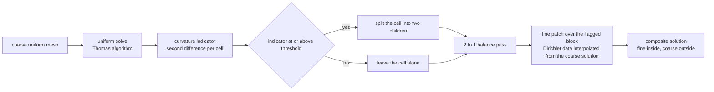
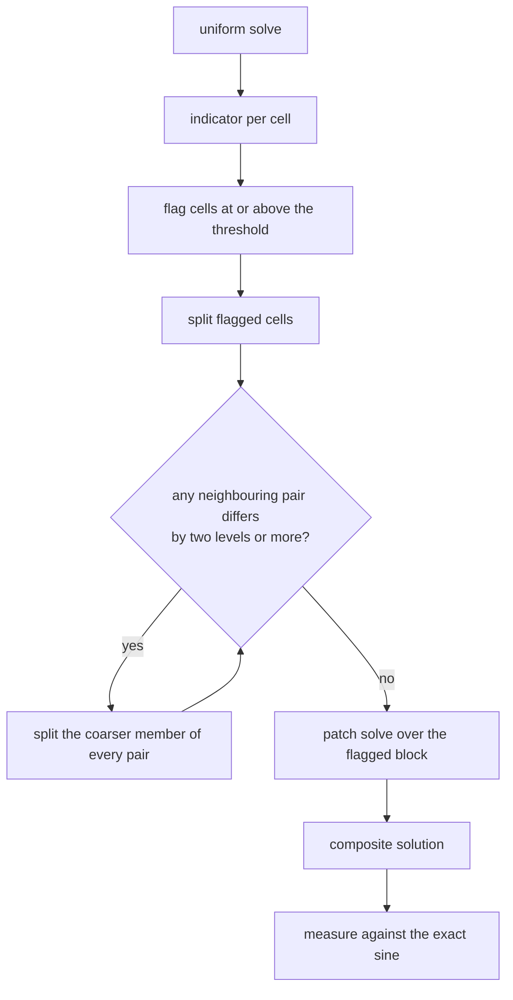
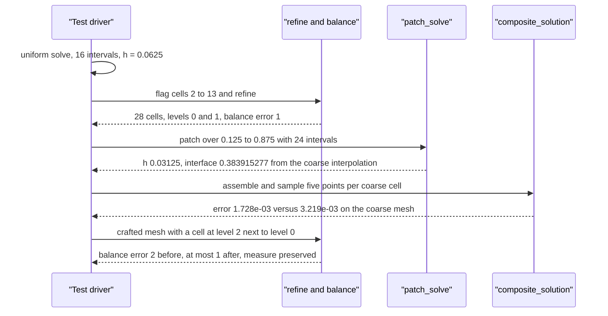

# 731 — Implement adaptive mesh refinement driving solver coupling

> **Tier:** Expert · **CTCI chapter:** Beyond — Graphics, Geometry & Robotics
> **Task spec:** [731-implement-adaptive-mesh-refinement-driving-solver-coupling.md](../../../tasks/expert/731-implement-adaptive-mesh-refinement-driving-solver-coupling.md)
> **Solutions:** [Python](../../../solutions/python/expert/731-implement-adaptive-mesh-refinement-driving-solver-coupling/solution.py) ·
> [Java](../../../solutions/java/expert/731-implement-adaptive-mesh-refinement-driving-solver-coupling/Solution.java) ·
> [JavaScript](../../../solutions/javascript/expert/731-implement-adaptive-mesh-refinement-driving-solver-coupling/solution.js) ·
> [C#](../../../solutions/csharp/expert/731-implement-adaptive-mesh-refinement-driving-solver-coupling/Solution.cs)

## 1. Problem restatement

Run the adaptive-mesh-refinement loop end to end: solve a PDE on a uniform mesh, use an **error
indicator** to decide where the mesh is too coarse, refine exactly those cells, repair the mesh so
the resulting levels are well posed, and couple the levels so the composite solution is more
accurate than the coarse one. The model problem is the 1D Poisson equation `-u'' = f` on `[0, 1]`
with Dirichlet data, `f = pi^2 sin(pi x)`, whose exact solution `u = sin(pi x)` is known — so every
claim can be measured.

| Piece | Signature | Role |
| --- | --- | --- |
| `solve_uniform(left, right, intervals, left_value, right_value, rhs)` | `(nodes, values, h)` | Thomas-algorithm FD solve of `-u'' = f`, with `2` on the diagonal and `-1` off it |
| `curvature_indicators(nodes, values)` | one value per cell | `max |u_{i-1} - 2 u_i + u_{i+1}|` over the two nodes touching the cell |
| `flag_cells(indicators, threshold)` | index set | cells whose indicator is `>= threshold` |
| `refine(cells, flagged)` | new cell list | each flagged cell splits into two children one level finer |
| `balance(cells)` | new cell list | enforces the 2:1 rule — no cell may touch a cell two levels finer |
| `patch_solve(...)` | `(nodes, values, h)` | fine-grid solve inside the flagged block, Dirichlet data interpolated from the coarse solution |
| `composite_solution(...)` | `x -> value` | coarse everywhere, fine inside the patch |

Concrete results the tests assert on the 16-cell coarse mesh (`h = 0.0625`):

- coarse error `3.219e-03`; a uniform 64-interval mesh gives `2.008e-04`; the loop flags cells
  `{2, 3, ..., 13}` (12 of 16), refines to `28` cells with `balance_error = 1`;
- the patch spans `[0.125, 0.875]` with 24 intervals (`h = 0.03125`) and its two interface values
  are the interpolated coarse values `0.383915277`;
- the composite error is `1.728e-03`, strictly less than the coarse `3.219e-03` (the test demands
  better than `coarse_error / 1.5`), while outside the patch the composite solution equals the
  coarse one to `1e-12`.

## 2. Intuition

Uniform refinement is the naive answer, and it is wasteful: achieving the 64-interval accuracy
everywhere costs four times the unknowns of the coarse mesh, even though the solution only bends
in the middle and is nearly linear near the ends. Adaptivity spends the unknowns where the
indicator says they are needed.

Three questions have to be answered before the loop can run:

1. **What is the indicator?** The local truncation residual is useless — the discrete solution
   satisfies its own equations exactly, so the residual is zero everywhere (the test asserts
   `< 1e-12`). Instead the solutions use the *curvature* `|u_{i-1} - 2u_i + u_{i+1}|`, which
   estimates `h^2 |u''|`: large where the solution bends, tiny where it is flat. On a sine solution
   the peak cell is the one containing `x = 0.5`, and the two end cells score `0.007521` against
   the middle `0.038553` — a factor of five.
2. **What makes a refined mesh legal?** Refinement creates *hanging nodes*: a coarse cell face
   touching two fine cell faces. If a neighbourhood differs by more than one level, the
   discretisation is no longer well posed, so a **2:1 balance pass** splits coarse neighbours of
   doubly refined cells until `balance_error <= 1` everywhere.
3. **How do the levels talk to each other?** The fine patch needs boundary values; it takes them
   from the coarse solution by linear interpolation, and the composite solution then consists of
   fine data inside the patch and coarse data outside — the coarse solution is the "boundary
   condition provider" and the fine solution the "correction".



## 3. Algorithm

1. Discretise `[0, 1]` into `intervals` equal cells; the unknowns are the interior nodes, so the
   tridiagonal system has `interior = intervals - 1` rows with `2` on the diagonal, `-1` off it and
   right-hand side `h^2 f(x_i)` plus the Dirichlet contributions at the two ends.
2. Solve by the Thomas algorithm: a forward sweep eliminating `diagonal[i-1]` from row `i`, then a
   backward sweep. Return `(nodes, values, h)`.
3. For every interior node compute the second difference and assign it to *both* cells that touch
   that node, taking the maximum — so a cell is flagged if either of its endpoints is curved.
4. Flag every cell whose indicator is at least `threshold` (the tests use `0.5 * max(indicator)`
   for the main run, `1.1 * max` to prove nothing is flagged, and `max` to prove the peak cell
   alone is flagged).
5. Refine: replace each flagged cell by its two halves at `level + 1`; unflagged cells are reused
   unchanged, so the mesh stays in order and neighbours are adjacent in the list.
6. Balance: while some adjacent pair differs by two or more levels, split the coarser member of
   every offending pair and repeat — at most 16 passes, after which a failure is an assertion
   rather than an infinite loop.
7. Build the patch over `[cells[first_flagged].lo, cells[last_flagged].hi]` with `2 * count(flagged)`
   intervals, taking its two Dirichlet values by linear interpolation of the coarse solution.
8. Define the composite solution: inside the patch sample the fine data, outside sample the coarse
   data. Measure `max |u_composite - u_exact|` by sampling five points per coarse cell.

```text
procedure solve_uniform(left, right, intervals, left_value, right_value, rhs)
    if intervals < 1 then raise "at least one interval is required"
    h ← (right - left) / intervals
    nodes ← [left + i h for i in 0 .. intervals]
    interior ← intervals - 1
    diagonal ← [2] repeated interior times
    upper ← lower ← [-1] repeated interior times
    load ← [h h rhs(nodes[i + 1]) for i in 0 .. interior - 1]
    add left_value to load[0] and right_value to load[interior - 1]
    for i ← 1 to interior - 1 do
        factor ← lower[i] / diagonal[i - 1]
        diagonal[i] ← diagonal[i] - factor upper[i - 1]
        load[i] ← load[i] - factor load[i - 1]                    // forward sweep
    values ← [left_value] plus interior zeros plus [right_value]
    values[interior] ← load[interior - 1] / diagonal[interior - 1]
    for i ← interior - 2 down to 0 do
        values[i + 1] ← (load[i] - upper[i] values[i + 2]) / diagonal[i]
    return nodes, values, h

procedure amr_loop(intervals, threshold_fraction)
    nodes, values, h ← solve_uniform(0, 1, intervals)
    cells ← uniform_mesh(intervals)
    indicators ← curvature_indicators(nodes, values)
    flagged ← indices of cells whose indicator ≥ threshold_fraction times max(indicators)
    refined ← refine(cells, flagged)
    balanced ← balance(refined)
    patch ← patch_solve(cells[first flagged].lo, cells[last flagged].hi,
                        2 times count(flagged), nodes, values)
    return composite_solution(nodes, values, patch)
```



## 4. Worked example

Coarse mesh: 16 cells, `h = 0.0625`, `coarse_error = 3.219e-03`. Indicators, printed as they are
produced by `curvature_indicators`:

| Cell | 0 | 1 | 7 | 8 | 15 |
| --- | --- | --- | --- | --- | --- |
| `indicator` | `0.007521` | `0.014750` | `0.038553` | `0.038553` | `0.007521` |

The maximum is `0.038553`, so the threshold `0.5 * max = 0.019277` flags cells `2` through `13` —
12 cells, one contiguous block, exactly what a sine solution should produce (the test asserts the
flagged set is contiguous).

| Step | Action | Result |
| --- | --- | --- |
| 1 | `refine(cells, {2..13})` | 28 cells (`16 - 12 + 24`), levels `{0, 1}`, `balance_error = 1` |
| 2 | patch over cells 2..13 | `[0.125, 0.875]`, 24 intervals, `h_patch = 0.03125` |
| 3 | interpolate coarse data at `0.125` and `0.875` | `0.383915277` on both ends |
| 4 | patch solve | interface values equal the interpolated data to `1e-15`, patch residual `< 1e-12` |
| 5 | composite | error `1.727906e-03` against the coarse `3.218964e-03` |
| 6 | telescoping flux identity | `-0.177569185` from both the summed second differences and the boundary one-sided flux |

Why the gain is modest — a factor of `1.86`, not the factor of 16 that uniform `h/2` would give —
is instructive: the refinement only halves `h` inside the flagged block, and only for one level.
The checkpoint the tests demand is `composite_error < coarse_error / 1.5`, which the run satisfies
with `1.7279e-03 < 2.1460e-03`.

The balancing pass needs an adversarial input to be exercised, and the tests supply a crafted mesh:

| Mesh | Levels | `balance_error` |
| --- | --- | --- |
| `[Cell(0, 0.25, 0), Cell(0.25, 0.3125, 2), Cell(0.3125, 0.375, 2), Cell(0.375, 0.5, 0), Cell(0.5, 1, 0)]` | `0, 2, 2, 0, 0` | `2` — illegal |
| after `balance` | no pair differs by two levels | `<= 1`, cell count grows, `min level = 0`, total measure still `1.0` |



## 5. Complexity

| Operation | Time | Space | Reason |
| --- | --- | --- | --- |
| Uniform solve, `n` intervals | `O(n)` | `O(n)` | tridiagonal Thomas sweep, two passes |
| Curvature indicator | `O(n)` | `O(n)` | one second difference per interior node, assigned to two cells |
| Flagging | `O(n)` | `O(n)` | single comparison per cell |
| Refinement | `O(c)` | `O(c)` | one list rebuild, `c` cells |
| Balancing | `O(c)` per pass, `O(c * passes)` total | `O(c)` | each pass splits the coarser member of offending pairs |
| Patch solve | `O(m)` | `O(m)` | `m = 2 * flagged` intervals, one level of refinement |
| Composite error measurement | `O(c)` samples | `O(1)` | five sample points per coarse cell |
| Uniform fine solve on the same `h` | `O(64)` here | `O(64)` | what the adaptive loop is competing against |

The adaptive loop is linear in the number of cells at every stage; the whole saving comes from
refining 12 of 16 cells instead of all of them, and from not solving a global fine system.

## 6. Pitfalls and edge cases

- **The truncation residual is the wrong indicator** — a discrete solution satisfies its own
  equations, so `discrete_residual < 1e-12` holds exactly and would flag nothing. The tests assert
  that property *and* use curvature for the flagging.
- **Degenerate cells are invalid**: `Cell(1.0, 1.0, 0)` (zero width) and `Cell(0.0, 1.0, -1)`
  (negative level) must raise.
- **`solve_uniform(0, 1, 0)` raises** — zero intervals is not a mesh.
- **A threshold above `max(indicator)` flags nothing** and the composite solution must then be
  *exactly* the coarse solution (`max_error(...) == coarse_error`); the strictest threshold must
  still flag at least the peak cell, so a single-cell patch has to work.
- **Balancing must not coarsen**: `min(cell.level) == 0` after the pass, and the domain measure
  `sum(width) == 1.0` to `1e-12` — a split is the only allowed repair.
- **The two interface values must come from the coarse solution**, not from the exact solution;
  the test compares against `interpolate(nodes, values, x)` to `1e-15`. This is the coupling
  condition that keeps the composite solution consistent with the data it was given.
- **Refining the whole domain reproduces the uniform fine solution exactly** (`2 * 32` intervals
  against `solve_uniform(0, 1, 64)` agree to `1e-15`), which pins the patch solver to the same
  scheme as the coarse solver.
- **Determinism**: two identical `solve_uniform` calls must return identical value lists, which
  rules out any iteration-order dependence.
- **Documented simplifications**: one spatial dimension; a single refinement level is actually
  *solved* (multi-level meshes are built and validated but not solved); linear interpolation stands
  in for a proper flux-matching refluxing step; no patch-hierarchy bookkeeping, no parallel patches
  and no time-dependent problem. What is not simplified: the indicator, the refinement and
  balancing logic, the interpolated coupling, the measured accuracy gain, and the level-consistency
  checks.

## 7. Variants and follow-ups

- **Higher dimensions** turn the hanging-node problem into real work: in 2D a cell with two
  children must announce its faces, which is why the 1D solution gets away with a list. The mesh
  bookkeeping cousins in this repository are
  [737 — OBB tree building](../../../tasks/expert/737-implement-oriented-bounding-box-tree-building-obb-tree-outline.md)
  and [736 — intersection detection with bounding volume hierarchies](../../../tasks/expert/736-implement-intersection-detection-in-3d-using-bounding-volume-hie.md),
  where the hierarchy also has to be kept balanced.
- **Refluxing / flux matching** replaces the linear interpolation with a correction that makes the
  coarse-fine interface conservative — the natural next step after the telescoping flux identity
  verified here.
- **Error estimators with rigorous bounds** (dual-weighted residuals) replace the curvature
  heuristic; the same loop then carries a computable error *certificate*.
- **Where the sampled data comes from** matters: the moving-mesh style approaches in
  [732 — particle-in-cell](../../../tasks/expert/732-implement-particle-in-cell-simplified-simulation-outline.md)
  deposit a Lagrangian description onto exactly the kind of grid this file refines.

## 8. Check yourself

<details><summary>Show answer</summary>
**Why is the curvature second difference a better indicator than the local residual?**
Because the discrete solution satisfies its own equations, the residual is identically zero (the
test asserts `< 1e-12`), so it cannot discriminate between cells. The second difference estimates
`h^2 |u''|`, which is `0.038553` at the peak cell and `0.007521` at the ends for a sine solution.
</details>

<details><summary>Show answer</summary>
**The flagged cells form one contiguous block. Is that a coincidence?**
No. `sin(pi x)` is symmetric and unimodal, so its curvature is largest in the middle and decreases
towards both ends; a threshold at half the maximum cuts out a single interval around the peak. The
test asserts contiguity precisely to catch an indicator that would flag scattered cells.
</details>

<details><summary>Show answer</summary>
**Why must `balance` only split and never coarsen?**
Coarsening would throw away a cell whose indicator already justified refinement, and it would make
the patch geometry depend on the order of the passes. Splitting keeps `min(level) == 0` and the
domain measure invariant, both of which are asserted; the crafted `level 0 / level 2` mesh needs
exactly that repair.
</details>

<details><summary>Show answer</summary>
**Where do the patch boundary values come from, and what would break if they came from the exact
solution instead?**
They are linear interpolations of the coarse solution at `x = 0.125` and `x = 0.875`, both
`0.383915277`. Using the exact solution would compare the fine patch against a different problem
and would hide a coupling bug; the test instead matches the interface values against `interpolate`
to `1e-15` and requires the composite solution to equal the coarse one everywhere outside the
patch.
</details>

<details><summary>Show answer</summary>
**The composite error `1.728e-03` only beats the coarse `3.219e-03` by a factor of 1.9. Why not
16?**
Because only one level of refinement is applied and only inside the flagged block: `h` halves from
`0.0625` to `0.03125` there, so the error in that region falls by about `4` while the rest of the
domain stays at the coarse accuracy. The asserted bar is deliberately modest —
`composite_error < coarse_error / 1.5`.
</details>
