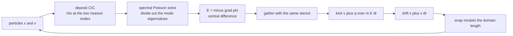
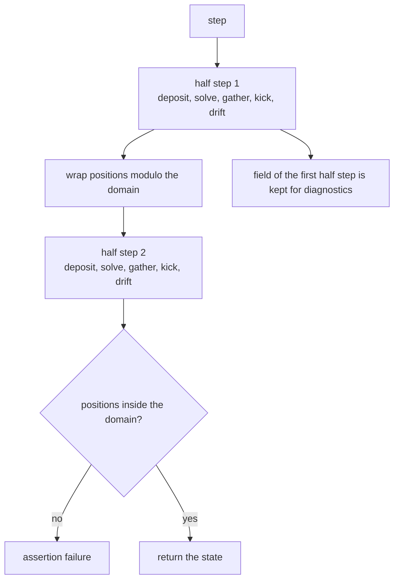
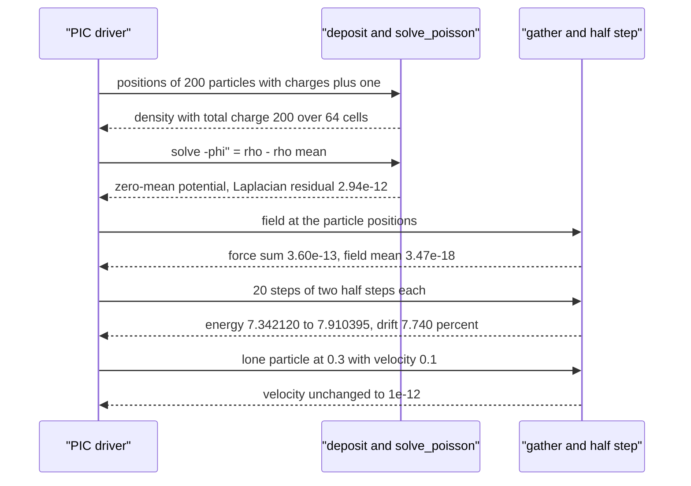

# 732 — Implement particle-in-cell simplified simulation outline

> **Tier:** Expert · **CTCI chapter:** Beyond — Graphics, Geometry & Robotics
> **Task spec:** [732-implement-particle-in-cell-simplified-simulation-outline.md](../../../tasks/expert/732-implement-particle-in-cell-simplified-simulation-outline.md)
> **Solutions:** [Python](../../../solutions/python/expert/732-implement-particle-in-cell-simplified-simulation-outline/solution.py) ·
> [Java](../../../solutions/java/expert/732-implement-particle-in-cell-simplified-simulation-outline/Solution.java) ·
> [JavaScript](../../../solutions/javascript/expert/732-implement-particle-in-cell-simplified-simulation-outline/solution.js) ·
> [C#](../../../solutions/csharp/expert/732-implement-particle-in-cell-simplified-simulation-outline/Solution.cs)

## 1. Problem restatement

Particle-in-cell couples a **Lagrangian** particle description to an **Eulerian** field on a grid.
One step of a 1D periodic electrostatic PIC loop is

```text
deposit  particles -> charge density rho on the grid     (cloud-in-cell weighting)
solve    -phi'' = rho - <rho> on the periodic grid       (spectral Poisson solve)
field    E = -grad phi                                   (central difference)
gather   E at the particle positions                     (the same stencil as the deposit)
push     v <- v + (q/m) E dt ,  x <- x + v dt            (two half steps per time step)
```

The four solutions expose the same pieces:

| Piece | Signature | Meaning |
| --- | --- | --- |
| `deposit(positions, charges, cells, length)` | density array | linear weighting onto the two nearest nodes, divided by `h` |
| `solve_poisson(density, length)` | potential array | discrete Fourier solve of `-phi'' = rho - <rho>`, `k = 0` mode left at zero |
| `electric_field(potential, length)` | field array | `-(phi[i+1] - phi[i-1]) / (2h)` with periodic indexing |
| `gather(field, positions, cells, length)` | one value per particle | linear interpolation, the transpose of the deposit |
| `PIC(cells, length, dt).load(...).step()` | the loop | two half steps, each re-depositing and re-solving |
| `field_energy`, `kinetic_energy`, `total_momentum` | scalars | the conservation diagnostics |

Concrete results the tests assert, all on a 64-cell grid with `h = 1/64`, `dt = 0.05`, 200
particles of charge `+1` and mass `1` seeded with `0x7321`:

- deposit conserves charge exactly: three unit particles give `sum(rho) * h = 3.0`;
- a particle sitting on a node deposits `2/h = 128` on that node and `0` on the next; a particle at
  a cell centre splits evenly (`64` and `64`);
- the Poisson solve inverts the discrete Laplacian to `2.94e-12` and returns a zero-mean potential
  (`2.65e-18`), and a uniform density gives an all-zero potential;
- over 20 steps energy drifts `7.740%` (`7.342120 -> 7.910395`) against a `0.25` bar, particles stay
  inside `[0, 1)`, charge and particle count are conserved, and the total gathered force is
  `-3.60e-13` because the field has zero mean (`-3.47e-18`);
- a lone particle keeps its velocity (`0.10000000000000006` against `0.1`), while an opposite-charge
  pair accelerates towards each other to `+0.015009` and `-0.015009`.

## 2. Intuition

The naive coupling is to treat particles as point charges and the field as a pointwise quantity.
That fails immediately: a point charge deposits a delta function, whose discrete Laplacian is
unbounded, and the force on a particle sitting exactly on a node would be the field *at* the
singularity. The cure is to **spread** the particle over a cell and to **interpolate** the field
back with the same weights:

1. **Cloud-in-cell (CIC) weighting.** A particle at `x` contributes `q (1 - w)` to the node on its
   left and `q w` to the node on its right, where `w` is the fractional position inside the cell.
   The stencil's zeroth moment is `1`, so the deposited total charge is exactly the particle total —
   the tests check `sum(rho) * h == 3.0` for three unit charges.
2. **The same stencil both ways.** Deposit *scatters* charge from particles to nodes; gather
   *collects* the field from nodes to particles with the identical weights. Sharing the stencil is
   what makes the scheme momentum conserving, and it makes the gather exact for any field that is
   linear across a cell — the tests probe exactly that (`3.009375` for the field `3 + 2x` at
   `x = 0.3h`).
3. **A spectral Poisson solve turns the operator into a diagonal.** On a periodic grid the discrete
   Fourier basis diagonalises `-d^2/dx^2`: the eigenvalue of mode `k` is
   `(2 - 2cos(2 pi k / cells)) / h^2`, so the solve is one transform, one scalar division per mode
   and one inverse transform. For 64 cells that eigenvalue at `k = 1` is `39.446719`.
4. **The `k = 0` mode must stay zero.** Poisson's equation with periodic boundaries has no solution
   unless the right-hand side has zero mean, so the solver subtracts `<rho>` first and leaves the
   mean of `phi` at zero; that is also why the field the particles feel has zero mean and the total
   force on the plasma vanishes.



## 3. Algorithm

1. `deposit`: for each particle compute `grid = x / h`, take `left = floor(grid) mod cells` and
   `w = grid - floor(grid)`, then add `q (1 - w)` and `q w` to `density[left]` and
   `density[left + 1]`; divide the whole array by `h` so it represents charge *per unit length*.
2. `solve_poisson`: subtract the mean from the density, forward-transform with the hand-written
   `O(N^2)` DFT, divide every mode `k >= 1` by `(2 - 2cos(2 pi k / N)) / h^2`, keep mode `0` at
   zero, inverse-transform and take the real part. Reject a grid with fewer than two cells.
3. `electric_field`: periodic central difference `-(phi[i+1] - phi[i-1]) / (2h)`.
4. `gather`: the deposit stencil applied to the field, producing one value per particle.
5. `PIC.step`: two `_advance` half steps of `dt/2`, each of which deposits, solves, differentiates,
   gathers, then kicks `v` and drifts `x` (with `x` reduced modulo the domain length). Re-evaluating
   the field at both half steps is what makes the integrator symmetric.
6. `energy` re-runs the deposit/solve/differentiate chain and returns `0.5 h sum((E - <E>)^2)` plus
   `0.5 sum(m v^2)`; `total_momentum` returns `sum(m v)`.
7. `load` validates the state: every mass positive, every starting position inside `[0, length)`.

```text
procedure deposit(positions, charges, cells, length)
    h ← length / cells
    density ← zeros of length cells
    for each (x, q) in (positions, charges) do
        grid ← x / h
        left ← floor(grid) modulo cells
        w ← grid - floor(grid)
        density[left] ← density[left] + q (1 - w)
        density[left + 1 modulo cells] ← density[left + 1 modulo cells] + q w
    return density / h

procedure solve_poisson(density, length)
    cells ← length of density
    if cells < 2 then raise "at least two grid cells are required"
    h ← length / cells
    mean ← sum(density) / cells
    spectrum ← dft(density - mean)
    for k ← 0 to cells - 1 do
        if k = 0 then
            potential[k] ← 0                            // the mean cannot be determined
        else
            eigenvalue ← (2 - 2 cos(2 pi k / cells)) / (h h)
            potential[k] ← spectrum[k] / eigenvalue
    return idft(potential)

procedure step(state)
    repeat 2 times
        density ← deposit(state.positions, state.charges, cells, length)
        potential ← solve_poisson(density, length)
        field ← electric_field(potential, length)
        at_particles ← gather(field, state.positions, cells, length)
        for i ← 0 to count(state.positions) - 1 do
            dt_half ← 0.5 dt
            state.velocities[i] ← state.velocities[i] + (charge[i] / mass[i]) at_particles[i] dt_half
            state.positions[i] ← (state.positions[i] + state.velocities[i] dt_half) modulo length
    return state
```



## 4. Worked example

The deposit is the easiest piece to trace. Three unit charges at `x = 0`, `x = 0.25h` and
`x = 0.5h` on a 64-cell grid (`h = 0.015625`):

| Particle | `grid = x/h` | `left` | `w` | Contribution to `density[left]` | Contribution to `density[left+1]` |
| --- | --- | --- | --- | --- | --- |
| `x = 0` | `0.0` | 0 | `0.0` | `1 * 1 = 1` | `1 * 0 = 0` |
| `x = 0.25h` | `0.25` | 0 | `0.25` | `0.75` | `0.25` |
| `x = 0.5h` | `0.5` | 0 | `0.5` | `0.5` | `0.5` |

Summed and divided by `h`, the array has `density[0] = 2.25 / h = 144` and
`density[1] = 0.75 / h = 48`, with `sum(density) * h = 3.0` — the exact total charge, because the
two weights of every particle add up to one. Boundary behaviour is the same statement with a
modulo: a particle at `length + 0.5h` deposits exactly like the particle at `0.5h`.

The Poisson solve, on a pure sine density `rho[i] = sin(2 pi i / 64)`:

| Quantity | Value |
| --- | --- |
| eigenvalue of mode `k = 1`, `(2 - 2cos(2 pi / 64)) / h^2` | `39.446719` |
| `phi[0]` | `4.79e-17` (the sine vanishes at node 0, so this is rounding) |
| residual `max |laplacian(phi) - rho|` | `2.94e-12` |
| mean of `phi` | `2.65e-18` |

The residual test is important because `laplacian` is written independently of `solve_poisson`: the
solver's answers are checked by *applying* the operator it claims to invert, not by comparing
against a stored expected array.

Then the coupled loop, 200 particles loaded with `v_i = 0.2 cos(2 pi (i + 0.5) / 200)` (a symmetric
load whose velocities sum to zero), `dt = 0.05`:

| Quantity | Start | After 20 steps |
| --- | --- | --- |
| total energy | `7.342120` | `7.910395` |
| relative drift | — | `7.740%` (bar: `25%`) |
| worst net momentum | `1.22e-13` | `1.22e-13` |
| particles inside `[0, 1)` | 200 | 200 |
| mean of the gathered field | `-3.47e-18` | still zero-mean |
| total gathered force `sum(q_i E(x_i))` | `-3.60e-13` (`1e-9` bar) | — |

The two single-particle probes show that the machinery is actually coupling: a lone particle sees a
field whose mean is zero and keeps its velocity (`0.10000000000000006` versus `0.1`, a change below
`1e-12`), while a `+1` and a `-1` charge at `x = 0.4` and `x = 0.6` attract and come out of the
first step with `v[0] = +0.015009` and `v[1] = -0.015009`.



## 5. Complexity

| Operation | Time | Space | Reason |
| --- | --- | --- | --- |
| Deposit | `O(N_p)` | `O(N_c)` | two nodes touched per particle |
| `dft` / `idft` as written | `O(N_c^2)` | `O(N_c)` | hand-written transform with no FFT factorisation (`N_c = 64`) |
| Solve | `O(N_c^2)` | `O(N_c)` | transform, one division per mode, inverse transform |
| Field and gather | `O(N_c + N_p)` | `O(N_c + N_p)` | one central difference per node, one stencil per particle |
| Push, two half steps | `O(N_p)` | `O(1)` | one multiply-add per particle per half step |
| Full step | `O(N_c^2 + N_p)` | `O(N_c + N_p)` | two deposit/solve/gather/push cycles |
| Real PIC with an FFT | `O(N_c log N_c + N_p)` | same | what replacing the direct transform would buy |

With an FFT the solve becomes `O(N_c log N_c)` and the particles dominate; the direct transform is
kept because 64 cells make it cheap and because it keeps the file self-contained.

## 6. Pitfalls and edge cases

- **A uniform density must give an all-zero potential** (asserted `< 1e-12`): with a nonzero mean the
  periodic problem has no solution at all, which is why the solver removes `<rho>` before dividing.
- **A grid of one cell is not usable**: `solve_poisson([1.0], 1.0)` raises, and `PIC(1, 1.0, 0.1)`
  raises; the smallest grid that works is two cells (`solve_poisson([1.0, -1.0], 1.0)` has zero sum).
- **Zero and negative time steps raise** (`PIC(8, 1.0, 0.0)`), as does a particle that starts
  outside the domain (`load([1.5], ...)` on a length-1 domain) and a particle with `mass <= 0`.
- **No particles is a legal state**: the deposit is all zeros, the potential is zero, and a step on
  an empty simulation leaves it empty with energy `0.0`.
- **The velocity of a lone particle must not change** (`< 1e-12`): a single charge in a periodic box
  has a mean-free field, so there is no force to feel. A symmetric load keeps net momentum at
  `1.22e-13` over 20 steps.
- **`field_energy` subtracts the mean field** before summing, matching the zero-mean convention of
  the solver; without that the "energy" of a uniform field would be counted even though it exerts no
  force.
- **Positions must be wrapped after every drift**, otherwise a particle crossing the boundary would
  deposit at an index outside the grid; the tests assert `0.0 <= x < length` after every step.
- **Determinism**: two simulations loaded from `create_particles(50, ..., 0x7322)` must produce
  identical positions, velocities and energies after five steps, so the seeded stream has to be the
  only source of randomness.
- **Documented simplifications**: one spatial dimension, one velocity dimension, electrostatic only
  (no magnetic field), an immobile neutralising background, no collisions, no boundary sheaths or
  absorbing walls, a fixed time step with no sub-cycling, and a direct `O(N^2)` discrete Fourier
  transform instead of an FFT. Not simplified: the CIC stencil, the spectral Poisson solve, the
  symmetric two-half-step push and the conservation checks.

## 7. Variants and follow-ups

- **Energy-conserving variants** replace the half-step splitting with a fully implicit push, which
  removes the `7.740%` drift at the cost of a nonlinear solve per step.
- **Higher dimensions and magnetic fields** need a current deposit as well as a charge deposit, and
  the Boris rotation for the velocity update.
- **Particle-mesh error** is dominated by the grid; an adaptive alternative is
  [731 — adaptive mesh refinement](../../../tasks/expert/731-implement-adaptive-mesh-refinement-driving-solver-coupling.md),
  which refines exactly where the density varies fastest.
- **Long-range interaction without a grid** is handled by tree or multipole methods in this
  repository: [733 — Barnes-Hut via a kd-tree](../../../tasks/expert/733-implement-kd-tree-based-n-body-barnes-hut-approximation-for-grav.md)
  and [734 — fast multipole method demo](../../../tasks/expert/734-implement-fast-multipole-method-conceptual-small-demo.md).

## 8. Check yourself

<details><summary>Show answer</summary>
**Why does the deposit conserve total charge exactly?**
Because linear weighting partitions one unit of weight between the two nearest nodes:
`(1 - w) + w = 1`. Three unit charges therefore sum to `3.0` after multiplying by `h`, and a
particle exactly on a node puts everything on that node (`128` in density units is `2/h`).
</details>

<details><summary>Show answer</summary>
**The Poisson solver sets mode `k = 0` to zero. What would happen if it did not?**
The eigenvalue `(2 - 2cos(0)) / h^2` is zero, so the division would blow up. Physically, `-phi'' = rho`
on a periodic domain only has a solution when `<rho> = 0`, because the Laplacian annihilates
constants; leaving the mean of `phi` at zero is the choice that makes the solution unique. That is
also why a uniform density produces an all-zero potential.
</details>

<details><summary>Show answer</summary>
**Why is it important that the gather uses the same stencil as the deposit?**
The gather is the transpose of the scatter. If they used different weights, the force computed on a
particle would not be the gradient of the energy the particle contributed, the scheme would lose its
momentum-conservation property, and the gather would no longer be exact for a linear field — the
`3 + 2x` probe would not return exactly `3.009375` at `x = 0.3h`.
</details>

<details><summary>Show answer</summary>
**What do the two single-particle probes demonstrate?**
A lone particle feels no force (velocity change below `1e-12`) because a mean-free field integrated
with the CIC stencil against a single unit charge yields zero. An opposite-charge pair, by contrast,
comes out of the first step with `+0.015009` and `-0.015009` — attraction — which is only possible if
deposit, solve, gather and push are all wired together correctly.
</details>

<details><summary>Show answer</summary>
**Energy grew by 7.740% over 20 steps with `dt = 0.05`. Is that acceptable, and what sets the bar?**
It is expected for an explicit leapfrog-style scheme: the drift depends on the time step and the
plasma frequency, and it is why the file asserts a modest `25%` bar instead of conservation, while
insisting on the *exact* invariants (charge, particle count, periodic containment, zero-mean field)
that the algorithm really does preserve.
</details>
