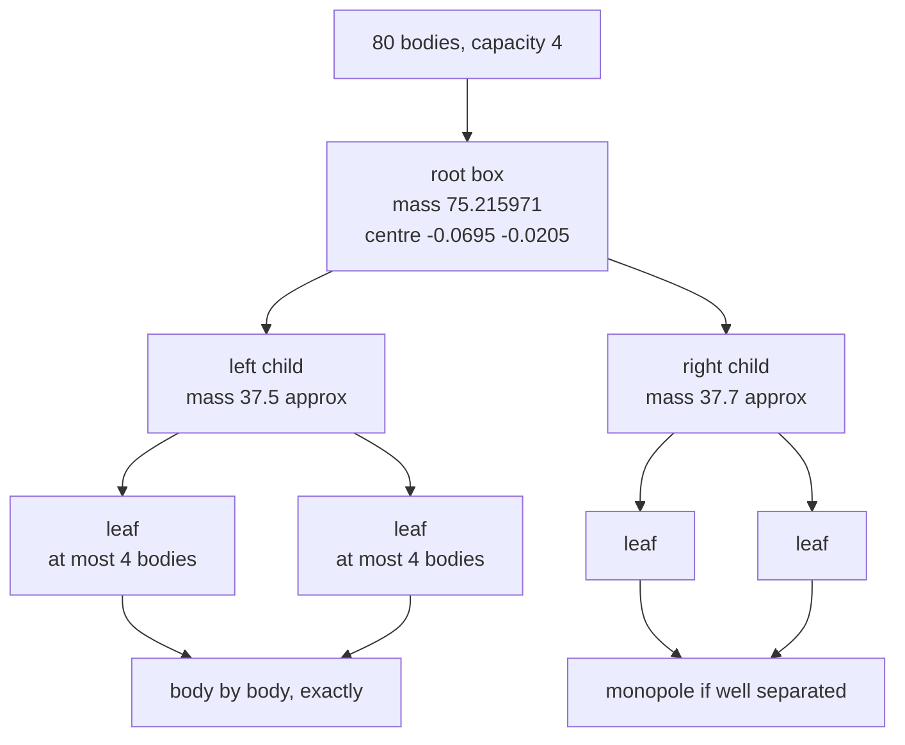
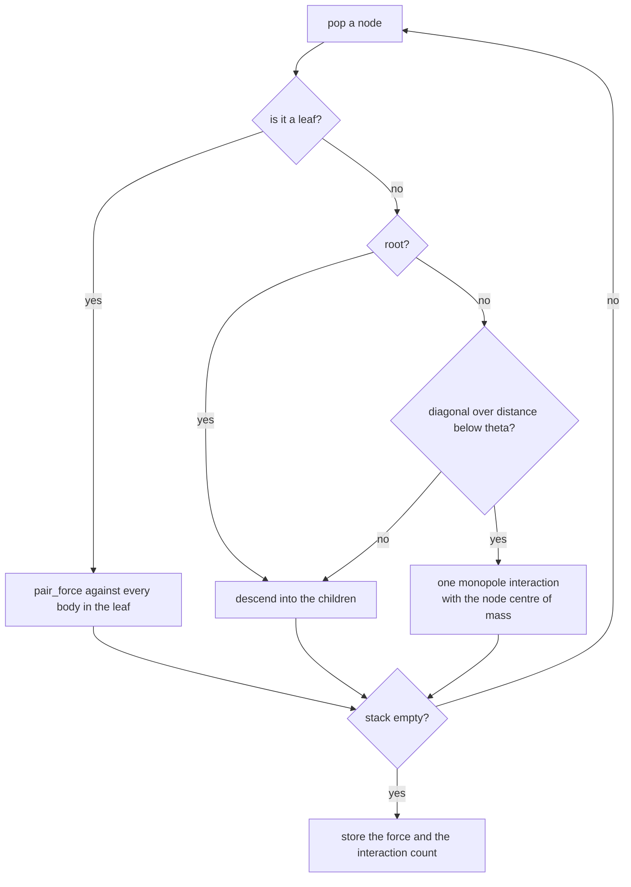
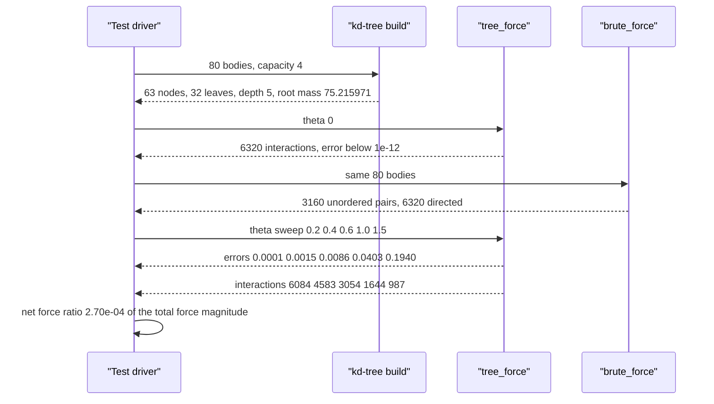

# 733 — Implement kd-tree based n-body Barnes-Hut approximation for gravity

> **Tier:** Expert · **CTCI chapter:** Beyond — Graphics, Geometry & Robotics
> **Task spec:** [733-implement-kd-tree-based-n-body-barnes-hut-approximation-for-grav.md](../../../tasks/expert/733-implement-kd-tree-based-n-body-barnes-hut-approximation-for-grav.md)
> **Solutions:** [Python](../../../solutions/python/expert/733-implement-kd-tree-based-n-body-barnes-hut-approximation-for-grav/solution.py) ·
> [Java](../../../solutions/java/expert/733-implement-kd-tree-based-n-body-barnes-hut-approximation-for-grav/Solution.java) ·
> [JavaScript](../../../solutions/javascript/expert/733-implement-kd-tree-based-n-body-barnes-hut-approximation-for-grav/solution.js) ·
> [C#](../../../solutions/csharp/expert/733-implement-kd-tree-based-n-body-barnes-hut-approximation-for-grav/Solution.cs)

## 1. Problem restatement

Evaluate the gravitational force on every body of an `N`-body system without paying the `O(N^2)`
pair sum. Barnes-Hut builds a **kd-tree** over the bodies, stores each node's total mass and centre
of mass, and replaces the bodies inside a distant node by a single monopole interaction with that
centre of mass — accepting the node when

```text
s / d < theta          s = node diagonal (the tree's box size),  d = distance to the centre of mass
```

The four solutions expose the same interface:

| Piece | Signature | Meaning |
| --- | --- | --- |
| `Body(x, y, mass)` | object | a point mass; non-positive mass is rejected |
| `Node(bodies, capacity, depth)` | tree | median-split kd-tree; leaves hold at most `capacity` bodies |
| `pair_force(left, right, softening)` | `(fx, fy)` | `G m1 m2 (dx, dy) / (d^2 + s^2)^(3/2)`, Plummer softened, `G = 1` |
| `brute_force(bodies, softening)` | forces | the `O(N^2)` oracle, both directions of every pair |
| `tree_force(bodies, tree, theta, softening)` | `(forces, interactions)` | one traversal per body, counting node interactions |
| `relative_error(reference, approximate)` | scalar | `||f_approx - f_ref||_2 / ||f_ref||_2` |

Concrete results the tests assert on 80 bodies seeded with `0x7331`, leaf capacity 4, default
softening `0.05`, and 3160 unordered pairs (`6320` directed ones):

| `theta` | relative error | interactions |
| --- | --- | --- |
| 0.0 | `< 1e-12` (exact) | `6320` |
| 0.2 | `0.0001` | `6084` |
| 0.4 | `0.0015` | `4583` |
| 0.6 | `0.0086` | `3054` |
| 1.0 | `0.0403` | `1644` |
| 1.5 | `0.1940` | `987` |

The error grows monotonically with `theta` while the work falls monotonically; `theta = 1.5` costs
less than a quarter of the dense sum (`987 < 6400 / 4`) and `theta = 0.2` stays under `5%` error.
The net force over all bodies is `2.70e-04` of the total force magnitude — the approximation does
not inject spurious momentum.

## 2. Intuition

The naive approach is the direct sum: every body against every other body. It is exactly right and
completely unscalable. The observation behind Barnes-Hut is that **far-away mass does not care about
its individual shape**: a cluster of 20 bodies that is ten box-widths away exerts almost exactly
the same force as one body of the same total mass placed at the cluster's centre of mass. The tree
is simply the data structure that makes "is this cluster far enough?" answerable in `O(1)`.

Three details make the construction work:

1. **Median split on the longer axis.** Given a set of points, sort along `x` if the extent in `x`
   is larger, along `y` otherwise, and split at the middle. Both children get about half the mass,
   which keeps the tree shallow (`depth 5` for 80 bodies at capacity 4) — and it degenerates
   gracefully: if `width == 0 and height == 0` the node must become a leaf, otherwise coincident
   bodies would recurse forever.
2. **Monopole summary up front.** Each node stores `M = sum(m_i)` and the mass-weighted centre
   `(cx, cy)`, so the traversal needs no extra pass; the root's mass is the total mass exactly
   (`75.215971` for the test load, asserted to `1e-12`).
3. **The near field stays exact.** The traversal descends to leaves for everything nearby and only
   approximates well-separated nodes, and `leaf-leaf` pairs are evaluated body by body in both
   directions — so Newton's third law holds exactly where it matters, which is why the net force
   stays at `2.70e-04` of the total even at `theta = 0.5`.



## 3. Algorithm

1. Validate masses (`mass > 0`) and generate bodies uniformly in `[-1, 1]^2` with masses in
   `[0.5, 1.5)` from the seeded `splitmix64` stream.
2. Build the tree recursively: compute the bounding box of the node's bodies, set
   `diagonal = 2 * hypot(width/2, height/2)`, and stop if the body count is at most `capacity` or
   the box is degenerate. Otherwise sort by `(x, y)` or `(y, x)` along the longer axis, split at
   `len // 2`, recurse, and clear the node's own body list so every body lives in exactly one leaf.
3. `tree_force`: for each body, stack-based traversal. A leaf contributes `pair_force` against each
   of its bodies (skipping the body itself). An internal node is **accepted** when it is not the
   root and `diagonal / max(d, 1e-12) < theta`, contributing one monopole term; otherwise its
   children are pushed.
4. Count every leaf-body interaction and every monopole acceptance as one interaction, so the cost
   of a traversal is measured, not assumed.
5. Compare against `brute_force` with `relative_error`; sweep `theta` and assert monotone accuracy
   loss and monotone work reduction.
6. Momentum check: `hypot(sum fx, sum fy) < 1e-3 * sum |f_i|`, plus the `0.1` relative-error bar at
   `theta = 0.5`.

```text
procedure build_node(bodies, capacity, depth)
    mass ← sum of body masses
    centre ← mass-weighted average position
    width ← max x - min x, height ← max y - min y
    diagonal ← 2 hypot(width / 2, height / 2)
    if count ≥ 2 and len(bodies) > capacity and not (width = 0 and height = 0) then
        if width ≥ height then sort bodies by (x, y) else sort bodies by (y, x)
        half ← floor(len(bodies) / 2)
        children ← [build_node(bodies[0 .. half-1], capacity, depth + 1),
                    build_node(bodies[half .. end], capacity, depth + 1)]
        bodies ← empty
    return node with mass, centre, diagonal, depth, children, bodies

procedure tree_force(bodies, tree, theta, softening)
    forces ← empty list
    interactions ← 0
    for body in bodies do
        fx ← 0, fy ← 0
        stack ← [(tree, is_root = true)]
        while stack is not empty do
            node, is_root ← pop(stack)
            if node is a leaf then
                for other in node.bodies do
                    if other is body then continue
                    (dx, dy) ← pair_force(body, other, softening)
                    fx ← fx + dx, fy ← fy + dy
                    interactions ← interactions + 1
            else
                dx ← node.centre.x - body.x, dy ← node.centre.y - body.y
                distance ← hypot(dx, dy)
                if not is_root and node.diagonal / max(distance, 1e-12) < theta then
                    softened ← distance squared + softening squared
                    scale ← body.mass node.mass / (softened sqrt(softened))
                    fx ← fx + scale dx, fy ← fy + scale dy
                    interactions ← interactions + 1
                else
                    push every child of node onto stack with is_root false
        append (fx, fy) to forces
    return forces, interactions
```



## 4. Worked example

The test load: 80 bodies from `random_bodies(80, 0x7331)`, uniform in `[-1, 1]^2` with masses in
`[0.5, 1.5)`, total mass `75.215971`.

| Tree statistic | Value |
| --- | --- |
| nodes | `63` |
| leaves | `32` (capacity 4) |
| maximum depth | `5` |
| root mass | `75.215971` (equals the total mass) |
| root centre of mass | `(-0.0695, -0.0205)` |
| root diagonal | `2.7732` |

The acceptance test on the root's children is the whole algorithm in one line: a body near the
centre of mass of a node at distance `d` sees that node as a single mass only when the box is small
compared with `d`. The traversal therefore opens everything near the body and collapses everything
far away, which is why the interaction count falls from `6320` (every directed pair) to `987` at
`theta = 1.5`:

| `theta` | accepted far nodes | leaf-leaf pairs | relative error |
| --- | --- | --- | --- |
| 0.0 | 0 | 6320 | `< 1e-12` |
| 0.6 | some | 3054 total | `0.0086` |
| 1.0 | more | 1644 total | `0.0403` |
| 1.5 | most | 987 total | `0.1940` |

`theta = 0` is the correctness anchor: with `s/d < 0` never satisfied, the traversal must visit
every leaf and reproduce the brute-force sum to rounding, and the interaction count is exactly the
dense count `6320`. That single test is what makes the error curve at larger `theta` meaningful —
without it, a fast traversal that simply computes the wrong thing would look great.

Two textbook checks pin the physics:

| Case | Setup | Result |
| --- | --- | --- |
| two bodies | masses `2` and `3` at `(-0.5, 0)` and `(0.5, 0)`, `softening = 0`, `theta = 1` | force `+6` and `-6` (`= G m1 m2 / d^2` with `d = 1`), no transverse component |
| one body | mass `4` at `(0.1, 0.7)` | force `(0, 0)` and `0` interactions |



## 5. Complexity

| Operation | Time | Space | Reason |
| --- | --- | --- | --- |
| Tree build | `O(N log^2 N)` as written | `O(N)` | a sort at every level of a `log N`-deep tree |
| Direct force sum | `O(N^2)` | `O(N)` | the oracle; what the tree exists to replace |
| Traversal, `theta = 0` | `O(N^2)` | `O(log N)` stack | every node is opened |
| Traversal, fixed `theta > 0` | `O(N log N)` expected | `O(log N)` stack | each body accepts `O(log N)` far nodes |
| Growth tracking / error | `O(N)` | `O(1)` | one norm accumulation |

The measured curve is the practical statement of the same bound: at 80 bodies the leaf-leaf near
field dominates, so the saving only becomes visible at a generous opening angle — a real property
of Barnes-Hut at small `N`, and the reason the tests only require `3054 < 6400` at `theta = 0.6` and
`987 < 1600` at `theta = 1.5`.

## 6. Pitfalls and edge cases

- **Coincident bodies** make `d = 0`; the softened kernel `1 / (d^2 + s^2)^(3/2)` with
  `softening = 1e-3` keeps the forces finite, which the tests assert explicitly. Without softening
  the same input is a division by zero.
- **A degenerate box must become a leaf**, otherwise a node holding many coincident bodies would
  split forever: the `width == 0 and height == 0` guard is what prevents it.
- **A capacity at or above the body count gives a single leaf** (`Node(bodies, len(bodies))`), and a
  one-body tree is a leaf with `diagonal = 0.0`.
- **Non-positive masses raise** (`Body(0, 0, 0)` and `Body(0, 0, -1)`) — a zero mass would corrupt
  every centre of mass on the path to the root.
- **`is_root` must be excluded from the acceptance test**: if the root were accepted for a body, the
  body would interact with its own mass and produce a self-force.
- **The interaction count is in *directed* pairs**: `6320 = 2 * 3160 = N (N - 1)`, because each body
  walks its own pair list. Comparing `3054` against `N^2 = 6400` is fair; comparing against `3160`
  is not.
- **`theta` is a trade-off, not a free parameter**: `0.2 -> 0.0001` error but `6084` interactions;
  `1.5 -> 0.1940` error for `987`. The tests assert `theta = 0.2` stays under `5%` and `theta = 1.5`
  is at least ten times worse than `theta = 0.2`.
- **Determinism**: repeated traversals must return identical forces and identical interaction
  counts, so the stack order must not depend on hash iteration.
- **Documented simplifications**: monopole expansions only (no quadrupole terms), a median-split
  kd-tree rebuilt from scratch on each call rather than an incremental tree, a fixed opening angle
  instead of an adaptive criterion, no periodic boundaries, no time integration and no parallel
  traversal.

## 7. Variants and follow-ups

- **Quadrupole terms** add a second moment to every node and cut the error at the same `theta`
  by roughly an order of magnitude, at the cost of more per-node bookkeeping.
- **The multipole version of the same idea** replaces the accept/reject test entirely:
  [734 — fast multipole method](../../../tasks/expert/734-implement-fast-multipole-method-conceptual-small-demo.md)
  expands each cluster in a series and translates it, which is `O(N)` for uniform distributions.
- **The tree itself** is the shared machinery with
  [736 — intersection detection with bounding volume hierarchies](../../../tasks/expert/736-implement-intersection-detection-in-3d-using-bounding-volume-hie.md)
  and [737 — OBB tree building](../../../tasks/expert/737-implement-oriented-bounding-box-tree-building-obb-tree-outline.md),
  where the same median-split recursion is used for collision queries instead of forces.
- **Distributed bodies with a grid** is the complementary approach taken by
  [732 — particle-in-cell](../../../tasks/expert/732-implement-particle-in-cell-simplified-simulation-outline.md),
  which solves for the field spectrally instead of summing pairwise.

## 8. Check yourself

<details><summary>Show answer</summary>
**Why is `theta = 0` the single most important test in the file?**
Because it turns the traversal into a full walk: `s/d < 0` is never true, so every node is opened
and every leaf-leaf pair is evaluated, reproducing the brute-force sum to `1e-12` with exactly
`6320` interactions. Without that anchor, a small error at `theta = 0.5` could not be attributed to
the approximation rather than to a broken tree.
</details>

<details><summary>Show answer</summary>
**The root holds 80 bodies and its diagonal is 2.7732. Why is the root never accepted, even for a
body on the opposite side of the domain?**
Because the traversal explicitly skips the acceptance test when `is_root` is true. A body is part of
the root's own mass, so accepting the root would include a self-force. The children are the largest
nodes that can be accepted.
</details>

<details><summary>Show answer</summary>
**Why does the interaction count not collapse to a small multiple of `N` at `N = 80`?**
Because most interactions at this size are near-field leaf-leaf pairs, which are always evaluated
body by body: with capacity 4 the leaves already account for several thousand directed pairs. The
far-field saving only overtakes them at larger `N` or a larger `theta`, which is why the file
documents the measured curve instead of claiming an asymptotic speedup.
</details>

<details><summary>Show answer</summary>
**Two bodies of mass 2 and 3 sit at `(-0.5, 0)` and `(0.5, 0)` with softening 0. What does the tree
compute and why is it exact?**
`6` and `-6`: with `G = 1` the magnitude is `m1 m2 / d^2 = 6 / 1 = 6`, the transverse components are
zero because the pair is collinear, and no approximation is involved because the two bodies live in
one leaf and are evaluated by `pair_force` directly.
</details>

<details><summary>Show answer</summary>
**The net force is `2.70e-04` of the total force magnitude rather than exactly zero. Where does
that residual come from?**
From the far field: a node is replaced by a single monopole, so the pair of forces between a body
and an accepted node is not exactly equal and opposite. Leaf-leaf pairs *are* exactly paired, which
is why the residual is four orders of magnitude below the force scale and why the test asserts
`< 1e-3` of the total rather than machine zero.
</details>
