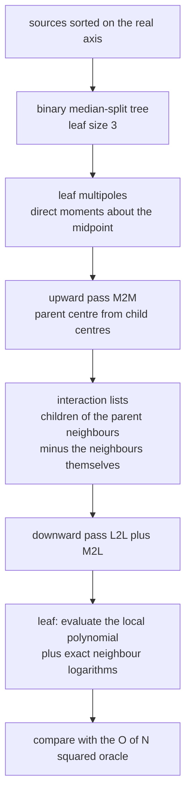
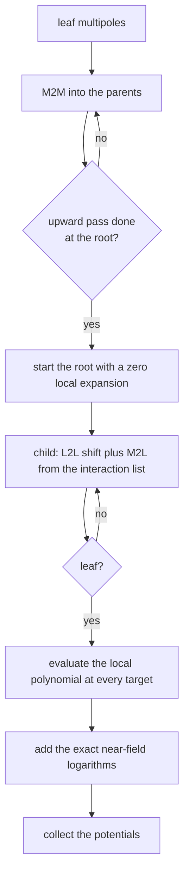
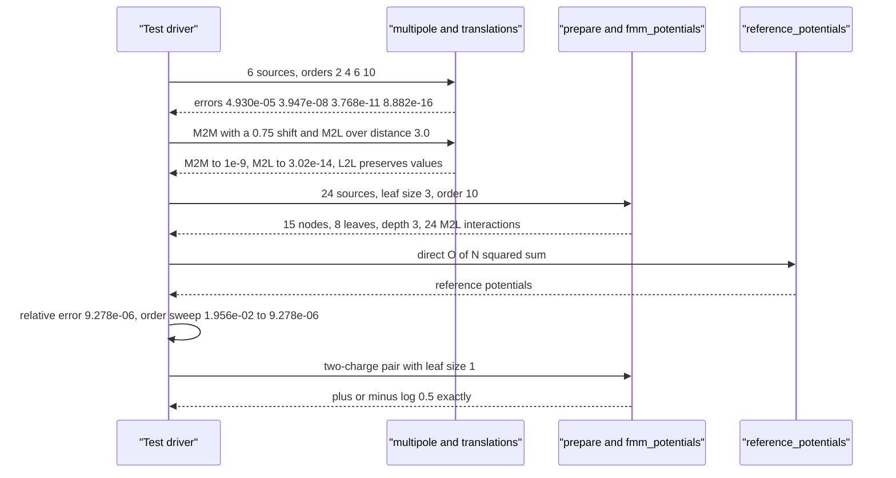

# 734 — Implement fast multipole method conceptual small demo

> **Tier:** Expert · **CTCI chapter:** Beyond — Graphics, Geometry & Robotics
> **Task spec:** [734-implement-fast-multipole-method-conceptual-small-demo.md](../../../tasks/expert/734-implement-fast-multipole-method-conceptual-small-demo.md)
> **Solutions:** [Python](../../../solutions/python/expert/734-implement-fast-multipole-method-conceptual-small-demo/solution.py) ·
> [Java](../../../solutions/java/expert/734-implement-fast-multipole-method-conceptual-small-demo/Solution.java) ·
> [JavaScript](../../../solutions/javascript/expert/734-implement-fast-multipole-method-conceptual-small-demo/solution.js) ·
> [C#](../../../solutions/csharp/expert/734-implement-fast-multipole-method-conceptual-small-demo/Solution.cs)

## 1. Problem restatement

Evaluate the 1D log-kernel potential

```text
phi(x) = sum_j q_j log|x - x_j|
```

at every source position in better than `O(N^2)`, by summarising distant clusters with a **multipole
expansion** and translating that expansion into a **local expansion** around the target. All three
translation operators are implemented and verified:

| Operator | Meaning |
| --- | --- |
| `multipole(points, order, centre)` | `(Q, a_1..a_p)` about `centre`, `a_k = (1/k) sum_j q_j (z_j - c)^k` |
| `m2m(child, coeffs, parent, order)` | shift a multipole from a child centre up to its parent (upward pass) |
| `m2l(source, coeffs, target, order)` | convert a well-separated source multipole into a local expansion |
| `l2l(parent, coeffs, child, order)` | shift a local expansion from a parent down to a child (downward pass) |
| `prepare(tree, order)` | upward pass plus Greengard interaction lists |
| `fmm_potentials(tree, order)` | downward pass returning the potential of every source |
| `reference_potentials(tree)` | direct `O(N^2)` oracle |

The complex representation `F(z) = sum_j q_j log(z - z_j)` is used because its real part is exactly
the kernel on the real axis (the branch jump of the logarithm is purely imaginary and cancels under
`Re`), so a multipole about `c` is `F(z) = Q log(z - c) - sum_k a_k (z - c)^{-k}` and a local
expansion about `c` is a Taylor polynomial `sum_n b_n (z - c)^n`.

Concrete results the tests assert on a 24-source zero-net-charge load seeded with `0x7341`, leaf
size 3, order 10:

- truncated multipole error against the direct sum at far targets `4.0 + 0.5i`:
  order 2 `4.930e-05`, order 4 `3.947e-08`, order 6 `3.768e-11`, order 10 `8.882e-16` — monotonically
  falling, the last more than six orders below the first;
- `M2M` reproduces a multipole computed directly about the parent centre to `1e-9`, and merging two
  shifted multipoles equals the multipole of the union; `M2L` reproduces the source multipole near
  the target centre to `3.02e-14`; `L2L` preserves the local expansion's values to `1e-9`;
- end to end: `relative_error = 9.278e-06` at order 10, with the order sweep `(2, 6, 10)` giving
  `1.956e-02`, `3.163e-04`, `9.278e-06`.

## 2. Intuition

The naive evaluation is again the `O(N^2)` direct sum. Barnes-Hut reduces the far field to a
*single* monopole per cluster; the fast multipole method goes further and treats the far field as a
*series*, which is what makes the accuracy controllable by a single parameter (`order`) and the cost
`O(N)` per pass rather than `O(N log N)` with an error that depends on geometry.

Two representations do all the work:

1. **A multipole about a cluster's own centre.** If a group of charges is summarised as
   `(Q, a_1, ..., a_p)` about `c`, then for any `z` far from `c` the exact potential is obtained up
   to the truncation order without touching the individual charges. The `a_k` are moments of the
   cluster — for the 6-source cluster of the trace, `c = -0.7281`, `Q = -2.92164` and
   `a_1 = -0.460585`.
2. **A local expansion about the target's centre.** The downward pass converts every well-separated
   source multipole into the coefficients of a Taylor series around the *target* node, so evaluating
   the potential of a whole cluster costs one polynomial evaluation per target.

Three translations glue the hierarchy together:

- **M2M** (multipole to multipole): parents accumulate their children's multipoles, so the upward
  pass fills every node bottom-up — this is what makes clusters of clusters work.
- **M2L** (multipole to local): a source node that is *not* a neighbour contributes a local
  expansion at the target node, which is where the approximation enters.
- **L2L** (local to local): a target node passes its accumulated local expansion to its children, so
  every leaf finally holds all the far-field information in one small coefficient list.

Greengard's interaction-list rule keeps correctness: a child's interaction list is the children of
the *parent's neighbours* that are not neighbours of the child, and the test asserts that no node is
ever its neighbour's far-field source. Everything else is evaluated exactly, so the near field
carries no truncation error at all.



## 3. Algorithm

1. Build a **zero-net-charge** load: pairs `(+m, -m)` with `m` in `[0.5, 1.5)` at uniform positions
   in `[-1, 1]`, then sort by position. The log kernel needs `sum(q) = 0` for the potential to decay.
2. Build a binary median-split tree: a node holds up to `leaf_size` sources, otherwise the sorted
   slice is split in half. Reject `leaf_size < 1`.
3. `multipole(points, order, centre)` computes `Q` and `a_1..a_p`; the tree uses the **midpoint of
   the cluster's extent**, which is defined even for a neutral cluster.
4. `m2m` expands the binomial shift `(z - c_child) = (z - c_parent) + (c_parent - c_child)` and
   returns the coefficients about the parent. The parent centre is the average of the two child
   centres; the upward pass runs over the nodes in reverse order so every parent sees finished
   children.
5. `prepare` also builds the interaction lists: for each node, the children of its parent's
   neighbours minus its own neighbours.
6. `m2l` converts a source multipole into a local expansion about the target centre using
   `1/(z - z_s) = 1/(d + (z - c_t))` expansions; the constant term is `Q log(d) - sum_k a_k d^{-k}`.
7. `l2l` shifts a local expansion down one level with a binomial sum.
8. `fmm_potentials` descends from the root with an all-zero local expansion: shift with `L2L`, add
   an `M2L` contribution for every node in the child's interaction list, recurse; at a leaf evaluate
   the local polynomial at each target and add the exact `sum q log|x - x_j|` over the target's own
   leaf and its neighbouring leaves. Compare against `reference_potentials`, check that every source
   appears in exactly one leaf, and check that the upward pass filled every node.

```text
procedure multipole(points, order, centre)
    if points is empty then raise "an empty cluster has no multipole"
    Q ← sum of charges
    for k ← 1 to order do
        a[k] ← (1 / k) sum of charge (z - centre) to the k over points
    return centre, (Q, a[1 .. order])

procedure m2m(child_centre, coefficients, parent_centre, order)
    shift ← parent_centre - child_centre
    out[0] ← coefficients[0]
    for m ← 1 to order do
        term ← coefficients[0] (-shift) to the m / m
        for t ← 1 to m do
            term ← term + choose(m - 1, t - 1) coefficients[t] (-shift) to the (m - t)
        out[m] ← term
    return out

procedure m2l(source_centre, coefficients, target_centre, order)
    d ← target_centre - source_centre
    local[0] ← coefficients[0] log(d) - sum of coefficients[k] / d to the k for k ≥ 1
    for n ← 1 to order do
        term ← coefficients[0] (-1) to the (n + 1) / (n d to the n)
        for k ← 1 to length(coefficients) - 1 do
            term ← term - coefficients[k] (-1) to the n choose(k + n - 1, n) d to the -(k + n)
        local[n] ← term
    return local

procedure prepare(tree, order)
    for node in reverse of the node list do
        if node is a leaf then
            node.centre, node.multipole ← multipole(midpoint centre of node, order)
        else
            centre ← average of the two child centres
            shifted ← [m2m(child.centre, child.multipole, centre, order) for child in children]
            node.centre, node.multipole ← centre, sum of shifted coefficient by coefficient
    for node in the level-ordered node list do
        neighbours ← the nodes immediately left and right of node on its own level
        allowed ← children of the neighbours of node.parent
        node.interaction ← allowed minus (neighbours of node plus node itself)
    return tree

procedure fmm_potentials(tree, order)
    descend(node, local)
        if node is a leaf then
            for target in node.sources do
                value ← real part of local_value(node.centre, local, target)
                for other in the target's leaf and neighbouring leaves do
                    if other ≠ target then value ← value + other.charge log(abs(target - other))
                record value for target
        else
            for child in node.children do
                shifted ← l2l(node.centre, local, child.centre, order)
                for source_node in child.interaction do
                    shifted ← shifted + m2l(source_node.centre, source_node.multipole,
                                            child.centre, order)
                descend(child, shifted)
    descend(tree, zeros of length order + 1)
```



## 4. Worked example

The load is `zero_net_load(24, 0x7341)`: 12 opposite-charge pairs, zero total charge exactly
(`< 1e-12`), sorted on the real axis, starting at `-0.9160, -0.7571, -0.6660, -0.5728, -0.5581,
-0.5402`.

**Step 1 — the multipole itself.** For the first six sources (three pairs) at order 4:

| Quantity | Value |
| --- | --- |
| midpoint centre `c` | `-0.7281` |
| `Q = sum q` | `-2.921640` |
| `a_1` | `-0.460585` |

The truncation error at four far targets `4.0 + 0.5i`, `i = 0..3`:

| order | 2 | 4 | 6 | 10 |
| --- | --- | --- | --- | --- |
| worst error | `4.930e-05` | `3.947e-08` | `3.768e-11` | `8.882e-16` |

Each two extra terms buy roughly three digits — that is the series converging, and the assertion
that order 10 is more than `1e-6` times better than order 2.

**Step 2 — the translations.** `M2M` with `child_centre = c` and
`parent_centre = c + 0.75` reproduces `multipole(left, 8, parent_centre)` to `1e-9`, and merging two
shifted multipoles equals the multipole of the union. `M2L` from `source_centre` to
`target_centre = source_centre + 3.0` reproduces the source multipole's own values at five probes
around the target centre to `3.02e-14`.

**Step 3 — the tree and the end-to-end pass** with `Node(sources, 3)` and order 10:

| Quantity | Value |
| --- | --- |
| nodes / leaves / depth | `15` / `8` / `3` |
| total M2L interactions (sum of the interaction-list sizes) | `24` |
| root centre / root `Q` | `-0.0310043` / `0.0` |
| relative error against the direct sum | `9.278e-06` |
| order sweep `(2, 6, 10)` | `1.956e-02`, `3.163e-04`, `9.278e-06` |

The 24 M2L entries are the far field of 24 sources replaced by 24 translation operations, while the
near field is exact: three sample potentials agree with the oracle to six decimals (`-1.931513` vs
`-1.931510`, `0.382170` vs `0.382170`, `3.435375` vs `3.435369`), and the root's multipole charge is
`0.0`. A `(+1, -1)` pair 0.5 apart with leaf size 1 returns `±log(0.5)` to nine digits; an empty load
returns no potentials.



## 5. Complexity

| Operation | Time | Space | Reason |
| --- | --- | --- | --- |
| Multipole of a cluster, order `p` | `O(|cluster| p)` | `O(p)` | one power and multiply per moment |
| `M2M` | `O(p^2)` | `O(p)` | double loop over the binomial shift |
| `M2L` | `O(p^2)` | `O(p)` | double loop over the translation series |
| `L2L` | `O(p^2)` | `O(p)` | binomial sum |
| Upward pass | `O(nodes p^2 + N p)` | `O(nodes p)` | one `M2M` per child plus the leaf multipoles |
| Downward pass | `O(nodes p^2 + N)` | `O(p)` per level | one `M2L` per interaction-list entry, one `L2L` per child |
| Direct oracle | `O(N^2)` | `O(N)` | what the demo replaces |
| Evaluation at leaves | `O(N * near-field size)` | `O(N)` | the neighbouring leaves are evaluated exactly |

The accuracy knob is `p` alone: cost grows like `p^2` per node while the truncation error falls
geometrically, which is why the demo can assert both "order 10 is far better than order 2" and
"order 2 is already within a few percent" without contradiction.

## 6. Pitfalls and edge cases

- **The load must have zero net charge** (`sum(q) < 1e-12` is asserted). Otherwise
  `phi(x) = sum q_j log|x - x_j|` does not decay and the far-field series has no chance to converge.
- **The multipole centre must be the midpoint of the cluster, not its centre of mass**: a neutral
  cluster has no meaningful centre of mass, and the midpoint keeps the series inside its region of
  convergence.
- **The branch cut of the complex logarithm cancels under `Re`** — that is why the code may use
  `cmath.log` on the complex plane and take `.real` at the end; forgetting `.real` injects a
  spurious imaginary part.
- **An empty cluster has no multipole** (`multipole([], 4)` raises) and `leaf_size < 1` is rejected;
  an empty *load* is legal and yields `{}` because `prepare` gives an empty tree a zero multipole.
- **Every source must sit in exactly one leaf**, the upward pass must leave no node without a
  multipole, and no node may ever be its neighbour's far-field source — all three are asserted,
  because any of them failing would silently produce a wrong potential.
- **Truncation order and the binomial table are fixed** (`BINOMIAL` is built up to 64), so an order
  beyond that would silently produce zeros from `choose`; the demo stays at `p <= 10`.
- **Determinism**: the same load and order must produce potentials equal to `1e-15`; two independent
  `prepare`/`fmm_potentials` runs are compared.
- **Documented simplifications**: a 1D layout on a binary median-split tree, one fixed order for the
  whole hierarchy, no adaptive order selection, no periodic images, and no multipole acceptance
  criterion beyond strict separation. The goal is to exercise every translation operator against a
  direct oracle, not to beat a tuned treecode.

## 7. Variants and follow-ups

- **Adaptive orders** pick `p` per level from the separation distance, which is what makes production
  FMM codes accurate for clustered distributions.
- **Higher dimensions** replace the log kernel by `1/r` and the complex series by spherical
  harmonics, but the `M2M`/`M2L`/`L2L` structure is unchanged.
- **Treecodes are the cheaper cousin**: [733 — Barnes-Hut](../../../tasks/expert/733-implement-kd-tree-based-n-body-barnes-hut-approximation-for-grav.md)
  keeps only the monopole (`p = 0`) and accepts or rejects a node by geometry, which is simpler but
  cannot be tuned to arbitrary accuracy.
- **The same expansions on a uniform grid** appear in
  [732 — particle-in-cell](../../../tasks/expert/732-implement-particle-in-cell-simplified-simulation-outline.md),
  where the field solve is spectral rather than hierarchical; the tree bookkeeping itself is shared
  with [737 — OBB tree building](../../../tasks/expert/737-implement-oriented-bounding-box-tree-building-obb-tree-outline.md).

## 8. Check yourself

<details><summary>Show answer</summary>
**Why is the complex logarithm representation legitimate for a real potential?**
Because `log(z - z_j)` on the real axis has real part `log|x - x_j|`, and the jumping branch of the
logarithm contributes only an imaginary constant. Taking `.real` at the end therefore returns exactly
`sum q_j log|x - x_j|`, while giving the code access to the algebraic translation identities (binomial
shifts) that a real-only formulation would have to derive again.
</details>

<details><summary>Show answer</summary>
**What exactly does `M2M` verify, and why is that the key identity of the upward pass?**
It checks that shifting a multipole from a child centre to a parent centre reproduces a multipole
computed *directly* about the parent centre (to `1e-9` here), and that merging two shifted multipoles
equals the multipole of the union. Without that identity the parent's summary would be inconsistent
with its children, and the downward pass would translate a wrong source.
</details>

<details><summary>Show answer</summary>
**Where does the approximation enter, and where is the near field exact?**
Only in `M2L`: a node in the interaction list is represented by a `p`-term series, whose truncation
error is the numbers `4.930e-05` down to `8.882e-16` in the sweep. Everything else — the target's own
leaf and its neighbouring leaves, evaluated with `q log|x - x_j|` directly — is exact, which is why
the two-charge pair returns `±log(0.5)` to nine digits.
</details>

<details><summary>Show answer</summary>
**The end-to-end relative error is `9.278e-06` at order 10 and `1.956e-02` at order 2. Why is the
gap smaller than the multipole sweep's six orders of magnitude?**
Because the end-to-end error mixes two sources: the `M2L` truncation (which the sweep isolates) and
the exact near-field terms, whose contribution is fixed. As the order rises, the truncation error
falls until the near field dominates the remaining discrepancy, so the sweep converges to a floor
rather than to zero.
</details>

<details><summary>Show answer</summary>
**Why does the demo require a strictly separated interaction list instead of an opening angle?**
Because the `M2L` series only converges inside a region where the source cluster is well separated
from the target cluster; an `s/d < theta` test borrowed from Barnes-Hut would sometimes convert a
nearby multipole and produce silently wrong coefficients. The demo instead asserts the structural
invariant — no node is ever its neighbour's far-field source — which is the correctness guarantee
the translations need.
</details>
