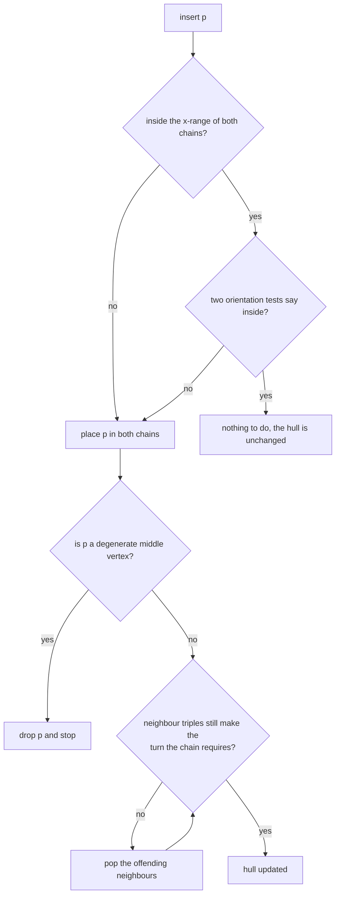
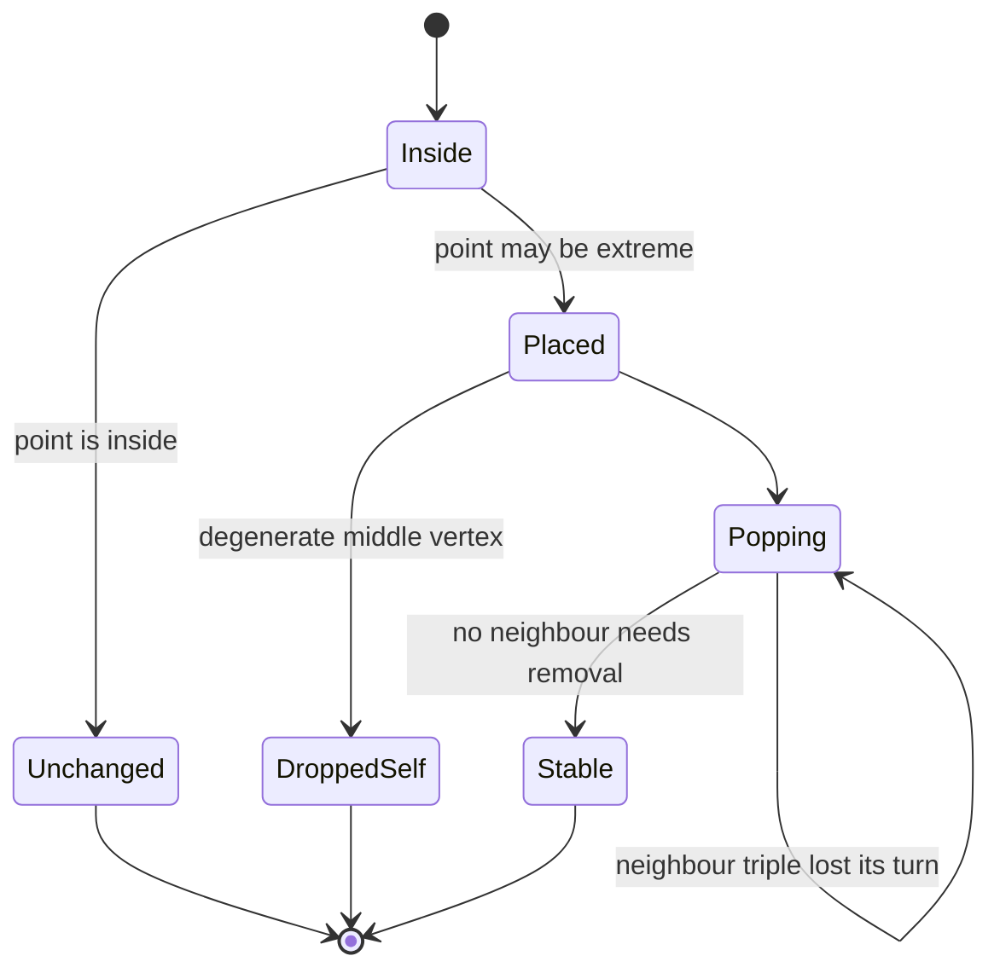
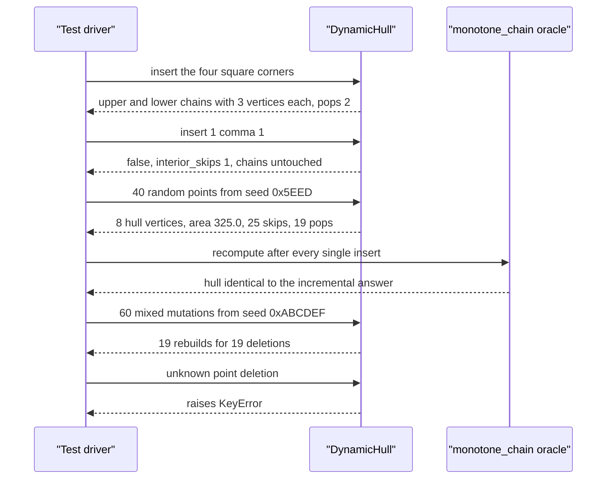

# 735 — Implement advanced geometric data structures: dynamic convex hull maintenance

> **Tier:** Expert · **CTCI chapter:** Beyond — Graphics, Geometry & Robotics
> **Task spec:** [735-implement-advanced-geometric-data-structures-dynamic-convex-hull.md](../../../tasks/expert/735-implement-advanced-geometric-data-structures-dynamic-convex-hull.md)
> **Solutions:** [Python](../../../solutions/python/expert/735-implement-advanced-geometric-data-structures-dynamic-convex-hull/solution.py) ·
> [Java](../../../solutions/java/expert/735-implement-advanced-geometric-data-structures-dynamic-convex-hull/Solution.java) ·
> [JavaScript](../../../solutions/javascript/expert/735-implement-advanced-geometric-data-structures-dynamic-convex-hull/solution.js) ·
> [C#](../../../solutions/csharp/expert/735-implement-advanced-geometric-data-structures-dynamic-convex-hull/Solution.cs)

## 1. Problem restatement

Maintain the convex hull of a point set under an interleaving of **insertions** and **deletions**,
instead of recomputing it from scratch after every update. The representation is the classic
two-chain form: an upper chain sorted by `x` whose every triple makes a clockwise turn, and a lower
chain whose every triple makes a counter-clockwise turn. The public hull is the cycle
`upper + reverse(lower)[1:-1]` walked clockwise and then reversed into a counter-clockwise cycle,
rotated to start at its lexicographically smallest vertex.

| Operation | Behaviour |
| --- | --- |
| `insert(p)` | returns `False` when the inside test proves `p` is not a vertex, otherwise places `p` in both chains and repairs locally |
| `delete(p)` | removes one occurrence (raises `KeyError` when absent) and rebuilds both chains |
| `vertices()` | canonical counter-clockwise cycle; degenerate hulls return fewer than three points |
| `area()` | exact shoelace area as a `Fraction` (`0` for fewer than three vertices) |
| `perimeter()` | boundary length; a two-point hull is the degenerate segment walked twice |
| `support(direction)` | extreme vertex in a direction, by a documented linear scan |
| `contains(p)` | inside-or-on test through the chains, with the vertical x-extreme edges handled explicitly |

All coordinates are exact `Fraction`s — there is no epsilon anywhere. Concrete results the tests
assert:

- the square `(0,0), (2,0), (2,2), (0,2)` has hull `[(0,0), (2,0), (2,2), (0,2)]`, area exactly `4`,
  perimeter `8.0`;
- inserting the interior point `(1,1)` returns `False`, increments `interior_skips`, and leaves both
  chains and the hull byte-identical;
- five identical points fuse to a single vertex; the collinear input
  `(0,0), (1,1), (2,2), (3,3), (1,1)` collapses to `[(0,0), (3,3)]` with perimeter `2 * sqrt(18)`;
- the interleaved stream (20 initial points, 60 mutations) ends with `hull_vertices = 8`,
  `stored_points = 42`, `interior_skips = 47`, `pops = 901`, `rebuilds = 19`, and every mutation is
  verified against a full monotone-chain recomputation.

## 2. Intuition

The naive approach recomputes the hull after each mutation: `O(n log n)` per update, which is
wasteful because a single insertion usually changes nothing at all — most points are inside the
current hull. The dynamic structure exploits exactly that:

1. **The inside test comes first.** If `x` lies outside the chains' `x`-range the point may be
   extreme; otherwise two binary searches into the `x`-sorted chains plus two orientation tests
   decide whether the point is inside. If it is, *nothing* changes: the counters show `47` of the
   mixed stream's mutations taking this path, and the big-square experiment inserts 19 interior
   points with `interior_skips` incremented 19 times and `pops` unchanged.
2. **An extreme point is repaired locally.** When the point is placed, it can only invalidate
   vertices *near* its position: neighbours are popped while their triples stop making the turn the
   chain requires. Only vertices that stopped being extreme are removed, which is what bounds the
   amortised cost.
3. **A point can lose its extremity immediately.** If the freshly inserted `p` sits between two
   neighbours that already span it, the repair deletes `p` itself — the "degenerate middle vertex"
   drop — and the mutation is over.



The representation pays off in the queries as well: `contains` needs the same two binary searches
the inside test uses, and `support` is a single pass over the hull vertices.

## 3. Algorithm

1. Represent the hull by two chains. `upper` is `x`-sorted with `cross(chain[i], chain[i+1],
   chain[i+2]) < 0` for every triple (clockwise); `lower` is `x`-sorted with `cross(...) > 0`
   (counter-clockwise). Both chains contain the leftmost and rightmost vertices, so the hull is
   `upper + reverse(lower)[1:-1]`.
2. `_inside(p)`: reject when either chain has fewer than two vertices or `p` lies outside
   `[upper[0].x, upper[-1].x]`; otherwise binary-search the last chain vertex with `x <= p.x` in both
   chains and require `cross(up[i], up[i+1], p) <= 0` **and** `cross(low[j], low[j+1], p) >= 0`.
3. `_chain_insert(chain, p, want)`: binary-search the `x`-sorted position, insert, then loop: drop
   `p` itself if its triple has the wrong sign; otherwise pop neighbours on the left while
   `cross(chain[pos-2], chain[pos-1], chain[pos]) * want >= 0` and on the right while
   `cross(chain[pos], chain[pos+1], chain[pos+2]) * want >= 0`, counting every popped vertex, and
   repeat until a round changes nothing.
4. `insert` records the point, applies the inside test, and only on failure to prove interior calls
   `_chain_insert` for the upper chain (`want = +1`) and the lower chain (`want = -1`), returning
   whether work was needed.
5. `delete` removes one occurrence (raising `KeyError` when it is not stored), then rebuilds both
   chains from the retained points in sorted order, incrementing `rebuilds`.
6. `vertices()` walks `upper + reverse(lower)[1:-1]`, drops consecutive duplicates and a repeated
   closure, returns the sorted distinct points when fewer than three remain, and otherwise returns
   `canonical(reversed(walk))`.
7. `area()` is the exact shoelace sum over the cycle; `perimeter()` uses `sqrt` only for the length
   (a two-vertex hull walks the segment twice); `support` maximises the dot product over the cycle
   and `contains` repeats the inside test, with the vertical x-extreme edges special-cased.

```text
procedure _inside(p)
    if either chain has fewer than 2 vertices then return false
    if p.x < upper[0].x or p.x > upper[-1].x then return false
    i ← last index with upper[i].x ≤ p.x        // binary search
    j ← last index with lower[j].x ≤ p.x
    if i + 1 ≥ len(upper) or j + 1 ≥ len(lower) then return false
    return cross(upper[i], upper[i + 1], p) ≤ 0 and cross(lower[j], lower[j + 1], p) ≥ 0

procedure _chain_insert(chain, point, want)
    lo ← binary search position of point in the x-sorted chain
    insert point at lo
    pos ← lo
    loop
        if 0 < pos < len(chain) - 1 and
           cross(chain[pos - 1], chain[pos], chain[pos + 1]) * want ≥ 0 then
            delete chain[pos]                     // point is not extreme after all
            count one pop
            return
        changed ← false
        while pos ≥ 2 and cross(chain[pos - 2], chain[pos - 1], chain[pos]) * want ≥ 0 do
            delete chain[pos - 1], pos ← pos - 1, changed ← true
        while pos + 2 < len(chain) and cross(chain[pos], chain[pos + 1], chain[pos + 2]) * want ≥ 0 do
            delete chain[pos + 1], changed ← true
        if not changed then return
        count one pop

procedure insert(point)
    append point to the stored set
    if _inside(point) then
        count one interior skip
        return false
    _chain_insert(upper, point, +1)
    _chain_insert(lower, point, -1)
    return true

procedure delete(point)
    if point is not stored then raise KeyError
    remove one occurrence from the stored set
    retained ← sorted stored set
    clear the stored set and both chains
    for q in retained do insert(q)
    count one rebuild
```



## 4. Worked example

The square `(0,0), (2,0), (2,2), (0,2)`, inserted in that order:

| Structure | Content |
| --- | --- |
| `upper` | `[(0,0), (0,2), (2,2)]` (left to right, clockwise turns) |
| `lower` | `[(0,0), (2,0), (2,2)]` (left to right, counter-clockwise turns) |
| `vertices()` | `[(0,0), (2,0), (2,2), (0,2)]` — counter-clockwise from the lex-smallest vertex |

Building the square already exercises the repair (`pops = 2`: the temporary diagonals introduced by
inserting the corners are popped once the later corners arrive). The queries:

| Query | Result |
| --- | --- |
| `area()` | `4` (exact `Fraction`) |
| `perimeter()` | `8.0` |
| `insert((1, 1))` | `False`, `interior_skips = 1`, `pops` unchanged at `2`, both chains unchanged |
| `verify(deep=True)` | incremental hull equals the monotone-chain recomputation; every stored point passes the edge-by-edge brute-force inside test |

Then the 40-point random stream from seed `0x5EED` (integer coordinates in `[-10, 10]`), verified
after **every** insert against a full recomputation:

| Statistic | Value |
| --- | --- |
| hull vertices | `8` |
| hull area | `325.0` |
| hull perimeter | `70.3260` |
| interior skips over the 40 inserts | `25` |
| pops over the 40 inserts | `19` |

More than half the inserts are answered by the inside test alone, and the repairs touch 19 chain
vertices in total — that is the amortised claim of the representation, measured.

The interleaved stream is the real test: 20 initial points, then 60 mutations driven by seed
`0xABCDEF`, each mutation verified against the recomputation (`deep` every fifth step), with the
property that `rebuilds == deleted`:

| Statistic | Value |
| --- | --- |
| hull vertices at the end | `8` |
| stored points | `42` |
| `interior_skips` | `47` |
| `pops` | `901` |
| `rebuilds` | `19` |

`pops = 901` looks large until you notice that every `delete` re-inserts all retained points, and
each of those inserts may pop — so the counter measures the *rebuild* work honestly rather than
hiding it. The final structure is still verified against the oracle, and 120 further probes check
`support` against a brute-force scan over all points and `contains` against the edge-by-edge hull
test, with the test asserting that the probes cover both inside and outside cases.

Degenerate inputs, all asserted:

| Input | Hull | Query results |
| --- | --- | --- |
| `()` | `[]` | `area() = 0`, `perimeter() = 0.0`, `support((1,0)) is None`, `contains((0,0))` false |
| `[(3,4)]` | `[(3,4)]` | `area() = 0.0`, contains itself but not `(3,5)` |
| `[(0,0), (3,4)]` | both points | `perimeter() = 10.0` (the segment walked twice) |
| `[(1,1)] * 5` | `[(1,1)]` | five identical points fuse |
| `[(0,0), (1,1), (2,2), (3,3), (1,1)]` | `[(0,0), (3,3)]` | `perimeter() = 2 * sqrt(18) = 8.485281` |
| rational triangle `(1/3, 1/7), (5/2, 0), (0, 9/4)` | three vertices | `area() = 253/112 = 2.258929` exactly |



## 5. Complexity

| Operation | Time | Space | Reason |
| --- | --- | --- | --- |
| Inside test | `O(log h)` | `O(1)` | two binary searches over the chains |
| Insert, point inside | `O(log h)` | `O(1)` | the chains are not touched |
| Insert, extreme point | amortised `O(log h + k)` | `O(1)` | binary placement plus `k` popped vertices |
| Delete, as implemented | `O(n log n)` | `O(n)` | rebuild from the retained points (documented simplification) |
| `vertices()` | `O(h)` | `O(h)` | walk, dedupe, canonical rotation |
| `area()` / `perimeter()` | `O(h)` | `O(1)` | shoelace / edge lengths |
| `support(direction)` | `O(h)` | `O(1)` | linear scan over the cycle |
| `contains(p)` | `O(log h)` expected | `O(1)` | chain search, plus an `O(h)` scan for the vertical extremes |
| Full recomputation (the alternative) | `O(n log n)` per mutation | `O(n)` | what the dynamic structure avoids for interior inserts |

`h` is the number of hull vertices and `n` the number of stored points; note `h <= n` and that the
tests report both.

## 6. Pitfalls and edge cases

- **Degenerate hulls must not invent vertices**: an empty point set, one point, two points, five
  identical points and a collinear set all have to come back as the sensible small object, and
  `area()` has to be exactly `Fraction(0)` rather than a float zero.
- **The two-point perimeter is the segment walked twice** (`10.0` for `(0,0), (3,4)`), which is why
  `perimeter()` uses `steps = 2 if len(poly) == 2 else len(poly)` instead of closing the loop
  naively.
- **The vertical extremes need explicit handling in `contains`**: at `x == upper[0].x` and
  `x == upper[-1].x` the two chains meet, and a naive binary search would index past the end of a
  chain.
- **A newly inserted point may be immediately non-extreme** — the middle-vertex drop is the branch
  that removes it again, and it is what keeps `insert` from permanently adding a point that the
  next repair would remove anyway.
- **Deleting an absent point must raise `KeyError`**, not silently do nothing: the tests delete
  `(10000, 10000)` and expect the exception.
- **`rebuilds` must equal the number of deletions**, and `delete` must remove exactly one occurrence
  (asking twice still removes one), because the tests compare `mixed.rebuilds == deleted`.
- **Interior inserts must never touch the chains**: the big-square check requires
  `len(upper) == len(lower) == 3` after 19 interior inserts with `interior_skips` up by exactly 19
  and `pops` unchanged.
- **Determinism**: identical insert streams must produce identical hulls *and* identical counters,
  and identical delete streams identical areas — no repair order may depend on iteration order.
- **Exactness is the point of the representation**: all coordinates are `Fraction`s, every
  orientation is an exact integer comparison, and the rational triangle's area comes out as
  `253/112` rather than a float a tolerance would have to swallow.
- **Documented simplifications**: `delete` rebuilds both chains from the retained points instead of
  a genuinely dynamic `O(log^2 n)` deletion, and `support`/`contains` scan linearly instead of
  binary-searching the edge-angle sequence.

## 7. Variants and follow-ups

- **Fully dynamic deletion** (Overmars-van Leeuwen style) removes a hull vertex by splicing in its
  neighbours' tangents, bringing deletion to `O(log^2 n)`; the tests here instead count `rebuilds`
  so the shortcut is visible.
- **Lower bounds / kinetic structures** maintain the hull of *moving* points, where the interesting
  events are orientation-sign changes rather than insertions.
- **The same orientation predicate** is the shared primitive with
  [745 — robust predicates for computational geometry](../../../tasks/expert/745-implement-robust-predicates-for-computational-geometry-exact-ari.md),
  which is where the exact-Fraction choice here gets a floating-point filter for speed.
- **Related geometric structures in this repository**: [736 — intersection detection with bounding
  volume hierarchies](../../../tasks/expert/736-implement-intersection-detection-in-3d-using-bounding-volume-hie.md)
  and [740 — visibility graph path planning](../../../tasks/expert/740-implement-visibility-graph-path-planning-for-polygons.md),
  which both build their edges from orientation and segment-intersection tests like these.

## 8. Check yourself

<details><summary>Show answer</summary>
**Why are there two chains instead of one cycle?**
Because each chain is `x`-sorted, so the inside test and the support queries become binary searches,
and a repair only has to look at a contiguous neighbourhood in `x`. The cycle is rebuilt from the
two chains when the public answer is requested:
`upper + reverse(lower)[1:-1]` walked clockwise, then reversed into a counter-clockwise cycle.
</details>

<details><summary>Show answer</summary>
**What does the `pops = 2` in the square construction mean?**
Inserting the corners in order transiently produces chains whose triples do not yet make the
required turn — the hull of the first three points is a triangle, not a square. Each repair pops a
vertex that stopped being extreme, twice in total, and the final chains hold exactly three vertices
each.
</details>

<details><summary>Show answer</summary>
**Why is `pops = 901` not evidence that the implementation is wasteful?**
Because 19 deletions each rebuild both chains by re-inserting every retained point, and every insert
may pop a temporary vertex. `901` is therefore accumulated rebuild work, not per-insert work:
the 40-insert random stream shows the honest number, `19` pops for 40 inserts and 25 inserts answered
by the inside test alone.
</details>

<details><summary>Show answer</summary>
**The collinear input has five points including a duplicate, yet the hull has two vertices. Which
branch removes the middles?**
The chain insert places `(1,1)`, `(2,2)` and `(3,3)` in turn; as soon as a triple is collinear the
cross product is exactly zero, and the repair condition uses `>= 0`, so the middle vertex is popped.
The duplicate `(1,1)` never becomes a new vertex because the inside test (or the immediate
middle-vertex drop) disposes of it.
</details>

<details><summary>Show answer</summary>
**Why do the tests verify against `monotone_chain` after *every* mutation rather than at the end?**
Because a dynamic structure can be wrong in a way that a final comparison hides: a bad repair may be
transiently inconsistent and only be fixed by a later deletion's rebuild. Checking at every step
(and deeply — every stored point against every hull edge — on a regular schedule) is what pins the
incremental answer to the oracle.
</details>
