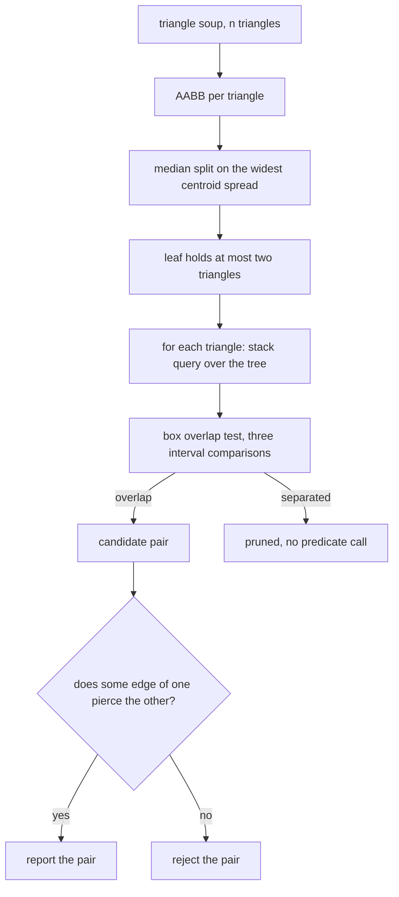
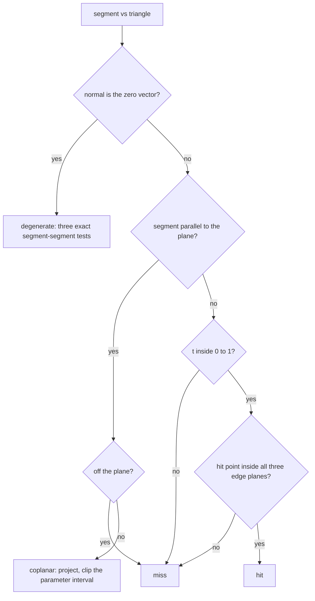
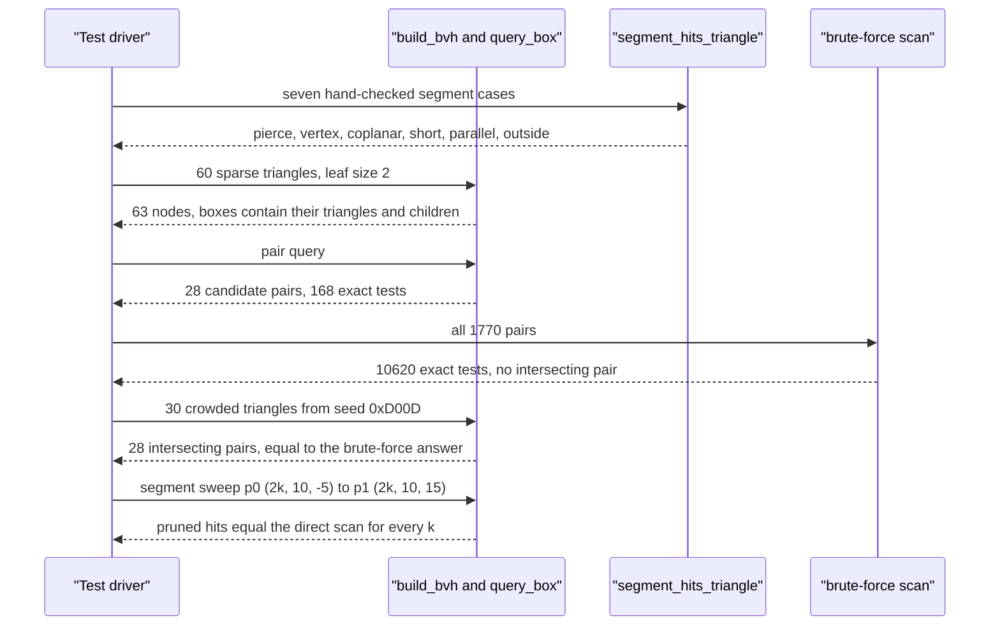

# 736 — Implement intersection detection in 3D using bounding volume hierarchies

> **Tier:** Expert · **CTCI chapter:** Beyond — Graphics, Geometry & Robotics
> **Task spec:** [736-implement-intersection-detection-in-3d-using-bounding-volume-hie.md](../../../tasks/expert/736-implement-intersection-detection-in-3d-using-bounding-volume-hie.md)
> **Solutions:** [Python](../../../solutions/python/expert/736-implement-intersection-detection-in-3d-using-bounding-volume-hie/solution.py) ·
> [Java](../../../solutions/java/expert/736-implement-intersection-detection-in-3d-using-bounding-volume-hie/Solution.java) ·
> [JavaScript](../../../solutions/javascript/expert/736-implement-intersection-detection-in-3d-using-bounding-volume-hie/solution.js) ·
> [C#](../../../solutions/csharp/expert/736-implement-intersection-detection-in-3d-using-bounding-volume-hie/Solution.cs)

## 1. Problem restatement

Given a soup of `n` triangles in 3D, report every pair `(i, j)` with `i < j` whose triangles
intersect — without running the `O(n^2)` exact test on all pairs. A **bounding volume hierarchy** of
axis-aligned boxes rejects most pairs on cheap interval comparisons before the exact test runs.

| Piece | Signature | Meaning |
| --- | --- | --- |
| `Aabb(lo, hi)` | box | exact rational bounds; `overlaps`, `contains`, `contains_point` |
| `build_bvh(triangles)` | `(boxes, left, right, leaf_items, root)` | median-split tree over flat arrays, `LEAF_SIZE = 2` |
| `query_box(bvh, box, skip, counter)` | sorted index list | every leaf triangle whose box overlaps the query box (touching counts) |
| `segment_hits_triangle(p0, p1, tri, counter)` | bool | exact segment/triangle intersection with a coplanar and a degenerate branch |
| `triangles_intersect(t1, t2, counter)` | bool | "some edge of one pierces the other", both directions |
| `soup_intersections(triangles, bvh, counter)` | pair list | with `bvh` the candidate pairs come from the tree; without it, the brute-force oracle |
| `Counter` | object | `segment_triangle_tests`, `nodes_visited`, `candidate_pairs` |

Everything is exact: coordinates are `Fraction`s, the box tests are interval comparisons and the
primitive is Möller-Trumbore translated into rational arithmetic. Concrete results the tests assert:

- the sparse soup (60 triangles of extent `< 3` scattered over a span of 40, seed `0xBEEF`) has
  `0` intersecting pairs, `63` BVH nodes, and the BVH candidate set is `28` pairs against the
  brute-force `1770` (`60 * 59 / 2`);
- the same soup costs `168` exact segment/triangle tests through the tree against `10620` in the
  brute-force scan — a factor of `63`;
- the crowded soup (30 triangles of extent `< 6` over a span of 6, seed `0xD00D`) really does
  intersect: `28` pairs found by both routes, with `224` BVH candidates and `1230` exact tests;
- rebuilding the tree reproduces every node box and every pair exactly, and a 10-step segment sweep
  through the tree must agree with a direct scan over all triangles.

## 2. Intuition

The naive approach tests all `n (n - 1) / 2` pairs with the exact predicate. That is correct but
quadratic, and the exact predicate is expensive: each triangle-triangle test is up to six
segment-triangle tests, each with a plane solve and three orientation tests. A spatial hierarchy
buys the same answer with far fewer predicate calls.

1. **An AABB is a cheap filter.** Two boxes are disjoint iff they are separated on *some* axis, which
   is three interval comparisons — no multiplication, no division, and with rational coordinates not
   even a rounding question. A tree of these boxes prunes the pairs a triangle can possibly touch.
2. **The split must be geometric, not arbitrary.** Each node picks the axis with the widest centroid
   spread, sorts the surviving triangles by centroid (ties broken by centroid then index, so the tree
   is deterministic) and halves the list. Leaves hold at most two triangles.
3. **The exact predicate needs its branches.** A segment is a full line segment, so a plane crossing
   outside `[0, 1]` must miss; a segment parallel to the plane must go to the **coplanar** branch,
   which projects by dropping the axis of the largest normal component and clips the projected
   parameter interval against the three half-planes; and a **zero-area** triangle has no plane at
   all, so it is tested through its three edges with an exact segment-segment test.



The two tree invariants the tests check — every leaf box contains its triangles and every parent box
contains its children's boxes — are what make the pruning *conservative*: nothing can be pruned that
could really intersect, so the pair set is identical to the brute-force answer.

## 3. Algorithm

1. `build_bvh`: recurse over index lists. Each node's box is the AABB of all vertex triples in its
   subtree; leaves with at most `LEAF_SIZE = 2` indices store them. Otherwise pick the axis with the
   widest centroid spread across the remaining triangles, sort by `(centroid[axis], centroid, index)`
   and recurse on the two halves. The result is four flat arrays plus the root.
2. `query_box`: an explicit stack; pop a node, count a visit, skip it unless its box overlaps the
   query box, extend the hit list with the leaf's indices (excluding `skip`) or push both children.
   Return the hits sorted and deduplicated — a conservative **superset** of the truly overlapping
   triangles.
3. `segment_hits_triangle`: compute `normal = cross(b - a, c - a)`. If it is zero the triangle is
   degenerate and the answer is "some of the three edges meets the segment" via the exact 3D
   segment-segment test. Otherwise `denom = dot(normal, direction)`; if `denom == 0` the segment is
   parallel to the plane — miss when it is off the plane, otherwise take the coplanar branch.
   Otherwise `t = dot(normal, a - p0) / denom`; miss unless `0 <= t <= 1`; compute the hit point
   `q = p0 + t * direction` and require it to be on the inner side of all three edge planes.
4. `coplanar_segment_hit`: drop the axis of the largest `|normal|` component, project segment and
   triangle into 2D, take the triangle's orientation sign, and clip the parameter interval
   `[t_low, t_high]` against each of the three half-planes; the segment hits iff the interval never
   empties.
5. `triangles_intersect`: test the three edges of `t1` against `t2` and the three edges of `t2`
   against `t1` — six calls. Coplanar overlap and containment are caught because the segment test
   itself has a coplanar branch.
6. `soup_intersections`: for each `i`, take candidates from `query_box` with `skip = i` (or all
   `j > i` when no tree is passed), count the candidate pair, run the exact test and record hits.

```text
procedure build(indices)
    node ← new node with box = AABB of every vertex of every triangle in indices
    if len(indices) ≤ LEAF_SIZE then
        store indices in the node as a leaf
        return node
    for axis in 0 .. 2 do
        spread[axis] ← max centroid[axis] - min centroid[axis] over indices
    best ← axis with the largest spread
    ordered ← sort indices by (centroid[best], centroid, index)
    half ← floor(len(ordered) / 2)
    node.left ← build(ordered[0 .. half-1])
    node.right ← build(ordered[half .. end])
    return node

procedure query_box(box, skip)
    hits ← empty list
    stack ← [root] when the tree is not empty
    while stack is not empty do
        node ← pop(stack)
        count one node visit
        if node.box does not overlap box then continue
        if node is a leaf then
            for i in node.indices where i ≠ skip do append i to hits
        else
            push node.left and node.right
    return sorted unique hits

procedure segment_hits_triangle(p0, p1, triangle)
    count one exact predicate call
    normal ← cross(b - a, c - a)
    if normal = zero then
        return any of the three edges of triangle meets the segment p0 p1
    direction ← p1 - p0
    denom ← dot(normal, direction)
    if denom = 0 then
        if dot(normal, p0 - a) ≠ 0 then return false
        return coplanar_segment_hit(p0, p1, a, b, c, normal)
    t ← dot(normal, a - p0) / denom
    if t < 0 or t > 1 then return false
    q ← p0 + t direction
    return dot(normal, cross(r - p, q - p)) ≥ 0 for all three edge pairs (p, r)
```



## 4. Worked example

The primitives are easiest to trust on hand-checked cases. With the triangle
`(0,0,0), (4,0,0), (0,4,0)` in the plane `z = 0` (normal `(0, 0, 16)`, so the coplanar projection
drops the `z` axis):

| Segment | Case | Result |
| --- | --- | --- |
| `(1,1,-1)` to `(1,1,1)` | pierces the plane inside the triangle | hit |
| `(5,5,-1)` to `(5,5,1)` | pierces the plane outside the triangle | miss |
| `(3,3,4)` to `(3,3,1)` | stops short of the plane, `t > 1` | miss |
| `(9,9,-1)` to `(9,9,1)` | parallel to the plane but off it (`dot(normal, p0 - a) != 0`) | miss |
| `(0,0,-1)` to `(0,0,1)` | passes exactly through a vertex, closed sets | hit |
| `(1,1,0)` to `(2,1,0)` | coplanar, inside the triangle | hit |
| `(5,5,0)` to `(6,6,0)` | coplanar, outside | miss |

Triangle against triangle adds the cases a single segment cannot show: the plane triangle versus a
triangle in the parallel plane `z = 1` (miss), versus a checker triangle that pierces it (hit),
versus a large coplanar triangle that contains it (hit — the containment is detected through the
coplanar branch, not through a piercing), versus a far coplanar triangle (miss), and against itself
(hit).

The degenerate triangles are where a naive implementation lies:

| Case | Result |
| --- | --- |
| zero-area sliver `(0,0,0), (4,4,0), (2,2,0)` versus a piercing triangle | hit (through the three edges) |
| the same sliver versus a far triangle | miss |
| the same sliver versus skew edges at `z = 3` | miss — a *projected* 2D test would happily call these crossing |

Now the cost, on the sparse soup (`random_soup(60, 40, 3, 0xBEEF)`):

| Quantity | Brute force | BVH |
| --- | --- | --- |
| candidate pairs | `1770` | `28` |
| exact segment/triangle tests | `10620` | `168` |
| nodes / node visits | — | `63` / `> 0` |
| intersecting pairs found | `0` | `0` |

The sparse soup has no intersections at all, which is why the test suite also builds a **crowded**
soup (`30` triangles of extent `< 6` in a span of `6`, seed `0xD00D`): there the answer is non-empty
— `28` pairs, found identically by both routes, with `224` BVH candidates and `1230` exact tests on
`31` nodes. A test suite that only used disjoint soup would never exercise the "found a pair" path in
the tree-filtered query.

The queries beyond pair detection are checked too: a point query at `(4,0,0)` must return a sorted,
deduplicated superset of the truly overlapping triangles (vacuously empty here, and the assertion is
a subset test for that reason), and a box at `(100,100,100)` must return nothing — including on an
empty tree, where the root index is `-1`.



## 5. Complexity

| Operation | Time | Space | Reason |
| --- | --- | --- | --- |
| Build | `O(n log^2 n)` as written | `O(n)` | a sort per level, `log n` levels |
| Box overlap test | `O(1)` | `O(1)` | three interval comparisons |
| Query for one triangle | `O(log n + k)` expected | `O(log n)` stack | `k` overlapping leaves |
| Segment/triangle test | `O(1)` exact | `O(1)` | one plane solve plus three orientations |
| Triangle/triangle test | `O(1)` (six segment tests) | `O(1)` | one test per edge pair |
| Pair detection with a BVH | `O(n log n + n c)` | `O(n)` | `c` candidate pairs per triangle |
| Brute-force pair detection | `O(n^2)` tests | `O(n)` | what the hierarchy replaces |

The measured numbers are the real bound: `28` candidates instead of `1770` and `168` exact tests
instead of `10620` for the sparse soup. Rational arithmetic makes each test slower than a float one
by a constant factor, and that constant is exactly why reducing the *number* of tests by a factor of
`63` is worth the tree.

## 6. Pitfalls and edge cases

- **A zero-area triangle has no plane.** The normal is the zero vector, so every plane-based branch
  is meaningless; the primitive falls back to the three edge segments with an exact 3D
  segment-segment test. A projected 2D test would report skew edges as crossing, which the sliver
  versus `skew` case exists to catch.
- **`t` must be clamped to the segment**, not the line: `(3,3,4)` to `(3,3,1)` on the plane `z = 0`
  has a valid plane intersection at `t = 4/3`, and the test asserts the miss.
- **Parallel-and-off-plane is a miss, parallel-and-on-plane is the coplanar branch**: the code
  distinguishes them with `dot(normal, p0 - a) != 0` before doing any projection.
- **The coplanar projection must drop the axis of the largest `|normal|` component** — then a
  non-degenerate triangle stays non-degenerate in 2D, so no degenerate 2D case can appear in the
  clipping loop.
- **Boundaries are closed**: a segment through a vertex counts as a hit, coplanar containment counts
  as an intersection, and a triangle intersects itself.
- **An empty soup has root `-1`** and must return no pairs and no query hits rather than indexing
  into an empty array; a single triangle cannot be paired with itself (`>= 0` comparisons everywhere).
- **Box overlap is conservative on purpose**: touching boxes count as overlapping, so the query
  returns a superset that the subset assertion (`overlaps <= set(found)`) tolerates while the exact
  predicate removes the false candidates.
- **Determinism requires the tie-break**: nodes are split by `(centroid[axis], centroid, index)`, so
  rebuilding reproduces every node box exactly and the same pairs — asserted by comparing rebuild
  results.
- **Pruning is asserted, not assumed**: `candidate_pairs` and `segment_triangle_tests` must be lower
  through the tree than in the brute-force scan, and `nodes_visited > 0`, otherwise a "hierarchy"
  that silently degenerates to a linear scan would pass the correctness check.
- **Documented simplifications**: a static median-split tree instead of a SAH-built one, one
  triangle-triangle test per candidate pair (no per-edge caching), exact `Fraction`s throughout
  (floats could let a near-coplanar case flip a sign), and small inputs so the whole file runs in
  well under a second.

## 7. Variants and follow-ups

- **Surface-area-heuristic builds** replace the median split with a cost model, which typically cuts
  the query work substantially on non-uniform soups.
- **Robust floating point** keeps the same predicates but adds interval filters and exact fallbacks:
  [745 — robust predicates for computational geometry](../../../tasks/expert/745-implement-robust-predicates-for-computational-geometry-exact-ari.md).
- **Tighter volumes** — OBBs instead of AABBs — prune more per node but need the extra orientation
  work of [737 — OBB tree building](../../../tasks/expert/737-implement-oriented-bounding-box-tree-building-obb-tree-outline.md).
- **The same boxes answer different queries**: ray casting and proximity queries reuse
  `query_box`, which is the machinery behind
  [738 — RRT motion planning](../../../tasks/expert/738-implement-motion-planning-basic-rrt-rapidly-exploring-random-tre.md)
  and [739 — probabilistic roadmaps](../../../tasks/expert/739-implement-prm-probabilistic-roadmap-for-motion-planning-small.md)
  when collision checking has to be fast.

## 8. Check yourself

<details><summary>Show answer</summary>
**Why is the median split made on the widest *centroid* spread rather than on the widest box?**
Because the split has to separate the triangles into two balanced groups along an axis that actually
discriminates them: the centroid spread measures how the triangles are distributed, while the box
width is dominated by the largest single triangle. Sorting by centroid then guarantees that each
child holds a contiguous slab, which is what makes the two children's boxes compact.
</details>

<details><summary>Show answer</summary>
**The sparse soup finds zero intersecting pairs. How can the tests still be meaningful?**
Because correctness and cost are checked separately: the BVH pair list must equal the brute-force
pair list (both empty here), *and* the counters must prove pruning happened (`28` candidates versus
`1770`, `168` exact tests versus `10620`). The crowded soup `0xD00D` then supplies a non-empty
answer of `28` pairs so the "found a pair" path is exercised too.
</details>

<details><summary>Show answer</summary>
**What is special about a triangle whose normal is the zero vector, and what would go wrong with the
plane-based path?**
Its three corners are collinear, so the triangle is a segment with no plane: `t = dot(normal, a - p0)
/ denom` would divide zero by zero. The primitive instead tests the three edges with an exact
segment-segment solve, which is also why the sliver versus `skew` case must miss — a 2D projection of
skew edges would report a crossing that does not exist in 3D.
</details>

<details><summary>Show answer</summary>
**Why does the coplanar branch clip a parameter interval instead of testing the endpoints?**
Because the intersection of the projected segment with the triangle is a sub-interval of `[0, 1]`
defined by three half-planes; a segment can have both endpoints outside the triangle while crossing
it, and `t_low`/`t_high` is exactly the bookkeeping that catches that. It also correctly returns
"hit" when the segment lies entirely inside the triangle, since then no half-plane clips anything and
the interval survives whole.
</details>

<details><summary>Show answer</summary>
**Why is the box overlap test allowed to be conservative, and how is that acceptable?**
Because pruning must never lose a real intersection: AABBs of intersecting triangles always overlap,
so a superset of candidates is safe, and the exact predicate decides the rest. The tests encode the
consequence — `query_box` must return every truly overlapping triangle (`overlaps <= set(found)`)
while the final pair list must match the brute-force answer exactly.
</details>
