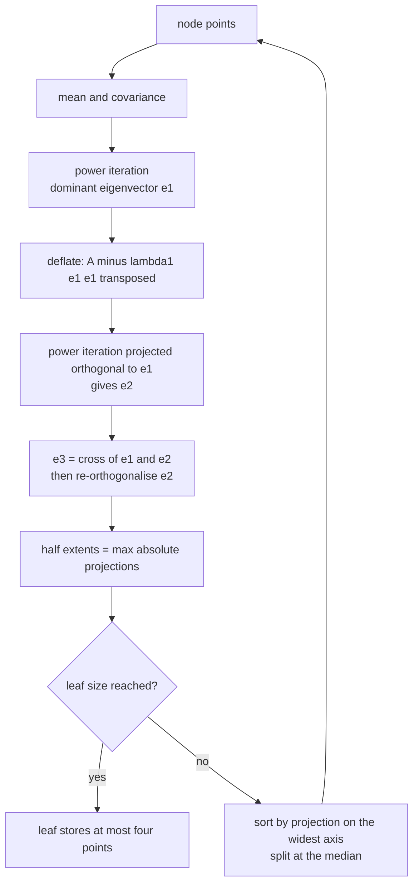
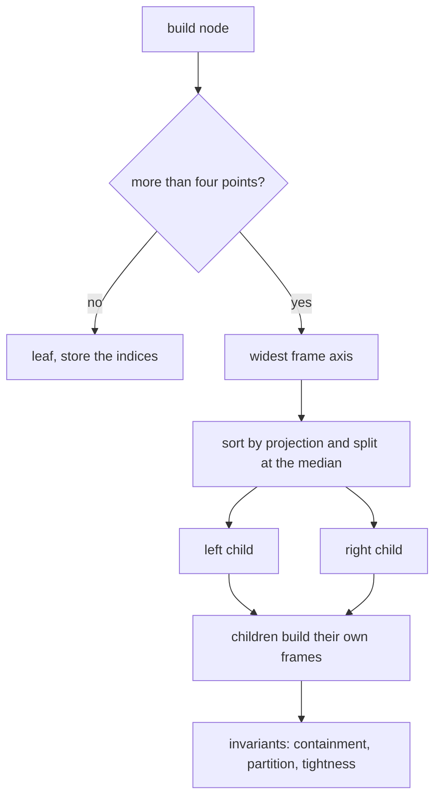
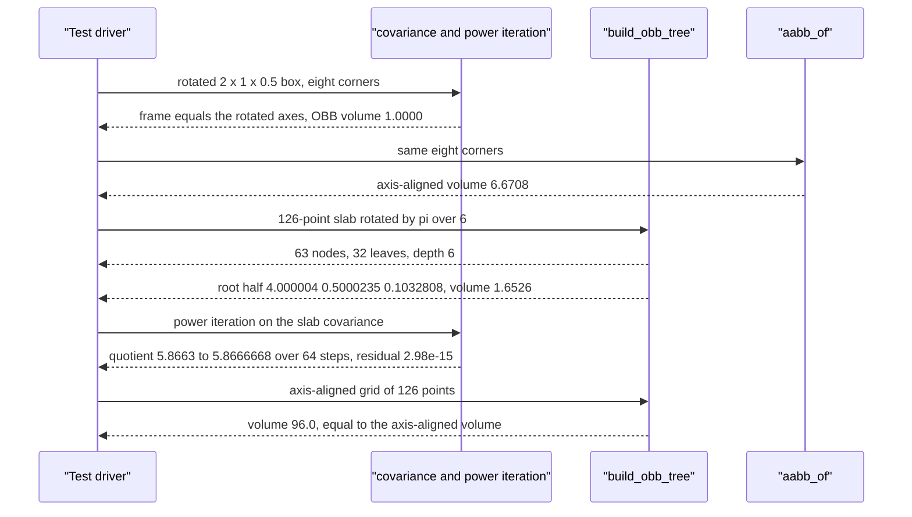

# 737 — Implement oriented bounding box tree building (OBB-tree) outline

> **Tier:** Expert · **CTCI chapter:** Beyond — Graphics, Geometry & Robotics
> **Task spec:** [737-implement-oriented-bounding-box-tree-building-obb-tree-outline.md](../../../tasks/expert/737-implement-oriented-bounding-box-tree-building-obb-tree-outline.md)
> **Solutions:** [Python](../../../solutions/python/expert/737-implement-oriented-bounding-box-tree-building-obb-tree-outline/solution.py) ·
> [Java](../../../solutions/java/expert/737-implement-oriented-bounding-box-tree-building-obb-tree-outline/Solution.java) ·
> [JavaScript](../../../solutions/javascript/expert/737-implement-oriented-bounding-box-tree-building-obb-tree-outline/solution.js) ·
> [C#](../../../solutions/csharp/expert/737-implement-oriented-bounding-box-tree-building-obb-tree-outline/Solution.cs)

## 1. Problem restatement

Build a hierarchy in which every node wraps its points in a **rotated** box that hugs their actual
shape, instead of the axis-aligned box a kd-tree would use. One node is built like this:

```text
centre  = mean of the node's points
frame   = eigenframe of the covariance matrix, dominant eigenvector first
half[i] = max over the node's points of |dot(point - centre, frame[i])|
split   = median along the frame axis with the largest half extent
```

| Piece | Signature | Meaning |
| --- | --- | --- |
| `covariance(points, mean)` | 3x3 matrix | second moments of the cloud about the mean |
| `power_iteration(matrix, seed, iterations=64, orthogonal_to)` | `(vector, residual, trace)` | dominant eigenvector plus the Rayleigh quotient trace |
| `orthonormal_frame(matrix)` | `((e1, e2, e3), residuals, traces)` | `e2` from the deflated matrix `A - lambda1 e1 e1^T`, `e3 = cross(e1, e2)` |
| `Obb(center, axes, half)` | box | `local`, `contains_point` (with `tol = 1e-9`), `volume` |
| `build_obb_tree(points)` | flat arrays | median split along the widest frame axis, `LEAF_SIZE = 4` |
| `aabb_of(points)` | `Obb` | the axis-aligned comparison box (identity frame) |
| `tree_invariants_ok(tree, points)` | bool | containment, partition, orthonormality, tightness |

Concrete results the tests assert:

- the hand-built rotated `2 x 1 x 0.5` box has OBB volume exactly `1.0000` while its axis-aligned box
  has volume `6.6708`;
- the rotated slab (126 points, `8 x 1 x 0.2` rotated by `pi/6`) gives OBB volume `1.6526` against an
  AABB volume of `7.4460` — a factor of `4.51` — with root half extents
  `(4.000004, 0.5000235, 0.1032808)`;
- on axis-aligned grid data the OBB volume equals the AABB volume exactly (`96.0` for 126 points),
  and the dominant frame axis is the `y` axis;
- the slab's tree has `63` nodes, `32` leaves of size 3 or 4, and depth `6`.

## 2. Intuition

An axis-aligned box pays for every rotation of its contents: a thin slab rotated by 30 degrees has a
huge AABB because the box must include the diagonal extent, even though the cloud itself is still
thin. The cure is to choose the box's *frame* from the data:

1. **The covariance matrix describes the spread.** `C = (1/n) sum (p - mean)(p - mean)^T` is symmetric
   positive semi-definite; its dominant eigenvector is the direction the cloud stretches along, so it
   is the natural first axis of the box.
2. **Power iteration finds that eigenvector with two lines of arithmetic.** Start from a fixed unit
   vector, repeatedly multiply by `C` and renormalise. The Rayleigh quotient is non-decreasing
   (`5.8663` then `5.8667, ...` on the slab) and the residual falls to `2.98e-15`.
3. **The remaining axes come from deflation.** The second axis is the dominant eigenvector of
   `A - lambda1 e1 e1^T`, computed by the same power iteration *while being projected orthogonally to
   `e1`*; the third is `cross(e1, e2)`. That keeps the frame exactly orthonormal whether or not the
   deflated matrix is well conditioned.
4. **Half extents are maxima of projections, so the box is tight by construction.** Some point
   attains each half extent, and the tests check precisely that (`|best - half[i]| < 1e-9`), which is
   the property that separates this construction from a "box that merely contains the points".



## 3. Algorithm

1. For a node's index set, compute the mean and the covariance matrix of its points.
2. `power_iteration(matrix)`: start from `[1, 1, 1] / sqrt(3)`, normalise, and iterate `64` times:
   multiply by the matrix, optionally project orthogonally to a given direction, renormalise, and
   record the Rayleigh quotient `v^T A v`. Stop early if the product's norm falls below `TOL = 1e-9`.
   Return the vector, the residual `||A v - lambda v||` and the quotient trace.
3. `orthonormal_frame`: take `e1` and `lambda1` from the first call; build the deflated matrix
   `A - lambda1 e1 e1^T`; run power iteration on it from seed `(1, 2, 3)` while projecting orthogonal
   to `e1` to get `e2`; set `e3 = cross(e1, e2)`, renormalise, guard the degenerate case (if
   `|e3| <= TOL`, complete the basis with a coordinate axis) and recompute `e2 = cross(e3, e1)`.
4. Build the `Obb`: the centre is the mean, the axes are the frame, and each half extent is the
   largest absolute projection of the node's points onto that axis.
5. If the index set fits `LEAF_SIZE = 4`, stop. Otherwise split at the median of the projection onto
   the axis with the largest half extent, and recurse on both halves with the same centre and frame
   used for the ordering.
6. Store everything in flat arrays (`obb`, `indices`, `left`, `right`, `root`, `frames`) so the tree
   is a pure function of the input and can be rebuilt reproducibly.
7. `tree_invariants_ok` re-checks the whole structure: every point lies in the OBB of every ancestor,
   the root covers all indices, children partition their parent disjointly, leaves respect the size
   threshold, the frame is orthonormal to `1e-9`, and every half extent is attained by some point.

```text
procedure power_iteration(matrix, seed, iterations, orthogonal_to)
    vector ← seed or [1, 1, 1] / sqrt(3)
    if orthogonal_to is given then project vector orthogonal to it
    vector ← vector / norm(vector)
    quotient ← 0
    trace ← empty list
    for step ← 1 to iterations do
        product ← matrix vector
        if orthogonal_to is given then project product orthogonal to it
        if norm(product) ≤ TOL then break
        vector ← product / norm(product)
        quotient ← dot(vector, matrix vector)
        append quotient to trace
    residual ← norm(matrix vector - quotient vector)
    return vector, residual, trace

procedure orthonormal_frame(matrix)
    e1, r1, trace1 ← power_iteration(matrix)
    lambda1 ← last value of trace1, or 0
    deflated ← matrix - lambda1 e1 e1 transposed
    e2, r2, trace2 ← power_iteration(deflated, seed = (1, 2, 3), orthogonal_to = e1)
    e3 ← cross(e1, e2)
    if norm(e3) ≤ TOL then e3 ← cross(e1, (0, 0, 1)) or cross(e1, (0, 1, 0))
    e3 ← e3 / norm(e3)
    e2 ← cross(e3, e1) / norm(cross(e3, e1))
    return (e1, e2, e3), (r1, r2), (trace1, trace2)

procedure build(indices)
    cloud ← the points of indices
    centre ← mean of cloud
    axes ← orthonormal_frame(covariance(cloud, centre))
    half[i] ← max over cloud of abs(dot(point - centre, axes[i]))
    record the node with centre, axes, half and indices
    if len(indices) ≤ LEAF_SIZE then return the node as a leaf
    axis ← index of the largest half extent
    ordered ← sort indices by (dot(point - centre, axes[axis]), index)
    half ← floor(len(ordered) / 2)
    recurse on ordered[0 .. half-1] and ordered[half .. end]
    return the node
```



## 4. Worked example

The rotated slab from `rotated_slab(pi/6, 0x5EED)`: 21 slabs in `x` times 3 offsets in `y` times 2
in `z`, i.e. 126 points forming an `8 x 1 x 0.2` box rotated by 30 degrees about `z`.

| Quantity | Value |
| --- | --- |
| root centre | mean of the cloud |
| `e1` (dominant axis) | `(0.8660254, 0.5000000, 3.96e-05)` — the 30-degree direction, recovered to `1e-7` |
| `e2` | `(-0.5000000, 0.8660254, -2.28e-04)` |
| `e3` | `(-0.0001483, 0.0001777, 0.99999997)` |
| half extents | `(4.000004, 0.5000235, 0.1032808)` |
| OBB volume | `1.6526` |
| AABB volume | `7.4460` |
| ratio | `4.51` |

The half extents read exactly like the slab: length `8` (half `4`), width `1` (half `0.5`), thickness
`0.2` (half `0.1033`, slightly above `0.1` because the `z` coordinates carry a `0.001` jitter). The
tests assert `cloud_obb.volume() < cloud_aabb.volume() / 2` and
`abs(volume - 1.6) < 0.25`, both satisfied.

The frame's provenance is checked through the power iteration itself:

| Quantity | Value |
| --- | --- |
| iterations recorded (first call) | `64` |
| Rayleigh quotient, first → last | `5.8663 -> 5.8666668` (non-decreasing throughout) |
| residual `||A v - lambda v||` | `2.98e-15` |
| residual of the deflated call | `6.21e-17` |

The same construction must *not* rotate when the data is already axis-aligned: on the grid
`x in [-4, 4], y in [-3, 3], z in {-1, 1}` scaled by `(1, 2, 0.5)`, the OBB volume is `96.0` — exactly
the AABB volume — with half extents `(6.0, 4.0, 0.5)`, and the dominant frame axis is the `y` axis
(`|axes[primary][1]| == 1`). That is the independent tightness oracle: a frame that invented a
rotation would inflate the box on this input.

The tree above the leaves:

| Statistic | Value |
| --- | --- |
| nodes | `63` |
| leaves | `32`, sizes 3 or 4 (`LEAF_SIZE = 4`) |
| leaf depth range | max `6`, and `max - min <= 2` by the balance assertion |
| leaf index union | exactly the 126 input indices |

And the degenerate clouds behave as geometry demands:

| Cloud | Root half extents | Volume |
| --- | --- | --- |
| empty | — | root index `-1`, no tree |
| single point `(1,2,3)` | zero in every axis | `0.0` |
| nine copies of `(2,2,2)` | zero | `0.0`, and the point is still contained |
| collinear `(k, 2k, -k/2)` | `(13.7477, 2.22e-16, 0.0)` | `0.0` (`half[2] < 1e-9`) |
| planar grid at `z = 0`, 49 points | thickness zero | `0.0` |



## 5. Complexity

| Operation | Time | Space | Reason |
| --- | --- | --- | --- |
| Covariance of `m` points | `O(m)` | `O(1)` | one pass of outer products |
| Power iteration | `O(64)` matrix-vector products | `O(1)` | fixed iteration cap of 64 |
| Frame construction | `O(1)` | `O(1)` | two power iterations plus a cross product |
| Half extents | `O(m)` | `O(1)` | one projection per point per axis |
| Node build | `O(m log m)` | `O(m)` | the median split sorts by projection |
| Whole tree | `O(n log^2 n)` as written | `O(n)` | a sort per level, `log n` levels |
| Query on the tree | depends on the query; boxes are tighter than AABBs | `O(n)` | the point of the construction |
| Axis-aligned comparison | `O(m)` per node | `O(1)` | six scalar reductions |

The construction cost is dominated by the sorting, not by the eigenframe: the frame is a fixed
64-step loop, which is why the outline can afford `O(1)` per node for it.

## 6. Pitfalls and edge cases

- **A degenerate cloud has fewer than three meaningful directions**: a collinear set has
  `half[2] = 0` (`2.22e-16` measured), a planar set has volume `0`, and a single point has a
  zero-volume box. The frame guard `if norm(e3) <= TOL` completes the basis with a coordinate axis so
  that renormalisation never divides by zero.
- **The frame must be *exactly* orthonormal, not merely almost**: `e2` is recomputed as
  `cross(e3, e1)` precisely so the test `|dot(axes[i], axes[j]) - delta| < 1e-9` holds for all nine
  pairs, including the pairs involving the guarded `e3`.
- **Deflation is required**: computing `e2` on the original covariance matrix would just return `e1`
  again (up to sign), and the projection orthogonal to `e1` inside the iteration keeps the iterate in
  the deflated complement even after floating-point drift.
- **Half extents must be attained, not merely sufficient**: the test recomputes
  `max |dot(p - centre, axes[i])|` for every node and requires it to match `half[i]` to `1e-9`, which
  is what "the box hugs the cloud" means operationally.
- **Containment needs a documented tolerance** (`tol = 1e-9`): the frame is a float approximation of
  an orthonormal basis, so a point exactly on a face can land a few ulps outside.
- **Duplicated points must not break the build** — nine copies of `(2,2,2)` still produce a box that
  contains them, and the covariance is exactly zero, so the power iteration falls back to its default
  direction.
- **The split must use the *frame* axis, not a coordinate axis**: sorting by the projection onto the
  widest `axes[axis]` is what keeps the children's boxes compact after a rotation.
- **The index partition must be exact**: children partition their parent disjointly and the root
  covers every input index, both asserted — a duplicated or dropped index would silently corrupt every
  downstream query.
- **Determinism**: rebuilding the tree must reproduce every centre and half extent and the whole
  partition, so the sort key includes the index as a final tie-break and power iteration starts from a
  fixed seed.
- **Documented simplifications (this is an outline)**: covariance plus median splitting instead of a
  surface-area-heuristic top-down build, power iteration instead of a symmetric eigensolver, leaves
  from a fixed size threshold, no refitting or merging of boxes while descending, and a float frame —
  hence the documented tolerance in the containment checks.

## 7. Variants and follow-ups

- **Surface-area-heuristic builds** choose the split axis and position by estimated query cost instead
  of the widest extent, which usually reduces query work at a higher build cost.
- **Refitting and incremental updates** (the standard for rigid-body hierarchies) update the boxes
  after motion instead of rebuilding; the JavaScript solution's notes call out that its boxes are not
  refitted.
- **The axis-aligned cousin** is [736 — intersection detection with bounding volume
  hierarchies](../../../tasks/expert/736-implement-intersection-detection-in-3d-using-bounding-volume-hie.md),
  which trades tightness for much cheaper box tests, and
  [733 — Barnes-Hut kd-tree](../../../tasks/expert/733-implement-kd-tree-based-n-body-barnes-hut-approximation-for-grav.md)
  for a tree built by the same median-split idea on points.
- **Where the hierarchy is consumed**: collision checks inside
  [738 — RRT motion planning](../../../tasks/expert/738-implement-motion-planning-basic-rrt-rapidly-exploring-random-tre.md)
  and [739 — probabilistic roadmaps](../../../tasks/expert/739-implement-prm-probabilistic-roadmap-for-motion-planning-small.md).

## 8. Check yourself

<details><summary>Show answer</summary>
**Why is the dominant eigenvector of the covariance matrix the right first box axis?**
Because the covariance measures the second moments of the cloud: the direction of maximum variance is
the direction in which the cloud is longest, and putting the box axis there minimises the extent that
has to be covered in that direction. On the `pi/6` slab the iteration recovers
`e1 = (0.8660254, 0.5000000, 3.96e-05)`, i.e. the true rotation to seven digits.
</details>

<details><summary>Show answer</summary>
**Why is the second axis computed on the deflated matrix `A - lambda1 e1 e1^T` instead of on `A`?**
Because power iteration always converges to the dominant eigenvector, so a second call on `A` would
return `e1` again. Removing the `lambda1` component, and projecting the iterate orthogonally to `e1`
at every step, forces convergence to the largest eigenvalue in the complementary subspace.
</details>

<details><summary>Show answer</summary>
**On the axis-aligned grid the OBB volume is exactly 96.0, the same as the AABB. Why is that the
strongest available check?**
Because it is the adversarial direction: a frame that added spurious rotation would inflate the box
and the volume would exceed `96.0`. Matching the axis-aligned volume exactly, together with the
assertion that the dominant axis has `|axes[primary][1]| == 1` (the `y` axis of an elongated grid),
shows the frame is driven by the data and not by the algorithm's defaults.
</details>

<details><summary>Show answer</summary>
**What does "the box is tight by construction" mean here, and how is it verified?**
Each half extent is defined as `max |dot(p - centre, axes[i])|` over the node's points, so some point
attains it. The verification recomputes that maximum for every node and every axis and requires the
difference to be below `1e-9`, which no merely-containing box could pass in general.
</details>

<details><summary>Show answer</summary>
**A planar cloud and a collinear cloud both give a zero-volume root box. What breaks if the frame
guard is removed?**
The cross product of `e1` and `e2` collapses to the zero vector when the cloud has no third
direction, and renormalising it divides by zero — every subsequent projection becomes `NaN`. The
guard detects `norm(e3) <= TOL` and completes the basis with a coordinate axis instead.
</details>
