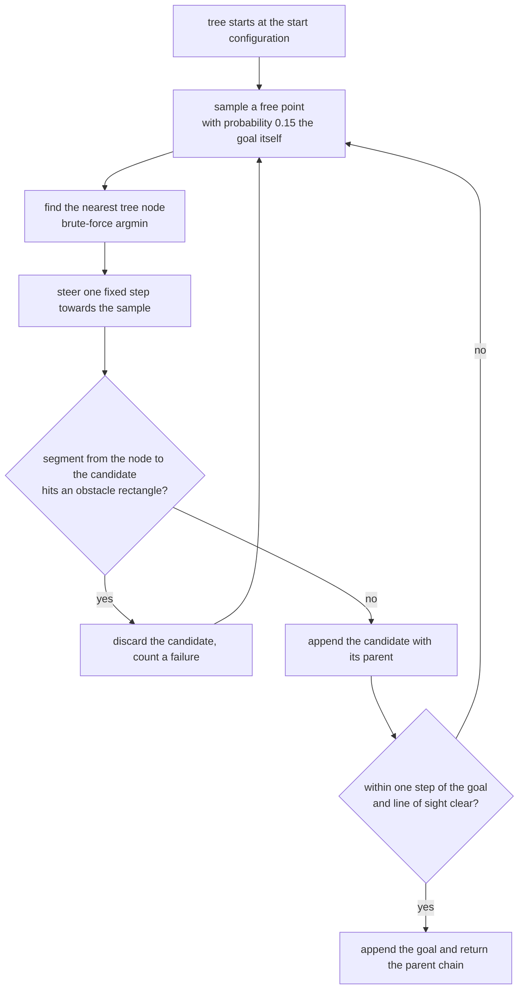
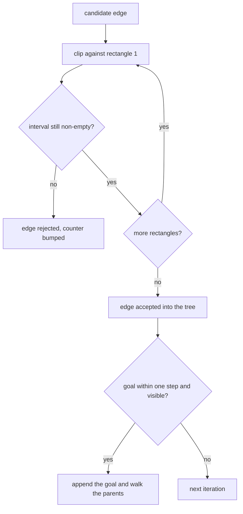
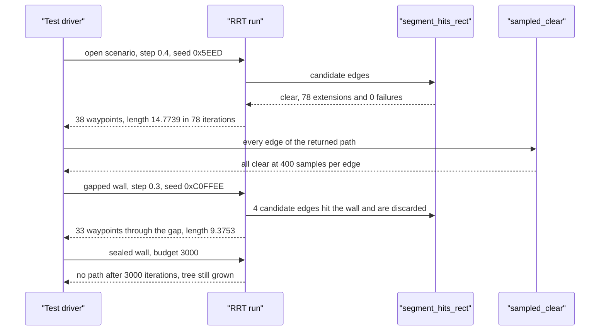

# 738 — Implement motion planning basic RRT (rapidly exploring random tree)

> **Tier:** Expert · **CTCI chapter:** Beyond — Graphics, Geometry & Robotics
> **Task spec:** [738-implement-motion-planning-basic-rrt-rapidly-exploring-random-tre.md](../../../tasks/expert/738-implement-motion-planning-basic-rrt-rapidly-exploring-random-tre.md)
> **Solutions:** [Python](../../../solutions/python/expert/738-implement-motion-planning-basic-rrt-rapidly-exploring-random-tre/solution.py) ·
> [Java](../../../solutions/java/expert/738-implement-motion-planning-basic-rrt-rapidly-exploring-random-tre/Solution.java) ·
> [JavaScript](../../../solutions/javascript/expert/738-implement-motion-planning-basic-rrt-rapidly-exploring-random-tre/solution.js) ·
> [C#](../../../solutions/csharp/expert/738-implement-motion-planning-basic-rrt-rapidly-exploring-random-tre/Solution.cs)

## 1. Problem restatement

Plan a collision-free path between two configurations in a bounded 2D workspace containing
axis-aligned rectangular obstacles, using **basic RRT**: grow a tree from the start by sampling a
random point, finding the nearest tree node, extending that node a fixed `step` towards the sample,
and keeping the new edge only when it is collision free.

| Piece | Signature | Meaning |
| --- | --- | --- |
| `Scenario(bounds, obstacles)` | object | bounded workspace, rectangles are closed sets |
| `point_free(p, tol)` | bool | no obstacle rectangle contains `p` |
| `segment_hits_rect(a, b, rect)` | bool | exact Liang-Barsky clip of a closed segment against a closed rectangle |
| `sampled_clear(a, b, samples=400)` | bool | **independent oracle**: dense sampling, used by the tests only |
| `RRT(scenario, start, goal, step, seed, goal_bias=0.15)` | object | deterministic planner with counters |
| `nearest(p)` / `steer(source, target)` / `sample(state)` | primitives | brute-force argmin, fixed-step extension, goal-biased uniform sampling |
| `run(iterations)` | path or `None` | grow the tree until a step lands within `step` of the goal with clear line of sight |
| `path_to(index)` / `edges()` | lists | the parent chain, and every tree edge |

Concrete results the tests assert:

- open space (`[0,10]^2`, no obstacles), `start = (0.5, 0.5)`, `goal = (9.5, 9.5)`, `step = 0.4`,
  seed `0x5EED`, budget 4000: a path with `38` waypoints, length `14.774` against a straight-line
  `12.728` (`16%` overhead, the bar is `40%`), finished in `78` iterations with `0` steering failures
  and `20` goal-biased samples;
- the wall at `x = 5` with a gap between `y = 4` and `y = 6` (obstacles `(5,-1,5.3,4)` and
  `(5,6,5.3,11)`), `start = (1, 5)`, `goal = (9, 5)`, `step = 0.3`, seed `0xC0FFEE`: `33` waypoints,
  length `9.375`, `76` iterations, `4` steering failures, and at least one waypoint inside the gap
  window `4.4 <= x <= 5.6`, `4 < y < 6`;
- a **sealed** wall (`(5,-1,5.3,11)`) yields no path after `3000` iterations, but the planner still
  grew a tree (`extensions > 0`); a goal inside an obstacle (`(5.05, 5.05)` in `(4.9,4.9,5.2,5.2)`)
  yields no path either;
- a goal within one step (`(2, 2) -> (2.2, 2)`, `step = 0.5`) returns `[(2,2), (2.2,2)]` with
  `iterations == 0` — the run short-circuits before sampling anything.

## 2. Intuition

A grid search over a continuous workspace cannot work: the reachable set is uncountable, and the
obstacles make the free space non-convex. RRT sidesteps the geometry entirely with a sampling trick:

1. **Sample in the workspace, not in the tree.** Every iteration draws a uniformly random free point
   (anywhere, including deep inside free regions that are hard to reach) and then extends the *nearest*
   tree node one step towards it. That is what makes the tree expand into unexplored space rather than
   along a plan: the samples pull the tree outwards.
2. **Goal bias breaks the tie with luck.** Returning the goal itself a fixed fraction of the time
   (`goal_bias = 0.15`) turns a slow diffusion process into a directed one; in the open run `20` of
   `78` samples were the goal, which is why the tree reached it in 78 steps instead of wandering.
3. **Feasibility is all basic RRT promises.** There is no rewiring and no smoothing, so the path is
   collision free but not optimal — the open-space overhead (`14.774 / 12.728 = 1.16`) is the price,
   and the tests only demand `< 1.4`.
4. **Collision checking must be conservative at the boundaries.** The Liang-Barsky clip treats
   obstacles as *closed* rectangles, so touching a face or squeezing through a corner counts as a
   collision; the independent sampled oracle (400 points per segment) is what makes the claim
   verifiable rather than self-referential.



## 3. Algorithm

1. Set up the workspace: bounds and a list of rectangles, both treated as closed sets.
2. `segment_hits_rect(a, b, rect)` clips the segment against the rectangle's four slabs with the
   Liang-Barsky parameter interval: for each slab direction pair `(p, q)`, a zero `p` with `q < 0`
   means parallel-and-outside (no hit), otherwise the ratio `q / p` tightens `t_low` or `t_high`, and
   the segment hits when `t_low <= t_high`.
3. `run(iterations)`: seed the tree with the start, then check the immediate case — if the goal is
   within one step and the direct segment is clear, connect both endpoints and return before any
   sampling.
4. For each iteration: draw a sample (the goal with probability `goal_bias`, otherwise uniform in the
   bounds), find the nearest node with a linear scan, steer one step towards the sample, and discard
   the candidate when the segment is not clear.
5. On acceptance, append the candidate with its parent index, then test the second termination
   condition: within one step of the goal *and* a clear line of sight to the goal, in which case the
   goal is appended and `path_to` walks the parent chain backwards.
6. Counters (`iterations`, `nearest_calls`, `steering_failures`, `goal_samples`, `extensions`) make the
   planner's behaviour measurable instead of anecdotal.
7. Verification: paths start at the start and end at the goal exactly, every edge passes
   `sampled_clear`, path length is at least the straight-line distance and close to it in open space,
   parents always point backwards (so the structure is a real tree), and identical seeds reproduce the
   tree, the path and every counter.

```text
procedure run(iterations)
    nodes ← [start], parents ← [-1]
    state ← seed
    if dist(start, goal) ≤ step and segment is clear from start to goal then
        append goal with parent 0
        return path_to(1)
    for iteration ← 1 to iterations do
        count an iteration
        state, sample ← goal with probability goal_bias, else uniform inside the bounds
        index ← nearest(sample)                        // brute-force argmin
        candidate ← steer(nodes[index], sample)
        if not clear(nodes[index], candidate) then
            count a steering failure
            continue
        append candidate with parent index
        count an extension
        if dist(candidate, goal) ≤ step and clear(candidate, goal) then
            append goal with parent (last candidate index)
            return path_to(last index)
    return none

procedure steer(source, target)
    length ← dist(source, target)
    if length ≤ step then return target
    ratio ← step / length
    return source + ratio (target - source)

procedure segment_hits_rect(a, b, rect)
    t_low ← 0, t_high ← 1
    for each slab (p, q) of the rectangle do
        if p = 0 then
            if q < 0 then return false           // parallel and outside
            continue
        ratio ← q / p
        if p < 0 then
            if ratio > t_high then return false
            t_low ← max(t_low, ratio)
        else
            if ratio < t_low then return false
            t_high ← min(t_high, ratio)
    return t_low ≤ t_high
```



## 4. Worked example

The open scenario, `step = 0.4`, seed `0x5EED`, sampling and extending by hand for the first
iterations (the goal bias fired on the very first draw, which is why the tree immediately heads
diagonally):

| Iteration | Sample | Nearest index | Candidate | Accepted |
| --- | --- | --- | --- | --- |
| 0 | `(9.5, 9.5)` — the goal, via the bias | 0 | `(0.7828, 0.7828)` | yes |
| 1 | `(3.6468, 4.4071)` | 1 | `(1.0308, 1.0967)` | yes |
| 2 | `(9.5, 9.5)` — bias again | 2 | `(1.3148, 1.3784)` | yes |
| 3 | `(1.6182, 0.7241)` | 2 | `(1.3686, 0.8824)` | yes |
| 4 | `(2.4537, 3.4628)` | 3 | `(1.5066, 1.7294)` | yes |
| 5 | `(1.3549, 1.7645)` | 5 | `(1.3549, 1.7645)` | yes — the sample is closer than one step, so `steer` returns it unchanged |

Every candidate is exactly `0.4` away from its parent (except iteration 5, where the sample is
closer), which is the fixed-step property. The run then finishes at iteration `78`: `80` nodes total
(including the goal), `38` waypoints, `20` goal-biased samples, `0` steering failures, length
`14.7739` against the straight line `12.7280`. The first four waypoints are
`(0.5,0.5), (0.7828,0.7828), (1.0308,1.0967), (1.3148,1.3784)` and the last two are
`(9.2406, 9.2307)` and the goal `(9.5, 9.5)` — appended exactly, not approximately.

The gapped wall is where the collision checker earns its keep:

| Quantity | Value |
| --- | --- |
| waypoints | `33` |
| path length | `9.3753` (straight line `8.0`) |
| iterations | `76` |
| steering failures | `4` (candidates that would have hit the wall) |
| goal-biased samples | `13` |
| waypoints inside the gap window `4.4 <= x <= 5.6`, `4 < y < 6` | present, e.g. `(4.6467, 5.0160)`, `(4.9300, 5.1147)`, `(4.9939, 5.4078)` |

The gap is `y in [4, 6]` and the wall spans `x in [5, 5.3]`, so the detour must thread a `2`-unit
opening; the assertion `any(4.0 < y < 6.0 and 4.4 <= x <= 5.6)` proves the path used the gap instead
of teleporting around the wall.

The negative cases and the step-size trade-off:

| Case | Result |
| --- | --- |
| sealed wall `(5,-1,5.3,11)`, budget 3000 | no path, `iterations == 3000`, `extensions > 0` |
| goal inside the obstacle `(4.9,4.9,5.2,5.2)` at `(5.05,5.05)` | no path |
| `start == goal` | `[(2,2)]`, a valid degenerate path |
| goal within one step | `[(2,2), (2.2,2)]` with `iterations == 0` |
| `step = 1.0` versus `step = 0.2` (seed `0x99`) | `14` waypoints, length `11.8187` versus `51` waypoints, length `9.9913` |

The step-size row is the classic trade-off in one line: coarse steps reach the goal with far fewer
waypoints but a coarser (longer) path, and the tests assert exactly the waypoint inequality.



## 5. Complexity

| Operation | Time | Space | Reason |
| --- | --- | --- | --- |
| One iteration | `O(n)` for `nearest` + `O(m)` for the collision check | `O(1)` | `n` tree nodes, `m` obstacle rectangles |
| `steer` | `O(1)` | `O(1)` | one distance and one ratio |
| `segment_hits_rect` | `O(1)` | `O(1)` | four slab clips, worst case `4` ratios |
| `run`, `k` iterations | `O(k (n + m))` | `O(k)` | linear nearest-neighbour scan per iteration |
| Path extraction | `O(|path|)` | `O(|path|)` | walk the parent chain backwards |
| Sampled oracle (tests) | `O(400 |path|)` | `O(1)` | independent verification, not used by the planner |

With a kd-tree nearest-neighbour query the iteration becomes `O(log n + m)`, which is the standard
production variant; the classic formulation — and this implementation — pays the linear scan.

## 6. Pitfalls and edge cases

- **Closed obstacles mean the planner may not squeeze through corners.** The Liang-Barsky clip is
  inclusive (`t_low <= t_high`), so a segment lying exactly along an obstacle face is a collision:
  `segment_hits_rect((0,4), (10,4), (5,-1,5.3,4))` is `True`.
- **Parallel-and-outside must be distinguished from parallel-and-inside**: the `p == 0, q < 0` branch
  rejects the whole segment, while `p == 0, q >= 0` continues to the other slabs — a missing branch
  turns a horizontal segment that misses every rectangle into a reported collision.
- **The goal-inside-an-obstacle case must fail, not loop forever**: it does, because every candidate
  placed near the goal is discarded and the tree exhausts the budget.
- **A sealed wall must exhaust the budget rather than crash**, and the planner must still have grown a
  tree (`sealed.extensions > 0`), which distinguishes "tried and failed" from "never started".
- **The immediate-connection case must skip sampling entirely**: `dist(start, goal) <= step` with a
  clear segment returns `[(2,2), (2.2,2)]` and leaves `iterations == 0`, an assertion that would catch
  a version that sampled first and then patched the path.
- **`start == goal`** returns the single-point path rather than an empty list.
- **Parents must always point backwards** (`parents[i] < i`), which is what makes the structure a tree
  and the `path_to` walk terminate; `self_consistent_tree` additionally checks that every node is
  reachable from the root.
- **A restricted `tol` in `point_free`** (`tol = 0.0`) keeps the free-space test and the segment test
  consistent, so the planner never accepts a node that the oracle calls blocked.
- **The two checkers must agree**: the planner uses exact clipping, the tests use dense sampling —
  a disagreement would mean an accepted edge passing through an obstacle, and the tests assert all
  path edges *and* all tree edges pass the sampled oracle.
- **Determinism**: identical seeds must reproduce the tree, the path, the iteration count and the
  failure count; the PRNG is `splitmix64` with the state threaded through every draw, including the
  goal-bias decision.
- **Documented simplifications**: deterministic PRNG with a fixed seed, linear nearest-neighbour scan,
  straight segments with no steering/curvature constraints, no rewiring or smoothing (this is RRT, not
  RRT*), no dynamic obstacles and no time dimension.

## 7. Variants and follow-ups

- **RRT\*** adds rewiring of nearby nodes as the tree grows, which makes the path asymptotically
  optimal and removes the open-space overhead visible as `14.774 / 12.728`.
- **Path smoothing** (shortcutting with collision checks) is the cheapest improvement one can bolt on
  here: it reuses `segment_hits_rect` unchanged.
- **Probabilistic roadmaps** attack the same problem from the other side — a static graph instead of a
  tree: [739 — PRM for motion planning](../../../tasks/expert/739-implement-prm-probabilistic-roadmap-for-motion-planning-small.md),
  with the gap-threading geometry shared with
  [740 — visibility graph path planning](../../../tasks/expert/740-implement-visibility-graph-path-planning-for-polygons.md).
- **Collision checking at scale** replaces the `O(m)` rectangle loop with a hierarchy:
  [736 — bounding volume hierarchies](../../../tasks/expert/736-implement-intersection-detection-in-3d-using-bounding-volume-hie.md)
  and [737 — OBB trees](../../../tasks/expert/737-implement-oriented-bounding-box-tree-building-obb-tree-outline.md).

## 8. Check yourself

<details><summary>Show answer</summary>
**Why does RRT sample the workspace instead of refining the current best path?**
Because the free space is non-convex and unknown: a sample drawn anywhere (then connected to the
*nearest* node) is what makes the tree branch into unexplored regions. Refining the current path
would only improve what the tree already found, which is RRT\*'s job after the sampling has covered
the space.
</details>

<details><summary>Show answer</summary>
**The open-space path is `14.7739` long against a straight line of `12.7280`. Is that a bug?**
No — it is the documented behaviour of basic RRT: no rewiring, no smoothing, so the path is feasible
but not optimal. The tests encode the expectation as `path_length < 1.4 * straight`, and the measured
overhead is `16%`.
</details>

<details><summary>Show answer</summary>
**Why is `segment_hits_rect` allowed to report collisions the sampled oracle would miss, but not the
other way round?**
Because the two must not disagree in the dangerous direction. The exact clip is conservative: it uses
closed intervals, so a segment grazing a corner is a collision, which can only make the planner more
careful. A false *negative* (missing a real hit) would let the planner accept an edge through an
obstacle, which is exactly what the sampled oracle on every path and tree edge is designed to catch.
</details>

<details><summary>Show answer</summary>
**Why does `steer` sometimes return the sample unchanged?**
Because it returns the target itself when `dist(source, target) <= step`. Iteration 5 of the trace is
such a case: the sample `(1.3549, 1.7645)` was closer than one step from its nearest node, so the
candidate equals the sample and the edge is shorter than `0.4`.
</details>

<details><summary>Show answer</summary>
**A sealed wall grows a tree but never finds a path. Why is `extensions > 0` asserted?**
Because it distinguishes a planner that explored and then honestly failed from one that returned
`None` immediately — for example because a bug rejected every candidate. Together with
`iterations == 3000` it shows the budget was actually spent on sampling and steering.
</details>
