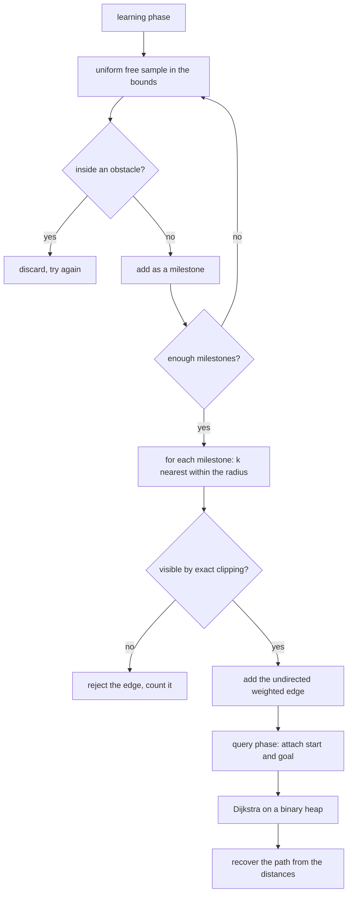
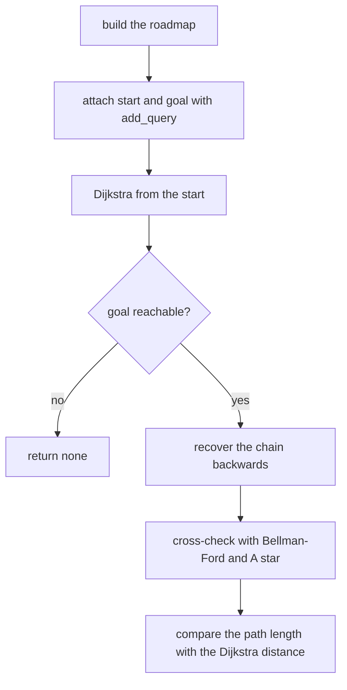
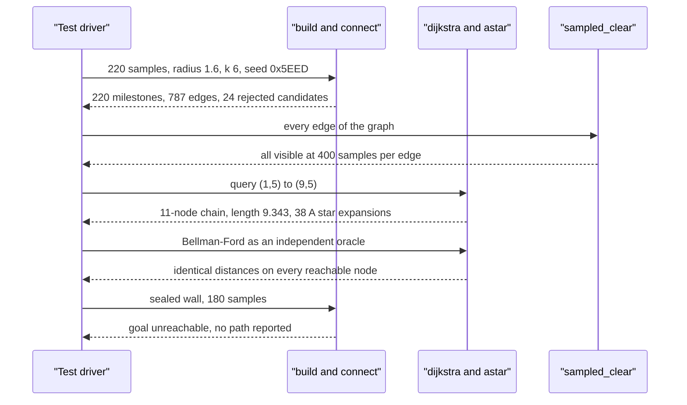

# 739 — Implement PRM (probabilistic roadmap) for motion planning small

> **Tier:** Expert · **CTCI chapter:** Beyond — Graphics, Geometry & Robotics
> **Task spec:** [739-implement-prm-probabilistic-roadmap-for-motion-planning-small.md](../../../tasks/expert/739-implement-prm-probabilistic-roadmap-for-motion-planning-small.md)
> **Solutions:** [Python](../../../solutions/python/expert/739-implement-prm-probabilistic-roadmap-for-motion-planning-small/solution.py) ·
> [Java](../../../solutions/java/expert/739-implement-prm-probabilistic-roadmap-for-motion-planning-small/Solution.java) ·
> [JavaScript](../../../solutions/javascript/expert/739-implement-prm-probabilistic-roadmap-for-motion-planning-small/solution.js) ·
> [C#](../../../solutions/csharp/expert/739-implement-prm-probabilistic-roadmap-for-motion-planning-small/Solution.cs)

## 1. Problem restatement

Plan in **two phases** instead of growing a tree per query. The learning phase scatters free
configurations over the workspace and joins each one to its nearest visible neighbours, producing an
undirected graph that captures the connectivity of the free space; the query phase attaches the start
and goal to that graph and runs a shortest-path search. Because the graph is built once, later queries
are cheap — that is the whole point of a roadmap.

| Piece | Signature | Meaning |
| --- | --- | --- |
| `Workspace(bounds, obstacles)` | object | closed axis-aligned rectangles; `point_free`, `segment_clear`, `sampled_clear` |
| `segment_hits_rect(a, b, rect)` | bool | exact Liang-Barsky clip, closed intervals |
| `Roadmap.add_node(point)` | index | appends a milestone |
| `Roadmap.connect(index, neighbours)` | count | joins visible neighbours both ways with the Euclidean weight |
| `Roadmap.build(samples, radius, k, seed)` | `self` | learning phase: uniform free samples, `k` nearest within `radius` |
| `Roadmap.add_query(point, radius, k)` | index | attaches start or goal with the same neighbourhood rule |
| `Roadmap.dijkstra(source)` / `astar(source, target)` / `bellman_ford(source)` | distances | the query phase, plus two independent cross-checks |
| `Roadmap.path(source, target)` | node chain | shortest path recovered from the Dijkstra distances |

Concrete results the tests assert on the gapped-wall workspace (a wall at `x in [5, 5.3]` with an
opening for `y in (4, 6)`), `220` samples, `radius = 1.6`, `k = 6`, seed `0x5EED`:

- `222` nodes (the milestones plus the start and the goal), `787` edges, `24` candidate edges rejected
  by the clipping test;
- the query `(1, 5) -> (9, 5)` returns a chain of `11` nodes with length `9.343`, against a
  straight-line lower bound of `8.0` and a `1.4x` acceptance bar, and A\* expands `38` nodes to
  produce the same cost;
- Dijkstra agrees with Bellman-Ford on every reachable node, and the reported path length equals the
  Dijkstra distance to the goal to `1e-9`;
- a sealed wall (`(5,-1,5.3,11)`) leaves the goal unreachable and `path` returns `None`.

## 2. Intuition

RRT answers "what path connects these two points"; PRM answers "what does the free space look like",
once, for everybody. Three observations make that trade useful:

1. **A random sample is a milestone, and a milestone only needs a few neighbours.** Uniform samples
   plus `k = 6` nearest neighbours within `radius = 1.6` produce `787` edges over `222` nodes — a
   graph dense enough to preserve connectivity without the `222 * 221 / 2` pairs. Roughly `97%` of
   the candidate edges survive the visibility test (`24` rejections), and the rejections are exactly
   the ones crossing the wall.
2. **Visibility is exact and conservative.** Liang-Barsky clipping treats obstacles as closed
   rectangles, so a candidate that grazes a wall face or squeezes through the corner of the gap is
   rejected; the tests re-check every surviving edge with an independent sampled oracle.
3. **The query phase is a shortest-path problem, so it can be cross-checked three ways.** Dijkstra on
   a binary heap is the implementation; Bellman-Ford is a different algorithm that must agree on every
   reachable node; A\* with the Euclidean heuristic must return the same cost because that heuristic
   is admissible *and* consistent on a metric graph.



## 3. Algorithm

1. Sample uniformly inside the bounds from the deterministic `splitmix64` stream, reject points inside
   an obstacle, and stop after `samples` accepted milestones (or `samples * 50` attempts, so a mostly
   blocked workspace cannot loop forever).
2. For each milestone, collect every other milestone within `radius`, sort by `(distance, index)` and
   keep the `k` nearest. Sorting with the index as the tie-break is what makes the roadmap
   reproducible.
3. `connect` adds the edge in both directions with the same weight after `segment_clear` confirms
   visibility, incrementing `rejected_edges` on failure; already-present edges are skipped so the
   second direction is free.
4. The query phase attaches the start and the goal with the very same neighbourhood rule
   (`add_query`), so the query nodes are ordinary graph nodes with ordinary edges.
5. `dijkstra(source)`: binary-heap relaxation with a standard stale-entry check
   (`cost > best[node]`), returning the best distance for every reachable node.
6. `bellman_ford(source)` relaxes every edge until nothing changes, as the independent oracle;
   `astar(source, target)` expands by `cost + Euclidean distance to the goal` and returns the cost and
   the number of expanded nodes.
7. `path(source, target)` recovers the chain by walking backwards from the target, at each step
   choosing a neighbour whose `best + weight` matches `best[node]` (with a `1e-9` tolerance) and
   preferring the smaller `best`, then the smaller index — a deterministic tie-break.
8. Verification: the adjacency is symmetric, every edge passes both the exact and the sampled test,
   the path is a chain of real edges, and a fixed seed reproduces the nodes and the path.

```text
procedure build(samples, radius, k, seed)
    state ← seed, placed ← 0, attempts ← 0
    while placed < samples and attempts < samples times 50 do
        state, rx ← next random, state, ry ← next random
        point ← uniform in the bounds
        if workspace.point_free(point) then
            add point as a milestone
            placed ← placed + 1
    for index in 0 .. number of milestones - 1 do
        connect(index, k_nearest(index, radius, k))
    return self

procedure k_nearest(index, radius, k)
    candidates ← sorted list of (distance, other) for other within radius, other ≠ index
    return the first k of candidates

procedure connect(index, neighbours)
    for other in neighbours do
        if other = index or other already adjacent then continue
        if not workspace.segment_clear(nodes[index], nodes[other]) then
            count one rejected edge
            continue
        weight ← dist(nodes[index], nodes[other])
        adjacency[index][other] ← weight
        adjacency[other][index] ← weight

procedure dijkstra(source)
    best ← {source: 0}
    queue ← [(0, source)]
    while queue is not empty do
        cost, node ← pop the smallest entry
        if cost > best[node] then continue
        for (other, weight) in adjacency[node] do
            candidate ← cost + weight
            if candidate < best[other] - 1e-12 then
                best[other] ← candidate
                push (candidate, other)
    return best

procedure path(source, target)
    best ← dijkstra(source)
    if best[target] is infinite then return none
    chain ← [target], node ← target
    while node ≠ source do
        step ← the neighbour with best[other] + weight(node, other) equal to best[node],
               smallest best first, then smallest index
        append step to chain
        node ← step
    return reverse of chain
```



## 4. Worked example

Learning phase on the gapped-wall workspace, `build(220, 1.6, 6, 0x5EED)`:

| Quantity | Value |
| --- | --- |
| milestones | `220` (exactly the requested count) |
| edges | `787` |
| rejected candidate edges | `24` — the candidates whose segment would cross the wall |
| edge density | `787 / 220 ≈ 3.6` edges per milestone, from `k = 6` candidates each |

Query phase, after `add_query((1, 5), 1.6, 6)` and `add_query((9, 5), 1.6, 6)`:

| Quantity | Value |
| --- | --- |
| graph size | `222` nodes |
| path | `11` nodes, a chain of real graph edges |
| path length | `9.343` |
| straight-line lower bound | `8.000` |
| ratio | `1.17`, against the asserted bar `<= 1.4 * 8.0 = 11.2` |
| Dijkstra distance to the goal | `9.343` to `1e-9` (the path length equals the reported cost) |
| A\* expanded nodes | `38` (must not exceed `222`) |

The three shortest-path implementations on this graph:

| Algorithm | Result |
| --- | --- |
| Dijkstra (heap) | distances for all reachable nodes |
| Bellman-Ford (relaxation oracle) | agrees with Dijkstra on every node to `1e-9` |
| A\* with the Euclidean heuristic | cost `9.343`, `38` expansions |

Boundary and negative cases, all asserted:

| Case | Result |
| --- | --- |
| sealed wall `(5,-1,5.3,11)`, 180 samples | goal unreachable, `dijkstra(...).get(goal)` infinite, `path(...) is None` |
| bare roadmap with two query nodes `(1,1)` and `(3,4)`, `radius 5`, `k 4` | one visible direct edge, cost `hypot(2, 3) = 3.6056`, path `[s0, g0]` |
| `start == goal` at `(4,4)` in a 20-sample roadmap | distance `0.0`, path `[node]` |
| two nodes `radius = 0.5` apart `> radius` (`(1,1)` and `(9,9)`) | no edge, unreachable |
| sparse roadmap (12 samples, `k = 3`) | fewer edges than the dense one, and its path can only be worse (`>= 9.343`) |

The bare-roadmap row is the smallest possible road: with only two nodes the "learning phase" is
empty, the direct edge exists because the workspace is open, and the answer is the straight line —
a useful check that the query phase does not depend on the sampling phase having done anything.



## 5. Complexity

| Operation | Time | Space | Reason |
| --- | --- | --- | --- |
| Sampling one milestone | `O(m)` | `O(1)` | rejection test against `m` obstacles |
| `k_nearest` | `O(n)` collect + `O(n log n)` sort | `O(n)` | linear scan and a full sort |
| `build` | `O(n^2 log n + n m)` | `O(n^2)` worst case | `n` neighbourhood queries, each scanning and sorting |
| `connect` | `O(k)` per node | `O(k)` | `k` visibility checks |
| Dijkstra | `O(E log V)` | `O(V + E)` | binary heap, `E = 787`, `V = 222` |
| A\* | `O(E log V)` worst case, fewer expansions in practice (`38`) | `O(V + E)` | consistent Euclidean heuristic |
| Bellman-Ford (oracle) | `O(V E)` | `O(V)` | plain relaxation, used only in the tests |
| Path recovery | `O(|path| * degree)` | `O(|path|)` | backward walk with a local-minimum scan per step |

`n` milestones and `E` edges; note that the build cost dominates for large `n`, which is why real
implementations use a kd-tree for `k_nearest` and cap the neighbourhood with `radius` — the same
`radius`/`k` cap this outline uses to keep the graph sparse.

## 6. Pitfalls and edge cases

- **The sampling loop must be bounded**: `attempts < samples * 50` prevents an infinite loop in a
  workspace whose free area is tiny, and the tests only require the free-space cases.
- **The radius cap matters as much as `k`**: two nodes further apart than `radius` must not be joined
  even when they are each other's nearest neighbour, which the `(1,1)`/`(9,9)` pair with `radius 0.5`
  asserts.
- **The graph must be undirected and symmetric**: `adjacency[other][node] == weight` for every edge,
  checked exhaustively; a one-way edge would make Dijkstra's answer depend on the direction of the
  query.
- **Closed obstacles**: `segment_clear` uses the inclusive Liang-Barsky interval, so an edge along a
  wall face is rejected and the roadmap never squeezes through the corner of the gap.
- **A sealed wall must be reported as unreachable**, not as a large distance: `dijkstra(...).get(goal)`
  must be infinite and `path` must return `None`.
- **`start == goal`** must give distance `0.0` and the one-node path `[node]`, not `None` and not an
  empty list.
- **An empty learning phase is legal**: with only the two query nodes the direct edge is the answer
  (`hypot(2, 3)`), which the bare-roadmap case checks.
- **Tie-breaks must be deterministic** in both `k_nearest` (sort by `(distance, index)`) and path
  recovery (prefer the smaller `best`, then the smaller index), otherwise a fixed seed would not
  reproduce the path.
- **A sparse roadmap may genuinely fail** to find the corridor; the test tolerates `None` but requires
  any found path to be no better than the dense one — the honest statement about a probabilistic
  method.
- **Numerical comparison needs a tolerance**: the relaxations use `< best - 1e-12` and the path
  recovery matches `best + weight` within `1e-9`, so floating-point noise cannot create a phantom
  improvement or break the chain walk.
- **Documented simplifications**: uniform sampling instead of Gaussian/OBPRM sampling, a fixed
  neighbourhood radius and `k` instead of an adaptive one, no roadmap expansion/repair, no re-sampling
  after a failed query, and workspaces small enough to run in well under a second.

## 7. Variants and follow-ups

- **Adaptive neighbourhoods** (grow the radius until a minimum degree is reached) fix the sparse-roadmap
  failure mode seen in the `12`-sample case.
- **Bridge and medial-axis tests** add milestones exactly where narrow passages are, which is the
  standard PRM repair for the gap that a sparse roadmap misses.
- **The single-query alternative** grows a tree per query instead of a graph once:
  [738 — RRT motion planning](../../../tasks/expert/738-implement-motion-planning-basic-rrt-rapidly-exploring-random-tre.md),
  which shares the collision checker and the workspace model.
- **Exact roadmaps from geometry** skip sampling entirely when the obstacles are polygons:
  [740 — visibility graph path planning](../../../tasks/expert/740-implement-visibility-graph-path-planning-for-polygons.md)
  builds the same kind of graph from obstacle vertices, and
  [741 — art gallery approximation](../../../tasks/expert/741-implement-art-gallery-problem-approximation-heuristics.md)
  uses visibility to place guards.

## 8. Check yourself

<details><summary>Show answer</summary>
**What does the roadmap buy over a per-query tree planner?**
Reuse. The learning phase costs `O(n^2 log n)` once, and each subsequent query is only an `add_query`
plus a Dijkstra run (`38` A\* expansions here on a `222`-node graph). A tree planner pays the sampling
cost again for every query.
</details>

<details><summary>Show answer</summary>
**Why are both `radius` and `k` needed?**
`k` caps the degree so the graph stays sparse, but a pure `k`-nearest rule would join two distant
nodes when a region is empty; `radius` caps the edge length so the graph cannot contain a long edge
that skips over a passage. The tests make the point with two nodes `8` units apart and `radius = 0.5`
— nearest neighbours, and deliberately unconnected.
</details>

<details><summary>Show answer</summary>
**Why cross-check Dijkstra with Bellman-Ford *and* A\*?**
Because they fail differently. Bellman-Ford is a different algorithm with a completely different
update order, so agreement rules out a heap or stale-entry bug in Dijkstra. A\* must return the same
cost only because the Euclidean heuristic is admissible and consistent on this metric graph — so
agreement also validates the heuristic, and the expanded count (`38` of `222`) shows the heuristic is
actually helping.
</details>

<details><summary>Show answer</summary>
**The dense roadmap's path is `9.343` long for a `8.0` straight line, and the sparse one may fail
outright. What does that say about PRM?**
That PRM is probabilistically complete and not optimal: with enough samples the graph captures the
corridor and the shortest path approaches the geometric optimum (`17%` overhead here, dominated by
the fixed `radius` connecting milestones at angles), but with `12` samples the corridor may simply
have no milestones, in which case the honest answer is "no path" rather than a wrong one.
</details>

<details><summary>Show answer</summary>
**What would break if `segment_clear` used open intervals instead of closed ones?**
An edge lying exactly along a wall face, or grazing the corner of the gap, would be accepted. The
planner could then report a path through a zero-width contact, which is geometrically infeasible;
closing the intervals keeps the roadmap conservative, and the tests re-check every edge with the
independent sampled oracle.
</details>
