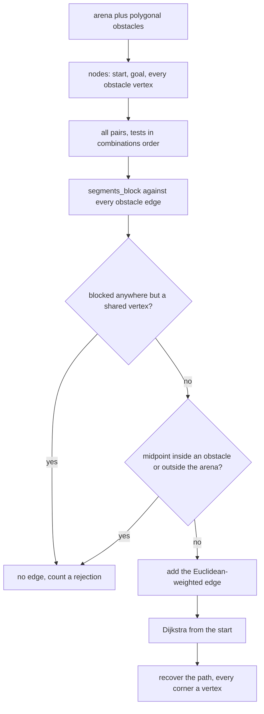
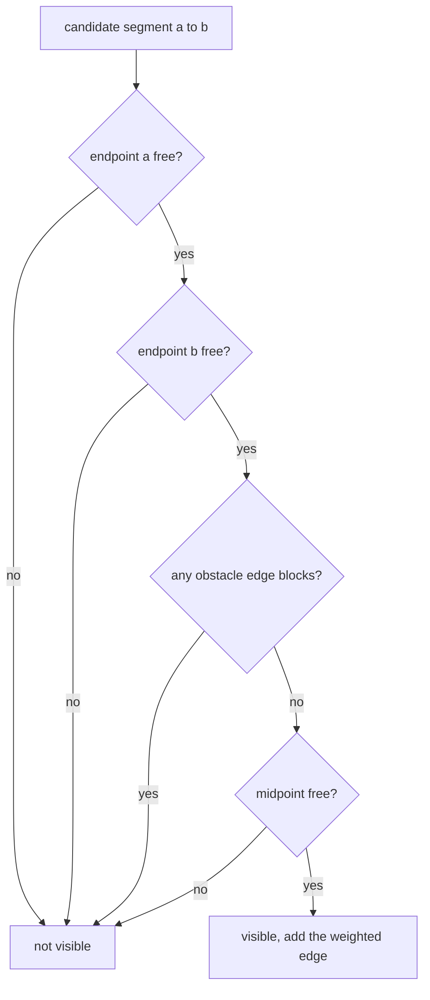
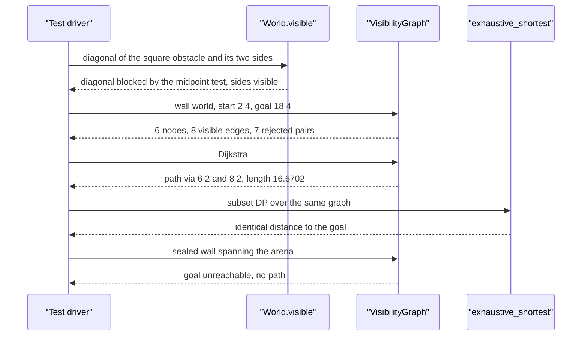

# 740 — Implement visibility graph path planning for polygons

> **Tier:** Expert · **CTCI chapter:** Beyond — Graphics, Geometry & Robotics
> **Task spec:** [740-implement-visibility-graph-path-planning-for-polygons.md](../../../tasks/expert/740-implement-visibility-graph-path-planning-for-polygons.md)
> **Solutions:** [Python](../../../solutions/python/expert/740-implement-visibility-graph-path-planning-for-polygons/solution.py) ·
> [Java](../../../solutions/java/expert/740-implement-visibility-graph-path-planning-for-polygons/Solution.java) ·
> [JavaScript](../../../solutions/javascript/expert/740-implement-visibility-graph-path-planning-for-polygons/solution.js) ·
> [C#](../../../solutions/csharp/expert/740-implement-visibility-graph-path-planning-for-polygons/Solution.cs)

## 1. Problem restatement

In a bounded polygonal world, the shortest collision-free path between two points is a polyline whose
interior corners are **obstacle vertices** — anywhere else the path could be pulled taut. That makes
planning a shortest-path problem: build the **visibility graph** whose nodes are the start, the goal
and every obstacle vertex, and whose edges join pairs that can see each other.

| Piece | Signature | Meaning |
| --- | --- | --- |
| `World(bounds, obstacles)` | object | integer polygonal obstacles in an axis-aligned arena; `edges` is the flat edge list |
| `orient(a, b, c)` | int | exact 2D orientation as an integer (integer coordinates) |
| `segments_block(a, b, p, q)` | bool | closed segments meet anywhere other than at one shared vertex |
| `point_in_polygon(polygon, p)` | bool | ray casting, boundary counts as outside |
| `World.visible(a, b)` | bool | exact visibility: edges must not block, and the midpoint must be free |
| `World.sampled_visible(a, b, samples=200)` | bool | independent dense-sampling oracle |
| `VisibilityGraph(world, start, goal)` | object | all pairs tested with `visible`, weights are Euclidean |
| `dijkstra` / `path` / `path_length` | distances, chain | the query |
| `exhaustive_shortest(source, target)` | scalar | subset DP over every simple path in the same graph |

Concrete results the tests assert:

- the wall world (arena `[0,20]^2`, obstacle `(6,2)-(8,12)`) has `6` nodes, `8` visible edges and `7`
  rejected pairs; the query `(2, 4) -> (18, 4)` returns `[(2,4), (6,2), (8,2), (18,4)]` with length
  `16.6702`, exactly the hand-derived optimum around the lower corner;
- a diagonal of a square obstacle and any segment that enters and leaves an obstacle are **not**
  visible, while the two sides of the rectangle are;
- a wall spanning the arena leaves the goal unreachable, and a start outside the arena sees nothing;
- the U-shaped pocket forces a detour of at least four waypoints, still entirely sampled-visible.

## 2. Intuition

The key geometric fact is the **taut-path property**: the shortest free path between two points in a
polygonal environment is a polyline whose interior breakpoints are obstacle vertices. If a breakpoint
were in free space, the two incident segments could be shortened by moving it; if it were in the
interior of an edge, sliding it to the endpoint would not lengthen the path. So a finite candidate set
suffices — start, goal, and every obstacle vertex.

Three ingredients make the construction work:

1. **Visibility must be exact, not sampled.** Two nodes are joined iff the segment between them stays
   in the free space. The implementation tests this with exact integer orientation arithmetic: a
   proper crossing blocks, a collinear overlap blocks, and a touch anywhere except at one shared
   endpoint blocks too (so the planner never slides along an edge or squeezes through a vertex it does
   not pivot on).
2. **Crossings alone are not enough.** A diagonal of a square obstacle crosses no edge and touches no
   vertex, yet it runs through the obstacle's interior. The second step — the segment **midpoint** must
   be free — is what rejects it, and it is exactly the case the tests probe first.
3. **One Dijkstra run finishes the job.** Because every edge is a straight visible segment, its weight
   is the Euclidean length, and the shortest path in the graph is the shortest path in the world.



## 3. Algorithm

1. Flatten the obstacles into an edge list: consecutive vertex pairs plus the closing pair of each
   polygon.
2. `segments_block(a, b, p, q)` computes the four orientations and returns `True` for a proper
   crossing. Otherwise it collects the contact points where an endpoint lies on the other segment.
   No contacts means no block; a single contact that is a shared endpoint of both segments means the
   segments meet legally; a contact set that *is* the whole segment `a-b` (when `p-q` is that same
   segment) is also legal; anything else blocks.
3. `point_in_polygon` is an exact ray cast with `Fraction` interpolation for the crossing `x`, and
   points on the boundary are declared outside.
4. `visible(a, b)`: identical endpoints are visible; both endpoints must be free; no obstacle edge may
   block the segment; and `point_free(midpoint(a, b))` must hold.
5. `VisibilityGraph` builds nodes `[start, goal] + all vertices`, tests every unordered pair with
   `visible`, stores the Euclidean weight both ways, and counts rejections.
6. `dijkstra` is a heap relaxation; `path` walks backwards from the target through neighbours whose
   `best + weight` matches `best[node]` within `1e-9`, preferring the smaller `best` then the smaller
   index.
7. `exhaustive_shortest` is the oracle: a Held-Karp style subset DP over the same graph. With positive
   weights the optimum is a simple path, so the DP value equals the true shortest distance without any
   heuristic.

```text
procedure visible(a, b)
    if a = b then return true
    if not (point_free(a) and point_free(b)) then return false
    for each obstacle edge (p, q) do
        if segments_block(a, b, p, q) then return false
    return point_free(midpoint(a, b))

procedure segments_block(a, b, p, q)
    d1 ← orient(a, b, p), d2 ← orient(a, b, q)
    d3 ← orient(p, q, a), d4 ← orient(p, q, b)
    if the signs of d1 and d2 differ and the signs of d3 and d4 differ
       and no d is zero then
        return true                                   // proper crossing
    contacts ← endpoints that lie exactly on the other segment
    if contacts is empty then return false
    if contacts has one point and that point is a shared endpoint of both segments then
        return false
    if contacts = {a, b} and {p, q} = {a, b} then return false
    return true

procedure dijkstra(source)
    best ← {source: 0}
    queue ← [(0, source)]
    while queue is not empty do
        cost, node ← pop the smallest entry
        if cost > best[node] then continue
        for (other, weight) in adjacency[node] do
            if cost + weight < best[other] - 1e-12 then
                best[other] ← cost + weight
                push (best[other], other)
    return best
```



## 4. Worked example

The wall world: arena `[0, 20]^2`, one rectangular obstacle `(6,2), (8,2), (8,12), (6,12)`. Nodes:
the start, the goal and the four obstacle corners — `6` nodes, `15` unordered pairs:

| Pairs | Count | Outcome |
| --- | --- | --- |
| tested | `15` | every unordered pair of the `6` nodes |
| visible edges | `8` | stored in both directions (that is `16` adjacency entries) |
| rejected pairs | `7` | blocked by an edge contact or by a non-free midpoint |

The query `(2, 4) -> (18, 4)` returns `[(2,4), (6,2), (8,2), (18,4)]`, i.e. it rounds the *lower*
corner of the wall rather than the upper one:

| Route | Length |
| --- | --- |
| via `(6,2)`, `(8,2)` (below the wall) | `4.4721 + 2.0 + 10.1980 = 16.6702` |
| via `(6,12)`, `(8,12)` (above the wall) | `8.9443 + 2.0 + 12.8062 = 23.7505` |

The reported length is `16.6702`, equal to the hand-derived `min(...)` used by the assertion, and
`math.dist` recomputed from the waypoints matches the Dijkstra distance to `1e-9`. Every interior
waypoint — `(6,2)` and `(8,2)` — is an obstacle vertex, which is the taut-path property, and the tests
assert it directly.

The visibility predicate on a square obstacle `(4,4)-(10,10)` shows both halves of the test:

| Segment | Blocking reason | Visible |
| --- | --- | --- |
| `(4,4)` to `(10,10)` | no edge contact, but the midpoint is inside the polygon | no |
| `(4,4)` to `(10,4)` | traverses an obstacle *side*, which is legal | yes |
| `(4,4)` to `(4,10)` | the other side, also legal | yes |
| `(0,7)` to `(20,7)` | crosses the left and right edges properly | no |

The first row is the one a naive "does the segment cross an edge?" implementation gets wrong; the
node pair `(4,4)`–`(10,10)` exists in the graph's node set, so the wrong answer would produce a bogus
shortcut through the obstacle.

The remaining worlds:

| World | Query | Result |
| --- | --- | --- |
| open arena `[0,20]^2` | `(1,1) -> (19,18)` | `2` nodes, one visible edge, path `[0, 1]` of length `math.dist` |
| sealed wall `(9,-1)-(11,21)` | `(2,10) -> (18,10)` | no path; `rejected > 0` |
| U-pocket (`(5,5)-(15,7)` plus two arms) | `(10,12) -> (10,4)` | a detour with at least `4` waypoints, all sampled-visible, length equal to the Dijkstra value |
| wall world | `(5,5) -> (5,5)` | path `[0, 1]`, distance `0.0` |
| wall world | start `(30,30)` outside the arena | isolated: the goal remains unreachable |
| wall world, mirrored query `(18,4) -> (2,4)` | | same length as the forward query (the graph is undirected) |



## 5. Complexity

| Operation | Time | Space | Reason |
| --- | --- | --- | --- |
| Edge list construction | `O(V)` | `O(V)` | `V` obstacle vertices |
| One visibility test | `O(V)` | `O(1)` | every obstacle edge is tested once |
| Graph build | `O(N^2 V)` | `O(N^2)` | `N = V + 2` nodes, all pairs, each against `V` edges |
| Dijkstra | `O(E log N)` | `O(N + E)` | binary heap; `E` visible pairs |
| Path recovery | `O(|path| * degree)` | `O(|path|)` | backward walk with a local scan |
| Subset-DP oracle (tests) | `O(2^N N^2)` | `O(2^N N)` | exponential, which is why it is only an oracle on 6-node graphs |
| Angular-sweep visibility (the alternative) | `O(V^2 log V)` | `O(V^2)` | rotating sweep around every vertex instead of pairwise tests |

The graph is dense in the worst case (`E = O(N^2)`), so with `N = V + 2` the build is `O(V^3)`. For the
small polygonal worlds here that is irrelevant; a production planner would use the angular sweep and
build only the pairs a query needs.

## 6. Pitfalls and edge cases

- **Crossing tests alone are insufficient**: a diagonal through a convex obstacle's interior touches no
  edge, so the midpoint check is mandatory. The tests name this case first.
- **A segment along an obstacle side is legal**, but a segment that *touches* an obstacle edge anywhere
  other than at one shared endpoint is not: `segments_block` distinguishes the single-shared-vertex
  contact (legal) from every other contact (blocked), which is what stops the planner from sliding
  along a wall or squeezing through a vertex it does not pivot on.
- **Boundary points count as outside the polygon** in `point_in_polygon`, so an endpoint exactly on an
  obstacle edge is not free; combined with the shared-vertex rule this keeps both tests consistent.
- **Collinear overlap counts as a block**, which is why the case "the two segments are the same
  segment" is explicitly exempted — an obstacle edge must be traversable from its own endpoints.
- **A sealed corridor must return `None`**, not an infinite length: the wall poking out of the arena on
  both sides (`(9,-1)-(11,21)`) leaves the goal unreachable, and `rejected > 0` shows the pairs were
  actually tested and rejected.
- **A start outside the arena sees nothing** and stays isolated (`dijkstra(...).get(goal)` is
  infinite); the arena test is part of `point_free`.
- **`start == goal`** returns the trivial path `[0, 1]` with distance `0.0` rather than an empty list.
- **Exact arithmetic is a design decision**: coordinates are integers, orientations are integers, and
  the only fraction in the code is the ray-cast crossing abscissa. A float tolerance would let a
  near-tangent segment flip its blocking verdict.
- **Consistency between the exact and sampled tests** is verified on every graph edge and every path
  edge; the sampled oracle interpolates with `Fraction`s so it cannot disagree for numerical reasons.
- **Determinism**: rebuilding the graph must reproduce every edge and the same path, so the pair
  iteration order and the path tie-breaks (`best`, then index) are fixed.
- **Documented simplifications**: obstacles are simple polygons with integer coordinates, no curved
  boundaries, a two-step visibility test instead of an angular sweep around each vertex, and a graph
  built from all vertices at once rather than incrementally per query.

## 7. Variants and follow-ups

- **Angular sweeps** compute the visibility of every vertex in `O(V log V)` each and drop the whole
  build to `O(V^2 log V)`; the pairwise test here is the honest, verifiable version.
- **Roadmaps** replace exact visibility with sampling, which generalises to curved obstacles at the
  cost of exactness: [739 — probabilistic roadmaps](../../../tasks/expert/739-implement-prm-probabilistic-roadmap-for-motion-planning-small.md).
- **Guarding rather than travelling** uses the same visibility relation in the other direction — how
  few guards see every point: [741 — art gallery approximation](../../../tasks/expert/741-implement-art-gallery-problem-approximation-heuristics.md).
- **The polygons themselves** are prepared by [742 — ear-clipping triangulation](../../../tasks/expert/742-implement-polygon-triangulation-ear-clipping-and-improvement.md)
  and [735 — dynamic convex hulls](../../../tasks/expert/735-implement-advanced-geometric-data-structures-dynamic-convex-hull.md),
  which share the exact orientation predicate.

## 8. Check yourself

<details><summary>Show answer</summary>
**Why are obstacle vertices enough as intermediate waypoints?**
Because of the taut-path property: if a breakpoint of the shortest path were in free space, the two
incident segments could be shortened by sliding it; if it were in an edge's interior, sliding it to an
endpoint would not lengthen the path. So the optimum is a polyline through vertices, and the tests
assert that every interior waypoint of the reported path is one.
</details>

<details><summary>Show answer</summary>
**The segment `(4,4)-(10,10)` in a square obstacle `(4,4)-(10,10)` touches the obstacle only at its own
endpoints, yet it must be rejected. Which step catches it?**
The midpoint test: `point_free(midpoint(a, b))` is false because `(7,7)` lies strictly inside the
polygon. No edge-wise crossing test can see this, which is why `visible` has two steps.
</details>

<details><summary>Show answer</summary>
**Why is a segment running along an obstacle side accepted, but a segment touching an obstacle edge in
its middle rejected?**
Because the first is a legal route (the path stays in the closed free space, and pivoting at the
corner is allowed), while the second would mean the path grazes a wall without pivoting there — and
in a real robot that is a collision. `segments_block` encodes the difference as "the only contact is a
shared endpoint" versus any other contact.
</details>

<details><summary>Show answer</summary>
**What is the point of comparing Dijkstra with an exponential subset DP?**
They share only the graph, not the search: the DP enumerates every simple path exactly, with no
heuristic and no priority queue. Agreement on the `6`-node graphs therefore validates the heap
relaxation and the `1e-12` comparison tolerance rather than re-testing the same algorithm twice.
</details>

<details><summary>Show answer</summary>
**The wall query could go above or below the obstacle. How does the algorithm choose, and how is that
verified?**
Both routes are in the graph (`(6,12)`, `(8,12)` above and `(6,2)`, `(8,2)` below), and Dijkstra picks
the cheaper one: `16.6702` below versus `23.7505` above. The test recomputes both sums by hand with
`math.dist`, takes the minimum and requires the reported path length to match it to `1e-9` — so the
choice is verified against geometry rather than against the algorithm's own output.
</details>
