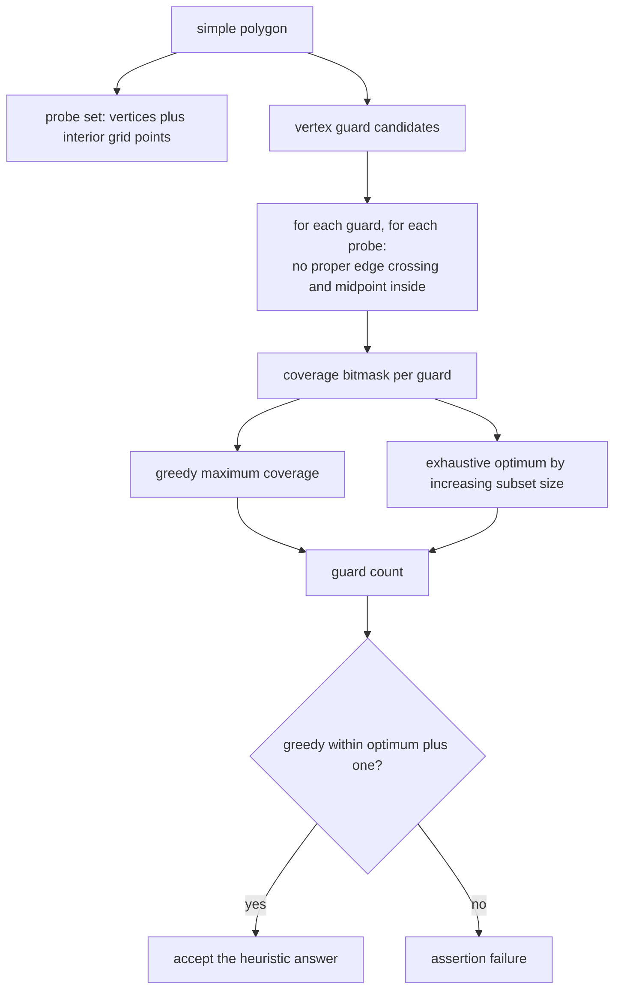
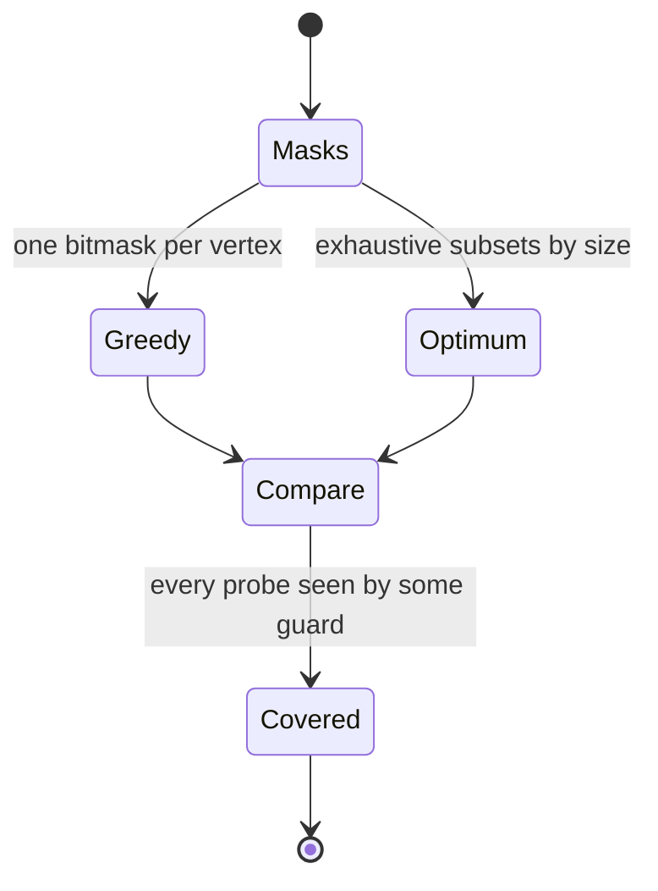
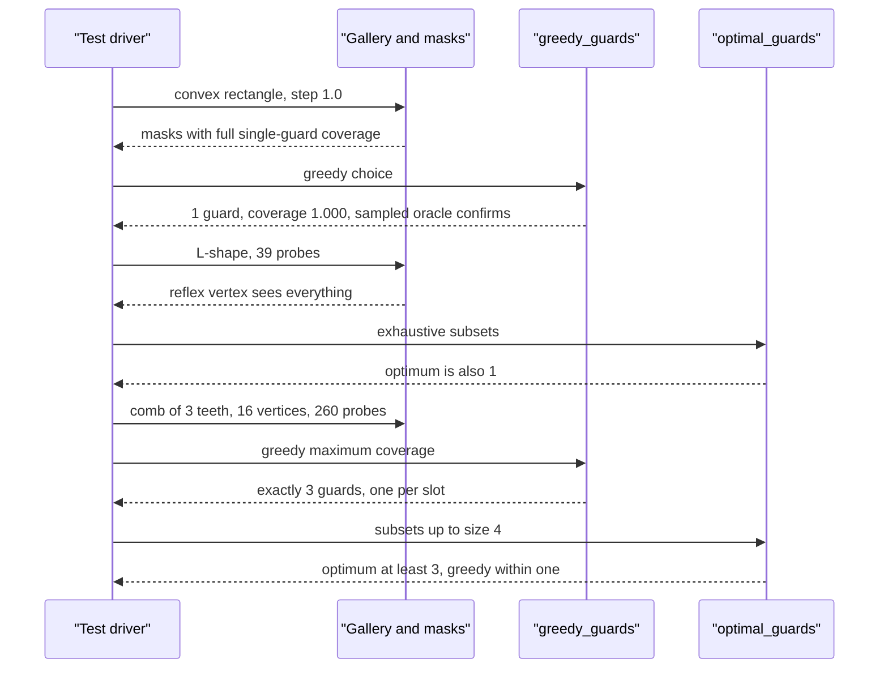

# 741 — Implement Art Gallery problem approximation heuristics

> **Tier:** Expert · **CTCI chapter:** Beyond — Graphics, Geometry & Robotics
> **Task spec:** [741-implement-art-gallery-problem-approximation-heuristics.md](../../../tasks/expert/741-implement-art-gallery-problem-approximation-heuristics.md)
> **Solutions:** [Python](../../../solutions/python/expert/741-implement-art-gallery-problem-approximation-heuristics/solution.py) ·
> [Java](../../../solutions/java/expert/741-implement-art-gallery-problem-approximation-heuristics/Solution.java) ·
> [JavaScript](../../../solutions/javascript/expert/741-implement-art-gallery-problem-approximation-heuristics/solution.js) ·
> [C#](../../../solutions/csharp/expert/741-implement-art-gallery-problem-approximation-heuristics/Solution.cs)

## 1. Problem restatement

Choose a small set of **vertex guards** that sees every point of a simple polygon — the art gallery
problem, which is NP-hard in general, with the classical theorem that `floor(n/3)` guards always
suffice for an `n`-gon. The solution pairs a heuristic with two things that make it verifiable: an
exact visibility predicate and an exact optimum on small instances.

| Piece | Signature | Meaning |
| --- | --- | --- |
| `Gallery(polygon, step)` | object | simple polygon, exact visibility, and a deterministic probe set |
| `build_probes(step)` | list | every polygon vertex plus the interior grid points of spacing `step` |
| `point_inside(polygon, p, allow_boundary=True)` | bool | even-odd ray cast with a `Fraction` crossing test |
| `proper_cross(a, b, p, q)` | bool | segment *interiors* meet (touching does not count) |
| `visible(guard, target)` | bool | no proper edge crossing and the midpoint inside |
| `sampled_visible(guard, target, samples=120)` | bool | independent dense-sampling oracle |
| `coverage_masks()` | one bitmask per vertex | the entire coverage model in one object |
| `greedy_guards(masks)` | `(chosen, covered)` | repeatedly take the vertex with the largest uncovered gain |
| `optimal_guards(masks, limit)` | list or `None` | exhaustive search over vertex subsets by increasing size |
| `coverage_fraction(guards, masks)` | float | covered probes over total probes |

Concrete results the tests assert:

- the convex rectangle `(0,0)-(6,4)` needs exactly `1` guard, and the exhaustive optimum is also `1`;
- the L-shape `(0,0), (6,0), (6,2), (2,2), (2,6), (0,6)` has `39` probes, coverage `1.000`, `1` greedy
  guard and `1` optimal guard;
- the three-tooth comb has `16 = 4 * 3 + 4` vertices, `260` probes and needs exactly `3` guards; its
  deep slot probes share no seeing vertex, so no guard can pay for two slots;
- greedy is never worse than `optimum + 1` on every instance tested.

## 2. Intuition

The naive reading — "place guards until every point is seen" — is not an algorithm, because "every
point" is an infinite set. Three reductions turn it into something implementable and checkable:

1. **Guards at vertices.** Restricting guards to polygon vertices is a standard restriction (an
   optimal solution of the vertex-guard variant exists with guards at vertices), and it makes the
   search space finite: at most `n` positions.
2. **Coverage measured on a deterministic probe set.** The area is replaced by a grid of probe points
   plus every polygon vertex. A grid can only *under-report* coverage — it never claims a region is
   seen without a witness point — so the heuristic cannot cheat, and the resolution effect is visible
   in the tests: covering a finer grid cannot take fewer guards.
3. **Greedy maximum coverage is the heuristic.** Repeatedly take the vertex that sees the most
   not-yet-seen probes. It is the classic `1 - 1/e`-style greedy, and on these instances it stays
   within one guard of the exhaustive optimum.

Visibility itself must be exact, because the polygons have reflex vertices where a naive
"does the segment cross an edge?" test is not sufficient: for the L-shape, a segment from one arm to
the other can avoid crossing an edge properly and still leave the polygon through a reflex corner, so
the **midpoint inside** test is what settles it.



## 3. Algorithm

1. Store the polygon as a float vertex list and build the edge list (consecutive pairs plus the
   closing pair).
2. `build_probes(step)`: start with every polygon vertex, then walk the bounding box on a `step` grid
   and keep the points that are inside the polygon. The vertex list is why coverage of the boundary is
   checked at all.
3. `point_inside`: even-odd ray cast; a point on the boundary returns `allow_boundary`; the crossing
   abscissa is computed as a `Fraction` so an integer grid point cannot flip its inside/outside status
   by rounding.
4. `visible(guard, target)`: identical points are visible; both endpoints must be inside; no polygon
   edge may cross the segment *properly* (`orient` products strictly of opposite signs on both sides);
   and the midpoint must be inside.
5. `coverage_masks`: for every vertex guard, one integer whose bit `i` is set when the guard sees
   probe `i`. This is the whole coverage model, and every later step is bit arithmetic.
6. `greedy_guards`: while the covered mask is not full, pick the candidate with the largest
   `bin(mask & ~covered).count("1")` gain, add it, and union its mask. Ties go to the lowest vertex
   index, which is what makes the result reproducible.
7. `optimal_guards`: enumerate subsets of increasing size (`combinations`) and return the first one
   whose union covers all probes; a `limit` bounds the search on larger instances.
8. Verification: every chosen guard is a vertex index, every probe is seen by some guard under both
   the exact predicate and the sampled oracle, the comb's slots are provably independent, and the
   results are deterministic.

```text
procedure build_probes(step)
    probes ← copy of the polygon vertices
    for i ← 0 to floor((max x - min x) / step) do
        for j ← 0 to floor((max y - min y) / step) do
            p ← (min x + i step, min y + j step)
            if point_inside(polygon, p) then append p to probes
    return probes

procedure visible(guard, target)
    if guard = target then return true
    if not point_inside(polygon, guard) or not point_inside(polygon, target) then return false
    for each polygon edge (p, q) do
        if proper_cross(guard, target, p, q) then return false
    return point_inside(polygon, midpoint(guard, target))

procedure coverage_masks
    for each vertex guard in the polygon do
        mask ← 0
        for index, probe in probes do
            if visible(guard, probe) then set bit index of mask
        append mask to masks
    return masks

procedure greedy_guards(masks)
    full ← (1 shifted left by number of probes) - 1
    covered ← 0, chosen ← empty list
    while covered ≠ full do
        best ← none, best_gain ← 0
        for index, mask in masks do
            if index in chosen then continue
            gain ← popcount(mask and not covered)
            if gain > best_gain then best ← index, best_gain ← gain
        if best is none or best_gain = 0 then break
        append best to chosen
        covered ← covered or masks[best]
    return chosen, covered

procedure optimal_guards(masks, limit)
    full ← (1 shifted left by number of probes) - 1
    for size ← 1 to min(limit, number of masks) do
        for subset in combinations of indices of length size do
            covered ← union of the subset masks
            if covered = full then return subset
    return none
```



## 4. Worked example

The convex rectangle `(0,0)-(6,4)` with `step = 1.0`:

| Quantity | Value |
| --- | --- |
| probes | polygon vertices plus interior grid points |
| greedy guards | `1` |
| exhaustive optimum | `1` |
| coverage | `1.000` — every probe seen, including under the sampled oracle |

One guard at a corner sees the whole convex polygon, which is the theorem's easiest case and the test
that the coverage model is not accidentally requiring more.

The L-shape `(0,0), (6,0), (6,2), (2,2), (2,6), (0,6)` is the first non-convex instance:

| Quantity | Value |
| --- | --- |
| probes | `39` |
| greedy guards | `1` |
| exhaustive optimum | `1` |
| coverage | `1.000` |

A single guard at the reflex vertex `(2,2)` sees both arms of the L, which is why greedy and the
exhaustive search agree exactly here — the case where the midpoint test matters, because segments from
one arm to the other pass close to the reflex corner.

The comb is where the count becomes interesting. `comb(teeth)` builds `teeth` narrow slots of depth
`10` hanging below a spine of height `10`, with `4 * teeth + 4` vertices in total:

| Instance | Vertices | Probes | Greedy guards | Exhaustive optimum |
| --- | --- | --- | --- | --- |
| `comb(2)` | `12` | `182` | `2` | `>= 2` |
| `comb(3)` | `16` | `260` | `3` | `>= 3` |

The lower bound is structural, not empirical: two slots cannot see each other, because the segment
between them would have to leave the polygon through the boundary. The tests make that explicit by
computing, for each of the three deep slot probes `(4i + 2, -9)`, the set of vertices that see it, and
asserting that the three sets are pairwise **disjoint** — so one guard can never pay for two slots:

| Probe | Seeing vertices (by `x`) |
| --- | --- |
| `(2, -9)` | `0, 1, 3` |
| `(6, -9)` | `5, 7` |
| `(10, -9)` | `9, 11` |

Together with `len(chosen) <= teeth + 1` and `len(chosen) >= teeth`, that pins greedy to exactly
`teeth` guards on combs. The classical bound `floor(n/3)` is consistent with this: for `comb(3)`,
`floor(16/3) = 5 >= 3`.

The grid-resolution check is the model's honesty test: on `comb(2)`, `step = 0.5` produces `611`
probes against `52` for `step = 2.0`, and the guard count for the finer grid must be `>=` the count
for the coarser one — both come out at `2`, because every probe added can only make coverage harder.



## 5. Complexity

| Operation | Time | Space | Reason |
| --- | --- | --- | --- |
| Probe construction | `O(A / step^2 * n)` | `O(A / step^2)` | each grid point is tested against `n` edges |
| One visibility test | `O(n)` | `O(1)` | every edge is checked for a proper crossing |
| Coverage masks | `O(n * P * n)` = `O(n^2 P)` | `O(n P)` bits | `n` guards against `P` probes, each test `O(n)` |
| Greedy | `O(k n P)` bit operations | `O(n P)` | `k` rounds, each scanning `n` masks of `P` bits |
| Exhaustive optimum | `O(2^n * n P)` worst case | `O(n P)` | subsets by increasing size, bounded by `limit` |
| Alternative: exact integer programming | exponential | — | what the heuristic replaces |

`n` vertices and `P` probes; the probe count is the model's resolution knob and the only parameter
that trades accuracy for speed. On `comb(3)` that is `16` guards, `260` probes and `3` greedy rounds.

## 6. Pitfalls and edge cases

- **A convex polygon must need exactly one guard** — if the coverage model demanded two, the model
  would be wrong, not the polygon.
- **The probe set must include every polygon vertex**, otherwise coverage of the boundary (exactly
  where reflex visibility fails) would be unchecked.
- **The midpoint test is not optional**: at a reflex vertex a segment can leave the polygon without
  crossing an edge properly, and only the midpoint-inside check catches it.
- **`proper_cross` uses strict sign products**, so touching a boundary does not count as a crossing;
  the visibility decision then lives entirely in the midpoint test, which uses `allow_boundary=True`
  to tolerate a segment running along an edge.
- **A degenerate zero-height polygon must not crash the gallery** (`rectangle(0, 0, 4, 0)`), and a
  polygon smaller than the grid step (`0.5 x 0.5` with `step = 1.0`) must still need — and get —
  exactly one guard, covering the vertex probes even though the interior grid is empty.
- **Guards are vertices**: every chosen guard must be a polygon vertex index, and the count can never
  exceed the vertex count.
- **Greedy must not be allowed to stall**: the loop breaks when no candidate has a positive gain, which
  can only happen if some probe is seen by no vertex at all.
- **Greedy ties must be deterministic** — the candidate scan takes the *first* strictly better gain, so
  equal gains resolve to the lowest vertex index, and the tests rebuild the masks and re-run greedy to
  confirm identical output.
- **The exhaustive optimum must be affordable**: it is only run on small instances (the comb search is
  limited to `teeth + 1`), because `2^n` subsets of a mesh polygon would be hopeless.
- **The approximation is documented as a model, not a proof**: a grid can only under-report coverage,
  so a "fully covered" verdict is honest, while a claim about the *continuous* polygon is not made.
- **Documented simplifications**: guards restricted to vertices, coverage measured on the deterministic
  grid instead of the continuum, greedy instead of an exact solver, and the exhaustive optimum used
  only as an oracle on small polygons.

## 7. Variants and follow-ups

- **Fisk's triangulation argument** proves `floor(n/3)` guards suffice by 3-colouring the triangles and
  taking a colour class; that construction is what
  [742 — ear-clipping triangulation](../../../tasks/expert/742-implement-polygon-triangulation-ear-clipping-and-improvement.md)
  supplies, and it also gives a polynomial-time guarantee where greedy gives none.
- **Point guards instead of vertex guards** strictly increase the search space (guards may sit anywhere
  on the boundary or in the interior) and destroy the finiteness argument used here.
- **Polygons with holes** break the simple-polygon visibility test and typically need the edges of the
  holes added to the crossing test; the sampled oracle generalises unchanged.
- **The visibility relation itself** is the shared primitive with
  [740 — visibility graph path planning](../../../tasks/expert/740-implement-visibility-graph-path-planning-for-polygons.md)
  and with [739 — probabilistic roadmaps](../../../tasks/expert/739-implement-prm-probabilistic-roadmap-for-motion-planning-small.md)
  when the geometry is sampled instead of exact.

## 8. Check yourself

<details><summary>Show answer</summary>
**Why restrict guards to polygon vertices?**
Because it makes the candidate set finite (`n` positions instead of a continuum), and the vertex-guard
variant always admits an optimal solution at vertices. Every guard invariant the tests check — "each
chosen guard is a polygon vertex index" — relies on this restriction, and it is also what makes the
exhaustive optimum enumerable.
</details>

<details><summary>Show answer</summary>
**The L-shape is non-convex yet one guard suffices. Which vertex, and why does the midpoint test
matter there?**
The guard sits at the reflex vertex `(2,2)`, from which both arms are visible. Near a reflex vertex a
segment can pass outside the polygon without crossing an edge *properly* (it may only touch at the
vertex), so the crossing test alone would wrongly call such a pair visible; requiring the midpoint to
be inside rejects it.
</details>

<details><summary>Show answer</summary>
**Why does a comb of `k` teeth need exactly `k` guards?**
Because the slots are mutually invisible: a segment between two slots would have to leave the polygon
through the boundary. The tests do not rely on that reasoning alone — they compute the seeing vertex
set of the deep probe `(4i + 2, -9)` in each slot and assert the three sets are pairwise disjoint, so
a single guard cannot cover two slots, and every slot needs one.
</details>

<details><summary>Show answer</summary>
**Coverage is scored on probe points instead of the whole area. Is that a weakness?**
It is a documented approximation with a known direction of error: a grid can only *under-report*
coverage, because a probe is a witness. The tests exploit the monotonicity — refining `step` from
`2.0` to `0.5` adds probes and can never *reduce* the guard count — so the model degrades gracefully
towards the continuous problem instead of giving false confidence.
</details>

<details><summary>Show answer</summary>
**Why compare greedy with an exhaustive subset search rather than with the `floor(n/3)` theorem?**
Because the theorem is a worst-case upper bound, not the optimum of these instances: on the L-shape the
optimum is `1` while `floor(6/3) = 2`. The exhaustive search over the *same* masks gives the true
optimum of the discrete instance, which is the meaningful comparison for a heuristic — and the tests
enforce the standard approximation claim, "never worse than optimum + 1".
</details>
