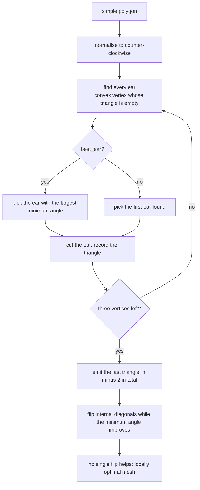
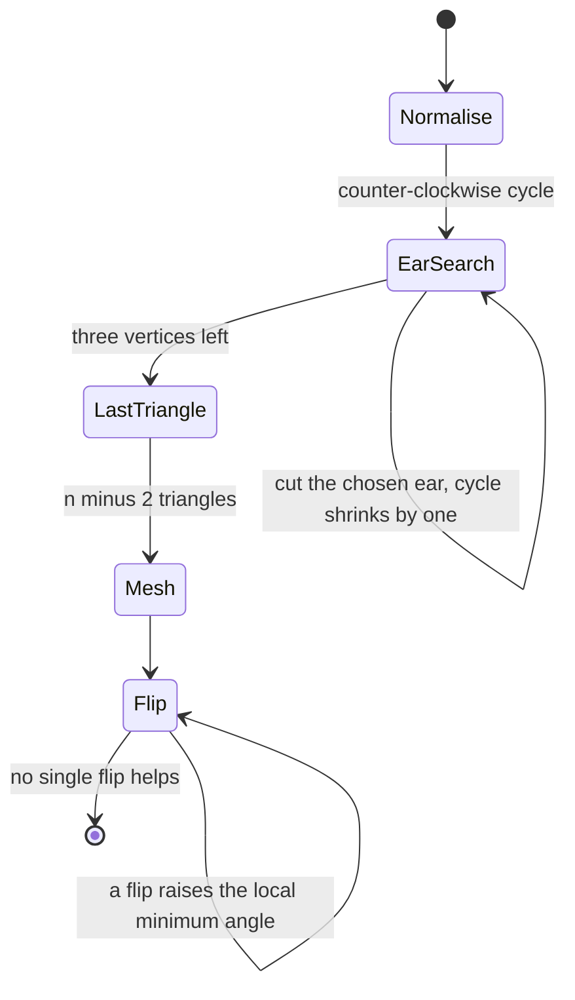
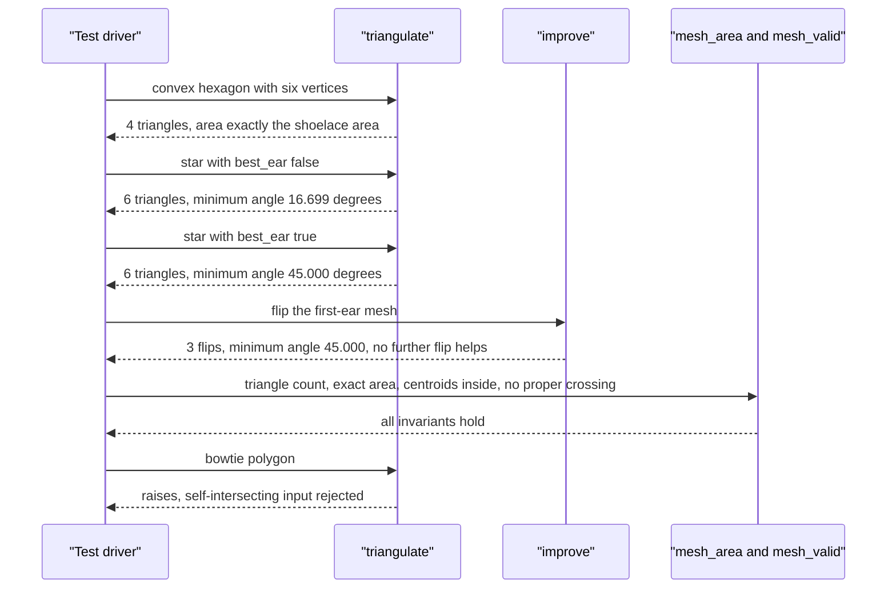

# 742 — Implement polygon triangulation (ear clipping) and improvement

> **Tier:** Expert · **CTCI chapter:** Beyond — Graphics, Geometry & Robotics
> **Task spec:** [742-implement-polygon-triangulation-ear-clipping-and-improvement.md](../../../tasks/expert/742-implement-polygon-triangulation-ear-clipping-and-improvement.md)
> **Solutions:** [Python](../../../solutions/python/expert/742-implement-polygon-triangulation-ear-clipping-and-improvement/solution.py) ·
> [Java](../../../solutions/java/expert/742-implement-polygon-triangulation-ear-clipping-and-improvement/Solution.java) ·
> [JavaScript](../../../solutions/javascript/expert/742-implement-polygon-triangulation-ear-clipping-and-improvement/solution.js) ·
> [C#](../../../solutions/csharp/expert/742-implement-polygon-triangulation-ear-clipping-and-improvement/Solution.cs)

## 1. Problem restatement

Triangulate a simple polygon by **ear clipping**, then improve the resulting mesh. A vertex is an
*ear* when the triangle of its two neighbours and itself is convex (on a counter-clockwise traversal)
and contains no other polygon vertex; repeatedly cutting ears leaves three vertices, i.e. exactly
`n - 2` triangles. *Which* ear to cut is free, and that freedom is the improvement:

| Piece | Signature | Meaning |
| --- | --- | --- |
| `orient(a, b, c)` | int | exact integer orientation, `> 0` counter-clockwise |
| `is_simple(polygon)` | bool | no two non-adjacent edges cross properly, no repeated vertex |
| `is_ear(polygon, cycle, position)` | bool | convex in the traversal order and empty of other vertices |
| `triangulate(polygon, best_ear=True)` | index triples | ear clipping, best-minimum-angle choice or first-found |
| `best_flip(triangles, points)` | tuple or `None` | the single diagonal flip that raises the local minimum angle most |
| `improve(triangles, points)` | `(mesh, flips)` | flip until no single flip improves anything |
| `mesh_min_angle` / `mesh_area` / `mesh_valid` | scalars / bool | the quality and validity measures |

Combinatorial decisions are exact (`orient` on integers, `Fraction` areas), while angles are floats
used **only** as a quality score, never inside a predicate. Concrete results the tests assert:

- the star-shaped polygon has `6 = n - 2` triangles; the first-ear rule gives a minimum angle of
  `16.699°`, the best-ear rule `45.000°`, and the flip pass reaches `45.000°` in `3` flips;
- triangle areas sum **exactly** to the shoelace area of the polygon (`Fraction` equality, no
  tolerance) for the hexagon, L-shape, star and zigzag;
- the improved mesh keeps the triangle count and the area, and `best_flip` returns `None` — no single
  flip improves it any further;
- a bowtie is rejected up front, a clockwise polygon is normalised rather than rejected, and a
  triangle returns a single triangle.

## 2. Intuition

Ear clipping is the greedy answer to a combinatorial fact: **every simple polygon with at least four
vertices has at least two ears** (the two-ear theorem). Cut one off and the remainder is still a
simple polygon, so the process terminates after exactly `n - 2` cuts.

That leaves three practical questions:

1. **What is an ear, exactly?** Two conditions: the triangle must be convex in the traversal
   direction (`orient(a, b, c) > 0` after normalising to counter-clockwise), and it must contain no
   other polygon vertex — including on its boundary, which is why the containment test is a
   closed-triangle sign test.
2. **Which ear to cut?** Cutting the first one found is trivial but shape-blind. Cutting the ear with
   the largest minimum angle is a shape-aware greedy that costs more per round; the star shows the
   difference: `16.699°` versus `45.000°`.
3. **Can a finished mesh be improved?** Yes, by **diagonal flipping**: for every internal edge shared
   by two triangles, if the quadrilateral is convex, replace the edge with the other diagonal when
   that raises the smallest of the six angles involved. Flipping ends in a state no single flip can
   improve (`best_flip` returns `None`), which is the standard local optimality statement.



## 3. Algorithm

1. Validate: at least three vertices, no repeated consecutive vertices, and `is_simple` — no proper
   crossing between non-adjacent edges.
2. Normalise the traversal: if the exact shoelace area is negative, reverse the index cycle so every
   ear test uses the same orientation convention.
3. Loop while the cycle has more than three vertices: for each position, test `is_ear`. Score each ear
   by `min_angle` when `best_ear` is set, otherwise score it `0`, and keep the best choice.
4. Cut the chosen ear: append the triple of *indices* (sorted, so the triangle key is canonical) and
   delete the vertex from the cycle. If no ear exists at all, raise — the polygon was not simple.
5. Emit the remaining three vertices as the last triangle, giving exactly `n - 2` triangles.
6. `improve`: build the undirected edge-to-triangles map, consider every internal edge, skip it when
   the quadrilateral is not convex (checked with `proper_cross` of the two opposite vertices), compute
   the current local minimum angle and the candidate one, and take the flip with the largest strictly
   positive gain. Repeat until no flip helps.
7. Verification: positive areas, vertex provenance, centroids inside the polygon, no triangle edge
   crossing a polygon edge properly, exact area summation, and the two comparisons that make the
   improvement claim meaningful — best-ear versus first-ear, and flipped versus unflipped.

```text
procedure triangulate(polygon, best_ear)
    if len(polygon) < 3 or not is_simple(polygon) then
        raise "ear clipping needs a simple polygon with at least three vertices"
    cycle ← indices 0 .. n-1
    if signed_area(polygon) < 0 then reverse cycle
    triangles ← empty list
    while len(cycle) > 3 do
        choice ← none
        for position in 0 .. len(cycle) - 1 do
            if not is_ear(polygon, cycle, position) then continue
            score ← min_angle of the three vertices when best_ear, else 0
            if choice is none or score > choice.score then choice ← (score, position)
        if choice is none then raise "no ear found - the polygon is not simple"
        append the sorted triple around choice.position to triangles
        delete cycle[choice.position]
    append the sorted remaining cycle to triangles
    return triangles

procedure is_ear(polygon, cycle, position)
    previous ← cycle[position - 1], current ← cycle[position], following ← cycle[position + 1]
    a ← polygon[previous], b ← polygon[current], c ← polygon[following]
    if orient(a, b, c) ≤ 0 then return false
    for each other index in cycle except the three do
        if closed_triangle_contains(a, b, c, polygon[other]) then return false
    return true

procedure improve(triangles, points)
    mesh ← triangles, flips ← 0
    loop
        best ← best_flip(mesh, points)
        if best is none then return mesh, flips
        replace the two triangles sharing the edge with the flipped pair
        flips ← flips + 1

procedure best_flip(triangles, points)
    best ← none
    for each internal edge (u, v) shared by exactly two triangles do
        p ← the opposite vertex of the first, q ← the opposite vertex of the second
        if p = q or the quadrilateral is not convex then continue
        current ← min of the two triangle minimum angles
        candidate ← min of the two minimum angles after flipping to (p, u, q) and (p, q, v)
        if candidate > current and (best is none or candidate > best.score) then
            best ← (candidate, the two triangle indices, the flipped pairs)
    return best
```



## 4. Worked example

The star `(0,0), (3,-4), (6,0), (10,3), (6,6), (3,10), (0,6), (-4,3)` is strongly non-convex, so the
ear choice matters. Every run produces `n - 2 = 6` triangles and the same total area:

| Rule | Minimum angle of the mesh | Notes |
| --- | --- | --- |
| first ear found | `16.699°` | the thin sliver that a blind greedy leaves behind |
| best ear (largest minimum angle) | `45.000°` | the shape-aware choice |
| best ear, then flip pass | `45.000°` | the flip pass on the first-ear mesh reaches the same value in `3` flips |

The improvement chain is asserted in stages, which is what makes it verifiable rather than anecdotal:

| Step | Assertion |
| --- | --- |
| first-ear mesh | `6` triangles, area exactly the shoelace area, `mesh_valid` true |
| best-ear mesh | same count and area, minimum angle strictly better than first-ear |
| flip pass on the first-ear mesh | `flips > 0` (`3`), triangle count unchanged, area unchanged, still valid, `min_angle(improved) > min_angle(first)`, and `best_flip(improved) is None` |
| flipped versus greedy | `min_angle(improved) >= min_angle(best_ear)` to `1e-9`, and improving the best-ear mesh stays valid |

`best_flip(improved) is None` is the interesting one: it is not "we stopped", it is "no single flip
can raise the local minimum angle any more", which is the local-optimality certificate this
construction can actually offer.

The exactness of the invariants is the other half of the story:

| Polygon | Triangles | Area check |
| --- | --- | --- |
| convex hexagon `(0,0), (4,0), (6,2), (4,4), (0,4), (-2,2)` | `4` | `Fraction` equality with the shoelace area |
| L-shape | `4` | exact equality |
| star | `6` | exact equality (both rules) |
| zigzag | `6` | `24.0` exactly |
| square `(0,0)-(4,4)` | `2` | `16` exactly |

A sum of triangle areas equal to the polygon area, together with "every triangle is inside the
polygon", is what proves the triangles are pairwise interior-disjoint: if two of them overlapped, the
sum would exceed the area. That is why the tests spend their effort on the area identity rather than on
a pairwise overlap scan.

Rejection and boundary behaviour:

| Input | Outcome |
| --- | --- |
| bowtie `(0,0), (4,4), (4,0), (0,4)` | `ValueError` — self-intersecting, rejected by `is_simple` |
| `[(0,0), (1,1)]`, `[(0,0), (0,0), (1,1)]`, `[]` | `ValueError` — fewer than three vertices |
| triangle `(0,0), (5,0), (0,5)` | a single triangle |
| clockwise L-shape | normalised (cycle reversed), triangulated just as well |
| star triangulated twice | identical output — deterministic |



## 5. Complexity

| Operation | Time | Space | Reason |
| --- | --- | --- | --- |
| `is_simple` | `O(n^2)` | `O(1)` | every edge pair is tested |
| One `is_ear` test | `O(n)` | `O(1)` | every remaining vertex is tested against the triangle |
| Ear search per round | `O(n^2)` | `O(1)` | `O(n)` candidates, each `O(n)` to verify |
| Ear clipping, whole run | `O(n^3)` | `O(n)` | `n - 2` rounds |
| With a doubly linked list and ear caching | `O(n^2)` | `O(n)` | the standard optimisation, not used here |
| `improve` | `O(flips * n)` | `O(n)` | each pass scans the internal edges |

The quadratic-per-round version is deliberate: it keeps every predicate exact and readable, and the
files work on polygons with at most a few dozen vertices. The `O(n^2)` improvement (linked list plus
an ear cache) changes no predicate.

## 6. Pitfalls and edge cases

- **A non-simple polygon must be rejected up front**, not triangulated into garbage: the bowtie is
  caught by `is_simple`, and `triangulate` also raises if it ever finds no ear, which is the backstop
  for a polygon that slipped through.
- **Orientation must be normalised first**: a clockwise polygon has `orient(a, b, c) < 0` at every
  convex vertex, so every ear test would fail. Reversing the cycle is the fix, and the clockwise
  L-shape test asserts it works.
- **Ear containment is a *closed* triangle test**: a vertex lying exactly on the ear's edge makes the
  ear illegal, which is why `closed_triangle_contains` uses `>= 0` on all three signs.
- **Degenerate inputs**: fewer than three vertices, repeated consecutive vertices, and an empty list
  all raise `ValueError`.
- **A triangle returns exactly one triangle** and a square exactly two with total area `16` — the
  `n - 2` rule must hold at the small end too.
- **Areas must be compared exactly**, not with a tolerance: they are `Fraction`s, so the tests use `==`
  and a rounded float would hide a real overlap or a missing sliver.
- **Angles are floats, but never predicates**: `min_angle` only ever scores and compares meshes, so its
  rounding cannot flip a combinatorial decision. Mixing the two roles is the classic way to make a
  triangulator non-deterministic.
- **Flipping must not change the count or the area** — it replaces two triangles with the other two,
  and the tests check both properties after every improvement run.
- **Flipping only convex quadrangles**: a non-convex quad would produce inverted triangles, which
  `proper_cross(points[p], points[q], points[u], points[v])` filters out.
- **Local optimality is not global optimality**: `best_flip(...) is None` means no single flip helps,
  not that the mesh is Delaunay-quality. The tests state the local claim and stop there.
- **Determinism**: the ear scan takes the first strictly better score and the flip scan takes the
  largest strictly better gain, so identical input gives identical meshes — asserted by re-running both
  stages.

## 7. Variants and follow-ups

- **Delaunay refinement** replaces the flip loop with a lift-and-locally-optimise criterion (or an
  in-circle test), targeting the empty-circumcircle property rather than the minimum angle.
- **Constrained Delaunay triangulation** keeps prescribed edges (holes, break lines) during flipping —
  the natural generalisation, outlined in
  [743 — constrained Delaunay triangulation](../../../tasks/expert/743-implement-constrained-delaunay-triangulation-outline.md).
- **Ear caching and a doubly linked cycle** turn the `O(n^3)` clip into `O(n^2)` with no change to the
  predicates; the JavaScript solution's notes describe a one-sided variant of the same idea.
- **The visibility machinery is shared** with
  [740 — visibility graph path planning](../../../tasks/expert/740-implement-visibility-graph-path-planning-for-polygons.md)
  and [741 — art gallery approximation](../../../tasks/expert/741-implement-art-gallery-problem-approximation-heuristics.md),
  where the same `orient` and inside tests decide what a guard or a route can see.

## 8. Check yourself

<details><summary>Show answer</summary>
**Why does ear clipping always terminate after exactly `n - 2` triangles?**
Because of the two-ear theorem: every simple polygon with at least four vertices has at least two
ears. Cutting one ear of an `n`-gon leaves a simple `(n - 1)`-gon, so the process can continue until
three vertices remain, and each cut removed exactly one vertex: `n - 2` triangles.
</details>

<details><summary>Show answer</summary>
**The star's minimum angle jumps from `16.699°` to `45.000°` when the ear choice changes. What is the
first-ear rule doing wrong?**
It cuts without looking at shape, so it can slice off a very flat sliver early and leave a mesh with a
nearly degenerate triangle. The best-ear rule scores each candidate ear by its minimum angle and takes
the largest, which is a greedy quality criterion rather than a geometric necessity — and the assertion
demands the strict improvement (`> first + 1e-9`) to prove the criterion does something.
</details>

<details><summary>Show answer</summary>
**Why is the *exact* area identity `sum triangle areas == shoelace area` such a strong check?**
Together with "every triangle lies inside the polygon" it proves pairwise interior-disjointness: if two
triangles overlapped, the sum would strictly exceed the area. Using `Fraction` equality means a
single missing sliver or a duplicated region shows up immediately, whereas a float tolerance would
absorb exactly the errors worth catching.
</details>

<details><summary>Show answer</summary>
**What does `best_flip(improved, star) is None` certify?**
That no single internal-edge flip can raise the local minimum angle any further — the mesh is locally
optimal with respect to the flip neighbourhood. It is *not* a claim of global optimality, and the tests
deliberately do not make one.
</details>

<details><summary>Show answer</summary>
**Why are angles allowed to be floats while orientations must be exact?**
Because they play different roles. An orientation decides whether a vertex is convex or whether a
triangle is empty — a wrong answer changes the topology of the result. An angle only *scores* two
candidate ears or meshes against each other, and a rounding difference there can at worst pick an
equally good alternative; the deterministic tie-breaks keep even that reproducible.
</details>
