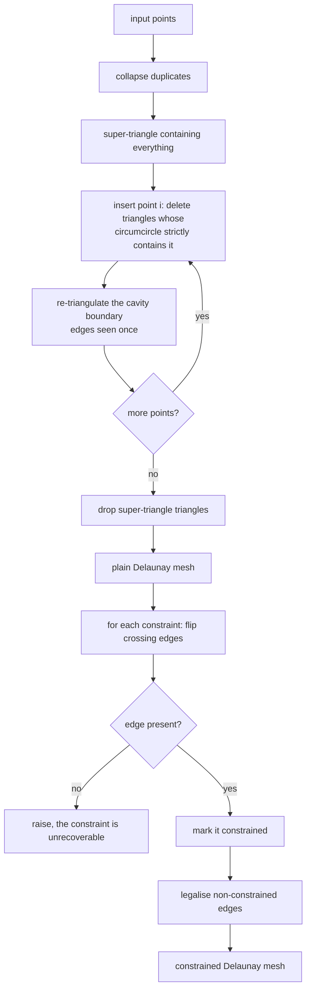
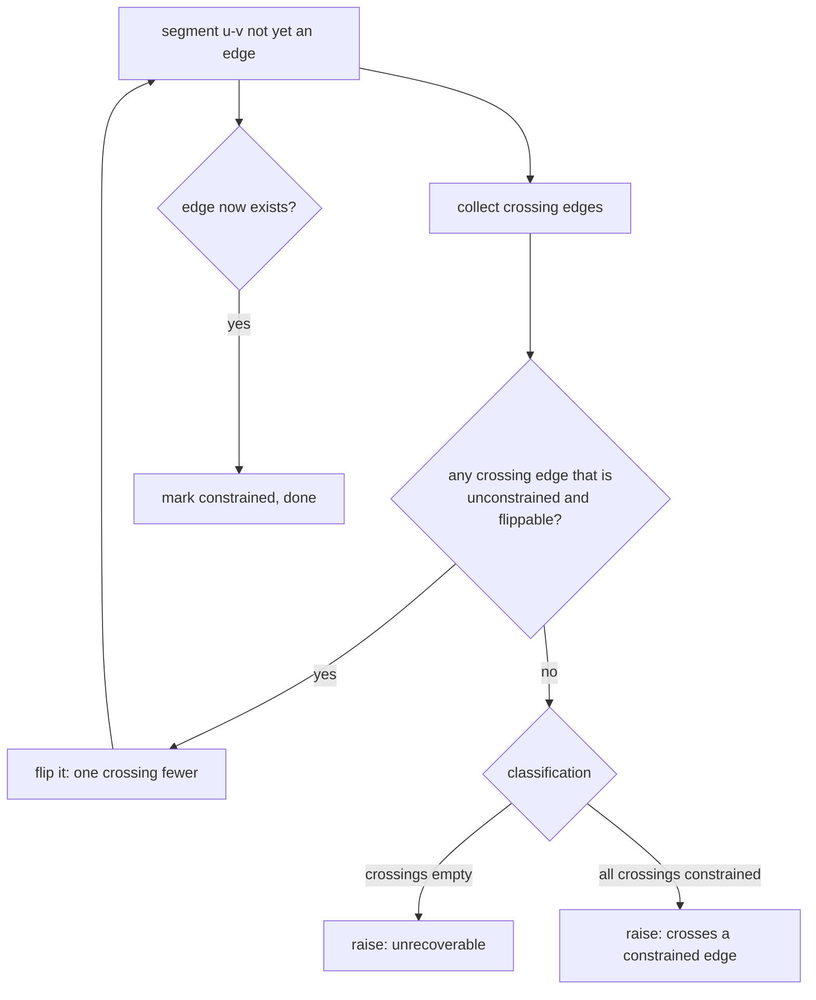
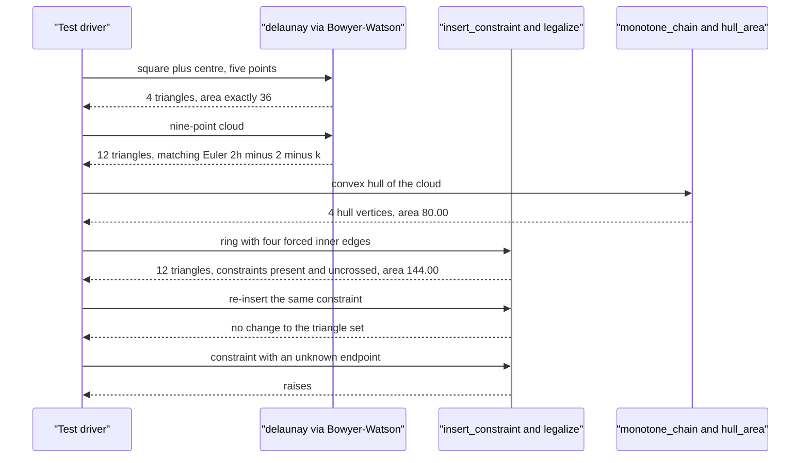

# 743 — Implement constrained Delaunay triangulation outline

> **Tier:** Expert · **CTCI chapter:** Beyond — Graphics, Geometry & Robotics
> **Task spec:** [743-implement-constrained-delaunay-triangulation-outline.md](../../../tasks/expert/743-implement-constrained-delaunay-triangulation-outline.md)
> **Solutions:** [Python](../../../solutions/python/expert/743-implement-constrained-delaunay-triangulation-outline/solution.py) ·
> [Java](../../../solutions/java/expert/743-implement-constrained-delaunay-triangulation-outline/Solution.java) ·
> [JavaScript](../../../solutions/javascript/expert/743-implement-constrained-delaunay-triangulation-outline/solution.js) ·
> [C#](../../../solutions/csharp/expert/743-implement-constrained-delaunay-triangulation-outline/Solution.cs)

## 1. Problem restatement

Build a triangulation of a point set in which **prescribed edges survive**: a plain Delaunay mesh
first, then forced segments, then legalisation that may only flip the edges that are not constrained.

| Stage | Entry point | What it does |
| --- | --- | --- |
| 1. Delaunay | `delaunay(points)` | Bowyer-Watson with exact integer predicates; returns index triples |
| 2. Constraints | `Mesh.insert_constraint(u, v)` | forces segment `u-v` by flipping the edges that cross it |
| 3. Legalisation | `Mesh.legalize()` | flips non-constrained interior edges until the local Delaunay test holds |
| Predicates | `orient`, `incircle`, `counter_clockwise` | integer determinants, no epsilon |
| Inspection | `total_area`, `local_delaunay_ok`, `positively_oriented`, `constraint_present`, `no_crossed_constraint` | the verified invariants |
| Oracles | `monotone_chain`, `hull_area`, `euler_triangle_count` | independent hull, area and count checks |

Concrete results the tests assert:

- the square plus its centre `(0,0), (6,0), (6,6), (0,6), (3,3)` triangulates into exactly `4`
  triangles whose areas sum to `Fraction(36)` — the square minus nothing, i.e. exactly filling it;
- the nine-point cloud `(0,0), (10,0), (10,8), (0,8), (2,3), (5,6), (8,2), (4,4), (7,5)` gives `12`
  triangles, matching Euler's formula `2h - 2 - k = 2 * 9 - 2 - 4 = 12`, with total area equal to the
  independently computed convex-hull area `80.00`;
- the ring with an inner quadrangle constrained by four edges keeps `12` triangles and tiles the outer
  square exactly (`144.00`), with every constrained edge present and uncrossed;
- collinear points yield no triangles, a single point or two points yield none, and duplicate input
  points collapse.

## 2. Intuition

Delaunay triangulation is the "nicest" triangulation: no point lies inside the circumcircle of a
triangle. Constrained Delaunay keeps that property **where it is allowed to** — a constrained edge
blocks legalisation, so the mesh is locally Delaunay everywhere except across forced segments.

Three ideas carry the implementation:

1. **Bowyer-Watson is incremental and predicate-driven.** Start with a huge super-triangle, insert
   points one at a time: delete every triangle whose circumcircle *strictly* contains the new point,
   then re-triangulate the cavity boundary with the new point. The boundary is simply the set of edges
   that appear exactly once among the deleted triangles — a count, not a geometric walk. Finally drop
   the triangles that touch the super-triangle.
2. **A constraint is forced by flipping the edges that cross it.** Each flip replaces a crossing
   diagonal with the other one, strictly decreasing the number of crossings; when no crossing edge is
   flippable the segment is reported as unreachable rather than silently ignored. Constrained edges are
   never flipped, so earlier constraints survive.
3. **Legalisation must respect the constraints.** The local Delaunay test (is the opposite vertex
   inside the adjacent triangle's circumcircle?) is applied to non-constrained interior edges only,
   flipping until none fails.



## 3. Algorithm

1. `delaunay(points)`: deduplicate the input (keeping input order), build a super-triangle strictly
   containing every point, and start from that triangle.
2. For each point in insertion order: collect the triangles whose circumcircle strictly contains the
   point (`incircle > 0` on a counter-clockwise triple), count the edges of those triangles, delete
   them, and add a triangle from every edge seen exactly once (the cavity boundary) to the new point.
3. Drop the triangles that use any super-triangle vertex; the result is the Delaunay triangulation of
   the cleaned point set.
4. `insert_constraint(u, v)`: while the edge is absent, find the edges crossing the segment internally
   (orientations of opposite signs on both segments, ignoring edges that touch `u` or `v`), take the
   first that is not constrained and whose quadrilateral is convex, flip it, and repeat. A constraint
   that cannot progress raises: it either crosses a constrained edge or is unrecoverable.
5. `legalize()`: repeat until no violation — find an interior, non-constrained edge whose opposite
   vertex lies inside the adjacent circumcircle, and flip it. The loop is bounded by `n^2 + 10` rounds
   so a pathological input cannot spin forever.
6. `constrained_delaunay(constraints)`: insert every constraint, then legalise.
7. Verification: triangle count equals `2h - 2 - k`; areas sum exactly to the independent hull area;
   every constrained edge is present and crossed by nothing; the local Delaunay test holds on all
   non-constrained interior edges; no triangle is degenerate; and duplicate or degenerate inputs
   behave as documented.

```text
procedure delaunay(points)
    clean ← deduplicated points
    if len(clean) < 3 then return no triangles, clean
    all ← clean plus a super-triangle that contains everything
    triangles ← {the super-triangle}
    for index in 0 .. len(clean) - 1 do
        bad ← empty set, boundary ← empty map
        for tri in triangles do
            a, b, c ← counter-clockwise order of the triangle vertices
            if incircle(a, b, c, all[index]) > 0 then
                add tri to bad
                for each of the three edges of tri do increment boundary[edge]
        remove bad from triangles
        for (edge, count) in boundary do
            if count = 1 then add triangle (edge[0], edge[1], index)
    return triangles without any super-triangle vertex, clean

procedure insert_constraint(u, v)
    for attempt in 0 .. len(points) squared + 10 do
        if edge (u, v) exists then mark it constrained and return
        crossings ← interior-crossing edges of the segment u-v
        if crossings is empty then raise "constraint is not recoverable"
        for edge in crossings do
            if edge is constrained then continue
            if flip(edge) then continue to the next attempt
        raise "constraint crosses a constrained edge"
    raise "constraint did not converge"

procedure legalize
    for round in 0 .. len(points) squared + 10 do
        violated ← none
        for each interior edge with two owners do
            if the edge is constrained then continue
            p ← the opposite vertex of the first triangle, q ← of the second
            a, b, c ← counter-clockwise order of (u, v, p)
            if incircle(a, b, c, q) > 0 then violated ← the edge and stop
        if violated is none then return
        if not flip(violated) then return        // not flippable: it stays legal enough
```



## 4. Worked example

The hand case, a square of side `6` with its centre `(3,3)`:

| Quantity | Value |
| --- | --- |
| distinct points | `5` |
| triangles | `4` — one per quadrant around the centre |
| total area | `Fraction(36)` exactly, i.e. `6 x 6` |
| local Delaunay | holds on all interior edges |
| degenerate triangles | none |

The four triangles share the centre, so the interior edges are the four spokes and each is Delaunay —
the centre is exactly the circumcentre of every quadrant triangle.

The nine-point cloud `(0,0), (10,0), (10,8), (0,8), (2,3), (5,6), (8,2), (4,4), (7,5)`:

| Check | Value |
| --- | --- |
| convex hull vertices (independent monotone chain) | `4` |
| Euler count `2h - 2 - k = 2 * 9 - 2 - 4` | `12` |
| triangles produced | `12` |
| total area | equals `hull_area(cloud) = 80.00` exactly |
| edge classification | interior edges plus hull edges satisfy the Euler relation, and the number of single-owner edges equals the number of hull points |

The last row is a structural cross-check on the mesh, not just on the count: `hull_edges` counted as
edges with exactly one owning triangle must equal the hull size computed by the monotone chain, and
`internal + hull == 3 * n - 3 - hull` is the edge form of Euler's formula.

The ring — outer square `(0,0), (12,0), (12,12), (0,12)` with an inner quadrangle
`(4,4), (8,4), (8,8), (4,8)` and its centre `(6,6)` — with four constrained edges
`(4,5), (5,6), (6,7), (7,4)`:

| Check | Value |
| --- | --- |
| triangles | `12` |
| constraints recorded | `4` |
| every constraint present in the mesh | yes |
| crossed constraints | none |
| total area | `144.00`, the outer square exactly |
| local Delaunay | holds on all non-constrained edges |

Boundary behaviour:

| Input | Result |
| --- | --- |
| one point, two points | no triangles |
| four collinear points | no triangles, but the four points are kept after deduplication |
| `(0,0), (0,0), (4,0), (0,4)` | the duplicate collapses: `3` clean points, `1` triangle |
| rectangle `(0,0)-(8,6)` with constraint `(0,2)` | `2` triangles, area `48`, diagonal forced |
| re-inserting an existing constraint | a no-op: the triangle set is unchanged |
| constraint `(0, 5)` on a four-point mesh | raises (`ValueError`/`IndexError`) — unknown endpoint |



## 5. Complexity

| Operation | Time | Space | Reason |
| --- | --- | --- | --- |
| Deduplication | `O(n)` expected | `O(n)` | insertion-ordered de-duplication |
| Bowyer-Watson | `O(n^2)` as written | `O(n)` triangles | every insertion rescans all triangles for the cavity |
| Cavity boundary extraction | `O(1)` per deleted triangle | `O(n)` | edge counting, no geometric walk |
| One `insert_constraint` | `O(n^2)` worst case | `O(1)` | each flip removes at least one crossing, at most `O(n^2)` scans |
| `legalize` | `O(n^2)` per round, bounded rounds | `O(1)` | scan-and-flip until the local test holds |
| Point location (the standard optimisation) | `O(log n)` per insertion | `O(n)` | what turns the build into `O(n log n)` expected |

The `O(n^2)` build is the classic Bowyer-Watson without a point-location structure; the file keeps it
because correctness and exactness are the points of the exercise, and the instances are small.

## 6. Pitfalls and edge cases

- **Predicates must be exact.** `orient` and `incircle` are integer determinants, and cocircular input
  is handled by the *strict* form of the incircle test (`> 0`), so a point exactly on a circumcircle
  neither deletes a triangle nor triggers a flip. A float epsilon would make the result depend on
  rounding.
- **The cavity boundary is derived, not walked**: edges counted once among the deleted triangles form
  the boundary. Walking edges geometrically is the usual source of bugs here.
- **The super-triangle must be far away**, scaled by `100 * span`, or its circumcircles interfere with
  real points and the triangle count comes out wrong; its triangles are dropped by vertex identity.
- **Duplicates collapse** (`dict.fromkeys`) and the cleaned list is returned, which is why the tests
  compare against `clean` rather than the raw input.
- **Fewer than three points, or collinear points, produce no triangles** — the code returns an empty
  set rather than raising, and the tests document that as the contract.
- **A constraint that crosses another constraint must be reported**, not forced: `insert_constraint`
  raises `"constraint crosses a constrained edge"` when no crossing edge can be flipped.
- **An unknown constraint endpoint must fail loudly** rather than index out of range silently — the
  tests accept either `ValueError` or `IndexError`.
- **Re-inserting an existing constraint is a no-op** (`if target in self.constraints: return 0`), so
  the triangle set is untouched.
- **Legalisation must skip constrained edges**, otherwise a constraint would be flipped away and the
  whole point of the constrained variant lost; `local_delaunay_ok` also skips them, which is why
  "locally Delaunay" is claimed only off the constraints.
- **Areas are compared exactly** with `Fraction`s against the independent hull area: a missing or
  overlapping triangle cannot hide behind a tolerance.
- **Determinism**: rebuilding reproduces the same mesh, which requires the insertion order and the
  flip choice to be fixed (the code flips the first improving, unconstrained crossing edge).
- **Documented simplifications (outline)**: constraints are inserted by flipping instead of
  re-triangulating a cavity, and the verified Delaunay property is the **local** one on the two
  triangles around a non-constrained edge rather than the global visibility-restricted CDT condition;
  duplicate input points are collapsed.

## 7. Variants and follow-ups

- **True CDT legalisation** replaces the local flip test with the visibility-restricted in-circle
  test (a flip may only happen when the quadrilateral is "visible" across the constraint), which
  yields the exact constrained Delaunay condition rather than the local one used here.
- **Incremental refinement** (Chew, Ruppert) inserts Steiner points to bound triangle quality, which
  is the natural step after the flip-based improvement in
  [742 — ear clipping and improvement](../../../tasks/expert/742-implement-polygon-triangulation-ear-clipping-and-improvement.md).
- **The dual structure** is the Voronoi diagram, which the same Delaunay mesh defines:
  [744 — Voronoi via Fortune's sweep line](../../../tasks/expert/744-implement-voronoi-diagram-via-fortune-s-sweep-line-outline.md).
- **Exactness at scale** — the orientation and incircle predicates used here are the same ones an
  adaptive-precision library provides:
  [745 — robust predicates for computational geometry](../../../tasks/expert/745-implement-robust-predicates-for-computational-geometry-exact-ari.md).

## 8. Check yourself

<details><summary>Show answer</summary>
**Why is the strict incircle test (`> 0`) the right form for Bowyer-Watson?**
Because a point exactly on a circumcircle is cocircular: deleting the triangle would create a
degenerate cavity and a duplicate edge on the boundary. The strict test leaves that triangle alone, and
the same strictness in `legalize` means cocircular edges are simply not flipped, which keeps the result
deterministic for grid-like input.
</details>

<details><summary>Show answer</summary>
**How is the cavity boundary found, and why is counting enough?**
The edges of all deleted triangles are counted; an edge that belongs to two deleted triangles is
interior to the cavity and appears twice, while a boundary edge appears once. So the new triangles are
exactly "edge counted once plus the new point" — no geometric walk around the cavity is needed.
</details>

<details><summary>Show answer</summary>
**Why can a constraint insertion fail, and what does the code do about it?**
Because a crossing edge can be unflippable — its quadrilateral may be non-convex, so replacing the
diagonal would create inverted triangles. If no crossing edge can be flipped, the segment either
crosses an already-constrained edge (the constraints are mutually inconsistent) or is unrecoverable,
and `insert_constraint` raises rather than returning a mesh that silently omits the constraint.
</details>

<details><summary>Show answer>
**The mesh is only "locally" Delaunay off the constraints. What is the difference from the true CDT
condition?**
The true condition restricts legalisation by visibility across the constraint: an edge may only be
flipped when the quadrilateral is visible through the constrained segment. The outline checks the
plain local test on the two triangles around each non-constrained edge, which is what can be verified
by a single in-circle determinant pair, and documents the difference explicitly.
</details>

<details><summary>Show answer>
**Why compare the triangle area sum with an independently computed hull area?**
Because it is the cheapest check that the mesh covers the convex hull exactly once: a missing triangle
loses area, an overlap gains area, and an independently built hull (monotone chain) gives the target
value without reusing any of the triangulation code. Combined with positive orientation and the Euler
count, it pins the mesh both combinatorially and geometrically.
</details>
