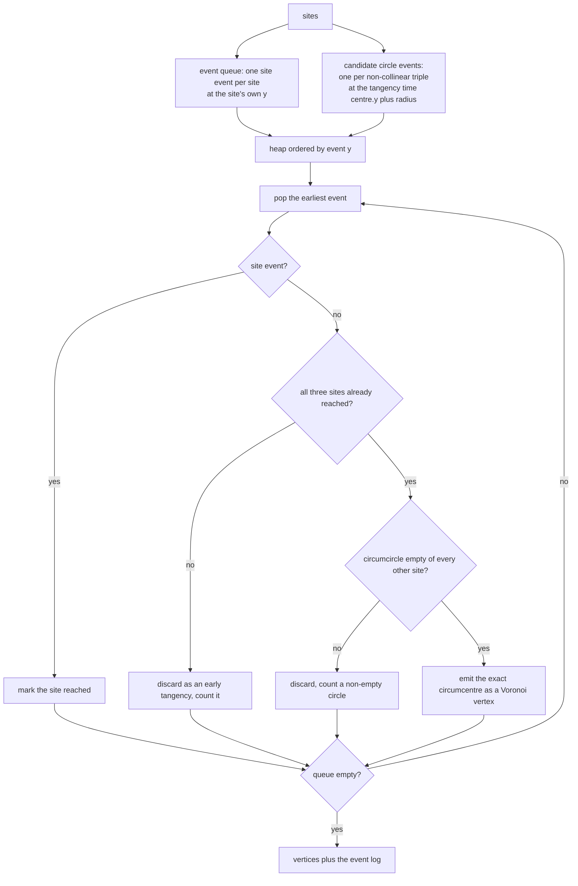
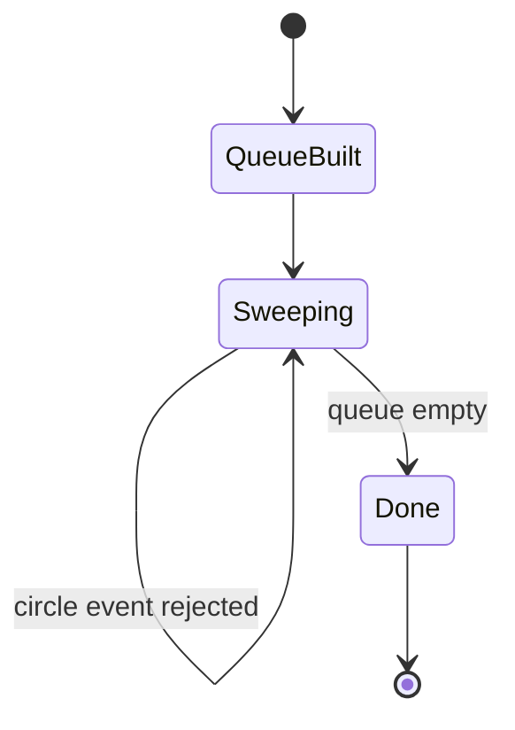
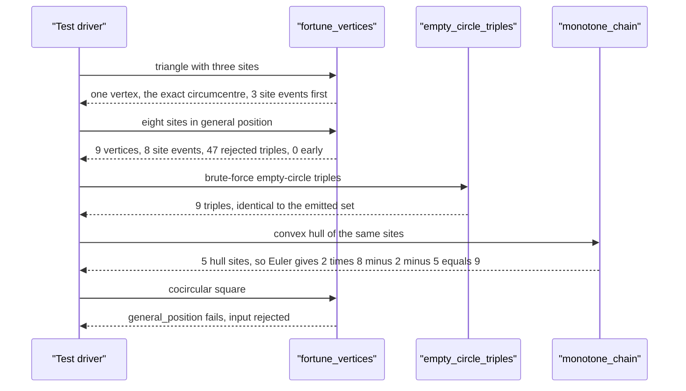

# 744 — Implement Voronoi diagram via Fortune's sweep-line (outline)

> **Tier:** Expert · **CTCI chapter:** Beyond — Graphics, Geometry & Robotics
> **Task spec:** [744-implement-voronoi-diagram-via-fortune-s-sweep-line-outline.md](../../../tasks/expert/744-implement-voronoi-diagram-via-fortune-s-sweep-line-outline.md)
> **Solutions:** [Python](../../../solutions/python/expert/744-implement-voronoi-diagram-via-fortune-s-sweep-line-outline/solution.py) ·
> [Java](../../../solutions/java/expert/744-implement-voronoi-diagram-via-fortune-s-sweep-line-outline/Solution.java) ·
> [JavaScript](../../../solutions/javascript/expert/744-implement-voronoi-diagram-via-fortune-s-sweep-line-outline/solution.js) ·
> [C#](../../../solutions/csharp/expert/744-implement-voronoi-diagram-via-fortune-s-sweep-line-outline/Solution.cs)

## 1. Problem restatement

Compute the **Voronoi vertices** of a planar point set with Fortune's sweep line. A horizontal sweep
line moves downwards over the sites and two kinds of event drive it:

| Event kind | When it fires | What it means |
| --- | --- | --- |
| site event | at the site's own `y` | the site enters the beach line and starts carving an arc |
| circle event | at the tangency time `centre.y + radius` of a triple's circumcircle | two Voronoi edges end and the middle arc pinches off, so the tangency point **is** a Voronoi vertex |

| Piece | Signature | Meaning |
| --- | --- | --- |
| `orient(a, b, c)`, `incircle(a, b, c, d)` | int | exact integer determinants |
| `circumcenter(a, b, c)` | `Fraction` pair | exact rational circumcentre |
| `circle_is_empty(sites, triple)` | bool | the Delaunay condition for the triple |
| `fortune_vertices(sites)` | `(vertices, log, stats)` | the sweep: ordered event queue, tangency times, emitted vertices |
| `empty_circle_triples(sites)` | set | independent brute-force Delaunay oracle |
| `general_position(sites)` | bool | distinct `y` and no four cocircular sites |
| `voronoi_edge_count(vertices)` | int | dual edges: vertices whose triples share two sites |
| `monotone_chain(points)` | list | independent convex hull oracle |

Concrete results the tests assert on the eight sites `(0,0), (12,3), (5,7), (9,12), (2,16), (15,8),
(7,20), (18,1)`:

- `9` emitted vertices, exactly equal to the `9` empty-circle triples of the brute-force oracle, with
  Euler's formula `2h - 2 - k = 2 * 8 - 2 - 5 = 9` satisfied for `h = 5` hull sites;
- event statistics: `8` site events, `9` accepted circle events, `47` triples rejected because their
  circumcircle was not empty, `0` tangencies that fired before their own sites;
- every emitted vertex equals the exact rational circumcentre of its triple bit for bit, and no other
  site is strictly closer to it than the three defining sites;
- three sites produce exactly one vertex, the exact circumcentre of the triangle.

## 2. Intuition

Fortune's algorithm is normally described as maintaining a **beach line** — the parabolic envelope of
the sites already swept. The outcome, however, is driven by two facts that survive even without the
beach line:

1. **A Voronoi vertex is a circumcentre.** Where two Voronoi edges end, three sites are equidistant;
   the point is the circumcentre of those three sites, and it is emitted exactly when the sweep line
   becomes tangent to their circumcircle, i.e. at `y = centre.y + radius`.
2. **A circle event is only real when its circle is empty.** The beach line exists to prune candidate
   triples; the invariant it maintains is precisely the Delaunay condition — the circumcircle of an
   accepted triple contains no other site — and that condition can be checked directly with the exact
   integer `incircle` determinant.

So this outline keeps the sweep and the event queue exactly (site events at `y_i`, circle events at the
tangency time, processed in `y` order by a heap) and replaces the beach line by the invariant it
maintains. The consequence is documented honestly: the candidate list is all `O(n^3)` triples instead
of the `O(n log n)` beach-line sweep, so this is a small-input outline — but the events, their order,
their tangency times and the emitted vertices are the real thing, and every vertex is an exact
rational circumcentre, so no tolerance is used anywhere.



## 3. Algorithm

1. Build the event queue: for each site a **site event** at its own `y`; for each non-collinear triple a
   **circle event** at `centre.y + radius` of its circumcircle (`float` for ordering only — the vertex
   itself stays exact).
2. Precondition: `general_position(sites)` requires distinct `y` coordinates (so the sweep order is
   unambiguous) and no four cocircular sites (so no simultaneous tangencies); the test sites satisfy
   it, and the cocircular square is explicitly rejected by it.
3. Pop events in increasing `y`. A site event marks the site as reached and is logged.
4. A circle event is accepted only when **all three of its sites have already been reached** — a
   tangency cannot precede the sites that define it — and when `circle_is_empty` holds, i.e. every
   other site lies strictly *outside* the circumcircle (`incircle < 0`).
5. On acceptance, compute the exact rational circumcentre and emit it with its defining triple; the
   event log records the kind, the payload and the event time so the schedule itself can be verified.
6. Counters separate the three outcomes: accepted events, non-empty circumcircles, and early
   tangencies, which is what makes the pruning measurable.
7. Verification: the emitted triples equal the brute-force Delaunay triples; each vertex is its exact
   circumcentre; no other site is closer to a vertex than the defining three; the triangle count
   matches Euler's formula against an independent convex hull; event times are non-decreasing and
   tangencies fire at `centre.y + radius`; the sweep is deterministic.

```text
procedure fortune_vertices(sites)
    events ← empty heap
    for index, (x, y) in sites do
        push (y, site event, index)
    for each triple of indices with non-collinear sites do
        cx, cy ← exact circumcentre of the triple
        radius ← distance from (cx, cy) to the first site
        push (cy + radius, circle event, triple)
    reached ← empty set, vertices ← empty list, log ← empty list
    while events is not empty do
        event_y, kind, data ← pop the earliest event
        if kind = site event then
            add data to reached
            append ("site", data, event_y) to log
            continue
        if not all of data in reached then
            count an early tangency
            continue
        if not circle_is_empty(sites, data) then
            count a non-empty circle
            continue
        cx, cy ← exact circumcentre of the triple data
        append (cx, cy, data) to vertices
        append ("circle", data, event_y) to log
    return vertices, log, stats

procedure circle_is_empty(sites, triple)
    a, b, c ← the three sites
    if orient(a, b, c) = 0 then return false
    ordered ← a, b, c reordered counter-clockwise
    for every site not in triple do
        if incircle(ordered, site) ≥ 0 then return false
    return true
```



## 4. Worked example

The smallest interesting case, the triangle `(0,0), (10,1), (4,9)`:

| Quantity | Value |
| --- | --- |
| emitted vertices | `1` |
| defining triple | `{0, 1, 2}` |
| vertex | the exact rational circumcentre of the three sites |
| site events | `3`, all before the tangency (`early_events == 0`) |

The eight-site set in general position is the real test:

| Quantity | Value |
| --- | --- |
| sites | `8` |
| emitted vertices | `9` |
| brute-force empty-circle triples | `9` — the emitted set is equal to it |
| hull sites (independent monotone chain) | `5` |
| Euler check `2h - 2 - k` | `2 * 8 - 2 - 5 = 9` |
| site events | `8` (one per site) |
| accepted circle events | `9` |
| rejected: circumcircle not empty | `47` |
| rejected: tangency before its own sites | `0` |

The `47` rejections are the point of the exercise: without an empty-circle test the sweep would emit a
"vertex" for every one of the `56` triples, and `9` of them would be real. The `0` early tangencies
confirm the event ordering: a circle event can never fire before the site events of the sites that
define it.

Every accepted vertex is checked three ways:

| Check | Assertion |
| --- | --- |
| exactness | `x == exact_x and y == exact_y` on `Fraction`s, no tolerance |
| emptiness | every other site satisfies `incircle(...) < 0` against the vertex |
| proximity | no other site is strictly closer to the vertex than the three defining sites |

An inner point makes the structure more interesting — the set
`(0,0), (10,0), (10,10), (0,10), (3,4)` has an interior site surrounded by three triangles — and the
tests run three further site sets through the same full comparison (emitted triples equal to the
brute-force empty-circle triples, ordered event times, one site event per site).

Boundary cases:

| Input | Result |
| --- | --- |
| `[(3, 4)]`, `[(0,0), (5,2)]` | no vertices (fewer than three sites), but the site events still fire |
| collinear `(0,0), (2,1), (4,2), (6,3)` | no vertices (`4` site events) — a collinear triple has no circumcircle |
| cocircular square `(0,0), (10,0), (10,10), (0,10)` | fails `general_position` up front; the sweep may only return the degenerate reading of at most `2` vertices |



## 5. Complexity

| Operation | Time | Space | Reason |
| --- | --- | --- | --- |
| Event queue construction | `O(n^3)` | `O(n^3)` | one circle event per triple |
| `circle_is_empty` | `O(n)` | `O(1)` | every other site is tested |
| Sweep | `O(n^3 log n)` heap operations + `O(n^4)` predicates | `O(n^3)` | every triple is tested once against every site |
| Brute-force Delaunay oracle | `O(n^4)` | `O(n^3)` | same shape, recomputed independently |
| Real Fortune with a beach line | `O(n log n)` | `O(n)` | the sweep this outline emulates |
| Voronoi edge count | `O(V^2)` | `O(V^2)` | pairs of vertices sharing two sites |

The outline is deliberately `O(n^3)` in the candidate list, because replacing the beach line by the
empty-circle invariant is exactly what removes the need for the balanced arc structure the original
algorithm needs. It is the same trade the docstring documents: real events, real tangencies, exact
vertices, small inputs.

## 6. Pitfalls and edge cases

- **A collinear triple has no circumcentre** and therefore no circle event; `orient(a, b, c) == 0` skips
  it, and the collinear input set produces no vertices at all.
- **Cocircular input breaks the sweep's premise** (two tangencies at the same `y`), so
  `general_position` rejects it up front. The square test asserts the rejection *and* that the sweep
  degrades to at most a degenerate reading instead of producing nonsense.
- **Distinct `y` coordinates are required** for a well-defined sweep order; the same precondition
  function checks it.
- **A tangency may not precede its own sites**: the `early_events` counter is `0` on every accepted
  run, and the event-log replay independently asserts `set(triple) <= reached` for every circle event.
- **The event time must equal `centre.y + radius`** to `1e-9` — the geometry of the tangency is
  asserted, not assumed, and the tangency must lie at or below the three defining sites.
- **Vertices must be exact**: coordinates are `Fraction`s and the tests compare with `==`, so a float
  circumcentre would fail immediately. Only the *ordering* of events uses floats.
- **The empty-circle test is strict**: `incircle(...) < 0` for every other site is required, which is
  the Delaunay condition; a site exactly on the circle is excluded by the general-position
  precondition.
- **Fewer than three sites produce no vertices** but still consume their site events, which the tests
  check so that the counting is not quietly skipped.
- **Every site must appear** in some emitted triple or on the hull (`used | hull_sites == all sites`),
  a completeness check that catches a sweep that silently dropped part of the input.
- **Determinism**: the same site set must reproduce the same vertices, the same stats and the same
  event schedule, else the heap tie-breaking would leak into the result.
- **Documented simplification**: an `O(n^3)` candidate list with an empty-circle filter instead of a
  beach-line arc structure — the events, ordering, tangency times and exact vertices are real, the
  asymptotic complexity is not.

## 7. Variants and follow-ups

- **A real beach-line implementation** keeps a balanced tree of arcs, which prunes candidates to
  `O(n log n)`; the docstring records that a float beach line was tried and drifted from the exact
  envelope, which is why the exact-vertex outline is the one kept.
- **The dual graph** is the Delaunay triangulation: [743 — constrained Delaunay
  triangulation](../../../tasks/expert/743-implement-constrained-delaunay-triangulation-outline.md)
  builds the same triangles from the other side, and the triangle count here is cross-checked by the
  same Euler formula.
- **Farthest-point and higher-order Voronoi diagrams** replace the three-site circle event with an
  order-`k` event and are used for clustering and k-nearest-neighbour queries.
- **Exact predicates at scale** are provided by the libraries whose core is described in
  [745 — robust predicates for computational geometry](../../../tasks/expert/745-implement-robust-predicates-for-computational-geometry-exact-ari.md),
  which is what a production sweep would call instead of hand-rolled integer determinants.

## 8. Check yourself

<details><summary>Show answer</summary>
**What are the two event kinds, and when exactly does each fire?**
A site event fires at the site's own `y` and makes the site's arc appear on the beach line. A circle
event fires when the sweep line becomes tangent to the circumcircle of a triple, at
`y = centre.y + radius`; that tangency point is where two Voronoi edges meet, and the emitted vertex is
the triple's circumcentre.
</details>

<details><summary>Show answer</summary>
**Why can the empty-circle test replace the beach line?**
Because the beach line's only job is to decide which triples are worth considering, and the property it
guarantees is exactly the Delaunay condition: an accepted triple's circumcircle contains no other site.
Checking that condition directly with `incircle` therefore reproduces the same accepted set — at the
cost of testing all `O(n^3)` triples instead of the `O(n log n)` the sweep structure prunes to.
</details>

<details><summary>Show answer</summary>
**The eight-site run rejects 47 triples. What are they, and what does `early_events == 0` mean?**
They are triples whose circumcircle is not empty — a "tangency" would fire there without any real
Voronoi vertex existing, so they are discarded (`not_empty`). `early_events == 0` means no tangency
was ever popped before the site events of the sites that define it, which is the ordering property a
correct sweep must have.
</details>

<details><summary>Show answer>
**Why is cocircular input rejected rather than handled?**
Because a cocircular quadruple produces two tangencies at the same sweep position, and the sweep would
then have to decide the order of simultaneous events — a degenerate case whose handling depends on
tie-breaking rather than geometry. `general_position` rejects it explicitly (the square test asserts
this), and the sweep's answer for such input is documented as a degenerate reading only.
</details>

<details><summary>Show answer>
**Why is a Voronoi vertex emitted with its defining triple?**
Because the triple is the certificate: an independent checker can recompute the exact circumcentre and
verify that the circle is empty (`incircle < 0` for every other site) and that no other site is closer
to the vertex. Without the triple, a vertex would be an isolated coordinate that could only be trusted,
not verified — and the dual edge count (two vertices sharing two sites) would be impossible to compute.
</details>
