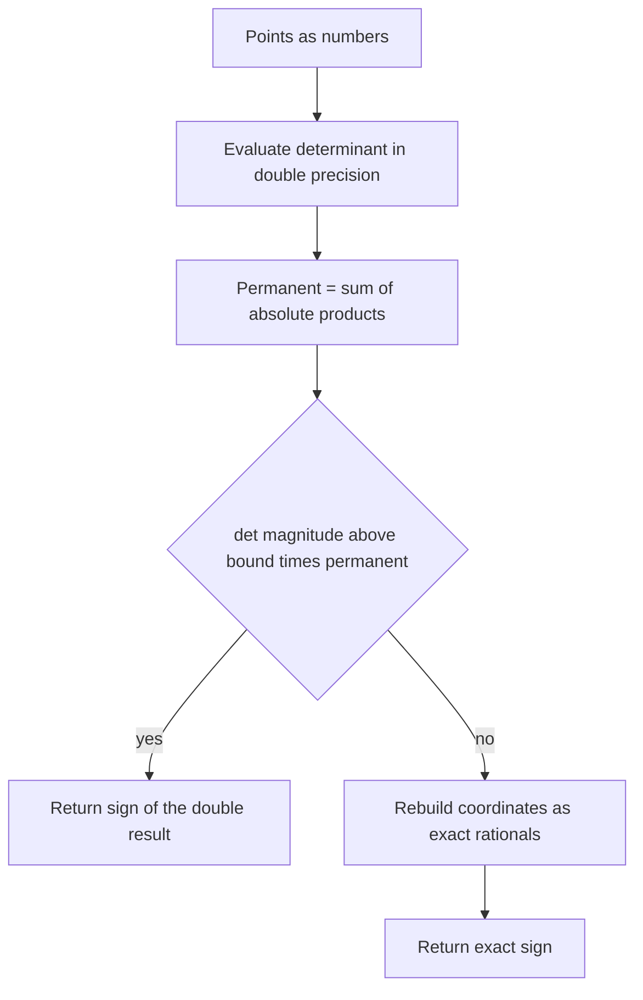
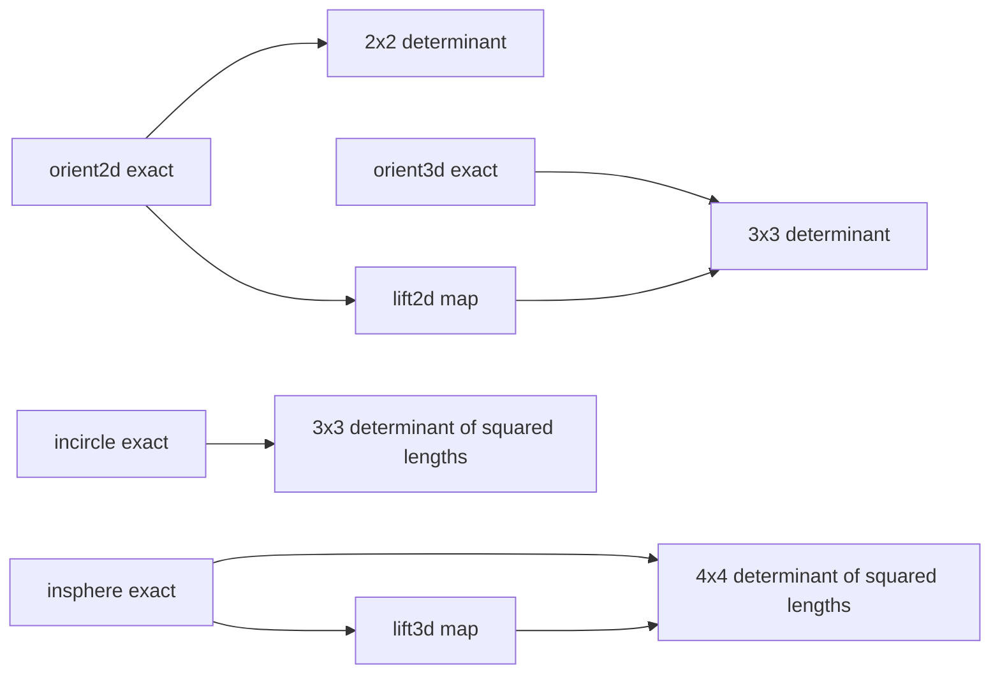
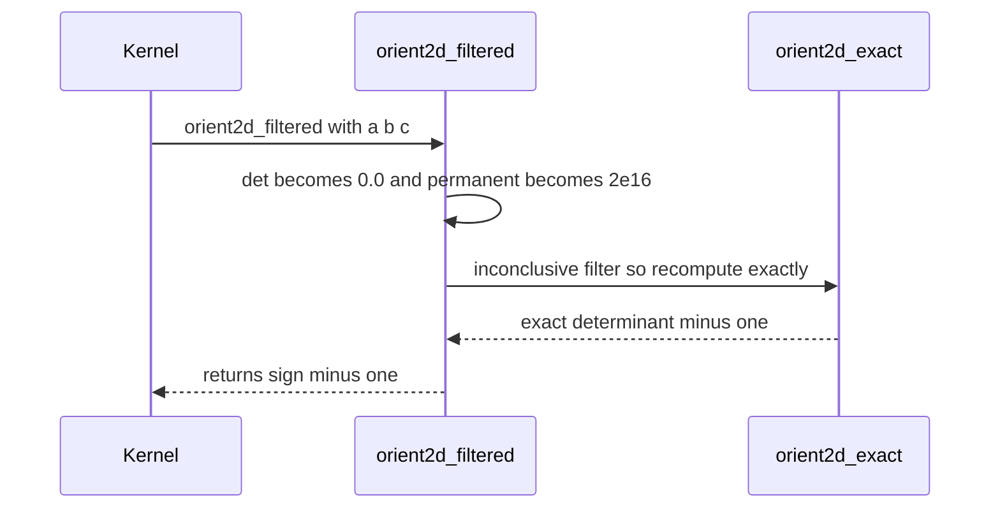

# 745 — Implement robust predicates for computational geometry (exact arithmetic)

> **Tier:** Expert · **CTCI chapter:** Beyond — Graphics, Geometry & Robotics
> **Task spec:** [745-implement-robust-predicates-for-computational-geometry-exact-ari.md](../../../tasks/expert/745-implement-robust-predicates-for-computational-geometry-exact-ari.md)
> **Solutions:** [Python](../../../solutions/python/expert/745-implement-robust-predicates-for-computational-geometry-exact-ari/solution.py) ·
> [Java](../../../solutions/java/expert/745-implement-robust-predicates-for-computational-geometry-exact-ari/Solution.java) ·
> [JavaScript](../../../solutions/javascript/expert/745-implement-robust-predicates-for-computational-geometry-exact-ari/solution.js) ·
> [C#](../../../solutions/csharp/expert/745-implement-robust-predicates-for-computational-geometry-exact-ari/Solution.cs)

## 1. Problem restatement

Every geometric kernel is built out of a handful of *predicates* — functions whose only job is to
return the **sign** of a determinant. The four implemented here are the classic ones:

| Predicate | Question it answers |
| --- | --- |
| `orient2d(a, b, c)` | is the turn `a → b → c` counter-clockwise, clockwise or straight? |
| `orient3d(a, b, c, d)` | is `d` below, above or on the plane through `a`, `b`, `c`? |
| `incircle(a, b, c, d)` | is `d` inside, outside or on the circle through `a`, `b`, `c`? |
| `insphere(a, b, c, d, e)` | is `e` inside, outside or on the sphere through `a`, `b`, `c`, `d`? |

Each predicate is exposed twice: an **exact** form that evaluates the determinant over rational
coordinates (`Fraction` in Python, `BigInteger`/`BigDecimal`-style rationals in the other
languages), and a **filtered** form that evaluates in IEEE double precision first, compares the
result against a conservative error bound, and only falls back to the exact form when the sign is
uncertain. Inputs are points given as tuples of numbers — integers, `Fraction`s or floats — in 2D
or 3D. Output is the exact determinant (a positive/negative number whose magnitude is normally
ignored) or, in the filtered form, just `-1`, `0` or `+1`.

Concrete behaviour asserted by the checks:

- `orient2d((0, 0), (1, 0), (0, 1)) == 1`, swapping the last two points gives `-1`, and the
  collinear triples `(0,0),(1,0),(2,0)` and `(0,0),(1,1),(2,2)` give *exactly* `0`.
- `incircle` on the corners `(0,0),(2,0),(2,2),(0,2)` gives exactly `0` — the fourth corner is
  cocircular; the centre `(1,1)` gives a positive value and `(9,9)` a negative one.
- `orient3d((0,0,0),(1,0,0),(0,1,0),(0,0,1)) == 1`, and flipping the last point to `(0,0,-1)`
  gives `-1`.
- `incircle(a, b, c, d) == -orient3d(lift2d(a), lift2d(b), lift2d(c), lift2d(d))` for random points,
  where `lift2d(x, y) = (x, y, x² + y²)`.
- The three adversarial configurations in `adversarial_orient2d_cases()` — e.g.
  `(0,0)`, `(1e8, 1e8+1)`, `(1e8+1, 1e8+2)` — have exact determinant `-1`, yet the plain double
  evaluation cancels to `0.0`, so the naive sign is wrong in all three cases while the filtered
  form stays correct.

## 2. Intuition

The naive idea is to evaluate the determinant in `double` and look at its sign. That works until
catastrophic cancellation eats the answer: the products that form `orient2d` are of size about
`10^16`, and their difference can be `±1`, which is far below the one-ulp spacing at that
magnitude, so the difference rounds to `0.0`. A kernel that (wrongly) believes three points are
collinear builds a degenerate triangulation, and the corruption spreads.

The key insight is that *exactness is only needed near zero*. Away from zero, plain double
arithmetic already has the right sign, and this can be proved: if the computed determinant is
larger in magnitude than a constant times the sum of the absolute values of the products that
formed it (the "permanent"), the rounding error cannot have flipped the sign. So the recipe is

1. evaluate in doubles,
2. compare against `bound × permanent`,
3. if the comparison is decisive, return that sign,
4. otherwise recompute exactly with rational arithmetic and return the exact sign.

The second insight ties the four predicates together: they are the same determinant in different
dimensions, linked by the *lifting maps* `(x, y) → (x, y, x² + y²)` and
`(x, y, z) → (x, y, z, x² + y² + z²)`. `incircle` is `orient3d` of the lifted 2D points up to sign,
so the two implementations cross-check each other exactly rather than merely agreeing on signs.



## 3. Algorithm

1. Normalise every coordinate with `frac`, which maps integers, rationals and floats to exact
   rational values (a float becomes the rational number it really is, not its decimal printout).
2. For `orient2d`, translate to the first point and evaluate the 2×2 determinant
   `(bx - ax)(cy - ay) - (by - ay)(cx - ax)` over rationals.
3. For `orient3d`, evaluate the 3×3 determinant of the edge vectors `b - a`, `c - a`, `d - a`;
   positive means `d` lies below the plane of a counter-clockwise `abc`.
4. For `incircle`, translate to `d` and evaluate the 3×3 determinant whose rows carry the squared
   lengths `|a - d|²`, `|b - d|²`, `|c - d|²`; positive means `d` is strictly inside.
5. For `insphere`, do the same in one more dimension with four lifted rows and subtract the
   `|d - e|²` row, positive for `e` strictly inside the positively oriented tetrahedron.
6. `orient2d_filtered` and `incircle_filtered` mirror the exact expressions in doubles, compute the
   permanent alongside, and return `sign(det)` when `abs(det)` exceeds `BOUND × permanent`; the
   constants are `3ε` for `orient2d` and `13ε` for `incircle` with `ε = 2.220446049250313e-16`.
7. When the filter is inconclusive, call the exact predicate and return its sign, so the filtered
   results are never wrong — they are only sometimes slower.

```text
function orient2d_exact(a, b, c)
    ax, ay ← frac(a)[0], frac(a)[1]
    bx, by ← frac(b)[0], frac(b)[1]
    cx, cy ← frac(c)[0], frac(c)[1]
    return (bx - ax) * (cy - ay) - (by - ay) * (cx - ax)

function orient2d_filtered(a, b, c)
    left ← (b.x - a.x) * (c.y - a.y)        # all in double precision
    right ← (b.y - a.y) * (c.x - a.x)
    det ← left - right
    permanent ← abs(left) + abs(right)
    if abs(det) > ORIENT2D_BOUND * permanent then
        return sign(det)
    return sign(orient2d_exact(a, b, c))

function lift2d(p)
    return (p.x, p.y, p.x * p.x + p.y * p.y)

function incircle_exact(a, b, c, d)
    u ← a - d ; v ← b - d ; w ← c - d
    return dot(u, u) * cross(v, w) - dot(v, v) * cross(u, w) + dot(w, w) * cross(u, v)
```



## 4. Worked example

Take the first adversarial configuration
`a = (0, 0)`, `b = (100000000, 100000001)`, `c = (100000001, 100000002)`.

Exact evaluation, with all coordinates integers:

| Quantity | Value |
| --- | --- |
| `bx - ax`, `cy - ay` | `100000000`, `100000002` |
| first product | `100000000 · 100000002 = 10000000000000000 + 200000000` |
| `by - ay`, `cx - ax` | `100000001`, `100000001` |
| second product | `100000001² = 10000000000000000 + 200000000 + 1` |
| exact determinant | `-1` |

Double evaluation: `2^53 = 9007199254740992`, and both products are about `1.0e16`, well above
that, so neither product is representable exactly and both round to the same double. Their
difference is therefore `0.0`, and the permanent is twice that value.

| Step | Value |
| --- | --- |
| `det` | `0.0` |
| `permanent` | about `2.0e16` |
| filter test | `0.0 > 3ε · 2.0e16` is **false** |
| action | fall back to the exact predicate |
| exact determinant | `-1` |
| returned sign | `-1` |

The naive helper `orient2d_naive_double` stops at `det = 0.0` and reports "collinear", which is
why the checks count it wrong on all three adversarial cases and count the filtered version wrong
on none.



## 5. Complexity

| Form | Time | Space | Reason |
| --- | --- | --- | --- |
| exact `orient2d` | O(1) rational operations | O(1) | a fixed 2×2 determinant; each operation costs as much as the bit length of its operands |
| exact `orient3d` / `incircle` | O(1) rational operations | O(1) | fixed 3×3 determinants |
| exact `insphere` | O(1) rational operations | O(1) | fixed 4×4 determinant |
| filtered predicate | O(1) double operations, plus the exact cost only when the filter is inconclusive | O(1) | one permanent and one comparison always; fallback is data-dependent |
| `cleared_denominator_det` oracle | O(1) integer operations on scaled coordinates | O(1) | independent formulation used to cross-check the rational one |
| naive double predicate | O(1) | O(1) | fastest, but provably wrong on the documented adversarial inputs |

The filtered form is the reason production kernels are fast *and* exact: the extra double work is a
handful of multiplications and one comparison, and the expensive exact path runs only for
near-degenerate configurations. Note that the exact form is not "slower by a constant" in a
machine-word sense — rational arithmetic grows with the input's bit length.

## 6. Pitfalls and edge cases

- **Zero is not a sign.** `sign(0) == 0` means "on the boundary", and callers must handle it
  explicitly (a collinear triple may need a point inserted rather than dropped).
- **Degenerate inputs must return exactly zero**, not a small number: the checks assert
  `orient2d((0,0),(1,0),(2,0)) == 0`, that the fourth square corner is cocircular, and that
  duplicated points (`orient2d((1,2),(1,2),(3,4))`, `incircle` with a repeated point,
  `orient3d` with a repeated point) give exact zeros in every predicate.
- **Antisymmetry.** Transposing two arguments must negate the result and cyclic permutations must
  leave it unchanged; both are verified for `orient2d` and for `insphere` against `(1, 1, 1)`.
- **The lifting identity has a sign.** The checks assert
  `incircle(...) == -orient3d(*lift2d(...))`; forgetting the minus flips inside and outside.
- **Mixed number types.** Coordinates may be ints, `Fraction`s or floats in the same call; the
  exact path converts each to a rational, and the filter path converts to double, so a float
  coordinate is treated as the double it is rather than its decimal literal.
- **Static filter bounds are load-bearing.** The constants `3ε`, `7ε`, `13ε`, `30ε` bound the
  rounding error for the specific expressions used; a tighter bound silently loses the soundness
  guarantee.
- **`circumsphere` raises on coplanar input.** The independent oracle used for `insphere` solves a
  3×3 rational system and rejects a zero determinant rather than returning a bogus sphere.
- **Determinism.** The same input must give the same values, which the checks verify for a fixed
  pair of triples.

## 7. Variants and follow-ups

- **Adaptive exact arithmetic** (Shewchuk's expansion arithmetic) replaces rational arithmetic with
  staged floating-point expansions, keeping the filter structure but avoiding general rationals.
- **Integer-only kernels** clear denominators once (as `cleared_denominator_det` demonstrates) and
  then use pure integer determinants; the sign is preserved because scaling all coordinates by a
  positive constant multiplies the determinant by its cube.
- **Interval arithmetic filters** bound the determinant from both sides and fall back when the
  interval straddles zero, with the same "exact only near zero" shape.
- Related work in this repository: the constrained Delaunay triangulation outline
  [743-implement-constrained-delaunay-triangulation-outline.md](../../../tasks/expert/743-implement-constrained-delaunay-triangulation-outline.md),
  Fortune's sweep for Voronoi diagrams
  [744-implement-voronoi-diagram-via-fortune-s-sweep-line-outline.md](../../../tasks/expert/744-implement-voronoi-diagram-via-fortune-s-sweep-line-outline.md),
  polygon triangulation by ear clipping
  [742-implement-polygon-triangulation-ear-clipping-and-improvement.md](../../../tasks/expert/742-implement-polygon-triangulation-ear-clipping-and-improvement.md)
  and visibility-graph path planning
  [740-implement-visibility-graph-path-planning-for-polygons.md](../../../tasks/expert/740-implement-visibility-graph-path-planning-for-polygons.md)
  are all consumers of exactly these predicates.

## 8. Check yourself

<details><summary>Show answer</summary>
**Why can the double evaluation be trusted when the determinant is large?**

Because the rounding error of the computed expression is bounded by a small constant times the sum
of the absolute values of the products that formed it. If `abs(det)` exceeds that bound, the true
value has the same sign as the computed one, so no fallback is needed.
</details>

<details><summary>Show answer</summary>
**What exactly goes wrong on `(0,0), (1e8, 1e8+1), (1e8+1, 1e8+2)`?**

Both products are about `1e16`, above `2^53`, so neither is exactly representable and both round to
the same double; the difference cancels to `0.0` even though the exact value is `-1`, i.e. the
points are very slightly clockwise. The filtered form detects that `0.0` is not decisively larger
than the error bound and recomputes exactly.
</details>

<details><summary>Show answer</summary>
**Why does `incircle` equal `-orient3d` of the lifted points?**

Lifting `(x, y)` to `(x, y, x² + y²)` turns "a point is inside the circle through three others" into
"the lifted point is on one side of the plane through the three lifted points". The sign flips
because the orientation of the lifting and the standard `orient3d` convention differ, which is why
the checks compare against `-orient3d`.
</details>

<details><summary>Show answer</summary>
**The predicate is exact — does that make a whole triangulation robust?**

No. Exactness removes the *predicate* failure, but the algorithm around it must still be
consistent: an exact-zero answer has to be resolved by a documented rule (insert, skip, perturb),
otherwise the same point set can produce different triangulations in different orders.
</details>

<details><summary>Show answer</summary>
**Why do the checks compare `incircle` with an integer determinant instead of trusting it?**

Because the two formulations are independently derived: one evaluates over rationals, the other
scales to integers and evaluates there with `Fraction` only in the scaling. Agreement on sign and on
zero detection is evidence that neither implementation has a transcription bug.
</details>
