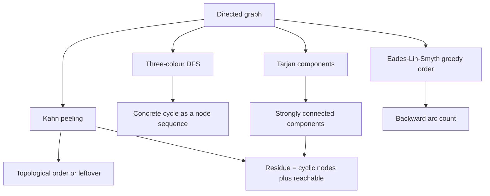
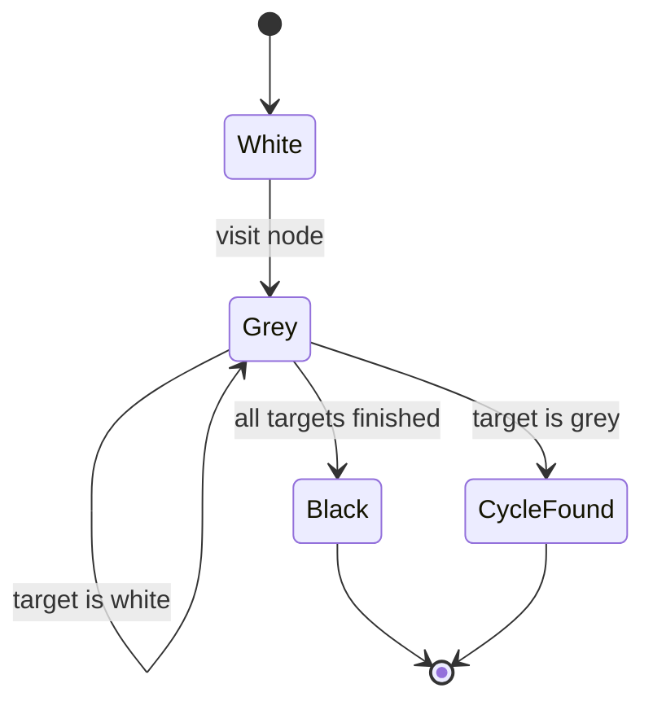
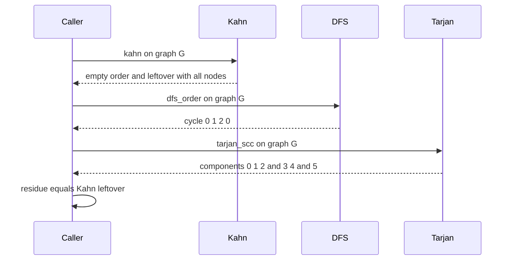

# 746 — Implement topological sort with cycle debugging and minimal feedback arc set heuristics

> **Tier:** Expert · **CTCI chapter:** Ch 4 — Trees and Graphs
> **Task spec:** [746-implement-topological-sort-with-cycle-debugging-and-minimal-feed.md](../../../tasks/expert/746-implement-topological-sort-with-cycle-debugging-and-minimal-feed.md)
> **Solutions:** [Python](../../../solutions/python/expert/746-implement-topological-sort-with-cycle-debugging-and-minimal-feed/solution.py) ·
> [Java](../../../solutions/java/expert/746-implement-topological-sort-with-cycle-debugging-and-minimal-feed/Solution.java) ·
> [JavaScript](../../../solutions/javascript/expert/746-implement-topological-sort-with-cycle-debugging-and-minimal-feed/solution.js) ·
> [C#](../../../solutions/csharp/expert/746-implement-topological-sort-with-cycle-debugging-and-minimal-feed/Solution.cs)

## 1. Problem restatement

Given a directed graph as a node list plus an edge list, the code has to answer three related
questions:

1. **Order it** — return a topological order when one exists, by two independent algorithms:
   Kahn's zero-in-degree peeling and a DFS whose post-order is reversed.
2. **Debug it** — when the graph is cyclic, do not just say "cyclic": extract a *concrete* cycle
   (the grey-stack segment of a three-colour DFS), and for larger residues condense the graph into
   its strongly connected components (Tarjan) and report which components are cyclic plus the
   "residue" — the cyclic components and everything reachable from them.
3. **Minimise backwards edges** — the feedback arc set is NP-hard, so compare three orderings: the
   naive input order, the Eades-Lin-Smyth greedy (GR), and, for graphs with at most 7 nodes, the
   exact optimum over all permutations.

Duplicate edges collapse, self-loops are *kept* because a self-loop is a cycle of length one, and
every routine is deterministic (heap-ordered Kahn, sorted adjacency, a fixed tie-break in GR).

Concrete behaviour the checks assert:

- The 6-node DAG with edges `0→1, 0→2, 1→3, 2→3, 3→4, 3→5, 1→5` yields a complete Kahn order with
  an empty leftover, a DFS order that is also topological, `tarjan_scc == [[0], [1], …, [5]]`, and
  `backward_arcs(order) == 0`.
- The cyclic graph `0→1, 1→2, 2→0, 2→3, 3→4, 4→3, 4→5` reports a real cycle (for example
  `[0, 1, 2, 0]`), yields `[[0, 1, 2], [3, 4], [5]]` from Tarjan (equal to the brute-force
  mutual-reachability oracle), and Kahn's leftover equals the residue `[0, 1, 2, 3, 4, 5]`.
- A directed triangle needs exactly one feedback arc: `min_fas_brute` returns `1` and `gr_order`
  achieves `1`.
- On the cyclic graph the greedy cost never beats the exact optimum and never loses to the naive
  order (both come out at `2` backward arcs here).
- Self-loops: the graph `0→0, 0→1, 1→2` orders to nothing, `find_cycle` returns `[0, 0]`, and
  `kahn` leaves `[0, 1, 2]`. The empty graph gives `([], [])`, `[]` and `None`; the single node `7`
  with a self-loop gives order `[]` and leftover `[7]`.

## 2. Intuition

The naive idea — "repeatedly print a node with no incoming edges" — is correct but useless when it
gets stuck: it tells you *that* there is a cycle without telling you *where*. The debugging
requirement is the interesting part, because a developer looking at a stuck build graph or a
dependency resolver needs a witness.

Three observations shape the design:

1. **Kahn's leftovers are exactly the cyclic part.** When peeling stops, every node still unpeeled
   is on a cycle *or* reachable from one — which is the residue, and it is precisely what an
   error message should show.
2. **Colours give a witness.** A DFS that paints nodes white (unvisited), grey (on the stack) and
   black (finished) hits a grey target exactly when it closes a cycle, and the slice of the stack
   between that target and the top *is* the cycle, in order.
3. **Component condensation shrinks the search.** Inside one strongly connected component a cycle
   always exists; between components the condensation is a DAG, so reachability on it explains the
   whole residue.

For the feedback arc set, the greedy heuristic is a "peel from both ends" idea: sinks must go to the
right end of the order and sources to the left, because in both cases every edge touching them points
forwards. Only when a pure cycle remains do we have to guess, and there the maximum
out-degree-minus-in-degree rule is the standard choice.



## 3. Algorithm

1. Build an adjacency **set** per node so duplicate edges collapse; keep `(v, v)` self-loops.
2. `kahn(graph)`: compute in-degrees, push all zero-in-degree nodes into a min-heap, repeatedly pop
   one into the order and decrement its targets, pushing new zeros. The heap and the sorted
   adjacency make the order deterministic.
3. `dfs_order(graph)`: recursive `visit` colours nodes grey while on the stack; on seeing a grey
   target it returns `stack[index(target):] + [target]`, which is the cycle. If no cycle is found,
   it returns the reversed post-order and `None`.
4. `is_topological(graph, order)` verifies an order by checking that every edge points forwards and
   that the order mentions exactly the graph's nodes; `is_cycle(graph, cycle)` verifies that every
   consecutive pair is an edge, that the last node repeats the first and that no node repeats
   inside.
5. `tarjan_scc(graph)`: iterative Tarjan with index/low-link bookkeeping and an explicit stack,
   emitting components in a deterministic order; `scc_brute` recomputes the same partition by
   mutual reachability as an independent oracle.
6. `condensation(graph, components)`: contract components and keep only inter-component edges; the
   result must be acyclic.
7. `cyclic_residue(graph, components)`: start from the cyclic components (size > 1, or a singleton
   with a self-loop) and take everything reachable from them in the condensation.
8. `gr_order(graph)`: repeatedly peel sinks to the right list and sources to the left list; when
   neither exists, remove the remaining node maximising `out-degree − in-degree` and append it to
   the left. Return `left + reverse(right)`.
9. `backward_arcs(graph, order)` counts edges whose source comes after their target; `min_fas_brute`
   enumerates all permutations for tiny graphs and returns the exact minimum.

```text
function kahn(graph)
    degrees ← in-degree of every node
    ready ← min-heap of nodes with in-degree 0
    order ← empty list
    while ready is not empty do
        node ← pop the smallest node from ready
        append node to order
        for target in sorted targets of node do
            degrees[target] ← degrees[target] - 1
            if degrees[target] = 0 then push target into ready
    leftover ← sorted nodes not in order
    return order, leftover

function dfs_order(graph)
    colour ← white for every node
    stack ← empty list
    order ← empty list
    visit node:
        colour[node] ← grey ; push node on stack
        for target in sorted targets of node do
            if colour[target] = grey then return stack[position of target ..] + [target]
            if colour[target] = white then
                cycle ← visit target
                if cycle is not none then return cycle
        pop node from stack ; colour[node] ← black ; append node to order
    for node in sorted nodes of graph do
        if colour[node] = white then
            cycle ← visit node
            if cycle is not none then return none, cycle
    return reverse of order, none

function gr_order(graph)
    remaining ← copy of graph ; left ← empty list ; right ← empty list
    while remaining is not empty do
        while a sink exists in remaining do move it to right
        while a source exists in remaining do move it to left
        if remaining is not empty then
            best ← node maximising out-degree minus in-degree in remaining
            move best to left
    return left + reverse of right
```



## 4. Worked example

Graph `G` on nodes `0..5` with edges `0→1, 1→2, 2→0, 2→3, 3→4, 4→3, 4→5`.

In-degrees: node 0 gets 1 (from 2), node 1 gets 1, node 2 gets 1, node 3 gets 2 (from 2 and 4),
node 4 gets 1, node 5 gets 1. No node has in-degree zero, so Kahn removes nothing.

| Step | Ready heap | Order | Leftover (unremoved) |
| --- | --- | --- | --- |
| initial | empty | `[]` | `{0, 1, 2, 3, 4, 5}` |
| after the loop | empty | `[]` | `{0, 1, 2, 3, 4, 5}` |

The DFS then produces a witness: from 0 it goes to 1, to 2, and from 2 the sorted target 0 is grey,
so the stack segment `[0, 1, 2]` plus the repeated target gives the cycle `[0, 1, 2, 0]`, which
`is_cycle` accepts because each consecutive pair is an edge and the last node repeats the first.

Tarjan returns the components `[0, 1, 2]`, `[3, 4]` and `[5]`. The residue starts from the two
cyclic components and follows the condensation edges, which adds `5` because `4→5` crosses out of
`[3, 4]`. That is exactly Kahn's leftover, as the checks assert.

For the ordering heuristic, GR first peels the only sink `5` to the right, then hits the cycle
`0→1→2→0`. Out-degree minus in-degree inside `{0, 1, 2}` is `0` for node 0, `0` for node 1 and
`+1` for node 2 (`2→0` and `2→3` out, `1→2` in), so node 2 is removed to the left, which exposes
node 1 as a sink and then node 0 as a sink.

| Step | Left | Right | Remaining |
| --- | --- | --- | --- |
| start | `[]` | `[]` | `{0, 1, 2, 3, 4, 5}` |
| sink 5 | `[]` | `[5]` | `{0, 1, 2, 3, 4}` |
| max difference picks 2 | `[2]` | `[5]` | `{0, 1, 3, 4}` |
| sink 1, sink 0 | `[2, 0]` | `[5, 1]` | `{3, 4}` |
| tie broken to 3, sink 4 | `[2, 3]` | `[5, 1, 0, 4]` | `{}` |

The final order is `[2, 3, 4, 0, 1, 5]`; counting edges that point backwards gives `2` (`1→2` and
`4→3`), the same as the naive order `[0, 1, 2, 3, 4, 5]` — so the greedy never lost to the naive
order, and it cannot beat the optimum `2`, which is what `min_fas_brute` computes by enumeration.



## 5. Complexity

Let `n` be the number of nodes and `m` the number of edges (after duplicate collapsing).

| Routine | Time | Space | Reason |
| --- | --- | --- | --- |
| `kahn` | O(n + m log n) | O(n + m) | every node and edge is touched once; the heap costs a log per push |
| `dfs_order` | O(n + m log n) | O(n + m) | each edge is scanned once and each adjacency list is sorted |
| `tarjan_scc` | O(n + m) expected | O(n + m) | one pass per node with index and low-link bookkeeping |
| `scc_brute` oracle | O(n(n + m)) | O(n + m) | one reachability search per node |
| `condensation` | O(n + m) | O(n + m) | one pass over the edges |
| `cyclic_residue` | O(n + m) | O(n + m) | reachability from the cyclic components on the condensation |
| `gr_order` | O(n² + n m) | O(n + m) | each peeling round rescans the remaining graph for sinks and sources |
| `min_fas_brute` | O(n!) | O(n) | every permutation is tried; only used for `n <= 7` |
| naive input order | O(m) | O(1) | just count backwards edges; no guarantee on the value |

The gap between `gr_order` and `min_fas_brute` is the point: the greedy is polynomial but has no
approximation guarantee in this toy form, while the exact answer is only reachable by enumeration.

## 6. Pitfalls and edge cases

- **Self-loops are cycles.** The code keeps `(v, v)` instead of silently deleting it, so
  `find_cycle` returns `[0, 0]` and Kahn leaves that node and everything downstream of it
  unplaced; `kahn` on `0→0, 0→1, 1→2` returns the empty order with leftover `[0, 1, 2]`.
- **Emptiness.** The empty graph must not crash: `kahn` returns `([], [])`, `tarjan_scc` returns
  `[]` and `find_cycle` returns `None`.
- **Duplicate edges.** Adjacency sets collapse `0→1` given twice into one edge, so in-degree
  counting cannot be fooled into leaving a node unpeeled.
- **Leftover is not the same as "cyclic components".** It is the larger residue: nodes reachable
  from a cycle can never be ordered either, and the checks assert that Kahn's leftover equals
  `cyclic_residue`, computed independently through the condensation.
- **Ties and determinism.** Healthier implementations return *some* valid order; this one must
  return the *same* order every run, so Kahn uses a min-heap, adjacency lists are sorted, and the
  GR tie-break compares nodes as strings when the degree differences are equal.
- **The greedy can be worse than the optimum but never than the naive order** in the tested
  instances; that property is an observation, not a theorem the code proves. On a directed triangle
  both are 1, and `min_fas_brute` confirms that 0 is impossible.
- **Verification helpers matter.** `is_topological` and `is_cycle` are the checks' own definition of
  correctness — a cycle witness is only accepted when every consecutive pair really is an edge.
- **Scale limit.** The exact FAS optimum enumerates permutations, so it is restricted to toy graphs;
  anything larger must fall back to the heuristic.

## 7. Variants and follow-ups

- **Lexicographically smallest topological order** — keep Kahn's min-heap; for the *reverse*-lexicographic
  variant, peel the largest node from the max-in-degree side, which needs the reversed graph.
- **All cycles / all agents of a deadlock** — replace Tarjan with a per-edge back-edge enumeration,
  or report one cycle per strongly connected component as this code does.
- **Approximation guarantees** — Eades-Lin-Smyth has a known `n/2 − o(n)` approximation bound on the
  linear arrangement it is derived from, and exact FAS is NP-hard; a branch-and-bound or LP
  relaxation would be the next step.
- Related work in this repository: the linearizability checker for concurrent histories
  [618-implement-linearizability-checker-for-concurrent-histories.md](../../../tasks/expert/618-implement-linearizability-checker-for-concurrent-histories.md)
  also relies on a happens-before DAG, the formal happens-before model
  [619-implement-formal-model-for-happens-before-and-verify.md](../../../tasks/expert/619-implement-formal-model-for-happens-before-and-verify.md)
  builds one from event traces, and the consistent-snapshot simulation
  [617-implement-consistent-snapshot-across-shards-simulation.md](../../../tasks/expert/617-implement-consistent-snapshot-across-shards-simulation.md)
  has to reason about ordering across shards.

## 8. Check yourself

<details><summary>Show answer</summary>
**Why does Kahn's leftover equal the residue rather than just the nodes of the cycles?**

Peeling removes a node only when all of its predecessors are gone. A node that sits downstream of a
cycle keeps a positive in-degree contribution from the cycle forever, so it can never be peeled even
though it is not itself on a cycle — that is exactly "reachable from a cyclic component" in the
condensation.
</details>

<details><summary>Show answer</summary>
**What does the grey-stack slice contain, and why is it a valid cycle?**

The stack holds the path from the DFS root to the current node. When an edge points at a node that
is still grey, that node is on the current path, so the path segment from it to the top plus the
edge back to it is a closed walk with no repeated node before the closing one — a cycle.
</details>

<details><summary>Show answer</summary>
**Is the Eades-Lin-Smyth order always optimal?**

No. It is a polynomial heuristic: peeling sinks to the right and sources to the left is forced
(every edge touching them points forwards), but once only cycles remain the choice is a heuristic.
The checks therefore verify `greedy_cost >= optimum` and `greedy_cost <= naive_cost`, never equality
with the optimum.
</details>

<details><summary>Show answer</summary>
**Why are duplicate edges collapsed but self-loops kept?**

Duplicates are redundant for both in-degree counting and order validity, so collapsing them keeps
the algorithms simple and the order stable. A self-loop, by contrast, is a genuine one-edge cycle:
deleting it would make a cyclic graph look acyclic.
</details>

<details><summary>Show answer</summary>
**Why does the condensation help at all?**

Because it shrinks the problem: cycle membership is an equivalence relation on strongly connected
components, and the condensation is a DAG. Computing reachability there gives the residue in one
sweep instead of re-running the peeling algorithm to find out why it stalled.
</details>
