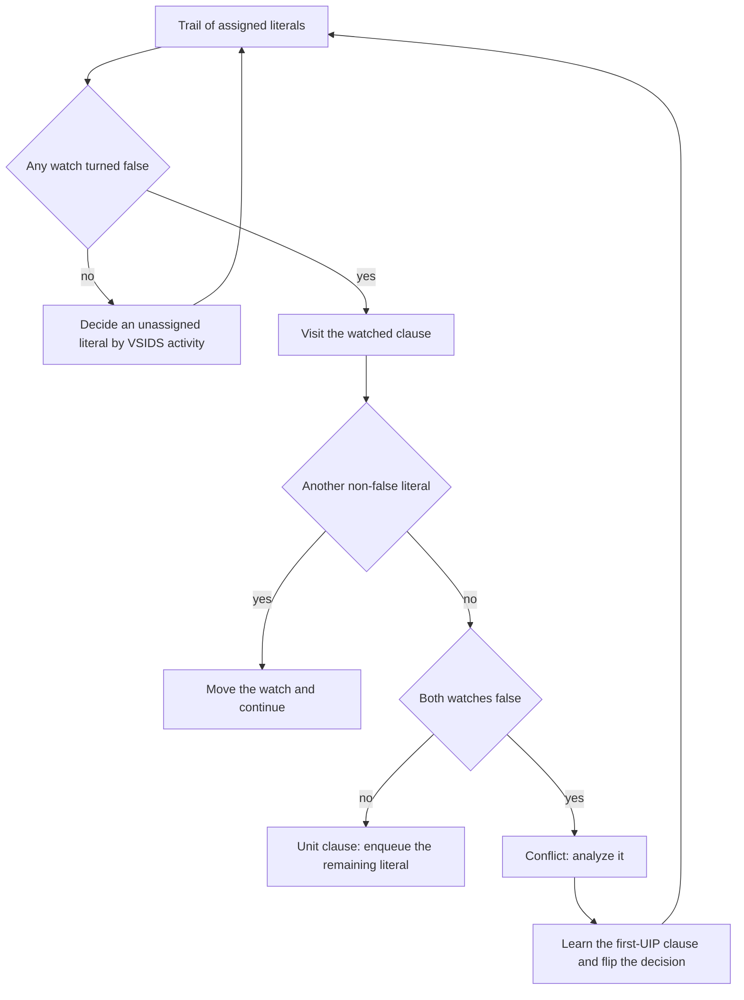
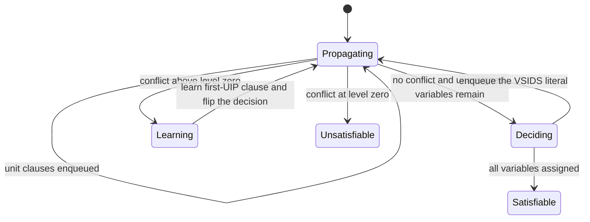
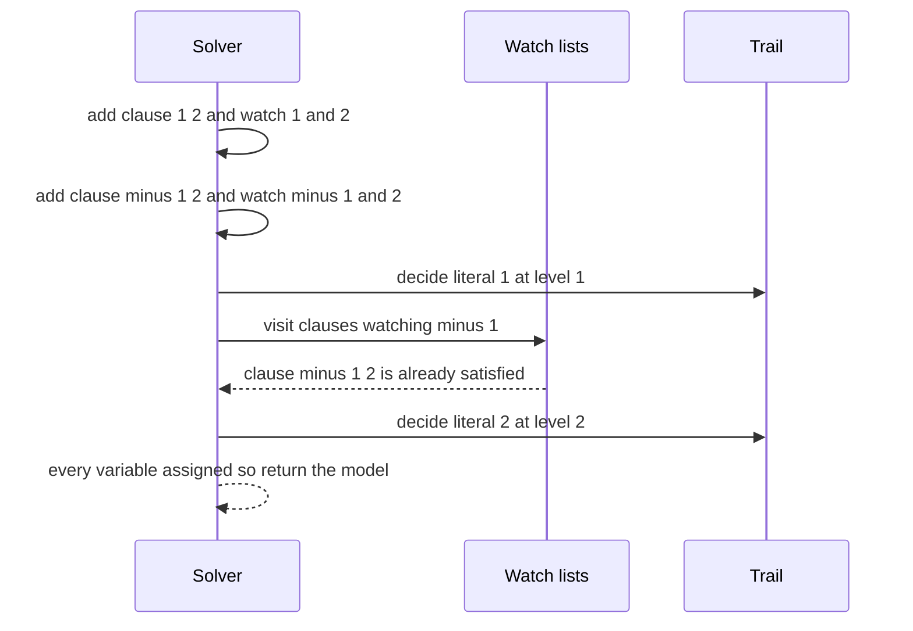

# 747 — Implement advanced SAT techniques: clause learning and watched literals in practice

> **Tier:** Expert · **CTCI chapter:** Beyond — Compilers, Languages & Solvers
> **Task spec:** [747-implement-advanced-sat-techniques-clause-learning-and-watched-li.md](../../../tasks/expert/747-implement-advanced-sat-techniques-clause-learning-and-watched-li.md)
> **Solutions:** [Python](../../../solutions/python/expert/747-implement-advanced-sat-techniques-clause-learning-and-watched-li/solution.py) ·
> [Java](../../../solutions/java/expert/747-implement-advanced-sat-techniques-clause-learning-and-watched-li/Solution.java) ·
> [JavaScript](../../../solutions/javascript/expert/747-implement-advanced-sat-techniques-clause-learning-and-watched-li/solution.js) ·
> [C#](../../../solutions/csharp/expert/747-implement-advanced-sat-techniques-clause-learning-and-watched-li/Solution.cs)

## 1. Problem restatement

Build a CDCL ("conflict-driven clause learning") SAT solver in the style of MiniSat, small enough
to instrument. Literature are signed integers (variable `v` is `v`, its negation is `-v`), a clause
is a list of literals, and a formula is a variable count plus a list of clauses. The solver must
return `(True, model)` or `(False, None)`, and it must record its work so the tests can inspect it:

| Piece | What it does |
| --- | --- |
| `add_clause(clause)` | deduplicates literals, drops tautologies, orders non-false literals first, installs two watches |
| `propagate()` | unit propagation driven by the watch lists and the trail |
| `analyze(conflict)` | first-UIP conflict analysis producing a learned clause and the backtrack level |
| `backtrack(level)` | undoes the trail down to a decision level |
| `stats` | `decisions`, `propagations`, `conflicts`, `learned`, `restarts`, `backjumps`, `max_learned_length` |
| `watch_invariant_ok()` | asserts the invariant "an unsatisfied clause has both watches non-false" |

Concrete behaviour the checks assert:

- `CDCL(2, [[1, 2], [-1, 2]])` is satisfiable, the returned model really satisfies both clauses,
  at least one decision was taken, and the watched-literal invariant holds afterwards.
- `CDCL(3, [[1], [-1, 2], [-2, 3]])` returns exactly the model `{1: True, 2: True, 3: True}` — the
  units are propagated, not guessed.
- `CDCL(2, [])` is satisfiable; `CDCL(2, [[]])` is unsatisfiable; the tautological clause
  `[1, -1]` is discarded, so `CDCL(1, [[1, -1]])` stays satisfiable with `len(clauses) == 0`.
- On 24 deterministic random 3-SAT instances (6 variables, 14 or 30 clauses) the verdict equals
  brute-force enumeration, every returned model is checked clause by clause, and every UNSAT case
  has produced at least one learned clause.
- Every learned clause is a logical consequence of the input: for 10 random 5-variable formulas,
  every assignment that satisfies the formula also satisfies every learned clause.
- Pigeonhole `PHP(3,2)` and `PHP(4,3)` are refuted with `conflicts > 0` and `learned > 0`, while
  `PHP(2,1)` is refuted trivially and `PHP(2,2)` is satisfiable.
- Six 8-variable, 22-clause instances still agree with brute force, and two identical instances
  produce identical verdicts and identical statistics.

## 2. Intuition

The textbook DPLL algorithm keeps the whole formula and, after every assignment, rescans every
clause to look for units or conflicts. That is correct but quadratic in the obvious way: a clause is
touched even when nothing it contains changed.

Two ideas fix it:

1. **Watch two literals per clause.** A clause can only become unit or falsified when one of its
   literals becomes false. If we "watch" two literals — chosen to be non-false whenever possible —
   then we only have to visit a clause when a watch turns false, and then we either find a
   replacement watch (the clause is still not unit) or the clause is now unit/falsified. The
   invariant that keeps this sound is: *an unsatisfied clause has both watches non-false*.
2. **Learn from conflicts.** Instead of only flipping the last decision, walk back over the
   implication graph and derive a new clause that explains the conflict. The cut at the **first
   unique implication point** produces a clause with exactly one literal from the current decision
   level, so the solver can add it and continue, never repeating the same conflict.

Activity (VSIDS) ordering and periodic restarts are the practical extras: variables in recent
conflicts get boosted so the search stays in the "interesting" region, and restarting with the
learned clauses kept in the database avoids thrashing on a bad early decision.



## 3. Algorithm

1. `add_clause`: scan the literals, return early when a tautology (`l` and `-l`) is found, drop
   duplicates; an empty list (or a clause whose literals are all false) marks the formula
   unsatisfiable immediately.
2. Order the surviving literals so the non-false ones come first, then install watches on the first
   two; a clause with only one non-false literal is unit and is enqueued right away rather than
   watched.
3. `enqueue(literal, reason)`: assign the variable, record its decision level and reason (the clause
   index, or `None` for a decision), and append to the trail.
4. `propagate`: pop literals from the propagation queue (older assignments first), and for each
   clause watching the *negation* of the popped literal, try to find a replacement watch among the
   remaining literals; if none exists and the other watch is false, report a conflict, otherwise
   enqueue the other watch as a unit with that clause as its reason.
5. `solve`: propagate to a fixpoint. Clean trail → pick an unassigned variable with the highest
   activity, open a new decision level, enqueue it, repeat. Conflict at decision level 0 → UNSAT.
6. Conflict handling: `analyze` walks the trail backwards, counting how many literals of the current
   level are still "open", and stops at the first UIP; the learned clause is the negation of the
   resolved literals, and the second-highest level in it is recorded as the backtrack level.
7. Backtrack one level, flip the decision literal, add the learned clause (which can itself be unit
   and propagate), decay all activities, and if 64 conflicts have accumulated since the last
   restart, jump back to level 0 and keep the learned clauses.
8. When every variable is assigned and propagation finds no conflict, return the model with any
   unassigned variable defaulting to false.

```text
procedure solve(formula)
    if formula is trivially unsat then return false, none
    conflicts_since_restart ← 0
    while true do
        conflict ← propagate()
        if conflict is none then
            literal ← pick unassigned variable with maximum activity
            if literal is none then return true, current assignment
            open a new decision level and enqueue literal with reason none
            continue
        if decision level is 0 then return false, none
        learned ← analyze conflict at the first unique implication point
        decision_literal ← the literal that opened the current level
        backtrack one level
        add learned clause to the database
        decay all activities and record the learned clause
        enqueue the negation of decision_literal
        if conflicts_since_restart ≥ restart_after then
            backtrack to level 0 ; conflicts_since_restart ← 0

procedure propagate()
    while the propagation queue is not empty do
        literal ← next queued literal
        for clause in watches of the negation of literal do
            find a literal in clause that is not false, preferring one that is not a watch
            if such a literal exists then move the watched position to it
            else if the other watch is false then return clause
            else enqueue the other watch with this clause as its reason
    return none
```



## 4. Worked example

Formula `(1 ∨ 2) ∧ (¬1 ∨ 2)` over two variables, i.e. `CDCL(2, [[1, 2], [-1, 2]])`.

Clause installation first. Clause 0 `[1, 2]` has no false literals, so the order is unchanged and
the watches are `1` and `2`. Clause 1 `[-1, 2]` likewise watches `-1` and `2`, so
`watches[2] = [0, 1]`.

| Step | Action | Trail | Watches touched | Result |
| --- | --- | --- | --- | --- |
| 1 | propagate | `[]` | none queued | no conflict |
| 2 | decide (`activity` all zero, so variable 1 wins by order) | `[1]` | — | level 1 opens at trail index 0 |
| 3 | propagate literal `1` | `[1]` | clauses watching `-1` → clause 1 | clause 1 already satisfied by `1`, nothing to do |
| 4 | propagate literal `1` again | `[1]` | clauses watching `1` → clause 0 | clause 0 is satisfied, no watch move |
| 5 | decide (variable 2 still free) | `[1, 2]` | — | level 2 opens |
| 6 | propagate | `[1, 2]` | none queued | no conflict |
| 7 | no unassigned variables | `[1, 2]` | — | return `{1: True, 2: True}` |

A variant shows the *unit* path: with `[[1], [-1, 2], [-2, 3]]`, clause `[1]` has no non-false
literal other than `1`, so `1` is enqueued at installation time; propagating `1` makes `-1` false in
`[-1, 2]`, whose only remaining literal `2` becomes unit and is enqueued with clause 1 as its
reason; the same happens for `3`. The solver therefore returns the forced model
`{1: True, 2: True, 3: True}` without taking a single decision.



## 5. Complexity

Let `m` be the number of clauses, `l` the number of literals and `n` the number of variables.

| Operation | Time | Space | Reason |
| --- | --- | --- | --- |
| `add_clause` | O(k) for a clause of length `k` | O(k) | one pass for dedup, tautology and watch selection |
| one propagation step | O(clauses watching the literal) | O(1) + trail | only clauses whose watch became false are visited |
| `analyze` | O(size of the implication graph at that level) | O(level) | one backward walk over the trail with a resolve counter |
| complete search | worst case O(2ⁿ · m) | O(m + learned clauses) | DPLL is complete but has no polynomial bound; learning prunes repeats |
| brute-force oracle | O(2ⁿ · m) | O(n) | used by the checks as the reference verdict |
| memory | — | O(l + learned literals) | the clause database grows with every learned clause; restarts keep it |

Watched literals change the *constant*, not the worst case: they make each propagation visit
proportional to the clauses that actually became affected rather than to the whole formula, which is
what makes the technique dominate practice. Because the solver keeps every learned clause, memory
grows monotonically during a run — a real solver adds clause deletion driven by LBD scores.

## 6. Pitfalls and edge cases

- **The empty clause.** `[[]]` makes the formula unsatisfiable on the spot; the code returns `False`
  before the search loop starts rather than trying to propagate nothing.
- **Tautologies.** `[1, -1]` is dropped entirely, so `CDCL(1, [[1, -1]])` has zero clauses and is
  satisfiable — forgetting this makes the solver report a spurious conflict.
- **Duplicate literals** in one clause must be squeezed out, otherwise the watch positions can point
  at the same literal twice and the "both watches false" test becomes meaningless.
- **The watch invariant is the whole correctness argument.** `watch_invariant_ok()` is asserted after
  hand cases, after random instances and after the pigeonhole refutations; if a watch is left on a
  false literal, propagation silently stops being complete.
- **Unit clauses must propagate immediately**, including at clause-installation time, which is why
  `add_clause` may enqueue a literal instead of installing watches.
- **Conflicts below level zero do not exist.** A conflict at decision level 0 is an unconditional
  UNSAT, so `analyze` is never called there.
- **Chronological backtracking is a documented simplification**: the learned clause is used, but the
  solver undoes exactly one decision level rather than backjumping to the second-highest level. That
  keeps the completeness argument immediate and is what makes the "model satisfies every clause"
  check meaningful.
- **Restarts must not delete learned clauses**, otherwise the pruning work is thrown away; the
  `restart_after = 64` budget counts conflicts since the last restart.
- **Determinism.** Variable selection iterates variables in ascending order and only replaces the
  current best on a strictly larger activity, so ties break by index; the checks compare two
  identical runs including the full `stats` dictionary.
- **Pigeonhole formulas are the classic stress case.** `PHP(p, h)` with `p > h` is unsatisfiable,
  and refuting it must involve real conflicts and learned clauses, which the checks assert.

## 7. Variants and follow-ups

- **Non-chronological backjumping** uses the second-highest level in the learned clause instead of
  one level down, which is the change with the largest practical impact.
- **LBD-based clause deletion and phase saving** keep the database and the polarity heuristic
  healthy over long runs; both are orthogonal to the watched-literal machinery.
- **Preprocessing** (unit propagation at parse time, pure literal elimination, variable elimination)
  simplifies the formula before the search starts.
- **SAT modulo theories** layers theory solvers on top of the same Boolean search — see
  [748-implement-smt-solver-front-end-sketch-theory-combination-simple.md](../../../tasks/expert/748-implement-smt-solver-front-end-sketch-theory-combination-simple.md),
  which uses this DPLL shape with a difference-logic and a congruence-closure theory, and
  [749-implement-symbolic-execution-skeleton-for-small-programs.md](../../../tasks/expert/749-implement-symbolic-execution-skeleton-for-small-programs.md),
  which decides its path conditions by enumeration instead of calling a solver.
- Related work in this repository: the formal happens-before model
  [619-implement-formal-model-for-happens-before-and-verify.md](../../../tasks/expert/619-implement-formal-model-for-happens-before-and-verify.md)
  also reduces a property question to a satisfiability question.

## 8. Check yourself

<details><summary>Show answer</summary>
**Why is it enough to watch only two literals per clause?**

A clause becomes interesting only when at most one literal is still non-false. As long as two
non-false literals are watched, the clause cannot be unit or falsified, so nothing can be inferred
from it — and the invariant "an unsatisfied clause has both watches non-false" guarantees that no
such clause is missed when a watch turns false.
</details>

<details><summary>Show answer</summary>
**What does the first-UIP cut buy the solver?**

It produces a learned clause containing exactly one literal of the current decision level. That
literal is the point to flip after backtracking, so the learned clause becomes a unit implication
immediately and the same conflict cannot recur along the same path — which is why learning prunes
the search instead of merely reordering it.
</details>

<details><summary>Show answer</summary>
**The checks verify that every learned clause is implied by the formula. Why is that the key check?**

A learned clause that is *not* implied would remove real models, so the solver could answer UNSAT
for a satisfiable formula. The strongest check available at this size is: for every assignment that
satisfies the original formula, at least one literal of the learned clause is true; the tests do
exactly that over all satisfying assignments of the small random instances.
</details>

<details><summary>Show answer</summary>
**Why does the solver default unassigned variables to false when building the model?**

Because a variable that was never decided is free: any value works as long as the propagation
fixpoint found no conflict. Filling it with false keeps the model total and deterministic, and the
"model satisfies every clause" check then validates the choice a posteriori.
</details>

<details><summary>Show answer</summary>
**What is the difference between the number of decisions and the number of conflicts in `stats`?**

A decision is a *guess* at a new decision level. A conflict is a *failed* propagation at some level,
which triggers analysis, learning and a flip. Comparing the two counts tells you whether a run was
dominated by guessing or by repairing wrong guesses — which is exactly how the tests distinguish
trivial instances from pigeonhole refutations.
</details>
