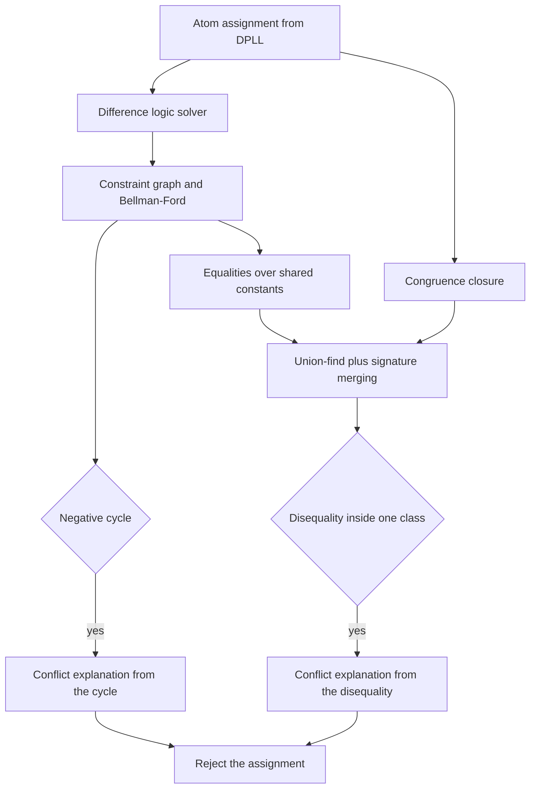
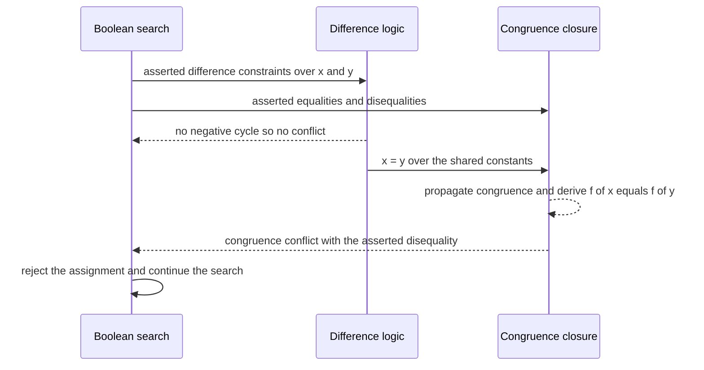

# 748 — Implement SMT solver front-end sketch (theory combination simple)

> **Tier:** Expert · **CTCI chapter:** Beyond — Compilers, Languages & Solvers
> **Task spec:** [748-implement-smt-solver-front-end-sketch-theory-combination-simple.md](../../../tasks/expert/748-implement-smt-solver-front-end-sketch-theory-combination-simple.md)
> **Solutions:** [Python](../../../solutions/python/expert/748-implement-smt-solver-front-end-sketch-theory-combination-simple/solution.py) ·
> [Java](../../../solutions/java/expert/748-implement-smt-solver-front-end-sketch-theory-combination-simple/Solution.java) ·
> [JavaScript](../../../solutions/javascript/expert/748-implement-smt-solver-front-end-sketch-theory-combination-simple/solution.js) ·
> [C#](../../../solutions/csharp/expert/748-implement-smt-solver-front-end-sketch-theory-combination-simple/Solution.cs)

## 1. Problem restatement

Write a miniature SMT front end over the **union of two theories**, in the shape of an SMT-LIB
front end that hands ground atoms to DPLL(T):

- **Integer difference logic** — atoms `x - y <= c`, where `x` and `y` are shared integer constants
  written as strings and `c` is an integer.
- **Equality with uninterpreted functions (EUF)** — atoms such as `f(x) = f(y)` and its negation,
  written as `(function, argument)` pairs where the argument is again a *shared* constant.

A formula is a list of atoms plus a list of clauses over atom polarities (`literal(atom, positive)`).
The front end must return `None` for UNSAT and, for SAT, an assignment of the atoms, the constant
values and a table for the uninterpreted functions. Concrete behaviour the checks assert:

- `theory_check([le("x","y",1), le("y","x",1)], [], [], shared)` reports **no conflict** — the two
  constraints are jointly satisfiable.
- `le("x","y",-1)` together with `le("y","x",0)` (that is `x < y` and `y ≤ x`) is refuted, and the
  explanation is a difference-logic **negative cycle** involving at least three entries.
- `f(x) = f(y)` alone is satisfiable; `f(x) = f(y)` with `f(x) ≠ f(y)` is refuted; and the chain
  `f(x) = f(y)`, `f(y) = f(z)`, `f(x) ≠ f(z)` is refuted by congruence transitivity.
- The combined instance `x ≤ y`, `y ≤ x`, `f(x) ≠ f(y)` (all asserted) is **UNSAT**, and the conflict
  comes from the *congruence* theory after the shared equality `x = y` was handed over — with at
  least one derived equality recorded. Replacing the disequality by `f(x) = f(y)` makes it SAT.
- An empty formula is satisfiable, a formula containing the empty clause is unsatisfiable, a single
  atom with a clause demanding it is satisfiable with a model respecting `x - y <= 0`, demanding an
  atom and its negation at once is unsatisfiable, and asking for the *negation* of `x - y <= 0`
  yields a model with `x - y >= 1`.
- Random instances (12 cases, atoms drawn over the shared constants) all agree with a brute-force
  oracle over the same domain, and two identical runs produce identical results and statistics.

## 2. Intuition

A Boolean SAT solver knows nothing about arithmetic and nothing about functions. The SMT idea is to
keep the Boolean search exactly as it is, and to answer a *theory question* whenever an atom
assignment is complete: "is the conjunction of the asserted atoms satisfiable in the theory?" If the
answer is no, the theory can usually also say *why*, and that explanation prunes the search.

Each theory then needs its own solver with its own notion of "why":

1. **Difference logic as a graph.** `x - y <= c` is an edge `y → x` with weight `c`. A set of such
   constraints is satisfiable exactly when the graph has no negative cycle, and if it has one, that
   cycle *is* the explanation. When it is satisfiable, shortest-path distances from a virtual source
   give a model: they satisfy every constraint by construction.
2. **Congruence closure.** Equality with uninterpreted functions is union-find plus a rule: two
   applications with the same function symbol and equal arguments must be in the same class. A
   disequality that ends up inside one class is the conflict.
3. **Theory combination, Nelson-Oppen style.** The two theories share the integer constants, so
   equalities about those constants must be exchanged: an equality `x = y` discovered by the
   difference-logic solver makes the arguments of `f(x)` and `f(y)` equal, which congruence closure
   discovers as `f(x) = f(y)`. Iterating the exchange to a fixed point is enough for this
   combination.



## 3. Algorithm

1. Represent atoms as tagged tuples: `("le", x, y, c)`, `("eq", left, right)`, `("neq", left, right)`
   where `left` and `right` are `(function, argument)` pairs.
2. Turn the assignment into theory input with `implied_constraints`: an asserted `x - y <= c` is
   passed through; its **negation** becomes `y - x <= -c - 1`, which is the integer-exact form
   (never `-c`); an asserted equality becomes an equality, an asserted `neq` or negated equality
   becomes a disequality.
3. `difference_conflict(asserted)`: build the edge list `(y, x, c)`, initialise every distance to 0
   (a virtual source connected to everything), run `|V|` relaxation rounds, and if a further
   relaxation still improves something, walk back through the predecessor chain to return the
   negative cycle.
4. `difference_potentials(asserted)`: when there is no conflict, the same relaxation without the
   "changed" abort returns shortest-path potentials, which are a model of the constraints.
5. `CongruenceClosure`: union-find with path compression; `propagate()` groups terms by
   `(function symbol, class of argument)` and merges any group with more than one member, repeating
   until no merge happens, and returns the derived equalities.
6. `theory_check` combines them: assert the difference constraints, seed congruence closure with the
   asserted equalities, propagate, then loop — if difference logic has a conflict, return it; if a
   pair `x = y` is implied in *both* directions by difference constraints, merge the two constant
   classes in congruence closure; then propagate again; finally feed congruences about shared
   constants back as `x - y <= 0` and `y - x <= 0` pairs, until nothing changes.
7. After the fixed point, a disequality whose two sides are congruent in the closure is a congruence
   conflict; otherwise the assignment is theory-consistent.
8. `SmtSolver.solve` enumerates atom assignments (Boolean search over the polarities, checking each
   clause as soon as it is falsified) and calls the combined theory check on every complete
   assignment; `model_for` searches the finite domain `(0, 1, 2)` for constant values satisfying the
   asserted difference constraints and builds a canonical function table from the congruence
   classes.

```text
procedure difference_conflict(asserted)
    nodes ← every constant named by asserted
    edges ← (y, x, c) for each atom x - y <= c
    distance[node] ← 0 for every node
    repeat |nodes| times do
        changed ← false
        for (source, target, weight) in edges do
            if distance[source] + weight < distance[target] then
                distance[target] ← distance[source] + weight
                predecessor[target] ← source
                changed ← true
        if not changed then return none
    for (source, target, weight) in edges do
        if distance[source] + weight < distance[target] then
            return the cycle recovered by walking predecessors
    return none

procedure theory_check(asserted_le, equalities, disequalities, shared)
    constraints ← asserted_le
    closure ← CongruenceClosure over shared constants and the application terms
    merge every asserted equality and propagate congruence
    repeat
        if difference_conflict(constraints) is not none then return the difference conflict
        for each pair x, y with both x - y <= 0 and y - x <= 0 asserted do
            merge the classes of the shared constants x and y
        propagate congruence, recording derived equalities
        for each pair of shared constants in the same congruence class do
            assert x - y <= 0 and y - x <= 0 into constraints
    until nothing changed
    for (left, right) in disequalities do
        if closure says left and right are congruent then return the congruence conflict
    return none
```



## 4. Worked example

### Part A — the negative cycle

Assert `le("x", "y", -1)` and `le("y", "x", 0)`, i.e. `x - y ≤ -1` and `y - x ≤ 0`. The edge list
is `(y → x, -1)` and `(x → y, 0)`, and all distances start at `0` because a virtual source sits
above every node with zero-weight edges.

| Round | Edge relaxed | Distance change |
| --- | --- | --- |
| 1 | `y → x` with weight `-1` | `dist[x] = -1` |
| 1 | `x → y` with weight `0` | `dist[y] = -1` |
| 2 | `y → x` with weight `-1` | `dist[x] = -2` |
| 2 | `x → y` with weight `0` | `dist[y] = -2` |
| after `|V| = 2` rounds | a further relaxation still improves a distance | negative cycle |

The cycle recovered by walking the predecessors is over `x` and `y` and has total weight `-1`, which
is the contradiction `x - y ≤ -1` together with `y - x ≤ 0`. The checks assert that the explanation
is of kind `"difference"` and that the reported cycle has at least three entries (the closing node
is repeated).

### Part B — theory combination

Now assert `le("x","y",0)`, `le("y","x",0)` and `neq(("f","x"), ("f","y"))`, all positive.

| Step | Theory state | Observation |
| --- | --- | --- |
| 1 | difference constraints: `x - y ≤ 0`, `y - x ≤ 0` | satisfiable, no negative cycle |
| 2 | both directions present with `c = 0` | shared equality `x = y` derived |
| 3 | union-find merges `("const","x")` and `("const","y")` | the constant classes become one |
| 4 | `propagate()` regroups terms by `(symbol, argument class)` | `("f","x")` and `("f","y")` share a signature |
| 5 | they merge, and the merge is recorded | `derived` contains `(("f","x"), ("f","y"))` |
| 6 | the asserted disequality `f(x) ≠ f(y)` now compares congruent terms | congruence conflict |

That is the classic Nelson-Oppen exchange in five steps: the *arithmetic* theory discovered the
equality of the arguments, and the *function* theory turned it into an equality between the
applications, contradicting the asserted disequality. Because the two theories share the constants,
neither could have found the contradiction alone.


## 5. Complexity

Let `V` be the shared constants, `E` the asserted difference constraints, `T` the application terms
and `k` the number of shared constants.

| Component | Time | Space | Reason |
| --- | --- | --- | --- |
| `difference_conflict` | O(V · E) | O(V + E) | Bellman-Ford relaxation rounds over all edges |
| `difference_potentials` | O(V · E) | O(V) | the same relaxation, returning the distances when it stabilises |
| `CongruenceClosure.propagate` | O(T α(T)) per pass | O(T) | union-find with path compression plus one grouping pass; passes repeat until no merge |
| `theory_check` | at most `|shared| + 2` exchange rounds, each bounded by the two solvers | O(V + E + T) | the fixed point loop only continues while something changed |
| `SmtSolver.solve` | worst case O(2^atoms) theory checks | O(atoms) | the Boolean layer is still an exhaustive DPLL for this sketch |
| `model_for` | O(3^k) | O(k) | the documented domain restriction: every shared constant is tried over `(0, 1, 2)` |
| brute-force oracle | O(3^k) with a clause check per point | O(k) | the same domain, used to confirm both verdicts |

The interesting asymmetry is that both theory solvers are polynomial while the Boolean search is
exponential; that is the same shape as in production SMT solvers, where the theory callback prunes
the Boolean search but never makes it polynomial.

## 6. Pitfalls and edge cases

- **Integer negation.** The negation of `x - y <= c` is `y - x <= -c - 1`, not `y - x <= -c`. Using
  the real-arithmetic form silently accepts assignments that violate the intended strict
  inequalities.
- **Only equalities are exchanged.** The front end deliberately does not split on disequalities, so
  it is *incomplete* for the general combination; the documented consequence is that verdicts are
  only confirmed against the brute-force oracle over the finite domain `(0, 1, 2)`, not over all of
  `Z`.
- **Verdicts are domain-relative.** "SAT" means "satisfiable with constants in the domain the solver
  searched", which is exactly what the checks compare against.
- **Congruence must be closed before checking disequalities.** A disequality is only violated once
  every implied merge has been performed; checking earlier misses transitivity chains such as
  `f(x) = f(y)`, `f(y) = f(z)`, `f(x) ≠ f(z)`.
- **Arguments must be shared constants.** Applications take constants from the declared `shared`
  list; an argument outside it is not part of the exchange and the theory check cannot reason about
  it.
- **Empty clause versus empty formula.** `SmtSolver([], [], shared)` is satisfiable; a formula
  containing `[]` is unsatisfiable immediately, since no literal can satisfy it.
- **An atom and its negation together** must be refused even when each is individually satisfiable —
  the clause layer rejects that assignment before (or independently of) the theory.
- **Determinism.** Terms are grouped through a `dict`, constants are sorted, and distances are
  initialised uniformly, so the same input produces the same conflict explanation and the same
  statistics; the checks compare two full runs.
- **Model completeness.** A SAT answer must satisfy every clause, every decided atom *and* the
  congruence obligations; `model_for` returns `None` when it cannot, and that failure is what turns
  a satisfiable Boolean assignment into a theory conflict.

## 7. Variants and follow-ups

- **Disequality splitting** (case splitting on `x = y` versus `x ≠ y` with backtracking) restores
  completeness for the combined theory at the cost of a search in the theory layer.
- **Simplex or difference-bound matrices** replace Bellman-Ford with an incremental solver that can
  produce minimal explanations, which is what real DPLL(T) needs.
- **Theory propagation** asks the theory for implied literals during the search instead of only
  checking complete assignments; that is the single biggest practical speedup.
- **More theories**: linear arithmetic over rationals, arrays with `select`/`store`, bit-vectors and
  the theory of strings all plug into the same "atom, model, explanation" interface.
- Related work in this repository: the CDCL base this front end sits on is
  [747-implement-advanced-sat-techniques-clause-learning-and-watched-li.md](../../../tasks/expert/747-implement-advanced-sat-techniques-clause-learning-and-watched-li.md),
  and a consumer of path constraints — with enumeration instead of a solver —
  is [749-implement-symbolic-execution-skeleton-for-small-programs.md](../../../tasks/expert/749-implement-symbolic-execution-skeleton-for-small-programs.md).

## 8. Check yourself

<details><summary>Show answer</summary>
**Why is a negative cycle the right conflict explanation for difference constraints?**

Each constraint `x - y ≤ c` is an edge `y → x` of weight `c`. Summing the constraints along a cycle
gives `0 ≤ (total weight)`, so a negative total weight is a contradiction. Conversely, with no
negative cycle the shortest-path distances are a valid assignment, so the cycle is both necessary
and sufficient — a complete explanation, not a heuristic.
</details>

<details><summary>Show answer</summary>
**In the combined example, which theory found the contradiction?**

The congruence theory, but only because the arithmetic theory handed it a fact it could not see:
`x = y` as a pair of difference constraints. The disequality `f(x) ≠ f(y)` is a congruence claim;
congruence closure could not derive `f(x) = f(y)` until the constant classes were merged.
</details>

<details><summary>Show answer</summary>
**Why does the model search enumerate only `(0, 1, 2)`?**

That is the documented domain restriction of this sketch: a real front end would hand the arithmetic
to a complete solver over `Z`. Restricting to a three-value domain makes the brute-force oracle
exact and cheap, so every SAT/UNSAT verdict can be *confirmed* rather than assumed — but it also
means the solver's answers are statements about that domain only.
</details>

<details><summary>Show answer</summary>
**What exactly does the fixed-point loop in `theory_check` exchange?**

Equalities over shared constants: difference logic tells congruence closure that two constants are
equal, so congruence closure can merge function applications built on them; conversely, when
congruence closure merges two constant classes, the corresponding `x - y ≤ 0` and `y - x ≤ 0` pairs
are asserted back into the difference constraints. The loop stops when neither direction learns
anything new.
</details>

<details><summary>Show answer</summary>
**Why is `f(x) = f(y)` with `x ≠ y` perfectly satisfiable for the function theory?**

Uninterpreted functions have no axioms beyond "equal arguments give equal results", and here the
arguments are constants, not terms. Nothing forces `x = y`, so any function table with
`f` mapping the two arguments to the same value — or with `x = y` in the arithmetic theory — is a
model. The checks confirm this by finding a model, not by assertion.
</details>
