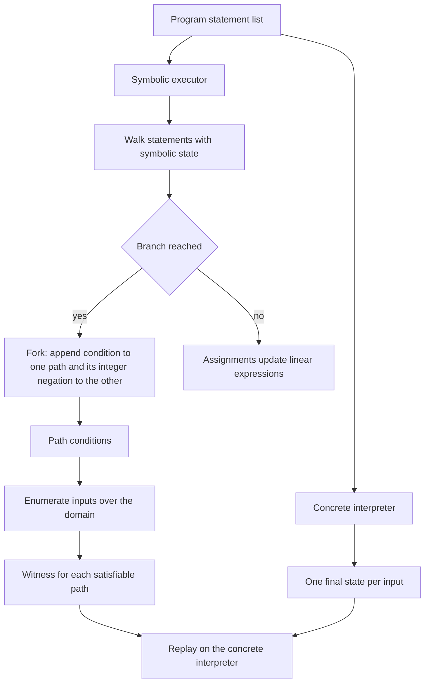
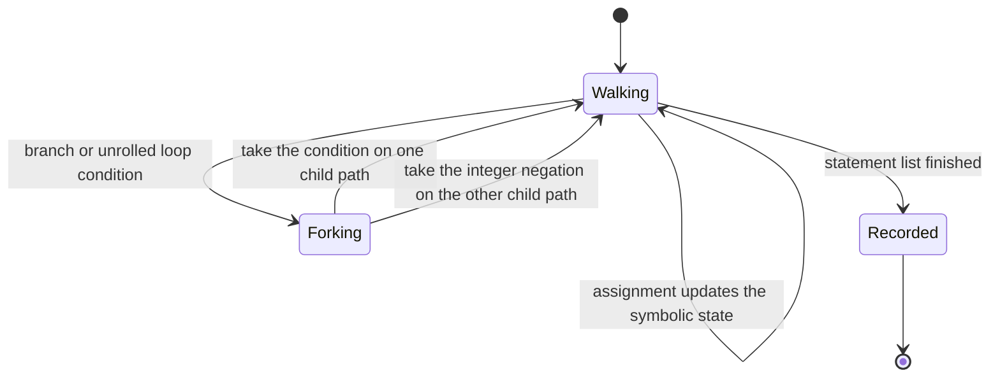
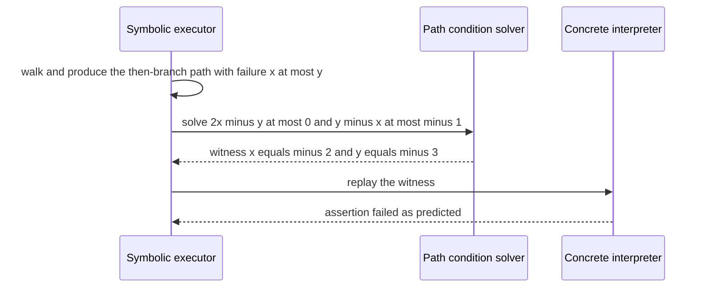

# 749 — Implement symbolic execution skeleton for small programs

> **Tier:** Expert · **CTCI chapter:** Beyond — Compilers, Languages & Solvers
> **Task spec:** [749-implement-symbolic-execution-skeleton-for-small-programs.md](../../../tasks/expert/749-implement-symbolic-execution-skeleton-for-small-programs.md)
> **Solutions:** [Python](../../../solutions/python/expert/749-implement-symbolic-execution-skeleton-for-small-programs/solution.py) ·
> [Java](../../../solutions/java/expert/749-implement-symbolic-execution-skeleton-for-small-programs/Solution.java) ·
> [JavaScript](../../../solutions/javascript/expert/749-implement-symbolic-execution-skeleton-for-small-programs/solution.js) ·
> [C#](../../../solutions/csharp/expert/749-implement-symbolic-execution-skeleton-for-small-programs/Solution.cs)

## 1. Problem restatement

Executed twice, a tiny imperative language must be analysed without running it on every input:

- a **concrete interpreter** that runs one assignment of the input variables at a time,
- a **symbolic executor** where variables hold *linear expressions over the input variables*, so
  each branch adds a constraint to a **path condition** and each completed path keeps its path
  condition, its symbolic final state, and the list of assertions (or explicit `fail` statements)
  that could fail along it.

The language is a statement list built from `assign(name, expression)`, `branch(condition, then,
else)`, `loop(condition, body, bound)`, `assertion(condition)` and `fail()`. Expressions are linear:
`const(c)`, `var(name)`, `add`, `sub`, `scale(expression, k)`, and conditions are `le(left, right)`.
Inputs are the program's free variables; the analysis explores the program for *all* of them.

Interface and documented simplifications:

- Path conditions use **integer semantics**, so the negation of `e <= c` is `-e <= -c - 1` — never
  `-e > -c` — which is what makes the fork exact rather than approximated.
- Satisfiability of a path condition is decided by **enumerating the input variables over a finite
  domain** `(-3, -2, -1, 0, 1, 2, 3)`. A real symbolic executor would hand the constraints to an SMT
  solver; inside the domain the decision is exact and the witness is a concrete input you can
  replay.
- `while` loops are **unrolled to a fixed bound** (three iterations in the loop program), which is
  also documented rather than hidden.

Concrete behaviour the checks assert:

- For every concrete input in the domain there is a symbolic path whose path condition it satisfies,
  and evaluating that path's symbolic final state at the input equals the interpreted final state.
- The set of inputs on which an assertion fails is exactly the union of the witnesses of the failing
  symbolic paths; every witness really satisfies its path condition and really triggers the
  assertion when executed.
- The loop program (`i = 0`, `acc = 0`, `loop(i <= x)` bounded at 3) yields exactly **four** paths,
  one for each exit point, and the accumulated value matches the interpreter on every covered input.
- A branch-free program yields exactly **one** path with `forks == 0`; an unreachable assertion has
  no witness, and the concrete runs confirm it never fails.
- An explicit `fail()` on the branch `x <= 0` is reported as its own path with a witness satisfying
  `x <= 0`, and the interpreter raises on that same witness.
- The empty program has exactly one path of kind `end` with an empty path condition and no failures;
  an unassigned variable defaults to the constant `0`, so `z = unset + 2` gives the expression
  `0 + 2`; `0 <= 0` is satisfiable while `0 <= -1` is not.
- The analysis is deterministic: two executors on the same program produce identical paths and
  identical statistics.

## 2. Intuition

Testing looks at one input at a time, and the interesting inputs — the ones near a boundary — are
precisely the ones random testing misses. Symbolic execution reverses the direction: instead of
picking inputs and computing results, it computes the *condition* under which each control-flow path
is taken.

The two key ideas are small:

1. **Symbolic values.** A variable holds a linear expression `(coefficients over the inputs,
   constant)`. Every assignment becomes arithmetic on those expressions, so no input is needed.
2. **Path conditions as constraints.** A branch appends its condition (or its negation, converted to
   the integer form `-e <= -c - 1`) to the current path condition, and the *unrolled* loop does the
   same once per iteration. A path is reachable exactly when its condition is satisfiable, and a
   satisfying assignment is a concrete input that drives execution down that path.

That gives the property the checks test hardest: a witness for a failing assertion is a *proof* of
unreachable-safe or of a real bug, and it can be replayed on the concrete interpreter.



## 3. Algorithm

1. Represent a symbolic expression as `(coefficients, constant)`: a dict from input variable to
   integer coefficient plus an integer offset. `const(c)` is `({}, c)`, `var(x)` is `({x: 1}, 0)`,
   and `add`, `sub`, `scale` combine them coefficient-wise.
2. Represent a path condition as a list of the same pairs, each meaning `sum(coeff * input) <=
   constant`. For an empty coefficient dict the constraint is just `0 <= constant`.
3. `walk(statements, state, constraints, failures)` handles a statement list, carrying the remaining
   statements into each fork so that every path runs to the end of the program.
4. Assignment: evaluate the right-hand side symbolically and rebind the variable in a *copy* of the
   state. Reads of unassigned variables default to the constant `0`.
5. `assertion(condition)`: negate the condition, append that constraint, and record it as a possible
   failure; `fail()` records an unconditional failure. Both continue the walk so the path is still
   completed and reported.
6. `branch`: recurse twice — once with the condition appended, once with the integer negation
   `-e <= -c - 1` appended. Each recursion increments the `forks` statistic.
7. `loop(condition, body, bound)`: unroll `bound` times, then fall through, producing the exit paths
   (for `bound = 3` that is the four paths the checks count).
8. `solve_path_condition(constraints, inputs)`: enumerate the input tuples over `DOMAIN` in a fixed
   order and return the first tuple satisfying every constraint, or `None`. Each call bumps
   `solver_calls`; every witness found bumps `witnesses`.
9. Paths are stored as `(kind, final state, path condition, failures)`, where `kind` is `end`, `fail`
   or the assertion that could fail — the shape the checks inspect.

```text
procedure walk(statements, state, constraints, failures)
    index ← 0
    while index < length(statements) do
        statement ← statements[index]
        rest ← statements[index + 1 ..]
        if statement is assign(name, expression) then
            state ← copy of state with name bound to symbolic_expression(expression, state)
        else if statement is assertion(condition) then
            constraints ← constraints + [negate(condition)]
            failures ← failures + [condition]
        else if statement is fail then
            failures ← failures + [always]
        else if statement is branch(condition, then, otherwise) then
            forks ← forks + 1
            walk(then + rest, state, constraints + [condition], failures)
            walk(otherwise + rest, state, constraints + [negate(condition)], failures)
            return
        else if statement is loop(condition, body, bound) then
            walk(unroll(condition, body, bound) + rest, state, constraints, failures)
            return
        index ← index + 1
    record the path (end, state, constraints, failures)

function negate(condition le(left, right))
    difference ← subtract(left, right)
    return scale(difference, -1) with constant offset minus one    # -e <= -c - 1

function solve_path_condition(constraints, inputs)
    for values in every tuple of DOMAIN of length equal to the number of inputs do
        if every constraint holds for values then return the corresponding mapping
    return none
```



## 4. Worked example

Use `failing_assert_program`, which is

```text
q = 2 * x - y
if q <= 0 then
    assert x <= y
else
    q = q + 1
```

**Symbolic result.** The walk starts with `x = ({x: 1}, 0)`, `y = ({y: 1}, 0)` and an empty path
condition, then computes `q = 2x - y` as the coefficients `{x: 2, y: -1}` with constant `0`.

| Path | Constraint appended | Final symbolic state | Failure recorded |
| --- | --- | --- | --- |
| then-branch | `2x - y <= 0` | `q = 2x - y` | `x <= y` |
| else-branch | `-(2x - y) <= -1`, i.e. `y - 2x <= -1` | `q = 2x - y + 1` | none |

**Solving the failing path.** Negating the assertion `x <= y` gives `y - x <= -1`. Enumerating
`DOMAIN x DOMAIN` in order, the first tuple satisfying both `2x - y <= 0` and `y - x <= -1` is
`x = -2`, `y = -3`: indeed `2(-2) - (-3) = -1 <= 0` and `-3 - (-2) = -1 <= -1`.

**Replay on the concrete interpreter.**

| Step | State | Reason |
| --- | --- | --- |
| 1 | `q = 2(-2) - (-3) = -1` | assignment |
| 2 | `-1 <= 0` holds | then-branch taken |
| 3 | assertion `x <= y` becomes `-2 <= -3` | false |
| 4 | the interpreter reports an assertion failure | witness confirmed |

The loop program behaves the same way, with the unrolling making the path count explicit: with
`bound = 3` there are four paths — exit before the first iteration, after one, after two, after
three. For `x = 1` the interpreter runs `i = 0` with `0 <= 1` true, then `i = 1` with `1 <= 1` true,
then `2 <= 1` false, so `acc = 0 + 1 = 1`; the symbolic path whose condition covers `x = 1`
evaluates to the same value, which is the check "the accumulated value must agree between symbolic
and concrete runs".



## 5. Complexity

Let `d` be the number of forks (branches plus unrolled loop iterations), `s` the statement count and
`k` the number of input variables.

| Quantity | Bound | Reason |
| --- | --- | --- |
| number of symbolic paths | O(2^d) in the worst case, exactly the number of exits for an unrolled loop | each branch duplicates the current path |
| walking cost | O(2^d · s · size of expressions) | each path re-walks the remaining statements |
| `solve_path_condition` | O(|DOMAIN|^k · constraints) | enumeration over the finite domain; with two inputs and seven domain values that is 49 tuples per query |
| space | O(2^d · (state + path condition)) | one entry per completed path |
| concrete interpreter | O(s) per input | one pass over the statements |
| brute-force alternative | O(|DOMAIN|^k · s) | running the interpreter on every input in the domain, which is what the checks do to validate the analysis |

The exponential path count is the classic symbolic-execution problem: without merging or pruning,
each branch doubles the work. The two documented simplifications — domain enumeration and bounded
loop unrolling — are what keep this skeleton's numbers small enough to check exhaustively.

## 6. Pitfalls and edge cases

- **Integer negation.** `not (e <= c)` is `-e <= -c - 1`. Using `-e <= -c` swaps a boundary case and
  makes the analysis claim paths that no integer input reaches.
- **Domain restriction.** A witness is a witness *inside* `(-3, …, 3)`. An assertion reported as
  never failing may still fail outside that window; the checks are limited to the domain by
  construction.
- **Bounded loops.** Unrolling to a fixed bound misses executions that need more iterations. The
  checks confirm the four-path count is consistent with the given bound, not that the bound is
  enough for every input.
- **Unassigned variables default to zero.** `z = unset + 2` gives `0 + 2`, which is deliberate and
  asserted; silently erroring would make generated programs harder to analyse.
- **Failures continue the path.** An assertion or `fail` is recorded and the walk continues, so the
  path's final state is still available; stopping early loses the state that the interpreter
  comparison relies on.
- **Fork bookkeeping.** The `forks` statistic is asserted to be 0 for the branch-free program and to
  be the source of the path count elsewhere; counting a loop iteration as a fork is what makes the
  loop program produce four paths.
- **Unreachable assertions.** The unreachable-assert program yields paths whose failure list is
  empty, and the concrete sweep over the domain independently confirms that no input triggers it.
- **Empty program.** It must still produce exactly one path (`kind = end`, no constraints, no
  failures) rather than zero paths, so downstream code can always rely on at least one path.
- **Determinism.** Enumeration order and state copying are fixed, so two runs give identical paths
  and identical statistics; path equality is compared element by element in the checks.
- **Concrete interpreter contract.** `fail()` raises on the same witness that the symbolic executor
  reports, which is what closes the loop between the two executions.

## 7. Variants and follow-ups

- **SMT-backed path conditions** replace domain enumeration with a real solver; the interface in
  [748-implement-smt-solver-front-end-sketch-theory-combination-simple.md](../../../tasks/expert/748-implement-smt-solver-front-end-sketch-theory-combination-simple.md)
  is exactly the "asserted difference constraints, model or conflict" shape this skeleton needs.
- **Path merging / state joining** widens the analysis: join paths that share a suffix so the number
  of explored states stops doubling at every branch.
- **Bound tightening with loop invariants** replaces fixed unrolling so loops can be analysed for all
  iterations instead of a prefix.
- **Concolic execution** runs one concrete input and collects the constraints along its path,
  negating the last branch condition to reach a neighbour input — a middle ground between testing and
  symbolic analysis, which is how the fuzzing harness in
  [750-implement-fuzzing-harness-with-coverage-guided-mutation-afl-like.md](../../../tasks/expert/750-implement-fuzzing-harness-with-coverage-guided-mutation-afl-like.md)
  relates to this task.
- Related work in this repository: the CDCL solver in
  [747-implement-advanced-sat-techniques-clause-learning-and-watched-li.md](../../../tasks/expert/747-implement-advanced-sat-techniques-clause-learning-and-watched-li.md)
  is the engine a production version of this skeleton would call.

## 8. Check yourself

<details><summary>Show answer</summary>
**Why is a symbolic witness stronger than a failing test?**

A failing test shows that *one* input breaks the assertion. A satisfiable failing path condition also
comes with the constraint that characterises *all* inputs that take that path and fail, and the
witness is guaranteed to reproduce: the checks replay it on the concrete interpreter and re-derive
the failure.
</details>

<details><summary>Show answer</summary>
**Why must the negation of `e <= c` be `-e <= -c - 1`?**

Over the integers, `e > c` is equivalent to `e >= c + 1`, and multiplying by `-1` flips the
inequality: `-e <= -c - 1`. Using `-e <= -c` would also accept `e = c`, merging two paths whose
behaviour differs exactly at the boundary.
</details>

<details><summary>Show answer</summary>
**How does the executor know a path is reachable?**

By solving its path condition over the input domain. `solve_path_condition` enumerates the domain and
returns the first satisfying assignment; a path with no satisfying assignment has no witness and is
effectively dead code for that domain.
</details>

<details><summary>Show answer</summary>
**Why does the loop program produce four paths when the bound is three?**

Each iteration is a decision: does `i <= x` still hold? With three unrolled iterations there are four
exit points — before the first iteration and after each of the three — and the unrolling creates one
path for each, which the checks assert exactly.
</details>

<details><summary>Show answer</summary>
**What is the main soundness gap left in this skeleton?**

Two: the domain restriction (witnesses and "never fails" verdicts apply only to inputs inside
`(-3, …, 3)`) and the bounded unrolling (executions needing more iterations are not modelled).
Both are stated in the solution header so the checks never claim more than the implementation proves.
</details>
