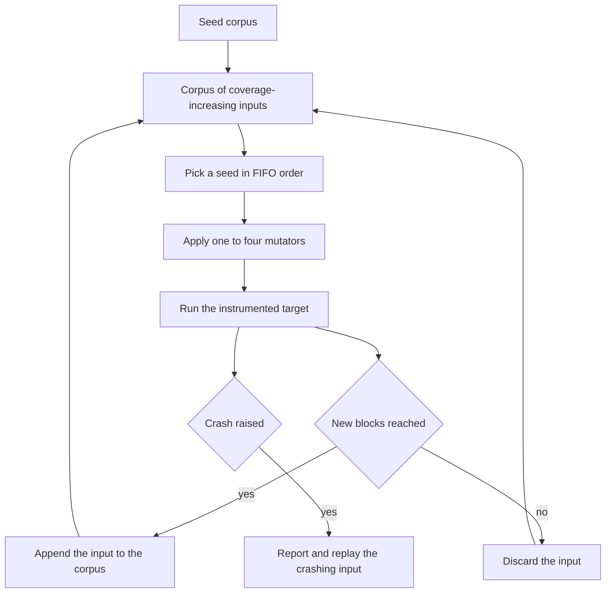
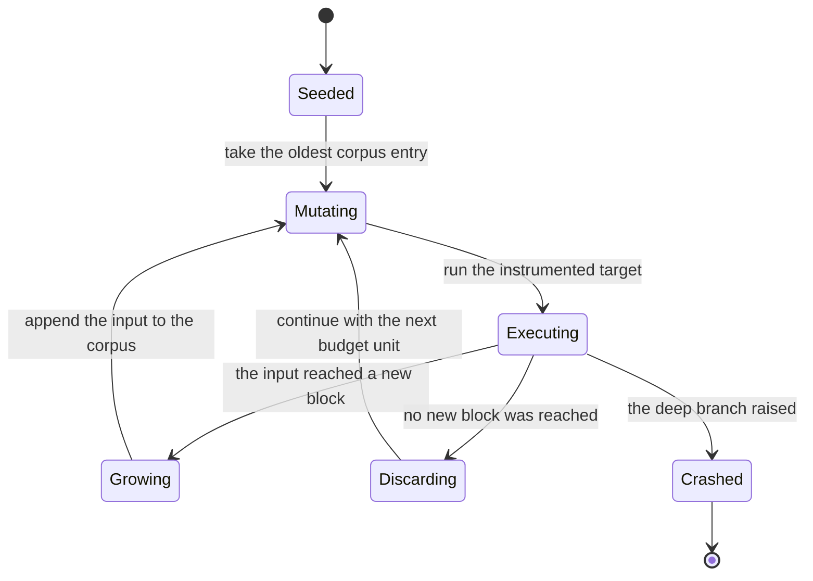
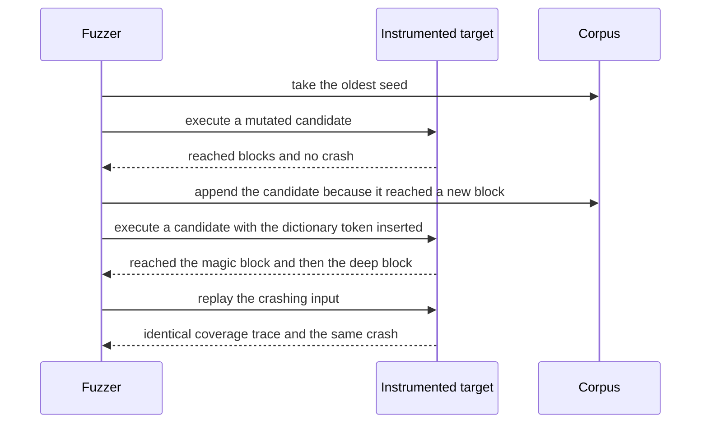

# 750 — Implement fuzzing harness with coverage-guided mutation (AFL-like)

> **Tier:** Expert · **CTCI chapter:** Ch 11 — Testing
> **Task spec:** [750-implement-fuzzing-harness-with-coverage-guided-mutation-afl-like.md](../../../tasks/expert/750-implement-fuzzing-harness-with-coverage-guided-mutation-afl-like.md)
> **Solutions:** [Python](../../../solutions/python/expert/750-implement-fuzzing-harness-with-coverage-guided-mutation-afl-like/solution.py) ·
> [Java](../../../solutions/java/expert/750-implement-fuzzing-harness-with-coverage-guided-mutation-afl-like/Solution.java) ·
> [JavaScript](../../../solutions/javascript/expert/750-implement-fuzzing-harness-with-coverage-guided-mutation-afl-like/solution.js) ·
> [C#](../../../solutions/csharp/expert/750-implement-fuzzing-harness-with-coverage-guided-mutation-afl-like/Solution.cs)

## 1. Problem restatement

Build a small AFL in one file: an **instrumented target** plus a **coverage-guided mutation fuzzer**
and, for contrast, an **unguided** fuzzer that uses the same mutators and the same execution budget
but never feeds coverage back into its choices.

The target is an instrumented parser over a byte string. Every branch records the identifier of the
basic block it entered in a coverage set, and one deep branch raises a `Crash` exception:

| Block | Entered when | Next |
| --- | --- | --- |
| 1 | always (entry) | requires `len(data) >= 2` |
| 2 | length at least 2 | requires `data[0] == 0x41` (`'A'`) |
| 3 | first byte is `'A'` | requires `data[1]` in `{0x01, 0x02}` |
| 4 | second byte is a valid selector | selector `0x02` goes to block 9 and returns |
| 5 | selector is `0x01` | requires `len(data) >= 6` |
| 6 | length at least 6 | requires `data[2:6] == MAGIC` |
| 7 | magic matches | requires `len(data) > 10` |
| 8 | length greater than 10 after a magic match | **raises `Crash`** |
| 9 | selector `0x02` | return without crashing |

The constants are `MAGIC = b"\x89MAG"`, `MAX_LENGTH = 24`, a seed corpus
`[b"", b"A", b"A\x01", b"B" * 4]`, and a dictionary that contains the constants the target compares
against, including `MAGIC`. The mutators are the classic ones — bit flips, byte assignments,
insertions, deletions, havoc, splicing with another corpus entry, and dictionary insertion — and each
generation applies one to four of them in sequence.

Concrete behaviour the checks assert:

- The crash is found and **replayed**: the recorded input really raises, and running it twice gives
  the same coverage trace.
- Every corpus entry is a `bytes` object within `MAX_LENGTH`; cumulative coverage never decreases and
  equals the union of the corpus members' coverage; `1` is always covered.
- The unguided baseline, with the same number of executions, does **not** reach block 7 and does not
  crash in that budget.
- The corpus cannot grow faster than one entry per execution, and an empty seed corpus consumes zero
  executions and finds nothing.
- The trivial input `b"A\x01"` covers exactly `{1, 2, 3, 4, 5}`; an input with the right length but
  the wrong magic covers block `6` and stops before `7`.
- Two hundred random applications of the mutator always return `bytes` of length at most
  `MAX_LENGTH`, including when mutating the empty input.
- Re-running with the same seed reproduces the corpus, the coverage and the crash exactly.

## 2. Intuition

Two properties make random testing fail here. First, the deep branch needs **four exact bytes** at a
specific offset, which uniform random mutation hits with probability `2⁻³²` per candidate. Second,
the branch is behind a length check, so a mutation that finds the magic but shortens the input stops
one block early.

Coverage guidance turns random search into hill climbing:

- Mutations are only *useful* if they reach new blocks. Keep every input that ever reached a block no
  earlier input reached — that is the **corpus**.
- Every new corpus entry makes *every* previous corpus entry more valuable, because splicing two
  partial solutions can combine them (an `'A'` seed with a valid selector, plus a seed carrying the
  magic bytes).
- The **dictionary** supplies the constants the target compares against, which is the "compare
  hints" idea: instead of hoping to guess `\x89MAG` byte by byte, insert the whole token.

The unguided baseline demonstrates that it is the *feedback* and not the mutators that matters: same
mutators, same budget, no corpus selection — and it never reaches the magic-comparison block.



## 3. Algorithm

1. `target(data, coverage)`: advance block by block, calling `hit(block)` (which adds the identifier
   to the shared coverage set) and returning as soon as a check fails. The last block raises `Crash`
   so the fuzzer can observe it as an exception.
2. `execute(entry)`: run the target on a fresh coverage set and return `(reached blocks, crash or
   None)`, which gives the fuzzer both the coverage signal and the crash signal in one call.
3. `mutate(data, state, corpus, dictionary)`: draw the operator count `1..4` from the PRNG, then apply
   that many operators drawn from the seven available kinds:
   - bit flip at a random position, random bit;
   - byte assignment at a random position;
   - insertion of a random or dictionary byte at a random position (only while below `MAX_LENGTH`);
   - deletion of a byte;
   - havoc (several random byte overwrites);
   - splicing: copy a random slice from a random corpus entry;
   - dictionary insertion: splice in a whole dictionary token such as `MAGIC`.
   Return a `bytes` value truncated to `MAX_LENGTH` on every path.
4. `Fuzzer.run(budget)`: while executions remain, take the oldest corpus entry, mutate it, execute the
   result, and if the execution reached any block not yet in the cumulative coverage, append the input
   to the corpus. Track `coverage_progress` after every execution and stop early when a crash appears,
   returning the crashing input.
5. `Fuzzer.unguided_run(budget)`: the same mutators and the same seed handling, but always mutate a
   randomly chosen seed from the *original* corpus and never add anything to it.
6. Replay: re-run `execute(crash)` and compare the coverage trace, which is the check "an input can be
   reproduced".

```text
procedure run(budget)
    executions ← 0
    while executions < budget do
        seed ← the oldest entry of the corpus
        candidate ← mutate(seed, state, corpus, dictionary)
        reached, crash ← execute(candidate)
        executions ← executions + 1
        if reached is not a subset of coverage then
            coverage ← coverage united with reached
            append candidate to the corpus
            record the cumulative coverage
        if crash is not none then return crash
    return none

procedure mutate(data, state, corpus, dictionary)
    result ← mutable copy of data
    count ← 1 plus a uniform draw from 0 to 3
    repeat count times do
        operator ← a uniform draw from the seven operators
        if operator is bit flip and result is not empty then flip one random bit
        else if operator is byte assignment then overwrite one random position
        else if operator is insertion and length is below the cap then insert a byte or a token
        else if operator is deletion and result is not empty then delete one random byte
        else if operator is havoc then overwrite several random positions
        else if operator is splicing and corpus is not empty then copy a slice from a random entry
        else if operator is dictionary insertion then splice a dictionary token into a random position
    return the first MAX_LENGTH bytes of result as bytes
```



## 4. Worked example

**Deriving the crashing input by hand.** The target needs, in order: `data[0] == 'A'`,
`data[1] == 0x01` (not `0x02`, which exits at block 9), `data[2:6] == b"\x89MAG"`, and
`len(data) > 10`. That is eleven bytes minimum.

| Offset | Byte | Why |
| --- | --- | --- |
| 0 | `0x41` (`'A'`) | passes the first-byte check |
| 1 | `0x01` | selector that continues instead of exiting at block 9 |
| 2 | `0x89` | first byte of `MAGIC` |
| 3 | `0x4D` (`'M'`) | second byte of `MAGIC` |
| 4 | `0x41` (`'A'`) | third byte of `MAGIC` |
| 5 | `0x47` (`'G'`) | fourth byte of `MAGIC` |
| 6..10 | five arbitrary bytes | bring the length to 11, which satisfies `len(data) > 10` |

**Block trace of that input.**

| Step | Test | Result | Coverage after the step |
| --- | --- | --- | --- |
| 1 | entry | continue | `{1}` |
| 2 | length at least 2 | pass | `{1, 2}` |
| 3 | first byte is `'A'` | pass | `{1, 2, 3}` |
| 4 | selector is `0x01` or `0x02` | pass | `{1, 2, 3, 4}` |
| 5 | selector is not `0x02` | pass | `{1, 2, 3, 4, 5}` |
| 6 | length at least 6 | pass | `{1, 2, 3, 4, 5, 6}` |
| 7 | `data[2:6]` equals `MAGIC` | pass | `{1, 2, 3, 4, 5, 6, 7}` |
| 8 | length greater than 10 | pass | `{1, 2, 3, 4, 5, 6, 7, 8}` and `Crash` |

**Two shorter inputs show why the feedback signal is informative.**

| Input | Blocks reached | Comment |
| --- | --- | --- |
| `b"A\x01"` | `{1, 2, 3, 4, 5}` | the trivial path the checks assert exactly |
| `b"A\x01\x00\x00\x00\x00"` plus eight more zeros | `{1, 2, 3, 4, 5, 6}` | right length, wrong magic — stops before block 7 |

The second row is the interesting one: it is only *one* mutation (a dictionary insertion of `MAGIC`
at offset 2) away from block 7. A fuzzer that keeps it because it added block 6 has effectively
stored half of the solution, which is exactly how coverage guidance shortens the search.



## 5. Complexity

Let `E` be the execution budget, `L` the input length (bounded by `MAX_LENGTH = 24`) and `K` the
number of instrumented blocks.

| Quantity | Bound | Reason |
| --- | --- | --- |
| one execution | O(L), at most O(K) block visits | the target walks the parser with early exits |
| one mutation | O(1) to O(L) | most operators touch one byte; splicing and havoc touch a slice |
| one fuzz step | O(L + corpus size) | the corpus append and the coverage union dominate |
| whole guided run | O(E · L) with a corpus of at most E entries | every execution costs at most one input length |
| corpus size | at most the number of executions, in practice at most one entry per newly covered block | only coverage-increasing inputs are appended |
| coverage map space | O(K) | a set of block identifiers |
| unguided baseline | O(E · L), same budget | same mutators, no corpus growth |

The point of the comparison is not a constant factor but reachability: with the same budget the
unguided run never enters block 7, because the probability of producing four exact bytes at the right
offset by chance is negligible.

## 6. Pitfalls and edge cases

- **Empty seed corpus.** With no seeds there is nothing to mutate: the run consumes zero executions
  and returns no crash. The checks assert that explicitly rather than assuming a special case.
- **Length cap.** Every mutation must return `bytes` of length at most `MAX_LENGTH`, including when
  the input is empty; the checks apply the mutator two hundred times and verify totality.
- **The dictionary is not cheating.** It is exactly the set of constants the target compares against,
  which is the documented AFL "compare hints" idea; without it, the four magic bytes would have to be
  guessed.
- **Unguided is a baseline, not a proof.** The claim the checks verify is narrow: *with this budget
  and these mutators* the unguided run does not reach block 7. It does not prove that random
  mutation can never find the crash.
- **Blocks 7 and 8 differ by the length test.** Reaching block 7 (magic matches) is not the crash;
  the crash needs `len(data) > 10` as well, so an input that satisfies the magic and stops short is
  recorded as a coverage win but not as a crash.
- **Coverage must be cumulative.** `coverage_progress` is asserted to be non-decreasing, and the
  final coverage is asserted to equal the union of the corpus members' coverage — a good check that
  the corpus append condition is not inverted.
- **Determinism requires discipline.** The PRNG is `splitmix64` with a fixed seed, seeds are taken in
  FIFO order, and the crash report carries the input; two runs must produce the same corpus and the
  same coverage.
- **Replay is a separate concern.** Finding a crash and *reproducing* it are different checks: the
  recorded input is re-executed and its coverage trace compared.
- **Concurrency is out of scope.** There is no fork server, no timeout handling and no parallel
  worker, all of which a production fuzzer needs before any of this is fast.

## 7. Variants and follow-ups

- **Better seed scheduling** — AFL's energy assignment favours small, fast, recently-discovered
  inputs instead of a strict FIFO queue.
- **Comparison logging** (Redqueen-style input-to-state or LLVM sanitizer coverage) replaces a static
  dictionary with hints collected at run time from the values the target actually compares.
- **Structure-aware fuzzing.** Instead of mutating bytes and hoping the syntax survives, derive
  inputs from a grammar — see
  [751-implement-grammar-based-fuzzing-for-structured-inputs.md](../../../tasks/expert/751-implement-grammar-based-fuzzing-for-structured-inputs.md),
  which generates only valid inputs and shrinks a found crash by delta debugging.
- **Guiding mutations with dataflow.** A taint analysis such as
  [752-implement-taint-analysis-simple-propagation-for-security-checks.md](../../../tasks/expert/752-implement-taint-analysis-simple-propagation-for-security-checks.md)
  identifies which input bytes influence a branch, which is how modern fuzzers pick mutation
  positions.
- **Path-condition harvesting** connects to the symbolic executor in
  [749-implement-symbolic-execution-skeleton-for-small-programs.md](../../../tasks/expert/749-implement-symbolic-execution-skeleton-for-small-programs.md):
  concolic execution turns a coverage goal into a constraint system.

## 8. Check yourself

<details><summary>Show answer</summary>
**Why does the fuzzer keep an input even when it does not crash?**

Because coverage — not crashes — is the search signal. An input that reached a block nobody reached
before is a stepping stone; storing it lets later mutations build on partial progress instead of
restarting from the seeds.
</details>

<details><summary>Show answer</summary>
**What is the minimum crashing input, and why?**

Eleven bytes: `'A'`, a selector of `0x01`, the four magic bytes `\x89MAG`, and five more bytes so the
length test `len(data) > 10` passes. The selector must be `0x01` rather than `0x02`, because `0x02`
exits at block 9 before any of the deep work.
</details>

<details><summary>Show answer</summary>
**Why is splicing useful even though both parents are "merely" coverage-increasing?**

Coverage-increasing inputs carry different partial solutions: one may satisfy the selector condition
while another carries the magic bytes at a different offset. Splicing concatenates slices, which
combines partial progress in a single step — something byte flips almost never do.
</details>

<details><summary>Show answer</summary>
**How do the checks know the corpus is being managed correctly?**

Two invariants: the size of the corpus never exceeds the number of executions, and the final coverage
equals the union of the coverage of all corpus members. Together they show that every covered block
is explained by some stored input, and that nothing is added without a coverage gain.
</details>

<details><summary>Show answer</summary>
**Why is the fuzzer's determinism a feature rather than a limitation?**

Because it makes the comparison with the unguided baseline *reproducible*: both runs consume the same
budget with the same seed, so the difference in reachability is attributable to the feedback loop
rather than to lucky randomness. Determinism also makes the crash replay check meaningful.
</details>
