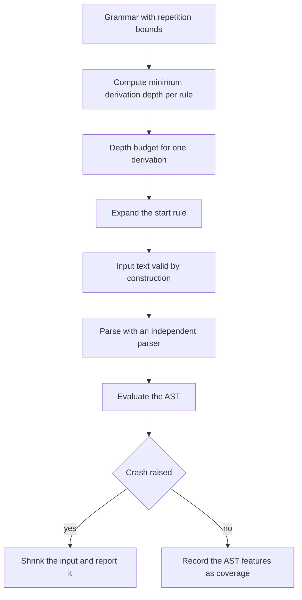
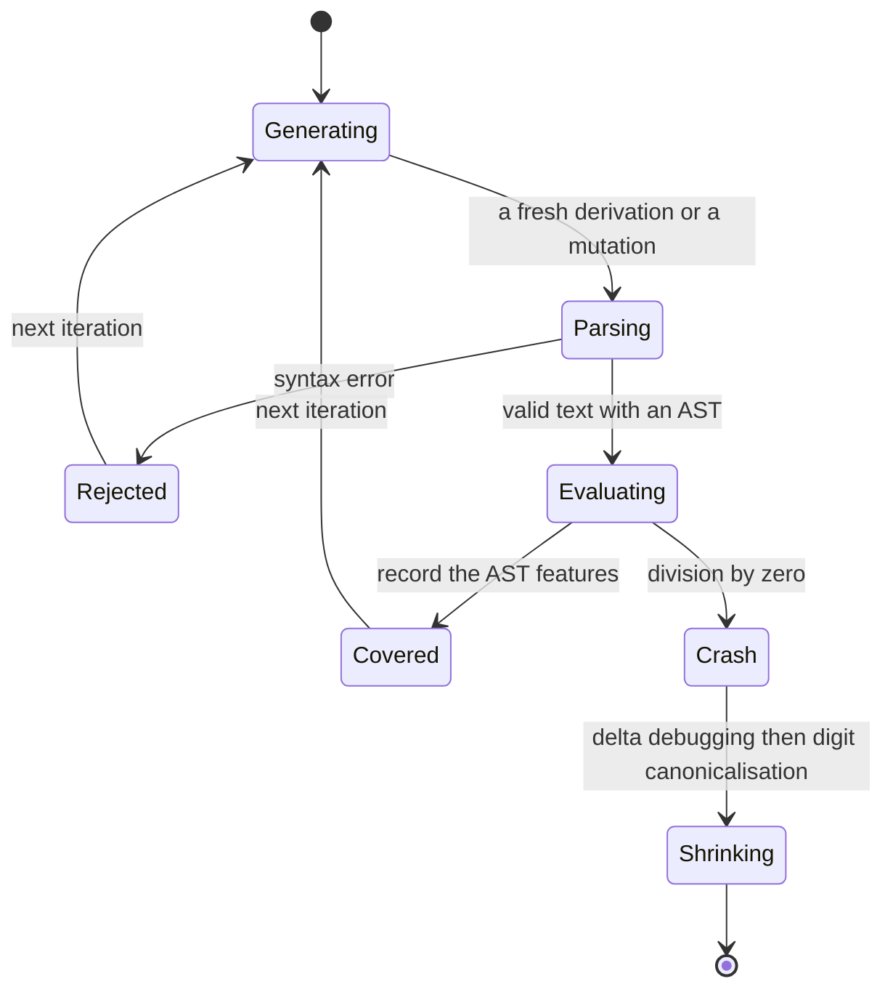
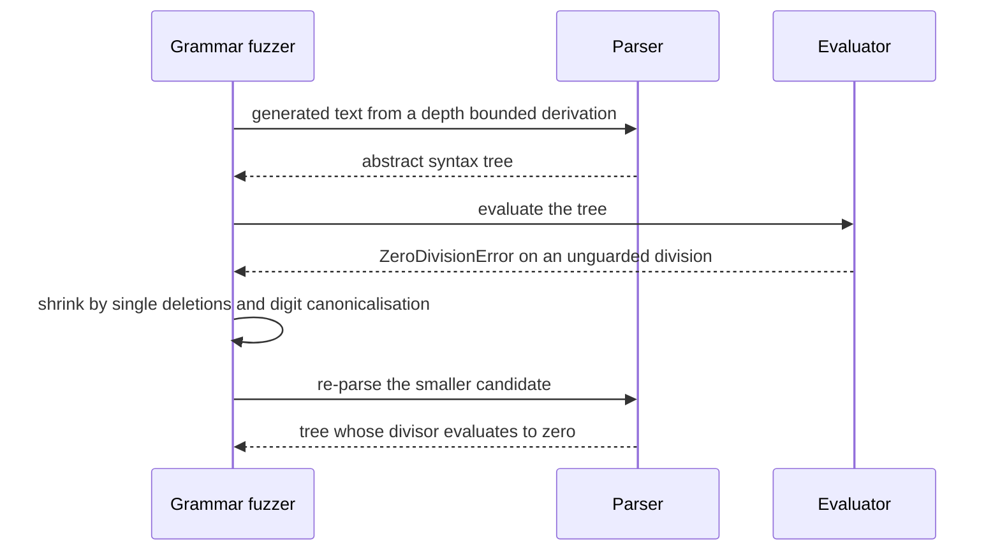

# 751 — Implement grammar-based fuzzing for structured inputs

> **Tier:** Expert · **CTCI chapter:** Ch 11 — Testing
> **Task spec:** [751-implement-grammar-based-fuzzing-for-structured-inputs.md](../../../tasks/expert/751-implement-grammar-based-fuzzing-for-structured-inputs.md)
> **Solutions:** [Python](../../../solutions/python/expert/751-implement-grammar-based-fuzzing-for-structured-inputs/solution.py) ·
> [Java](../../../solutions/java/expert/751-implement-grammar-based-fuzzing-for-structured-inputs/Solution.java) ·
> [JavaScript](../../../solutions/javascript/expert/751-implement-grammar-based-fuzzing-for-structured-inputs/solution.js) ·
> [C#](../../../solutions/csharp/expert/751-implement-grammar-based-fuzzing-for-structured-inputs/Solution.cs)

## 1. Problem restatement

Byte-level mutation destroys syntax: almost every mutation of a valid program text produces something
the parser rejects, so the fuzzer wastes its budget on inputs that never reach the interesting code.
**Grammar-based fuzzing** derives inputs *from a grammar*, so every generated input is syntactically
valid by construction. The grammar describes a tiny arithmetic language:

```text
<start>  -> <expr>
<expr>   -> <term> ( <addop> <term> ){0,3}
<term>   -> <factor> ( <mulop> <factor> ){0,2}
<factor> -> <number> | '(' <expr> ')' | '-' <factor>
<number> -> <digit> <digit>{0,2}
<digit>  -> '0' .. '9'
<addop>  -> '+' | '-'          <mulop> -> '*' | '/'
```

Each rule is expanded with a **depth budget**: `rule_depths` computes the least fixpoint of the
minimum derivation depth of every rule (one per expansion plus the depth of the referenced rules), and
an alternative is only eligible when it fits the remaining budget — which is what makes the recursive
`<factor> -> '-' <factor>` production terminate instead of looping forever. A purely cyclic grammar
receives depth infinity, and a budget below the start rule's depth is refused.

The fuzzer runs three modes over that grammar:

| Mode | Input source | Property |
| --- | --- | --- |
| `generate` | a fresh derivation per iteration | 100% syntactically valid by construction |
| `mutate` | coverage-guided mutation of a corpus of valid inputs | coverage is the set of AST features seen so far |
| `random` | uniform noise over an alphabet with language characters *and* junk | almost never valid |

The target is `evaluate`, whose deliberate defect is an unguarded division: dividing by an expression
that evaluates to zero raises `ZeroDivisionError` — the "crash" the fuzzer hunts. A found crash is then
**shrunk** by deleting single characters and canonicalising digits to `'0'` until no further reduction
still crashes.

Concrete behaviour the checks assert:

- Every generated input parses with an independent recursive-descent parser: 300 generated inputs,
  0 rejections, 300 parsed, and at least one crash.
- The minimal budget `depths[<start>]` yields a one-digit expression with no parentheses and no unary
  minus (every number is a single digit), and a budget one below that is refused with a message
  naming the reason.
- Mutation mode: 2000 rounds find crashes, reject a non-zero number of byte mutations as
  syntactically invalid, and never lose feature coverage relative to generation mode.
- Uniform noise: 400 inputs, 0 parsed, 0 crashes.
- The shrunk crash is smaller than the original, still crashes, still parses, has no single deletion
  that still crashes and no digit that can be canonicalised further, and its AST provably contains a
  division whose divisor evaluates to zero; the checks require at most 15 characters.
- `evaluate` agrees on the documented cases: `(1+2)*3 == 9`, `-(2+3) == -5`, `8/4 == 2`, and `1/0`
  raises `ZeroDivisionError`; the invalid inputs `""`, `"1+"`, `"(1+2"`, `"1 2"`, `"()"`, `"+1"` and
  `"1++2"` all raise `SyntaxError` rather than counting as crashes.
- The whole pipeline is reproducible: identical seed, identical crash, identical minimisation.

## 2. Intuition

A fuzzer needs to reach deep code, and deep code is usually guarded by a parser. Uniform random bytes
almost never parse — the checks measure exactly that with 400 noise inputs and zero successes. So the
random-search space has to be replaced by the space of *valid* inputs, which is what a grammar gives
you for free.

Three ingredients turn that into a working fuzzer:

1. **Depth-budgeted expansion.** Naively expanding a recursive grammar does not terminate. Computing
   each rule's minimum derivation depth once, then only allowing alternatives that fit the remaining
   budget, guarantees both termination and a lower bound on the shapes you can produce.
2. **Coverage over AST features, not bytes.** In mutate mode the interesting signal is which grammar
   productions and node kinds have been exercised, so the corpus keeps inputs that reach unseen
   features — the same hill-climbing idea as byte-level coverage guidance, one level up.
3. **Shrinking.** A crash found by random derivation is usually large and unreadable. Delta debugging
   plus digit canonicalisation reduces it to a minimal witness, which is what a bug report needs.



## 3. Algorithm

1. Build the grammar as a rule table; each alternative is a sequence of elements, where an element is
   a literal, a reference to another rule, or a repetition with explicit minimum and maximum counts.
2. `rule_depths` computes, for every rule, the least fixpoint of the minimum expansion depth: start
   from infinity, repeatedly relax each alternative to one plus the maximum depth of its referenced
   rules, until nothing changes. A cyclic grammar keeps infinity.
3. `Generator(grammar, budget).generate(iteration)`: expand the start rule, and at each step filter
   the alternatives to those whose depth fits the remaining budget; raise an error naming the reason
   when none fits. Which alternative is taken, and how often a repetition is unrolled, come from a
   hand-written `splitmix64` PRNG, so runs are exactly reproducible.
4. `parse(text)`: an independent recursive-descent parser producing an AST; it raises `SyntaxError`
   on invalid text. The fuzzer never trusts the generator — every generated input is re-parsed.
5. `evaluate(ast)`: evaluate the AST with integer arithmetic; division is unguarded, so a zero divisor
   raises `ZeroDivisionError`. That exception is the planted defect.
6. `fuzz(iterations, seed, mode, generator)`:
   - `generate` — one fresh derivation per iteration, re-parsed and evaluated;
   - `mutate` — apply the four classic byte mutations to a corpus of valid inputs, keep inputs that
     reach new AST features, and count mutations whose text no longer parses as rejected;
   - `random` — sample uniformly from an alphabet containing the language characters and junk.
   Each mode records generated, rejected, parse-ok, crashes and the covered feature set.
7. `shrink(text)`: greedily delete single characters, then canonicalise every non-zero digit to `'0'`,
   keeping a change only while the candidate still crashes; the result is a local minimum.

```text
procedure rule_depths(grammar)
    depth[rule] ← infinity for every rule
    changed ← true
    while changed do
        changed ← false
        for rule, alternatives in grammar do
            for alternative in alternatives do
                candidate ← 1
                for element in alternative do
                    if element is a reference then
                        candidate ← 1 + depth[element.rule]
                if candidate < depth[rule] then
                    depth[rule] ← candidate
                    changed ← true
    return depth

procedure generate(grammar, budget, state)
    text ← ""
    expand the start rule with remaining budget equal to budget:
        choose an alternative whose depth fits the remaining budget
        for each element of the alternative do
            if element is a literal then append the literal
            else if element is a repetition then append a repeat count between its bounds
            else expand the referenced rule with the budget reduced accordingly
    return text, state

procedure fuzz(iterations, seed, mode, generator)
    corpus ← the first eight generated inputs for the generate and mutate modes
    for step in 1 .. iterations do
        candidate ← generate a fresh input, or mutate a corpus entry, or draw uniform noise
        features ← ast_features(parse(candidate))
        if parsing failed then rejected ← rejected + 1
        else
            parse_ok ← parse_ok + 1
            covered ← covered united with features
            if evaluating the AST raises ZeroDivisionError then record the crash

procedure shrink(text)
    current ← text
    repeat until no change improves it:
        for each single-character deletion of current do
            if the candidate still crashes then current ← candidate
        for each digit in current that is not zero do
            if replacing it by zero still crashes then current ← the replacement
    return current
```



## 4. Worked example

**Part A — the depth budget.** Relaxing the rule table to a fixed point gives these minimum
derivation depths:

| Rule | Cheapest derivation | Depth |
| --- | --- | --- |
| `<digit>` | a literal digit | 1 |
| `<number>` | `<digit>` | 2 |
| `<factor>` | `<number>` | 3 |
| `<term>` | `<factor>` with zero repetitions | 4 |
| `<expr>` | `<term>` with zero repetitions | 5 |
| `<start>` | `<expr>` | 6 |

So the smallest legal budget is 6, and at that budget the *only* affordable derivation of
`<factor>` is `<number>` — which is exactly what the checks verify: the generated expression is a
single digit, contains no parentheses, and the unary-minus production is unreachable. Asking for a
budget of 5 is refused with a message that mentions the remaining depth.

**Part B — a crash and its minimal witness.** The defect fires when a divisor evaluates to zero. The
expression `0/0` is in the grammar (`<number>` → `<digit>` → `0` on both sides of the `<mulop>` `/`),
it evaluates to a division by zero, and it is a *local minimum* under the shrinker:

| Candidate change | Result | Still crashes |
| --- | --- | --- |
| delete the first `0` | `"/0"` | no, `SyntaxError` |
| delete the `/` | `"00"` | no, evaluates to `0` |
| delete the last `0` | `"0/"` | no, `SyntaxError` |
| canonicalise the first digit | `"0/0"` | unchanged, already canonical |

Because the divisor is `0`, the checks' AST inspection finds a division node whose divisor evaluates
to zero, which is the machine-checkable statement "this crash really is the planted defect" rather
than "the fuzzer found something that raised".



## 5. Complexity

Let `L` be the generated text length, `R` the number of grammar rules, `A` the number of
alternatives and `I` the iteration count.

| Quantity | Bound | Reason |
| --- | --- | --- |
| `rule_depths` | O(R · A) relaxation rounds at most | the fixpoint loop repeats only while some depth improves |
| one `generate` call | O(L) | each expansion step appends at least one character |
| one `parse` call | O(L) | the recursive-descent parser consumes the text once |
| one `evaluate` call | O(AST size), proportional to `L` | one visit per node |
| `fuzz` in generate mode | O(I · L) | one derivation, one parse and one evaluation per iteration |
| `fuzz` in mutate mode | O(I · L) plus corpus bookkeeping | byte mutations are cheaper to write but are frequently rejected by the parser |
| `fuzz` in random mode | O(I · L) | almost every iteration stops at the first parse failure |
| `shrink` | O(L² · cost of one crash test) | each pass tries `L` single deletions and can be repeated |
| space | O(L + features) | the corpus, the current AST and the covered feature set |

The interesting constant is the rejection rate: mutation mode reports a non-zero number of rejected
candidates while generation mode reports zero, which is exactly the qualitative difference the task is
about — and it is why the mutation mode still needs a valid corpus to start from.

## 6. Pitfalls and edge cases

- **Recursive productions need a budget.** Without the depth bookkeeping, `<factor> -> '-' <factor>`
  expands forever; the minimal-depth computation plus the eligibility test is what makes generation
  terminate.
- **A purely cyclic grammar has infinite depth.** No alternative fits any finite budget, so generation
  must refuse rather than loop — and the refusal message names the reason.
- **Generated input is still parsed independently.** The generator's own notion of validity is not
  trusted; every input goes through the recursive-descent parser, which is what the "300 parsed,
  0 rejected" check measures.
- **A parse error is not a crash.** `SyntaxError` is counted in `rejected`; only `ZeroDivisionError`
  from `evaluate` counts as a crash, otherwise noise would look like a huge win.
- **Uniform noise is essentially useless here.** 400 noise inputs produced zero valid parses, which is
  the empirical justification for grammar-based generation.
- **Canonicalising digits changes semantics.** Replacing digits by `'0'` can create or destroy a zero
  divisor, so the shrinker only keeps a canonicalisation that still crashes; the resulting witness is
  still checked to contain a zero-valued divisor.
- **Shrinking is local, not global.** The result is minimal with respect to single deletions and digit
  canonicalisation, not across all equivalent inputs.
- **Length cap.** `LENGTH_CAP = 1000` bounds how large a derivation may grow; deeper budgets increase
  text size quickly because `<expr>` and `<term>` allow up to three and two repetitions.
- **Coverage is coarse.** The feature set is AST-based, so two structurally different inputs with the
  same shape are indistinguishable to the corpus — a documented simplification relative to edge
  coverage.
- **Reproducibility.** The PRNG is a fixed `splitmix64`, so the same seed yields the same crash and
  the same minimisation; without that, the check "minimisation must be reproducible" could not exist.

## 7. Variants and follow-ups

- **Weighted or learned grammars** bias alternative selection toward historically productive
  productions instead of drawing uniformly.
- **Grammar inference** (learning the input format from a corpus of valid samples) removes the need to
  write the grammar by hand.
- **Structure-aware mutation** replaces byte flips with tree edits (replace a subtree, splice two
  trees), which keeps validity while exploring more shapes.
- **Comparison with byte-level fuzzing.** The coverage-guided byte fuzzer in
  [750-implement-fuzzing-harness-with-coverage-guided-mutation-afl-like.md](../../../tasks/expert/750-implement-fuzzing-harness-with-coverage-guided-mutation-afl-like.md)
  has the opposite trade-off: no grammar knowledge, but no rejection-by-construction either.
- Related work in this repository: guiding mutations with dataflow is the idea behind the taint
  analysis in
  [752-implement-taint-analysis-simple-propagation-for-security-checks.md](../../../tasks/expert/752-implement-taint-analysis-simple-propagation-for-security-checks.md),
  and constraint-based input generation is what the symbolic executor in
  [749-implement-symbolic-execution-skeleton-for-small-programs.md](../../../tasks/expert/749-implement-symbolic-execution-skeleton-for-small-programs.md)
  produces.

## 8. Check yourself

<details><summary>Show answer</summary>
**Why does a depth budget make generation terminate?**

Because every expansion step consumes budget and no alternative may exceed the remaining budget, so
the recursion depth is bounded by the budget. Computing the *minimum* depth per rule first means the
generator can refuse a budget that cannot produce any derivation at all instead of failing mid-way.
</details>

<details><summary>Show answer</summary>
**What does the fuzzer use as its coverage signal in mutate mode?**

A set of AST features — which productions and node kinds appear in the parsed input — rather than
byte-level code coverage. Inputs that introduce a feature nobody reached before are kept in the
corpus and used as parents for the next round of mutations.
</details>

<details><summary>Show answer</summary>
**Why is a `SyntaxError` not treated as a crash?**

Because the loop only counts an exception raised by `evaluate` as a crash. If parse errors counted,
uniform noise would dominate the "findings" while testing nothing: the checks confirm that 400 noise
inputs yield zero parses and zero crashes.
</details>

<details><summary>Show answer</summary>
**What makes the shrunk witness convincing as a bug report?**

Three properties that are all checked: it still crashes, it is locally minimal (no single deletion and
no digit canonicalisation still crashes), and the AST proves the crash mechanism — a division node
whose divisor evaluates to zero — so the finding is the planted defect rather than an incidental
exception.
</details>

<details><summary>Show answer</summary>
**Why does mutation mode still report rejections if the corpus starts out valid?**

Because mutations operate on text: a byte flip can break parentheses or delete an operator, and the
parser then rejects the candidate. That is the cost grammar-based *generation* avoids, and the reason
the two modes are reported side by side.
</details>
