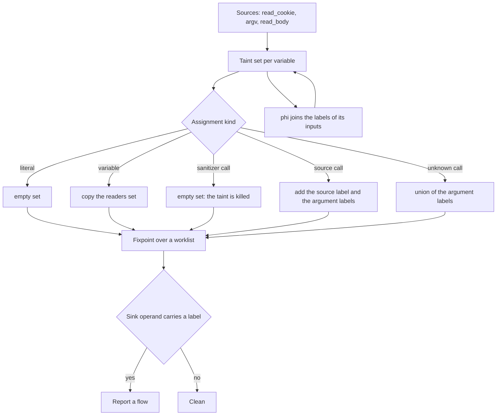
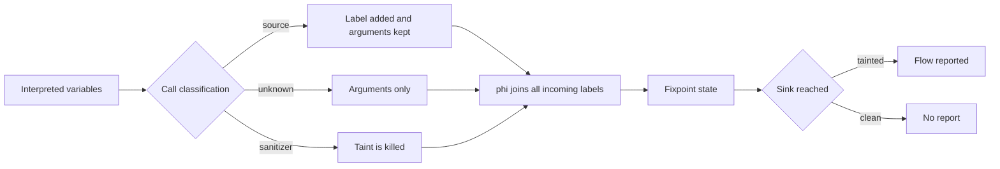
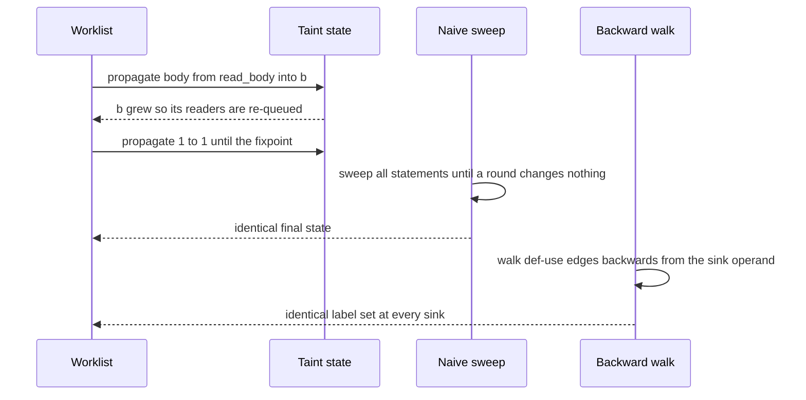

# 752 — Implement taint analysis: simple propagation for security checks

> **Tier:** Expert · **CTCI chapter:** Beyond — Security & Privacy
> **Task spec:** [752-implement-taint-analysis-simple-propagation-for-security-checks.md](../../../tasks/expert/752-implement-taint-analysis-simple-propagation-for-security-checks.md)
> **Solutions:** [Python](../../../solutions/python/expert/752-implement-taint-analysis-simple-propagation-for-security-checks/solution.py) ·
> [Java](../../../solutions/java/expert/752-implement-taint-analysis-simple-propagation-for-security-checks/Solution.java) ·
> [JavaScript](../../../solutions/javascript/expert/752-implement-taint-analysis-simple-propagation-for-security-checks/solution.js) ·
> [C#](../../../solutions/csharp/expert/752-implement-taint-analysis-simple-propagation-for-security-checks/Solution.cs)

## 1. Problem restatement

Decide, for a program in a flat **SSA statement list**, whether any value derived from an untrusted
input can reach a dangerous operation. Every variable holds a **taint set**: the set of source labels
whose value may have reached it.

| Construct | Transfer function |
| --- | --- |
| `assign v = lit` | `{}` |
| `assign v = var w` | `taint[w]` |
| `assign v = call f(args)` with `f` a **sanitizer** | `{}` (kill) |
| `assign v = call f(args)` with `f` a **source** | `{label(f)} ∪ taint(args)` |
| `assign v = call f(args)` otherwise (unknown callee) | `∪ taint(args)` (propagates) |
| `phi v = (w1, w2, …)` | `∪ taint[wi]` (join of the incoming edges) |
| `sink op(v)` for `op` in `{sql_query, os_exec, write_file}` | report a flow when `taint[v]` is non-empty |

`SOURCES = {read_cookie: cookie, argv: argv, read_body: body}`,
`SANITIZERS = {escape_html, int_cast, sql_escape}`, `SINKS = {sql_query, os_exec, write_file}`. The
allowlists are the security policy: anything not listed as a sanitizer *propagates*, including a
lookalike named `validate_weak`, so the analysis errs toward reporting.

The analysis is a **worklist fixpoint** over a def-use ("readers") index: a statement is re-queued
only when one of the variables it reads gained a strictly larger taint set. Because the transfer
functions are unions only (monotone) and the domain is a finite lattice of label sets, the least
fixpoint exists and the worklist terminates. Two independent oracles check it:

1. a naive implementation that sweeps every statement until nothing changes, and
2. a **backward** traversal from the sink operand that collects source labels along def-use edges and
   stops at sanitizer calls.

Because the transfer functions are pure unions, backward reachability must return *exactly* the same
label set as the forward fixpoint; any disagreement is a bug in the readers index or in the kill rule.

Concrete behaviour the checks assert:

- The empty program is clean, and a sink fed by a constant reports nothing (`lit 7` carries no label).
- Malformed IR is rejected: a read of an undefined variable, a sink on a ghost variable, a
  redefinition of the same variable, and a `phi` whose input is a literal.
- On 30 random programs of 24 statements, the worklist fixpoint equals the naive sweep, and for every
  sink the forward taint equals the backward label set.
- The reported state is a real fixpoint: re-applying the transfer function to a statement changes
  nothing. At least one random program re-processes a statement, so loop back-edges force genuine
  iterations.
- Monotonicity: turning a clean call into `read_body` can only add labels, and it becomes observable
  at the sink (`base_taint["b"] == {}` versus `tainted_taint["b"] == {"body"}`).
- The analysis is deterministic and idempotent (same flows and same update counts on re-runs).
- Known limitation: a sink downstream of `phi(safe, raw)`, where `safe` came from `int_cast` and `raw`
  straight from `read_body`, **is** reported — a path-insensitive false positive.

## 2. Intuition

The naive idea is to mark the input functions and then look for them at the sink, on each execution
path. That is unsound as an analysis (you cannot enumerate the paths of a real program) and useless
for a static checker, which has to warn *before* running anything.

The dataflow view drops paths on purpose: every variable carries the set of labels that *may* have
reached it, so the answer is conservative — it over-approximates the true set of flows. Three
observations make that both cheap and checkable:

1. **Unions only.** Every transfer function is a union of input taint sets, so the analysis is
   monotone and the least fixpoint can be computed by chaotic iteration: start with empty sets, apply
   transfers until nothing changes.
2. **Only changed reads matter.** A statement's result can only grow when one of the variables it
   *reads* grows. Maintaining a readers index and re-queueing exactly those statements turns the naive
   round-based sweep into a worklist algorithm.
3. **Forward and backward must agree.** Since the transfer functions only union, the set of labels
   that can reach a sink is the same whether you propagate forward from the sources or walk backward
   from the sink. That equivalence gives a second, structurally different implementation to check the
   first one against — the same reason the SAT solver checks learned clauses against real models.



## 3. Algorithm

1. Represent statements as tagged tuples: `("assign", v, rhs)`, `("phi", v, (u1, u2, …))` and
   `("sink", op, v)`. `Program` validates the list: every read must be of a variable defined by an
   earlier statement, every variable is defined at most once (SSA), and a `phi` must join variable
   reads, not literals.
2. Build the **readers index**: for each variable, the list of statement indices that read it. Sinks
   also register their operand as a read.
3. Initialise `taint[v] = {}` for all variables and queue every statement.
4. Process the worklist: compute the transfer result for the statement, and if it is *strictly larger*
   than the current set for the defined variable, update it and enqueue every statement in the readers
   index of that variable. Count the update as one worklist step.
5. Sinks have no defined variable; a sink whose operand carries a label is recorded as a flow with the
   statement index, the sink operation and the labels.
6. The `naive_analyze` oracle performs the same iteration without the index: sweep all statements
   repeatedly until a full round changes nothing, and count the rounds.
7. `backward_labels(program, sink_operand)` walks the def-use edges backwards from the sink: for an
   assignment it collects the labels contributed by the right-hand side and recurses into the read
   variables, stopping at sanitizer calls (they contribute nothing) and at literals.
8. Both oracles are compared statement by statement and sink by sink; the checks also verify that the
   forward result is a fixpoint by re-applying the transfer function.

```text
procedure analyze(program)
    taint[v] ← empty set for every variable
    worklist ← every statement index
    while worklist is not empty do
        statement ← take the next statement index
        if statement is a sink then
            if taint[operand] is not empty then record a flow
            continue
        result ← transfer(statement, taint)
        if result is strictly larger than taint[defined variable] then
            taint[defined variable] ← result
            for each reader of that variable do push the reader onto the worklist
    return taint and the recorded flows

function transfer(statement, taint)
    if statement is assign of a literal then return the empty set
    if statement is assign of a variable w then return taint[w]
    if statement is assign of call f with arguments arguments then
        if f is a sanitizer then return the empty set
        if f is a source then return the label of f united with the union of taint over arguments
        return the union of taint over arguments
    if statement is phi with inputs nodes then return the union of taint over nodes
    return the empty set

function backward_labels(program, variable)
    labels ← empty set
    statement ← the definition of variable
    if statement is a sanitizer call then return the empty set
    if statement is a source call then add the source label
    for every variable read by statement do
        labels ← labels united with backward_labels(program, read variable)
    return labels
```



## 4. Worked example

Two three-statement programs differing only in the first statement.

**Clean version:** `a = clean_fn()`, `b = concat(a, "!")`, `sink os_exec b`.

| Step | Statement | Transfer | `taint[a]` | `taint[b]` | Flow |
| --- | --- | --- | --- | --- | --- |
| 1 | `a = clean_fn()` | unknown call, no arguments | `{}` | — | — |
| 2 | `b = concat(a, "!")` | unknown call, union of argument labels | `{}` | `{}` | — |
| 3 | `sink os_exec b` | operand carries `{}` | `{}` | `{}` | none |

**Tainted version:** the first statement becomes `a = read_body()`.

| Step | Statement | Transfer | `taint[a]` | `taint[b]` | Flow |
| --- | --- | --- | --- | --- | --- |
| 1 | `a = read_body()` | source: `{body}` plus argument labels | `{body}` | — | — |
| 2 | `b = concat(a, "!")` | unknown call, union of argument labels | `{body}` | `{body}` | — |
| 3 | `sink os_exec b` | operand carries `{body}` | `{body}` | `{body}` | **reported** with label `body` |

That is exactly the monotonicity check: adding a source can only add labels, and the change becomes
visible at the sink (`{}` before, `{body}` after).

**Where the analysis is deliberately imprecise.** The guarded-sink program is
`a = read_body()`, `safe = int_cast(a)`, `merged = phi(safe, a)`, `sink sql_query merged`.

| Step | Statement | Label set |
| --- | --- | --- |
| 1 | `a = read_body()` | `{body}` |
| 2 | `safe = int_cast(a)` | `{}` — the sanitizer kills the taint |
| 3 | `merged = phi(safe, a)` | `{body}` — the join takes the maximum over both inputs |
| 4 | `sink sql_query merged` | flow reported |

A flow-sensitive analysis that knew the `int_cast` branch dominates the sink would stay silent. This
one cannot, and the checks assert the false positive instead of pretending it away.



## 5. Complexity

Let `n` be the number of statements, `m` the number of reads (edges in the def-use graph) and `k` the
number of labels (a small constant: three sources).

| Quantity | Bound | Reason |
| --- | --- | --- |
| one `transfer` call | O(arity + k) | unions over the arguments, and each set has at most `k` labels |
| worklist analysis | O(n + m · k) | a variable's set can grow at most `k` times, and each growth enqueues its readers |
| naive sweep oracle | O(rounds · n · k) | whole-program sweeps; rounds can exceed `n` because back-edges force re-processing |
| backward labels for one sink | O(n + m) | each statement is visited once through the def-use edges |
| space | O(n + m + n · k) | the statements, the readers index and the per-variable label sets |
| IR validation | O(n) | one pass for the SSA and defined-before-use checks |

The worklist wins on the constant and, more importantly, it is the version whose termination argument
is easy: the state only grows inside a finite lattice, so the number of updates is bounded. The naive
sweep is kept precisely because its cost profile is different, which makes agreement between the two a
meaningful check.

## 6. Pitfalls and edge cases

- **Empty program and constant sinks.** Both must be clean: no source, no label, no report. The checks
  assert `flows == []` and `updates == 0` for the empty program and no flow for `sink sql_query n`
  where `n` is a literal.
- **Skip the IR validation and everything downstream lies.** A read of an undefined variable, a sink
  on a ghost variable, a redefinition (not SSA) and a `phi` over a literal are all rejected by
  `Program` before analysis, so the fixpoint never sees an undefined read.
- **Unknown calls propagate, they do not kill.** This is the conservative choice and it is deliberate:
  a lookalike sanitizer such as `validate_weak` keeps the taint instead of removing it.
- **Sanitizers kill the whole taint**, not just the argument they wrap. That is a documented
  simplification: real sanitizers are usually modelled per-argument.
- **Path-insensitivity produces false positives.** The `phi` join of a cleaned and a raw value is
  reported even though a guard may have made the raw value unreachable — asserted, not hidden.
- **Implicit flows are not modelled.** A branch on a secret that later writes a constant leaks
  through control flow, and this analysis says nothing about it.
- **The backward oracle is exact only because the transfer functions are unions.** Introduce an
  intersection or a kill on one path and forward/backward agreement stops being a theorem, so the
  check would have to change too.
- **Worklist correctness lives in the readers index.** If a read edge is missing, a statement is never
  re-queued and the result is *smaller* than the fixpoint; the naive sweep and the backward walk both
  catch that.
- **Loops matter.** At least one random program re-processes a statement, which is the signal that the
  fixpoint is non-trivial; without back-edges a topological order would suffice.
- **No aliasing, no fields, no arrays.** Variables are the only storage, so a pointer-based program
  would first need to be lowered into this IR before the analysis says anything useful.

## 7. Variants and follow-ups

- **Path-sensitive analysis** (splitting on branches, or an IFDS/IDE formulation) removes the guarded
  false positive at the price of exponential state — the classic precision/scale trade-off.
- **Per-argument sanitizers** model a function as cleaning one operand while propagating the others,
  which needs a richer transfer signature than "returns empty set".
- **Implicit flows** require tracking the branch condition as an implicit taint source on every value
  written inside the branch.
- **Aliasing and field sensitivity** add a points-to analysis underneath, which is where real
  industrial taint engines spend most of their complexity.
- **Connection to fuzzing.** A taint analysis tells a fuzzer which input bytes influence a branch,
  which is how the harness in
  [750-implement-fuzzing-harness-with-coverage-guided-mutation-afl-like.md](../../../tasks/expert/750-implement-fuzzing-harness-with-coverage-guided-mutation-afl-like.md)
  could choose mutation positions more intelligently.
- Related work in this repository: the CFI checker skeleton
  [753-implement-control-flow-integrity-checker-skeleton.md](../../../tasks/expert/753-implement-control-flow-integrity-checker-skeleton.md)
  and the shadow-memory detector
  [754-implement-memory-sanitizer-style-shadow-memory-detector-toy.md](../../../tasks/expert/754-implement-memory-sanitizer-style-shadow-memory-detector-toy.md)
  both analyse programs with explicit, checkable models rather than real binaries; the happens-before
  model in
  [619-implement-formal-model-for-happens-before-and-verify.md](../../../tasks/expert/619-implement-formal-model-for-happens-before-and-verify.md)
  is a third, different static analysis in the same spirit.

## 8. Check yourself

<details><summary>Show answer</summary>
**Why does the analysis terminate, and why is the result the least fixpoint?**

Every transfer function is a union of already-computed taint sets, so the state can only grow, and the
domain is the finite lattice of label sets. A variable's set can grow at most as many times as there
are labels, so the worklist empties; starting from the empty sets and only ever adding labels
therefore reaches the least fixpoint.
</details>

<details><summary>Show answer</summary>
**Why must the backward walk agree exactly with the forward fixpoint?**

Because both compute reachability in the same graph: a label reaches the sink forward if and only if
the sink's def-use cone contains that source. The transfer functions contain no intersection or kill
that depends on other paths — sanitizers simply stop the walk — so the two computations are two
directions of the same reachability question, and any disagreement is a bug in the readers index.
</details>

<details><summary>Show answer</summary>
**What happens to a call to an unknown function such as `concat`?**

It propagates: the result carries the union of the argument labels. That is the conservative default —
an unknown function might pass its input through — and it is why allowlisting sanitizers, rather than
denylisting "clean" functions, is the safe design.
</details>

<details><summary>Show answer</summary>
**Why is the `phi(safe, raw)` sink reported even though `int_cast` cleaned the value?**

Because the analysis is path-insensitive: `phi` computes the union over both inputs, and the raw input
still carries the `body` label. Reaching the conclusion that the sanitized branch dominates would
require reasoning about which branch of the guard leads to the join.
</details>

<details><summary>Show answer</summary>
**Give one class of real leak this analysis is blind to.**

Implicit flows: if a secret decides whether a constant is written, the written value itself carries no
label, yet the secret has influenced observable behaviour. The solution header lists this together
with aliasing, fields and array elements as the deliberate scope limits.
</details>
