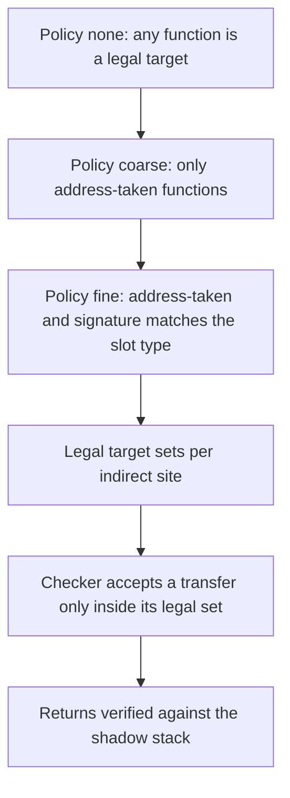
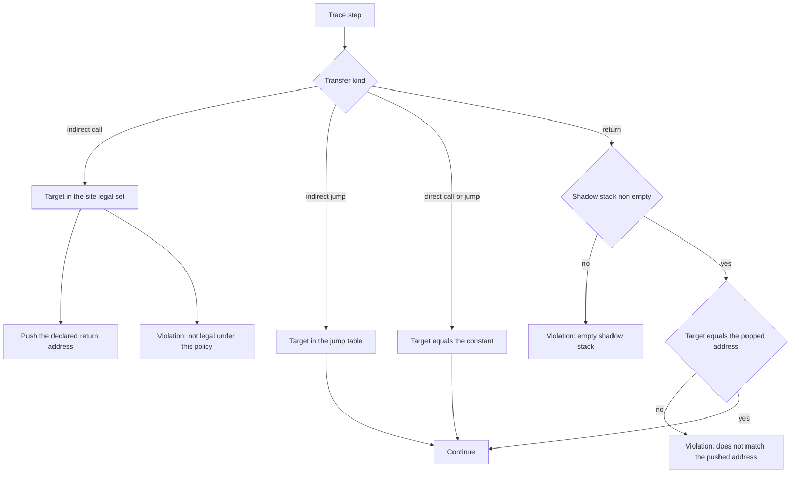
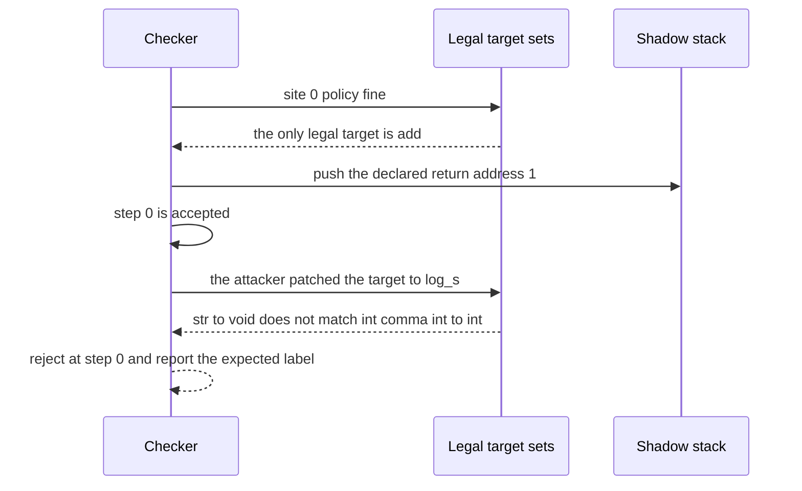

# 753 — Implement a control-flow integrity (CFI) checker skeleton

> **Tier:** Expert · **CTCI chapter:** Beyond — Security & Privacy
> **Task spec:** [753-implement-control-flow-integrity-checker-skeleton.md](../../../tasks/expert/753-implement-control-flow-integrity-checker-skeleton.md)
> **Solutions:** [Python](../../../solutions/python/expert/753-implement-control-flow-integrity-checker-skeleton/solution.py) ·
> [Java](../../../solutions/java/expert/753-implement-control-flow-integrity-checker-skeleton/Solution.java) ·
> [JavaScript](../../../solutions/javascript/expert/753-implement-control-flow-integrity-checker-skeleton/solution.js) ·
> [C#](../../../solutions/csharp/expert/753-implement-control-flow-integrity-checker-skeleton/Solution.cs)

## 1. Problem restatement

Control-flow integrity checks every **indirect** control transfer against a statically computed set of
legal targets: an attacker who can overwrite a function pointer or a return address must not be able
to reach a block the program could never legitimately jump to. The skeleton models a program as a
block list with four kinds of transfer:

| Transfer | Meaning | Legality rule |
| --- | --- | --- |
| `('icall_ind', slot, ret)` | indirect call through a function pointer | the slot's declared type label (`SLOT_SIGNATURES`) must match the callee's label under fine CFI |
| `('ijmp', table)` | indirect jump through a switch jump table | the target must be one of the table's declared targets |
| `('ret',)` | return | the target must equal the address on the run-time **shadow return stack** |
| `('call', f, ret)` | *direct* call (target is a constant) | the target must be that function's entry block |

Three policies, coarse to fine:

- `none` — any function may be called indirectly (no protection at all);
- `coarse` — only functions whose address is taken anywhere in the image may be targets;
- `fine` — additionally the callee's signature label must equal the call site's expected label.

The block image used by the checks has `main` at block 0 with an indirect call through the `fp` slot
(expected `int,int->int`), block 1 calling through `cb` (expected `int->void`), block 3 performing an
indirect jump through the `switch_a` table with targets `(4, 5)`, a direct `call add` from block 6,
and one-block functions `add`, `sub`, `log_i`, `log_s`, `gadget` that all end in `ret`. Taking an
address is expressed by a `mov` instruction, so `add`, `log_i` and `log_s` are address-taken while
`sub` and `gadget` are not.

The checker walks a **trace** of transfers, recomputes the shadow return stack, and reports the first
violation with its step index. Concrete behaviour the checks assert:

- A trace produced by an interpreter that only makes legal transfers is accepted under `fine`.
- Patching a call to a **non-address-taken** function is rejected by both `coarse` and `fine`.
- Patching the same call to an address-taken function with the **wrong signature** (`log_s`,
  `str->void`, where `int,int->int` is expected) is rejected by `fine` with a message naming the
  expected label, and quietly accepted by `coarse` — the documented weakness of coarse CFI.
- Patching a call to a block that exists but is **not a function entry** is rejected with "not a
  function entry".
- A corrupted indirect jump is reported as a "jump table" violation, a corrupted direct jump as a
  "direct jump" violation, and a corrupted direct call as a "direct call" violation.
- A ROP-style return hijack is caught by the shadow stack ("does not match the pushed address"), and a
  return with an empty shadow stack is rejected as well.
- **Exhaustive soundness**: for every indirect site, every block in the image and every policy, the
  checker accepts exactly the targets an independently recomputed legality predicate accepts.
- Coarse traces really do contain type-confused calls that `fine` rejects, and policy inclusion is
  monotone: whatever `fine` accepts, `coarse` accepts, and whatever `coarse` accepts, `none` accepts.
- `fine` shrinks the total size of the per-site legal sets compared with `coarse`; the empty trace is
  clean; malformed traces raise `ImageError`; and the interpreter plus checker are deterministic.

## 2. Intuition

An indirect branch is dangerous because its target is *data*: if an attacker controls the pointer, they
control where the program goes. CFI cannot stop the corruption; it makes the corruption useless by
restricting the set of values the transfer may legally take.

The ladder of policies is the whole design in miniature:

1. **None** trusts the pointer completely — the baseline an attacker prefers.
2. **Coarse** asks "could this target ever be used indirectly?" Taking a function's address is a static
   fact, so a function whose address never appears in the image can be excluded from every indirect
   site at once. That kills a large class of attacks (calling a gadget or an internal helper) but is
   blind to *type confusion*: a call through a `int->void` pointer can still land on a `str->void`
   function that happens to be address-taken.
3. **Fine** adds the callee's *signature*: the call site knows which slot it is calling through, and
   the slot has a declared type, so only functions with the matching label are legal. Its cost is
   granularity — the legal set shrinks — and the extra static bookkeeping of type labels.

Returns need a different mechanism, because the return address is not a constant the compiler can
check: the shadow stack records the address pushed by each call and requires the matching return. That
is why the checks can say "coarse and fine cannot help here, the shadow stack must".



## 3. Algorithm

1. `Image(blocks, entries, slot_signatures, jump_tables, signatures)` validates the block list: every
   block's function must have a signature, every `mov` must name a known function, and every jump
   table target must exist. Address-taken functions are collected while walking the `mov`
   instructions.
2. `legal_functions(site, policy)` computes the target set of one indirect site once and memoises it:
   - `none` — every function in the image;
   - `coarse` — the address-taken functions;
   - `fine` — the address-taken functions whose signature equals the site's expected label.
   A jump-table site uses the declared table targets instead of a policy-dependent set.
3. `check_trace(image, trace, policy)` walks the trace step by step, keeping a shadow return stack and
   a depth trace for diagnostics:
   - `icall_ind`: pop nothing, check the target block against the site's legal set (including that the
     target is a function entry) and push the site's declared return address;
   - `ijmp`: check the target against the jump table;
   - `call`: the target is a constant; check that it is that function's entry;
   - `ret`: the stack must be non-empty and the target must equal the popped address.
   On the first violation it returns `(step index, reason text, depth trace)`; a clean trace returns
   `(-1, "", depth trace)`.
4. `independent_legal(image, site, policy)` recomputes the legality predicate from scratch — a
   different formulation for the same question — so the checker's decisions can be compared against it
   over the entire state space rather than over the traces the interpreter happens to produce.
5. `interpret(image, policy, seed)` produces traces by making only legal transfers under the given
   policy, driven by a deterministic `splitmix64` PRNG; these are the positive controls.
6. `patch(trace, index, target)` builds the violating traces by replacing one target, which is the
   attacker model: the attacker redirects a transfer but cannot change the static image.
7. Malformed input (an unknown transfer kind, a trace entry that is not a tuple) raises `ImageError`
   rather than being silently ignored.

```text
function check_trace(image, trace, policy)
    shadow ← empty stack
    depths ← empty list
    for index, step in trace do
        kind ← the transfer kind of step
        if kind is icall_ind then
            site ← the block of the step
            target ← the target block of the step
            if target is not an entry of the image then return index, not a function entry
            if target is not in legal_functions(site, policy) then
                return index, target is not legal under this policy
            push the declared return address of the step onto shadow
        else if kind is ijmp then
            if target is not in the jump table of the step then return index, jump table violation
        else if kind is call then
            if target is not the entry of the called function then return index, direct call violation
        else if kind is jmp then
            if target is not the constant the instruction names then return index, direct jump violation
        else if kind is ret then
            if shadow is empty then return index, empty shadow stack
            expected ← pop the top of shadow
            if target is not expected then return index, does not match the pushed address
        else return malformed trace
        append the current depth of shadow to depths
    return minus one, clean, depths

function legal_functions(site, policy)
    if policy is none then return every function of the image
    if policy is coarse then return the address-taken functions of the image
    expected ← the declared label of the slot used at this site
    return the address-taken functions whose signature equals expected
```



## 4. Worked example

**A clean trace, built by hand from the block image.** Blocks: 0 = `mov fp, add` then
`icall_ind fp, 1`; 1 = `mov cb, log_s` then `icall_ind cb, 2`; 2 = `jcc 3, 6`; 3 = `ijmp switch_a`;
6 = `mov guarded, log_i` then `call add, 7`; 7 = `halt`; and `add` at 10, `log_i` at 30.

| Step | Transfer | Policy check | Shadow stack after |
| --- | --- | --- | --- |
| 0 | site 0, indirect call through `fp` to block 10 (`add`, `int,int->int`) | expected label `int,int->int` matches | `[1]` |
| 1 | block 10, `ret` | popped `1` is the target | `[]` |
| 2 | site 1, indirect call through `cb` to block 30 (`log_i`, `int->void`) | expected label `int->void` matches | `[2]` |
| 3 | block 30, `ret` | popped `2` is the target | `[]` |
| 4 | site 3, indirect jump via `switch_a` | target `4` is in the table `(4, 5)` | `[]` |
| 5 | block 4, `jmp 6` | direct jump to the constant `6` | `[]` |
| 6 | block 6, direct call to `add` | target is `add`'s entry, block 10 | `[7]` |
| 7 | block 10, `ret` | popped `7` is the target | `[]` |
| 8 | block 7, `halt` | no target to check | `[]` |

`check_trace` returns `(-1, "", …)`, which is the positive control.

**The same trace, patched one step at a time.**

| Patch | Policy | Verdict | Reason text |
| --- | --- | --- | --- |
| step 0 target becomes `log_s` entry | `fine` | rejected at step 0 | expected `int,int->int` |
| step 0 target becomes `log_s` entry | `coarse` | **accepted** | coarse CFI has no signature check |
| step 0 target becomes `sub` entry | `coarse` and `fine` | rejected at step 0 | `sub` is not address-taken |
| step 0 target becomes block 4 | `coarse` | rejected at step 0 | not a function entry |
| step 4 target becomes `10` | `coarse` | rejected at step 4 | jump table |
| the `ret` at step 1 targets block 3 | `coarse` | rejected at step 1 | does not match the pushed address |

The second and third rows together are the point of the policy ladder: coarse CFI blocks the
non-address-taken call but happily accepts the type-confused one.



## 5. Complexity

Let `t` be the trace length, `b` the number of blocks, `f` the number of functions and `s` the number of
indirect sites.

| Quantity | Bound | Reason |
| --- | --- | --- |
| `legal_functions` once per site and policy | O(f) | one scan over the functions, filtered by address-taken and signature |
| all legal sets | O(s · f) | memoised once, then O(1) lookups per checked transfer |
| `check_trace` | O(t) | one constant-time legality test per step plus stack operations |
| shadow stack | O(t) space, push/pop O(1) | depth bounded by the number of nested calls in the trace |
| `independent_legal` per (site, policy) | O(b · f) | the agreement sweep recomputes the predicate for every block |
| exhaustive soundness sweep | O(s · b · policies) legality tests | that is the size of the state space the checks enumerate |

The runtime cost is linear in the trace, which is what makes this deployable: the expensive part is
the *static* computation of the legal sets, and once those exist a transfer check is a set lookup. The
price of fine-grained CFI is visible in the stats — the total size of the fine legal sets is strictly
smaller than the coarse one — and so is the benefit: coarser policies leak type confusion, which the
checks demonstrate by finding type-confused calls in the coarse traces themselves.

## 6. Pitfalls and edge cases

- **A legal-looking address is not a legal target.** Block 4 exists in the image, but it is not a
  function entry, so an indirect call to it is rejected with "not a function entry" — a checker that
  only validates "the address is mapped" would accept it.
- **Coarse CFI is genuinely weaker.** The checks do not hide this: they find traces in the coarse
  target sets that contain a type-confused call, accept them under `coarse` and reject them under
  `fine`. Monotonicity (fine clean implies coarse clean implies none clean) is asserted in the other
  direction only.
- **Returns need the shadow stack.** Neither policy can validate a return address, because the correct
  target is dynamic; the hijacked return and the return-on-empty-stack cases are the two checks that
  belong to the stack, not to the target sets.
- **The attacker model is "retarget one transfer".** `patch` changes a target but never the static
  image or the legal sets, which is the honest statement of what CFI defends against.
- **Malformed traces must raise**, not be skipped: an unknown transfer kind or a non-tuple step raises
  `ImageError`, so a checker bug cannot silently turn into "clean".
- **Empty trace is trivially clean** and has an empty depth trace; APIs that assume at least one step
  have to handle the boundary.
- **Address-taken is a whole-image property.** A function that takes its own address anywhere becomes
  a legal target everywhere under coarse CFI, which is why fine-grained signatures matter.
- **Determinism.** The interpreter is seeded and the checker is a pure function of the trace, so both
  the traces and the verdicts are reproducible — which is what makes the exhaustive sweep meaningful.
- **Simplifications versus a real deployment.** The program is a block list rather than a binary, type
  labels are canonical signature strings instead of vtable hash labels, there is no landing-pad layout
  and no exception unwinding, and the frame layout is not modelled — only which value may be jumped to.

## 7. Variants and follow-ups

- **Vtable or class-hierarchy checks** generalise the signature label to a set of legal members for the
  object type at the call site, which is how production CFI handles virtual dispatch.
- **Landing-pad based checks** (as in Windows CFG export suppression) add valid call targets for
  exception handling, which is exactly the layout this skeleton omits.
- **Return protection alternatives**: shadow stacks, stack canaries and authenticated return addresses
  (pointer authentication) all try to make the return target unforgeable; the shadow stack here is the
  simplest of the three.
- **Hardware-assisted CFI** enforces the same legal sets in silicon, which removes the per-transfer
  software cost.
- Related work in this repository: the taint analysis in
  [752-implement-taint-analysis-simple-propagation-for-security-checks.md](../../../tasks/expert/752-implement-taint-analysis-simple-propagation-for-security-checks.md)
  models dataflow rather than control flow, the shadow-memory detector in
  [754-implement-memory-sanitizer-style-shadow-memory-detector-toy.md](../../../tasks/expert/754-implement-memory-sanitizer-style-shadow-memory-detector-toy.md)
  covers the memory-integrity half of the same security story, and the ORAM sketch in
  [757-implement-oram-oblivious-ram-sketch-for-simple-access-patterns.md](../../../tasks/expert/757-implement-oram-oblivious-ram-sketch-for-simple-access-patterns.md)
  attacks a third side of the same problem: hiding the access pattern rather than the target of a
  branch.

## 8. Check yourself

<details><summary>Show answer</summary>
**Why can coarse CFI not detect a type-confused call?**

Because it only asks whether the callee's address is taken anywhere in the image. Two address-taken
functions with different signatures are equally legal targets, so a call through an `int->void` slot
that lands on a `str->void` function passes. Adding the signature label per site is exactly what `fine`
does.
</details>

<details><summary>Show answer</summary>
**Why is a return address checked against a shadow stack rather than a legal set?**

Because the correct return target depends on which call is currently active, which is dynamic
information the static image does not have. The shadow stack reconstructs that information at run time:
the call pushes its declared return address and the return must pop the same value.
</details>

<details><summary>Show answer</summary>
**What does the exhaustive (site, policy, block) sweep prove that interpreter traces do not?**

Interpreter traces only exercise the paths the interpreter chose. The sweep checks the checker against
an independently recomputed predicate for *every* block in the image and every policy, so a systematic
error — an off-by-one in the address-taken set, a wrong signature comparison — cannot hide behind a
friendly trace set.
</details>

<details><summary>Show answer</summary>
**Why does the checker verify direct calls and jumps at all?**

Because a corrupted direct branch is a symptom of the same memory corruption that can hit an indirect
one. Verifying the constant costs almost nothing and catches "the instruction was patched" as a
distinct violation kind, which the checks assert with the "direct jump" and "direct call" reason texts.
</details>

<details><summary>Show answer</summary>
**What is the practical trade-off between coarse and fine policies?**

Fine-grained CFI shrinks the legal target sets — the checks measure a strictly smaller total — which
means fewer places an attacker can jump to, but it needs accurate type information and can break
programs that legitimately reuse a function pointer across signatures. Coarse CFI is cheaper and more
permissive, and the checks document its blind spot rather than assuming it away.
</details>
