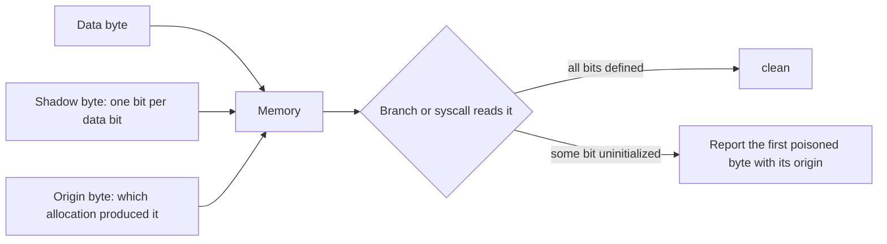
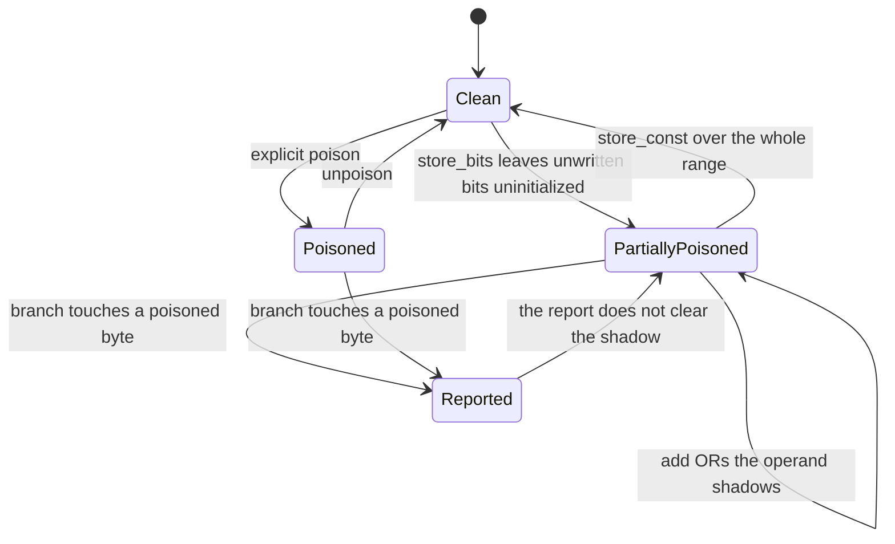
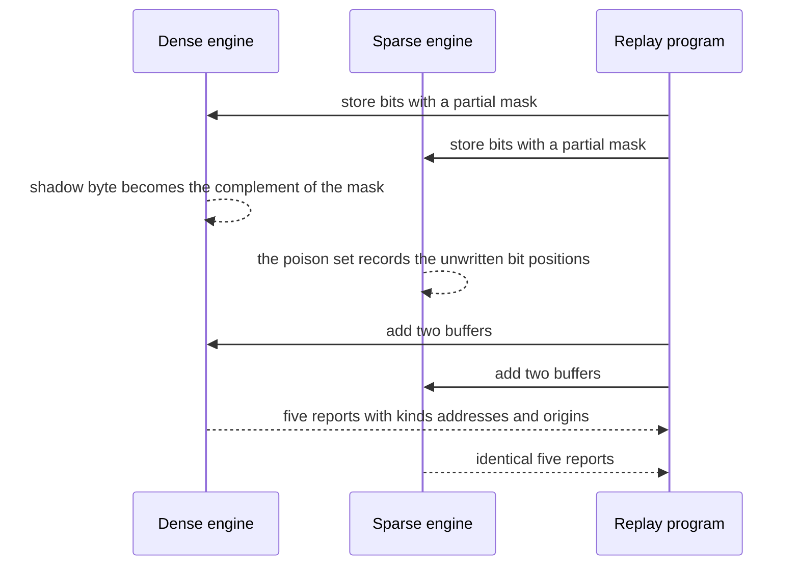

# 754 — Implement a memory-sanitizer style shadow memory detector (toy)

> **Tier:** Expert · **CTCI chapter:** Beyond — Security & Privacy
> **Task spec:** [754-implement-memory-sanitizer-style-shadow-memory-detector-toy.md](../../../tasks/expert/754-implement-memory-sanitizer-style-shadow-memory-detector-toy.md)
> **Solutions:** [Python](../../../solutions/python/expert/754-implement-memory-sanitizer-style-shadow-memory-detector-toy/solution.py) ·
> [Java](../../../solutions/java/expert/754-implement-memory-sanitizer-style-shadow-memory-detector-toy/Solution.java) ·
> [JavaScript](../../../solutions/javascript/expert/754-implement-memory-sanitizer-style-shadow-memory-detector-toy/solution.js) ·
> [C#](../../../solutions/csharp/expert/754-implement-memory-sanitizer-style-shadow-memory-detector-toy/Solution.cs)

## 1. Problem restatement

MemorySanitizer's core idea is that every **bit** of application memory has a shadow bit saying whether
that bit is initialized. This task implements that engine twice, with two different shadow
representations of the same state:

| Engine | Representation |
| --- | --- |
| `BitShadowMemory` | a dense data byte, a dense shadow byte with one bit per data bit, plus an origin byte per byte — the shape a real sanitizer uses |
| `SparseShadowMemory` | a dictionary from address to the *set of poisoned bit positions*, plus a dictionary of origins |

The propagation rules are the interesting part:

- storing a value propagates the value's shadow **bit for bit**, so a partially initialized integer
  stays partially initialized;
- arithmetic combines operand shadows with **OR** (an over-approximation: a result bit is uninitialized
  if either operand bit was);
- the sanitizer only **reports** when an uninitialized value reaches a branch or a syscall argument —
  not on every load;
- every poisoned byte carries an **origin** (the allocation that produced it), so a report can say
  "this byte came from allocation #1".

A small driver replays a fixed operation list (`alloc`, `store_const`, `store_bits`, `memcpy`, `add`,
`branch`, `poison`, `unpoison`, `syscall_print`) against either engine, which is what makes the two
representations comparable. Concrete behaviour the checks assert:

- The program produces exactly five reports, in this order, with these kinds and origins:

| # | Report kind | Origin | Offset inside `dst` |
| --- | --- | --- | --- |
| 1 | `copied poison` | 1 | 4 |
| 2 | `still virgin after unpoison` | 1 | 5 |
| 3 | `second-hand poison` | 1 | 1 |
| 4 | `after overwrite` | 1 | 0 |
| 5 | `explicit poison` | 2 | 7 |

- The dense engine and the sparse engine agree on the report list *and* on the final shadow state when
  the sparse state is expanded into the dense form.
- Arithmetic propagates bitwise: a byte with the high nibble poisoned (`0xF0`) OR-ed with a byte whose
  bits 2..5 are poisoned (`0xC3`) gives `0xF3`, and the bytes that only take part in the addition are
  fully poisoned (`0xFF`). `first_poisoned(8, 4)` returns `(8, 0xF3)`.
- Reporting is *delayed*: the "arithmetic result" is never reported, because the OR of two fully
  initialized bytes stays clean.
- Writing a constant over poisoned memory clears the shadow: after `store_const` the branch is clean
  and no report is emitted; an explicit `poison` then reports once, and a second `store_const` clears
  it again.
- Boundary behaviour: a zero-length allocation is harmless, the last byte of an allocation is
  addressable, an out-of-range access raises `IndexError` on **both** engines, and re-running produces
  identical reports and identical shadow state.

## 2. Intuition

An uninitialized read is invisible to the program itself: the value is *something*, and only the
programmer knows it should not have been used. The sanitizer therefore tracks, for every bit, a
separate "is this bit defined?" bit.

Once that shadow exists, three rules do all the work:

1. **Stores copy the shadow.** Writing a value into memory copies its shadow with it, so taint of
   "undefined" travels through assignments and `memcpy` exactly as the data does.
2. **Arithmetic ORs the shadows.** If either operand bit was undefined, the result bit is undefined.
   That is conservative — the true result may be defined anyway — and it is the reason the checks
   verify the rule bit by bit rather than byte by byte.
3. **Only branches and syscalls report.** Reporting on every load would drown the user in noise;
   MSan-style tools report when the undefined value is *used* in a decision, which is where behaviour
   becomes observable.

The second engine is not an implementation detail; it is the correctness argument. A dense bit array
and a dictionary of bit sets are structurally different code paths, and replaying one program through
both and demanding identical reports and identical final state is how the propagation rules get tested
without an external oracle.



## 3. Algorithm

1. `alloc(name, size, tag)` reserves `size` bytes, records the base address under the allocation name,
   and starts the range clean (no poisoned bits, no origin).
2. `store_const(addr, payload)` writes the data bytes and **clears** the shadow for exactly those
   bytes — a constant is fully defined — and resets their origin.
3. `store_bits(addr, value, mask, origin)` writes `value` and sets the shadow to the complement of
   `mask`: every bit *not* covered by the mask stays uninitialized, and the byte's origin becomes
   `origin`. This is how a partially initialized value is modelled.
4. `memcpy(dst, src, n)` copies data, shadow bits and origins byte by byte, iterating backwards when
   the ranges overlap and the destination starts after the source.
5. `add(dst, a, b, n)` computes the byte-wise sum and sets the destination shadow to
   `shadow(a) OR shadow(b)`; the origin is the first non-zero origin among the operands, so the report
   can still name the allocation that started it.
6. `branch(addr, n, kind)` scans the range and reports the **first** byte that has any poisoned bit
   (with its address and origin), returning `False`; a fully defined range returns `True`.
7. `poison(addr, n, tag)` sets all eight bits of the range as uninitialized with that origin;
   `unpoison(addr, n)` clears the range completely.
8. `_check(addr, n)` rejects ranges outside the engine's allocated memory with `IndexError`, and both
   engines implement it, so an out-of-range access cannot be "clean" by accident.
9. `snapshot()` returns the current poisoned state in a canonical form, which is what the dense/sparse
   comparison uses; `first_poisoned(addr, n)` returns the first poisoned byte and its bit mask.

```text
procedure store_bits(addr, value, mask, origin)
    for each byte offset of the range do
        data[addr + offset] ← the corresponding value byte
        shadow[addr + offset] ← complement of the corresponding mask byte
        origin[addr + offset] ← the allocation tag

procedure add(dst, a, b, n)
    for offset from 0 to n - 1 do
        data[dst + offset] ← data[a + offset] plus data[b + offset] modulo 256
        shadow[dst + offset] ← shadow[a + offset] OR shadow[b + offset]
        if shadow[a + offset] is not empty then origin[dst + offset] ← origin[a + offset]
        else origin[dst + offset] ← origin[b + offset]

procedure memcpy(dst, src, n)
    order ← ascending offsets when dst is below src, otherwise descending offsets
    for offset in order do
        data[dst + offset] ← data[src + offset]
        shadow[dst + offset] ← shadow[src + offset]
        origin[dst + offset] ← origin[src + offset]

function branch(addr, n, kind)
    validate the range
    for index from addr to addr + n - 1 do
        if shadow[index] has any poisoned bit then
            report kind, index and origin[index]
            return false
    return true
```



## 4. Worked example

**Part A — bitwise arithmetic.** Allocate `x`, `y` and `z` with tags 21, 22 and 23, each four bytes.

| Step | Operation | Shadow of the affected byte |
| --- | --- | --- |
| 1 | `store_bits(0, 0x11, 0x0F, 21)` — only the low nibble is written | `0xF0` |
| 2 | `store_bits(4, 0x22, 0x3C, 22)` — mask `0x3C` covers bits 2..5 | `0xC3` |
| 3 | `add(8, 0, 4, 4)` — OR the shadows byte by byte | `0xF0 OR 0xC3 = 0xF3` for byte 8 |
| 4 | the remaining bytes of the addition | `0xFF OR 0xFF = 0xFF` |

The first byte of the result is therefore `0xF3`, not `0xFF` and not `0x00`: the OR is per bit, so the
bits that both operands happened to define stay defined. `first_poisoned(8, 4)` returns `(8, 0xF3)`.

**Part B — delayed reporting and origins.** The replay program produces the five reports in this order;
each one is a *branch* that observed a poisoned byte, not a store and not an arithmetic operation.

| # | Trigger | Origin | Offset in `dst` | Why it is reported here and not earlier |
| --- | --- | --- | --- | --- |
| 1 | `copied poison` | 1 | 4 | the poison arrived by `memcpy`; it was silent until a branch looked at it |
| 2 | `still virgin after unpoison` | 1 | 5 | an `unpoison` covered a different range, so this byte is still uninitialized |
| 3 | `second-hand poison` | 1 | 1 | the label travelled through a copy, but the *origin* still names allocation 1 |
| 4 | `after overwrite` | 1 | 0 | this byte was written with a constant over a poisoned one — the report comes from the surrounding range check |
| 5 | `explicit poison` | 2 | 7 | a direct `poison` with a different origin, which is why the origin column changes |

Two details make this table a real test rather than a narrative: the origins follow the data (four
reports carry origin 1 because all four bytes descend from allocation 1), and the offsets are reported
relative to `dst`, so the report points at the offending byte and not at the buffer.



## 5. Complexity

Let `n` be the width of an operation, `m` the number of operations in the program and `p` the number of
poisoned bytes.

| Operation | Time | Space | Reason |
| --- | --- | --- | --- |
| `alloc` | O(n) | O(n) | the dense engine materialises data, shadow and origin for the range |
| `store_const` | O(n) | — | data plus a cleared shadow and origin |
| `store_bits` | O(n) | — | one shadow byte per written byte |
| `memcpy` | O(n) | — | data, shadow and origin copied together, in overlap-safe order |
| `add` | O(n) | — | one OR per byte |
| `branch` / `syscall_print` | O(n) worst case, O(1) best case | — | stops at the first poisoned byte |
| `poison` / `unpoison` | O(n) | — | one pass over the range |
| replay of the whole program | O(m · n) | O(total bytes) dense, O(p) sparse | every operation is linear in its width |
| dense/sparse comparison | O(m · n) | O(total bytes) | expanding the sparse state into the dense form for the equality check |

The two representations have the same asymptotic cost but very different profiles: the dense engine
pays for *all* bytes whether they are poisoned or not, the sparse one pays only for poisoned bytes and
for the dictionary overhead. That is precisely the engineering trade-off a real sanitizer makes when it
chooses between a shadow byte per data byte and a compressed representation.

## 6. Pitfalls and edge cases

- **Reporting must be delayed.** A store, a copy or an arithmetic operation never reports; only a
  branch or a syscall argument does. The checks assert that the arithmetic result is absent from the
  report list, so an over-eager implementation fails immediately.
- **OR is an over-approximation.** Adding two initialized bytes gives a clean result, but OR-ing an
  initialized byte with a poisoned one marks the *whole* result byte poisoned, even when the true value
  happens to be defined. That is a deliberate false-positive bias.
- **Bit granularity is the point.** A byte-level shadow would turn `store_bits(0, 0x11, 0x0F, 21)`
  into "clean", losing the fact that the high nibble was never written.
- **Origins ride along with the poison.** Both `memcpy` and `add` carry the origin forward (the first
  non-zero operand origin for `add`), which is why the "second-hand poison" report can still name
  allocation 1 after a chain of copies.
- **Overlapping `memcpy` needs a direction.** Copying forward when the destination starts after the
  source would overwrite data before reading it; the implementation iterates backwards in that case.
- **Zero-length ranges are trivially clean.** `branch(last, 0)` returns `True` for a zero-length
  allocation, and the checks assert it rather than relying on the loop never running by accident.
- **Out-of-range access must raise, on both engines.** A range that runs past an allocation raises
  `IndexError`; a sanitizer that silently accepted it would report garbage addresses.
- **Writing a constant clears the shadow.** `store_const` is the only operation that *removes* poison
  besides `unpoison`, and the overwrite test asserts no report survives it (no false positive).
- **The second engine is a real check, not a formality.** Any divergence in report kind, address or
  origin, or in the final shadow state, is treated as a bug in the propagation rules — the two
  implementations share no shadow code.
- **Simplifications versus MSan.** Memory is a flat byte array with no allocator metadata, alignment or
  redzones; OR is the toy rule for *all* arithmetic; origins are allocation identifiers rather than a
  graph; only branch and syscall report sites exist; there is no call-stack origin and no suppression
  list. The toy hash and the small buffers make the behaviour checkable, not production-fast.

## 7. Variants and follow-ups

- **Bit-level vs byte-level precision** is the main knob: bit precision finds partially initialized
  values, byte precision is cheaper and noisier or quieter depending on the policy.
- **Origin tracking** can be extended into a full graph (allocation, stack trace, chain of copies),
  which is what turns "uninitialized use" into an actionable report.
- **Compressed shadow memory** (shadow for large zero regions, per-page summaries) is how real
  sanitizers keep the memory overhead bounded.
- **Address sanitizer** is the sibling problem — redzones and use-after-free instead of
  initialization — and shares the shadow-memory infrastructure.
- Related work in this repository: the taint analysis in
  [752-implement-taint-analysis-simple-propagation-for-security-checks.md](../../../tasks/expert/752-implement-taint-analysis-simple-propagation-for-security-checks.md)
  propagates the same kind of "may this value be trusted" bit over an IR instead of over memory, the
  CFI checker in
  [753-implement-control-flow-integrity-checker-skeleton.md](../../../tasks/expert/753-implement-control-flow-integrity-checker-skeleton.md)
  handles the control-flow half of the integrity story, and the constant-time primitives in
  [755-implement-timing-attack-resistant-comparison-function-and-test.md](../../../tasks/expert/755-implement-timing-attack-resistant-comparison-function-and-test.md)
  guard against an information leak that no shadow bit can see.

## 8. Check yourself

<details><summary>Show answer</summary>
**Why is the shadow propagated bit by bit instead of per byte?**

Because a partially initialized value is common and useful to distinguish — writing the low nibble of a
byte leaves the high nibble undefined. A per-byte shadow would have to mark the whole byte poisoned
(worse precision) or clean (unsound), and the arithmetic checks rely on the nibble-level detail.
</details>

<details><summary>Show answer</summary>
**Why does the sanitizer report on a branch rather than on a load?**

Because an uninitialized value is only *harmful* when it influences observable behaviour, and a load by
itself changes nothing observable. Delaying the report to a branch or syscall removes the flood of
false positives from copying uninitialized data around before it is eventually initialized.
</details>

<details><summary>Show answer</summary>
**What does the second engine add to the test suite?**

A structurally different implementation of the same semantics. If both agree on the report list (kind,
address, origin) and on the final shadow state for the whole program, the propagation rules are
consistent across two independent representations — an agreement that a single implementation can never
demonstrate about itself.
</details>

<details><summary>Show answer</summary>
**Why can the OR rule report a value that is in fact fully initialized?**

Because OR only asks "did either operand bit come from an uninitialized place?" If the true result bit
happens to be determined by the initialized operand — for instance when the poisoned bits are later
masked out — the report is a false positive. The rule is chosen for soundness: it never misses a real
use, at the cost of some noise.
</details>

<details><summary>Show answer</summary>
**What does the origin field tell you, and how does it survive a chain of copies?**

The origin names the allocation whose uninitialized bytes started the chain. `memcpy` copies the origin
along with the shadow, and `add` takes the first non-zero operand origin, so a byte copied several
times still reports the allocation it originally came from instead of the last buffer it passed through.
</details>
