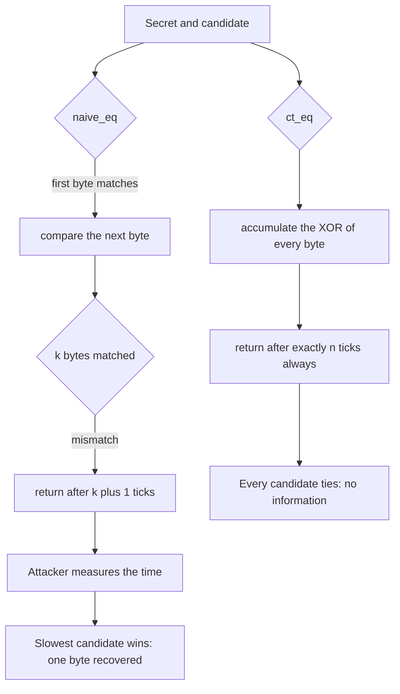
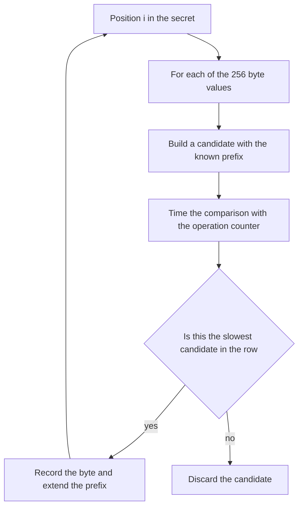
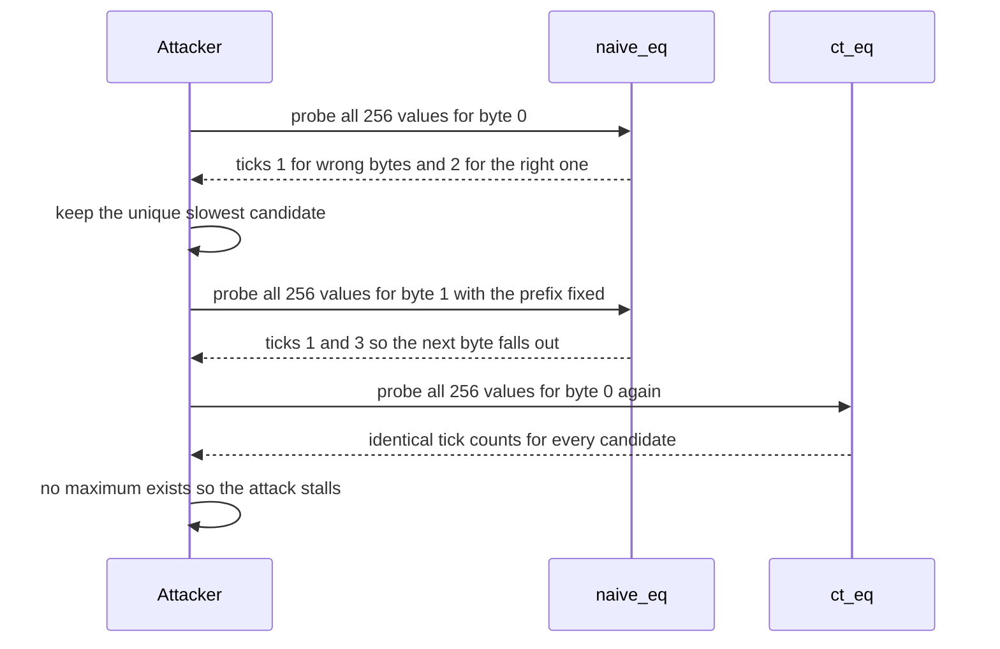

# 755 — Implement a timing attack resistant comparison function and test

> **Tier:** Expert · **CTCI chapter:** Beyond — Security & Privacy
> **Task spec:** [755-implement-timing-attack-resistant-comparison-function-and-test.md](../../../tasks/expert/755-implement-timing-attack-resistant-comparison-function-and-test.md)
> **Solutions:** [Python](../../../solutions/python/expert/755-implement-timing-attack-resistant-comparison-function-and-test/solution.py) ·
> [Java](../../../solutions/java/expert/755-implement-timing-attack-resistant-comparison-function-and-test/Solution.java) ·
> [JavaScript](../../../solutions/javascript/expert/755-implement-timing-attack-resistant-comparison-function-and-test/solution.js) ·
> [C#](../../../solutions/csharp/expert/755-implement-timing-attack-resistant-comparison-function-and-test/Solution.cs)

## 1. Problem restatement

A `memcmp`-style comparison that returns as soon as two bytes differ leaks the **length of the common
prefix** through its running time: an attacker who can measure response time learns the secret one byte
at a time. Implement both sides of the story and a test that proves the difference:

| Piece | Behaviour |
| --- | --- |
| `naive_eq(a, b)` | the leaky implementation: return at the first differing byte |
| `ct_eq(a, b)` | the constant-time one: one pass over the whole string accumulating `diff OR= a[i] XOR b[i]` |
| `ct_select_u32(bit, x, y)` | branch-free selection built from masks only |
| `ct_lt_u32(x, y)` | branch-free comparison returning `1` or `0` via borrow masks |

The length is treated as **public**, exactly as every real constant-time API does: RSA and CMAC tag
comparators fail fast on a length mismatch, because the length is part of the public encoding and not
the secret.

The "clock" is an **operation counter**, a timing model: it charges one tick per byte comparison plus a
fixed epilogue. Being a model it is exact and reproducible, so the security claim becomes testable
rather than measured. Concrete behaviour the checks assert:

- `ct_eq` produces **exactly one** distinct tick count over all equal-length pairs, while `naive_eq`
  produces a distinct count per common-prefix length — the costs for prefixes `1 … n` are `2 … n+1`, so
  every prefix length is distinguishable.
- The byte-at-a-time timing attack on `naive_eq` recovers the first `n-1` bytes of the secret in
  `(n-1) · 256` probes; in every row the correct byte is the **unique** slowest candidate, and each
  row's winning tick count grows by one.
- The **same** attack on `ct_eq` gets no signal at all: every candidate in every row ties, so the
  attack cannot even start, and the recovered value is all zeros.
- A static lint walks the bytecode of both functions and counts conditional jumps **inside a loop
  body**: `ct_eq` has none, `naive_eq` has at least one.
- The bitwise primitives are exact on the boundary set `{0, 1, 2, 0x7FFFFFFF, 0x80000000, 0xFFFFFFFE,
  0xFFFFFFFF, 12345, 0xDEADBEEF}` and on 200 random 32-bit pairs, are branch-free by the same lint, and
  the attack is reproducible.

## 2. Intuition

A comparison looks harmless because its *result* is a single bit. The leak is in the *control flow*: an
early exit on the first mismatch means the running time is proportional to the number of matching bytes.
An attacker cannot read the secret directly, but with a few thousand timed attempts they can score each
candidate byte and keep the one that took longest to fail.

The fix is a discipline rather than a trick:

1. **Touch every byte.** Compare the full buffer and OR the differences into one accumulator; the loop
   trip count is then independent of the data.
2. **Branch on nothing secret.** No `if`, no early return, no `break`, no data-dependent memory index.
   The final decision is `diff == 0`, and even the *return* can be arranged to be a mask.
3. **Make the property checkable.** Because the "clock" counts operations rather than nanoseconds, the
   tests can verify the exact claim — one tick count per input length, a distinct count per prefix
   length, and an attack that succeeds on one implementation and ties on the other. The bytecode lint
   adds a second, structurally different check: whatever the counter says, a data-dependent branch in a
   loop is disqualifying.



## 3. Algorithm

1. `naive_eq(a, b)`: compare the lengths, then loop over the indices and return `False` at the first
   differing byte. This is the leak: the number of iterations equals the matching prefix length plus
   one.
2. `ct_eq(a, b)`: compare the lengths (public), then loop over **all** indices, accumulating
   `difference |= a[i] ^ b[i]`, and return `difference == 0`. The loop count is the length of the
   strings, never the data.
3. `ct_select_u32(bit, x, y)`: build the mask `-(bit & 1)` (all ones or all zeros in 32 bits) and
   return `(x & mask) | (y & ~mask)`, so the value is chosen without a branch.
4. `ct_lt_u32(x, y)`: compute `x - y` with borrow propagation and extract the borrow bit via shifting
   and masking, returning `1` when `x < y` and `0` otherwise; no comparison operator is used.
5. `loop_interior_branches(function)`: disassemble the function with the standard bytecode tooling,
   walk the instructions, track loop bodies (backward jumps delimit a loop), and count conditional
   jumps whose target or position lies inside such a body. A constant-time routine must have none.
6. `timing_attack(compare, length)`: for each position from `0` to `length - 2`, probe all 256 byte
   values with the already-recovered prefix fixed and record the tick count of each probe; the row's
   unique maximum is the next secret byte. Return the recovered prefix and the rows.
7. The tick counter charges one tick per byte comparison plus a fixed epilogue, and the checks compare
   the resulting counts rather than wall-clock times.

```text
function naive_eq(a, b)
    if length of a is not length of b then return false
    index ← 0
    while index < length of a do
        charge one tick
        if a[index] is not b[index] then return false
        index ← index + 1
    charge the epilogue
    return true

function ct_eq(a, b)
    if length of a is not length of b then return false
    difference ← 0
    index ← 0
    while index < length of a do
        charge one tick
        difference ← difference OR a[index] XOR b[index]
        index ← index + 1
    charge the epilogue
    return difference is 0

function ct_select_u32(bit, x, y)
    mask ← negate of the low bit of bit
    return x AND mask OR y AND complement of mask

function ct_lt_u32(x, y)
    difference ← x minus y as 32-bit words with borrow propagation
    return the borrow bit shifted down to position zero

procedure timing_attack(compare, length)
    rows ← empty list
    recovered ← empty list
    for position from 0 to length - 2 do
        row ← empty list of 256 tick counts
        for candidate in every byte value do
            probe ← recovered joined with candidate and arbitrary filler up to length
            row[candidate] ← tick count of comparing probe with the secret
        append row to rows
        append the index of the unique maximum of row to recovered
    return recovered, rows
```



## 4. Worked example

Take the demo secret `T0p-S3cret!` (12 bytes; `T` is `0x54`) and the first attack row, which probes all
256 values for the first byte with no prefix known yet. Costs are in ticks: `1 + length of the matching
prefix`.

| Candidate | Matching prefix | Ticks | Comment |
| --- | --- | --- | --- |
| any byte other than `0x54` | 0 bytes | 1 | fails immediately |
| `0x54` (`'T'`) | 1 byte | 2 | the unique maximum of the row |

The attacker keeps `0x54` and moves on. In row two the known prefix is `T`, so every candidate now
matches at least one byte (1 tick) and the correct second byte matches two (3 ticks): the maximum of
each row grows by one, which is exactly why the checks assert that the winning tick counts are
`2, 3, …, 12` for a 12-byte secret.

| Row | Known prefix before the row | Tick count of the winning candidate |
| --- | --- | --- |
| 0 | empty | 2 |
| 1 | `T` | 3 |
| 2 | `T0` | 4 |
| … | … | … |
| 10 | first eleven bytes | 12 |

Running the identical attack against `ct_eq` produces rows in which **every** entry has the same tick
count, because a full pass costs the same regardless of the data. There is no maximum to pick, so the
attack returns a prefix of zeros and learns nothing — the security claim is the absence of a signal,
not an argument about it.



## 5. Complexity

Let `n` be the compared length and `k` the length of the matching prefix.

| Quantity | Time | Reason |
| --- | --- | --- |
| `ct_eq` | O(n) always, independent of the data | one pass over the whole buffer, no early exit |
| `naive_eq` | O(k + 1) with `k` the matching prefix | it returns at the first mismatch, which is the leak |
| `ct_select_u32` / `ct_lt_u32` | O(1) word operations | masks and shifts only, no branch |
| one attack row | O(256 · n) | 256 probes, each costing a full or partial comparison |
| whole attack on `naive_eq` | O((n - 1) · 256 · n) probes of work | one row per recovered byte, and each probe compares up to `n` bytes |
| whole attack on `ct_eq` | the same probe count | every probe costs the same, so no row has a maximum |
| bytecode lint | O(size of the function) | a single disassembly walk |

The asymmetry is the whole point: the *attacker's* work is identical in both cases, but only the leaky
implementation gives a usable signal. A constant-time comparison is not cheaper to attack — it simply
carries no information about the prefix.

## 6. Pitfalls and edge cases

- **The length is public on purpose.** Failing fast on a length mismatch is standard and is *not* the
  leak being fixed; pretending the length is secret would break every real API that includes it in the
  encoding.
- **The timing model is not a measurement.** It cannot see micro-architectural effects such as cache
  line granularity, vector units or CPU speculation, and it says nothing about the compiler's
  optimisations. What it does verify, exactly, is the algorithmic property: the operation count and the
  control flow do not depend on the compared data.
- **Python integers are not constant time.** Big-integer arithmetic itself branches on the operand
  sizes, so a production implementation needs fixed-width machine words; the solution header states this
  limitation rather than glossing over it.
- **The return value of a constant-time routine must also be branch-free** if the caller branches on it
  immediately; `ct_select_u32` exists for exactly that reason.
- **The boundary set matters.** `0x80000000` and `0x7FFFFFFF` are where mask-based comparisons usually
  break, which is why the primitives are checked exhaustively on those values plus 200 random pairs.
- **The static lint is a second, independent check.** A clever counter can be fooled; a data-dependent
  conditional jump inside a loop body cannot be argued away.
- **The attack's tie-break argument assumes a non-zero first secret byte.** With a zero first byte the
  "no candidate stands out" case would be ambiguous, and the check asserts that assumption explicitly.
- **Determinism.** Every probe is reproduced by the same code path, so two attack runs return identical
  rows — which is what makes the comparison against `ct_eq` a controlled experiment.

## 7. Variants and follow-ups

- **Double-blind or random-length comparisons** hide the length too, at the cost of extra protocol
  round trips.
- **Hashed comparison** (compare hashes of the values rather than the values themselves) reduces the
  data-dependent work but moves the leak into the hash unless the hash is also constant time.
- **Constant-time primitives beyond equality** include selection, conditional swap, modular reduction
  and encoding, all built from the same mask discipline used in `ct_select_u32` and `ct_lt_u32`.
- **Real measurement** (cycle counters, statistical tests over many samples) complements the model, but
  it measures the machine as much as the code — which is why this task starts from a model.
- Related work in this repository: the constant-time modular exponentiation in
  [756-implement-side-channel-resistant-constant-time-modular-exponenti.md](../../../tasks/expert/756-implement-side-channel-resistant-constant-time-modular-exponenti.md)
  extends the same "no branch on secret, no secret index into memory" discipline to exponentiation, the
  ORAM sketch in
  [757-implement-oram-oblivious-ram-sketch-for-simple-access-patterns.md](../../../tasks/expert/757-implement-oram-oblivious-ram-sketch-for-simple-access-patterns.md)
  removes the address-pattern leak, and the taint analysis in
  [752-implement-taint-analysis-simple-propagation-for-security-checks.md](../../../tasks/expert/752-implement-taint-analysis-simple-propagation-for-security-checks.md)
  is the static counterpart of "which value may influence a branch".

## 8. Check yourself

<details><summary>Show answer</summary>
**Where exactly is the leak in `naive_eq`?**

In the loop trip count: the function returns at the first mismatch, so the elapsed work is proportional
to the length of the common prefix. Measuring the response time tells the attacker how many leading
bytes were correct, which is one byte of information per row.
</details>

<details><summary>Show answer</summary>
**Why does `ct_eq` still compare lengths first, if length checks leak?**

Because the length is part of the public encoding of the value (a tag length, a ciphertext length).
Treating it as secret would be futile and would break interoperability; the secret being protected is
the *content*, not the size.
</details>

<details><summary>Show answer</summary>
**Why is an operation counter a legitimate way to make a security claim?**

Because the claim under test is about the algorithm: the number of primitive operations and the control
flow do not depend on the data. A counter captures exactly that invariant and makes it reproducible,
whereas wall-clock measurement would add machine-specific noise that cannot be turned into an assertion.
It cannot prove anything about caches or speculation, and the solution says so.
</details>

<details><summary>Show answer</summary>
**In the attack on `ct_eq`, why does "every candidate ties" stop the attack?**

The attack picks the slowest candidate in each row. If all candidates have identical cost, there is no
maximum to distinguish — the attacker learns nothing, so the recovered prefix stays empty. Absence of a
signal is the property being verified.
</details>

<details><summary>Show answer</summary>
**What does the bytecode lint add over the tick counter?**

Independence. It inspects the compiled control flow and flags conditional jumps inside loop bodies,
which catches a data-dependent branch that the counter might not be modelling — for example a branch
that costs no extra ticks but still reveals information through branch prediction or instruction cache
behaviour.
</details>
