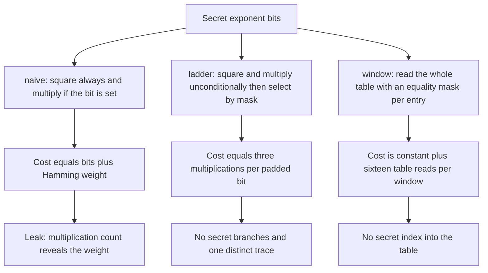
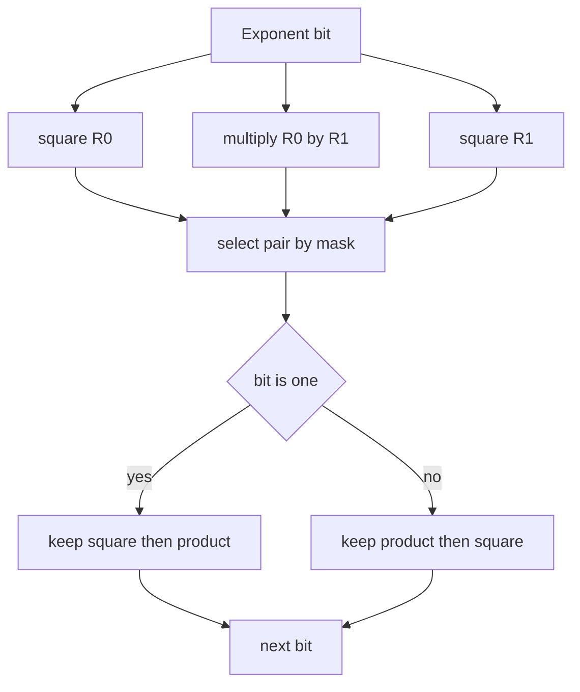
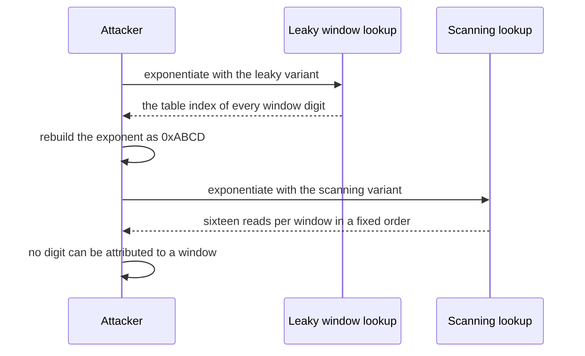

# 756 — Implement side-channel resistant constant-time modular exponentiation

> **Tier:** Expert · **CTCI chapter:** Beyond — Security & Privacy
> **Task spec:** [756-implement-side-channel-resistant-constant-time-modular-exponenti.md](../../../tasks/expert/756-implement-side-channel-resistant-constant-time-modular-exponenti.md)
> **Solutions:** [Python](../../../solutions/python/expert/756-implement-side-channel-resistant-constant-time-modular-exponenti/solution.py) ·
> [Java](../../../solutions/java/expert/756-implement-side-channel-resistant-constant-time-modular-exponenti/Solution.java) ·
> [JavaScript](../../../solutions/javascript/expert/756-implement-side-channel-resistant-constant-time-modular-exponenti/solution.js) ·
> [C#](../../../solutions/csharp/expert/756-implement-side-channel-resistant-constant-time-modular-exponenti/Solution.cs)

## 1. Problem restatement

Naive square-and-multiply is the textbook timing leak of public-key cryptography: it squares every bit
of the exponent but multiplies only when that bit is set, so both the number of modular multiplications
and the branch taken depend on the secret exponent. Implement and **instrument** three variants:

| Variant | Structure | Leak |
| --- | --- | --- |
| `naive_pow` | textbook square-and-multiply with an `if bit:` branch | per-bit cost equals the Hamming weight of the exponent |
| `ladder_pow` | Montgomery ladder: per bit compute `R0²`, `R0·R1`, `R1²` unconditionally and select with a branch-free mask | none, and the invariant `R0 = base^prefix`, `R1 = base^(prefix+1)` holds after every step |
| `window_pow` | fixed-window exponentiation whose precomputed table is read with a full-table scan using a branch-free equality mask | none when scanning; leaks each window digit in its trace when the scan is disabled |

`Model` is the cost and leakage model under test: it counts modular multiplications, records a *trace*
of operations (including which table index was read), records whether a branch was taken on a secret
bit, and records the selects. Everything runs on toy moduli — `0x7FFFFFFF`, `65537`, `0xFFFF` and
`1000003`, never key material — with `pow(base, exponent, modulus)` as the correctness oracle.

Concrete behaviour the checks assert:

- Results equal the oracle `pow(base, exponent, modulus)` for random and boundary inputs: exponent `0`,
  modulus `1`, base `0`, all-ones exponent, powers of two and leading-zero padding.
- The cost and the trace of `ladder_pow` and of the scanning window variant are **identical for every
  exponent of the same padded bit length**, while `naive_pow`'s cost tracks the Hamming weight.
- The number of secret-dependent branches is `0` for the constant-time variants and equals the Hamming
  weight for `naive_pow`.
- The scanning lookup reads **every table index once per window** (16 reads per window at `w = 4`) and
  exposes no digits; the non-scanning lookup leaks the digits, and the checks *recover the whole
  exponent* from that leak, digit by digit, rebuilding the value exactly.
- Padding: a longer declared bit length costs proportionally more work but does not change the result —
  `ladder_pow` with `bit_length = 8` performs 24 multiplications (three per bit) for the same value as
  `bit_length = 3`.
- An exponent longer than the declared bit length is rejected, for both the ladder and the window
  variant.
- The mask primitives are exact: `ct_eq_mask(a, b)` returns `1` exactly when `a == b` and `ct_select`
  picks the right operand for both bit values, on the boundary set
  `{0, 1, 2, 15, 16, 255, 0x7FFFFFFF, 0x80000000, 0xFFFFFFFF}` and every modulus.
- Degenerate cases: modulus `1` yields `0`, base `0` with exponent `0` yields `1` and with exponent `3`
  yields `0`, a zero-length exponent is the identity, and the naive path agrees on the identity and the
  single-bit exponent.
- Determinism: the same inputs give the same value and the same trace.

## 2. Intuition

The multiplication count of square-and-multiply is not just a performance detail — it is a function of
the secret. An attacker who can measure the total time of an exponentiation sees the number of
multiplies, and from a few observations of the same exponent at different bases they can recover the
Hamming weight of the exponent, then work out which bits are set.

Two disciplines remove the leak, and both are visible in the code:

1. **Make the control flow data-independent.** The Montgomery ladder does the same *two* products for
   every bit — `R0·R0`, `R0·R1`, `R1·R1` — and then selects the pair to keep with a mask instead of a
   branch. The cost is uniform and the same instructions execute for both bit values.
2. **Make the memory access pattern data-independent.** A windowed implementation normally reads
   `table[digit]`, which leaks the digit through the address. Scanning the whole table with a
   branch-free equality mask per entry costs a constant number of reads per window and exposes nothing:
   sixteen reads per window at `w = 4`, the same for every exponent.

The instrumentation is part of the deliverable rather than an afterthought: without a cost and leakage
model there is nothing to assert, and the checks all compare *models*, not wall-clock times.



## 3. Algorithm

1. `Model` records `muls`, `branches` (secret-dependent branches), `selects`, the ordered `trace` of
   operations, and the sequence of table indices actually read.
2. `naive_pow(base, exponent, modulus, model)`: square on every bit; multiply only when the bit is set,
   with the branch recorded in the model. The multiplication count is `bits + popcount(exponent)`.
3. `ladder_pow(base, exponent, modulus, bit_length, model)`: pad the exponent to `bit_length` and walk
   the bits from the most significant to the least. `R0 = 1`, `R1 = base`; per bit compute
   `square(R0)`, `product(R0, R1)` and `square(R1)`, then keep `(R0, R1) = (square, product)` when the
   bit is one and `(product, square)` when it is zero — always by mask selection, never by branch.
4. `ct_eq_mask(a, b)` and `ct_select(model, bit, left, right, modulus)`: branch-free equality and
   selection built from masks, used by both the ladder and the window lookup.
5. `window_pow(base, exponent, modulus, window, bit_length, constant_time, model)`: precompute the table
   of `2^window` consecutive powers, split the padded exponent into `window`-bit digits from the most
   significant one, and for each digit either
   - scan all table entries accumulating `select(ct_eq_mask(index, digit), entry, accumulator)` and
     record every index read (the constant-time variant), or
   - read `table[digit]` directly and record the single index (the leaky variant the checks use to
     demonstrate the attack);
   then square the accumulator `window` times.
6. `run(variant, base, exponent, modulus, …)` wraps the computation in a fresh `Model` and returns
   `(value, model)`, so the checks can compare both the value against `pow` and the model against its
   expectations.
7. `leaked_table_indices()` returns the indices recorded by a non-scanning lookup — the attacker's
   view: with `window = 4` and `bit_length = 16`, the digits of `0xABCD` come out as `0xA, 0xB, 0xC,
   0xD` and rebuild the exponent exactly.

```text
function ladder_pow(base, exponent, modulus, bit_length, model)
    if exponent does not fit into bit_length then reject
    r0 ← 1
    r1 ← base
    for bit position from bit_length - 1 down to 0 do
        square0 ← multiply(r0, r0, modulus, model)
        product ← multiply(r0, r1, modulus, model)
        square1 ← multiply(r1, r1, modulus, model)
        bit ← the exponent bit at this position
        r0 ← ct_select(model, bit, square0, product, modulus)
        r1 ← ct_select(model, bit, product, square1, modulus)
    return r0

function window_pow(base, exponent, modulus, window, bit_length, constant_time, model)
    if exponent does not fit into bit_length then reject
    table ← the powers of base from zero up to two to the window minus one
    accumulator ← 1
    for each window digit from the most significant to the least do
        if constant_time then
            accumulator ← 1
            for index from 0 to size of table minus 1 do
                entry ← multiply(accumulator, table[index], modulus, model)
                accumulator ← ct_select(model, ct_eq_mask(index, digit), entry, accumulator, modulus)
        else
            accumulator ← multiply(accumulator, table[digit], modulus, model)
            record digit as a read index
        square the accumulator window times
    return accumulator

function ct_select(model, bit, left, right, modulus)
    mask ← mask for the low bit of bit
    record one select in the model
    return left AND mask OR right AND complement of mask reduced modulo modulus
```



## 4. Worked example

**Part A — the ladder on `3^5 mod 0x7FFFFFFF`.** Exponent 5 is `101` in three bits. `R0 = 1`,
`R1 = 3`, and the invariant after bit `i` is `R0 = 3^prefix`, `R1 = 3^(prefix+1)`.

| Bit | `R0²` | `R0·R1` | `R1²` | Selected `R0` | Selected `R1` | Exponent prefix |
| --- | --- | --- | --- | --- | --- | --- |
| 1 | 1 | 3 | 9 | 3 | 9 | `1` = 1 |
| 0 | 9 | 27 | 81 | 9 | 27 | `10` = 2 |
| 1 | 81 | 243 | 729 | 243 | 729 | `101` = 5 |

Three multiplications per bit, nine in total, and the final `R0 = 243 = 3^5`, which is what
`pow(3, 5, 0x7FFFFFFF)` returns. Note that the *same* nine multiplications happen for exponent 2
(`010`), 4 (`100`) or 7 (`111`) — the model's cost is a function of the padded bit length only.

**Part B — the leak that is not there.** For the naive variant, cost equals `bits + popcount`. With the
same three-bit length, exponent 5 (`101`, weight 2) costs five multiplications, exponent 3 (`011`,
weight 2) also costs five, and exponent 7 (`111`, weight 3) costs six: the cost distribution is a
function of the secret, which is exactly the oracle an attacker measures.

| Variant | Exponent 5 | Exponent 4 | Exponent 7 | Trace distinctness |
| --- | --- | --- | --- | --- |
| `naive_pow` | 5 muls | 4 muls | 6 muls | traces differ across exponents |
| `ladder_pow` | 9 muls | 9 muls | 9 muls | one distinct trace per padded length |

**Part C — recovering a window digit from a leaky lookup.** With `window = 4`, `bit_length = 16` and
exponent `0xABCD`, the leaky variant records one table index per window.

| Window | Digit | Index recorded by the leaky lookup |
| --- | --- | --- |
| 1 (most significant) | `0xA` | 10 |
| 2 | `0xB` | 11 |
| 3 | `0xC` | 12 |
| 4 (least significant) | `0xD` | 13 |

Rebuilding the exponent from the digits gives `0xABCD` — the whole secret. The constant-time variant
performs the same computation and records sixteen reads per window, all of which are the *same*
sequence regardless of the digits, so `leaked_table_indices()` is empty.



## 5. Complexity

Let `b` be the padded bit length, `w` the window width, and `2^w` the table size.

| Variant | Multiplications | Reason |
| --- | --- | --- |
| `naive_pow` | `b + popcount(exponent)` | one square per bit plus one multiply per set bit — data-dependent |
| `ladder_pow` | `3b` | three products per bit, all unconditional; 24 for `b = 8`, as the checks assert |
| `window_pow`, scanning | about `b + b/w · 2^w` plus the squarings of the accumulator | each window costs `2^w` masked multiplies to scan the table |
| `window_pow`, leaky | about `b + b/w` | one table read per window, at the price of a secret-dependent address |
| table precomputation | O(`2^w`) modular multiplications | computed once per exponentiation in this sketch |
| space | O(1) for the ladder, O(`2^w`) for the window table | the ladder keeps two registers |

The trade-off is explicit: the ladder's factor of three is pure overhead compared with the naive
average of `b + popcount/2`, and the scanning window pays a table-sized constant to avoid an address
that depends on the secret. Constant-time code is bought with work, and the model makes the price
visible in the numbers the checks compare.

## 6. Pitfalls and edge cases

- **Padding must be public and explicit.** The exponent is padded to a declared `bit_length`, so the
  cost depends on a public value rather than on the exponent's leading zeros; an exponent that does not
  fit is rejected instead of silently truncated.
- **The ladder's invariant is the correctness argument.** `R0 = base^prefix` and `R1 = base^(prefix+1)`
  after every bit — if the selection is swapped, the result is wrong and the value check against `pow`
  catches it immediately.
- **Selection must be branch-free.** `ct_select` is where a compiler or a careless rewrite re-introduces
  the leak; the model counts selects separately so the checks can confirm they happen.
- **The table scan is only half of "constant time".** Constant access time also requires the table to
  fit in cache lines that are always touched; the model sees instructions, not cache behaviour.
- **The leaky variant is a deliberate tool.** It exists so the checks can *recover the exponent* and
  thereby demonstrate that the leak is real, not hypothetical; it is never the recommended path.
- **Degenerate moduli.** Modulus `1` yields `0`, base `0` with exponent `0` yields `1`, and a
  zero-length exponent is the identity — all asserted, because loops over zero bits are a classic
  source of accidental secrets.
- **The model is not a cycle-accurate simulator.** It cannot see cache-line granularity,
  micro-architectural side effects or power consumption, and it does not model exponent blinding,
  Montgomery/CIOS multiplication or modular inversion.
- **Python big integers are not constant time**, so this implementation would need fixed-width words to
  be production-safe; the property verified here is algorithmic (uniform operation count, uniform memory
  access pattern, no secret branches), and the solution header says so.
- **Determinism.** Traces are recorded in a fixed order and the value is a pure function of the inputs,
  so two runs agree on both the value and the trace.

## 7. Variants and follow-ups

- **Sliding-window and fixed-window with constant-time table scan** is the standard middle ground
  between the ladder and the naive variant; the scanning cost grows with the window width, so the
  choice is a real engineering decision.
- **Montgomery multiplication and CIOS** replace the `%` operation with word-level arithmetic that is
  itself constant time — the missing piece before any of this is deployable.
- **Blinding**: multiplying the base or the exponent by a random value makes the *input* to each
  exponentiation unpredictable, which defends against attackers who can repeat the operation and
  correlate traces.
- **Hardware countermeasures** (constant-time multipliers, noise injection, dual-rail logic) attack the
  same problem below the software layer.
- Related work in this repository: the constant-time comparison primitives in
  [755-implement-timing-attack-resistant-comparison-function-and-test.md](../../../tasks/expert/755-implement-timing-attack-resistant-comparison-function-and-test.md)
  supply `ct_eq_mask`-style building blocks of exactly the kind the window scan needs, the ORAM sketch
  in
  [757-implement-oram-oblivious-ram-sketch-for-simple-access-patterns.md](../../../tasks/expert/757-implement-oram-oblivious-ram-sketch-for-simple-access-patterns.md)
  removes the same class of address-pattern leak one level lower, and the XOR-sharing demo in
  [758-implement-secure-multiparty-computation-basic-xor-sharing-demo.md](../../../tasks/expert/758-implement-secure-multiparty-computation-basic-xor-sharing-demo.md)
  keeps secrets hidden from a different adversary: another party rather than a measurement.

## 8. Check yourself

<details><summary>Show answer</summary>
**Why does the Montgomery ladder have a uniform cost?**

Because it computes both candidate products for every bit and then selects the pair by mask, so the
sequence of operations is the same whether the bit is zero or one. The cost becomes a function of the
padded bit length, which is public, instead of the Hamming weight, which is secret.
</details>

<details><summary>Show answer</summary>
**What is being protected by scanning the whole window table?**

The memory address. Reading `table[digit]` leaks the digit to anyone who can observe the addresses the
CPU touches — including a co-resident process sharing a cache. Touching every entry once per window
makes the access pattern identical for all exponents.
</details>

<details><summary>Show answer</summary>
**The checks recover the whole exponent from the leaky variant. Why is that in the test suite?**

Because it turns "this might leak" into a demonstrated fact and shows that the instrumented model is
sensitive enough to observe real leakage. It also gives a positive control: the constant-time variant
must produce no recoverable digits under the very same analysis.
</details>

<details><summary>Show answer</summary>
**Why is `24` multiplications the right count for `ladder_pow` with `bit_length = 8`?**

The ladder performs three modular multiplications per exponent bit — `R0²`, `R0·R1` and `R1²`
unconditionally — so eight padded bits give twenty-four, regardless of the exponent value. That
uniformity is exactly what the model is checking.
</details>

<details><summary>Show answer</summary>
**What does this task deliberately not prove?**

That a real implementation is side-channel free: the model counts operations and addresses, not cycles,
cache lines or power, it does not model blinding or Montgomery multiplication, and the modular
arithmetic uses big integers that are themselves not constant time. The verified property is
algorithmic uniformity.
</details>
