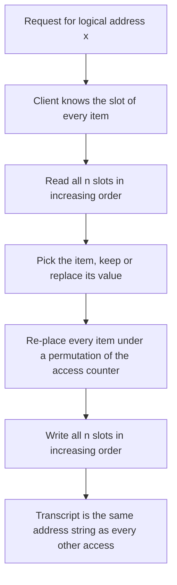
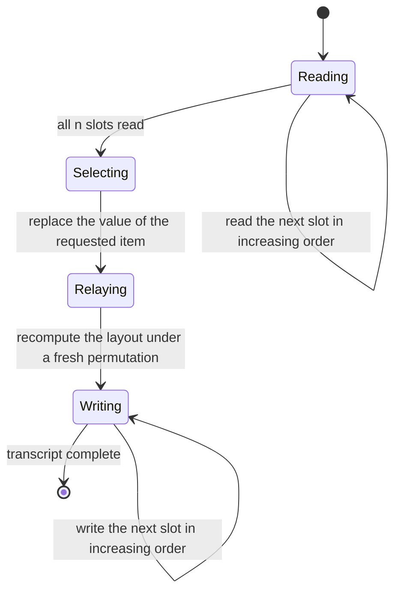
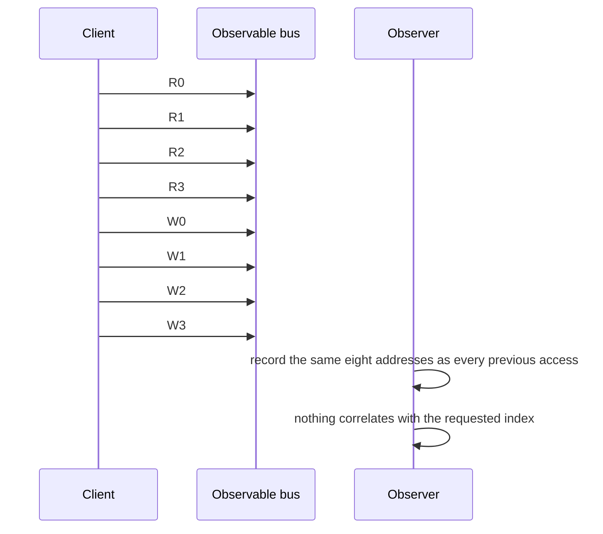

# 757 — Implement an ORAM (oblivious RAM) sketch for simple access patterns

> **Tier:** Expert · **CTCI chapter:** Beyond — Security & Privacy
> **Task spec:** [757-implement-oram-oblivious-ram-sketch-for-simple-access-patterns.md](../../../tasks/expert/757-implement-oram-oblivious-ram-sketch-for-simple-access-patterns.md)
> **Solutions:** [Python](../../../solutions/python/expert/757-implement-oram-oblivious-ram-sketch-for-simple-access-patterns/solution.py) ·
> [Java](../../../solutions/java/expert/757-implement-oram-oblivious-ram-sketch-for-simple-access-patterns/Solution.java) ·
> [JavaScript](../../../solutions/javascript/expert/757-implement-oram-oblivious-ram-sketch-for-simple-access-patterns/solution.js) ·
> [C#](../../../solutions/csharp/expert/757-implement-oram-oblivious-ram-sketch-for-simple-access-patterns/Solution.cs)

## 1. Problem restatement

An ORAM hides *which* logical address the CPU is touching from the party that observes the physical
memory bus. This task implements the trivial ("linear scan") construction explicitly, so the
obliviousness argument can be checked line by line:

- memory is an array of `n` slots, each holding exactly one `(logical id, value)` pair, and a fresh
  pseudo-random permutation decides the physical slot of every item;
- on `access(x)` the client reads **every** slot in increasing order and then writes **every** slot back
  in increasing order, with the items re-placed under a permutation derived from the access counter (the
  trusted client keeps the layout; the observer only sees addresses);
- the observable transcript is therefore `R0 R1 … R(n-1) W0 W1 … W(n-1)` for *every* access,
  independent of the logical address, of the access history and of the order of the accesses — which is
  exactly the property that makes it oblivious.

`Prp` is a four-round Feistel network over a domain of `n = 2^bits` points with a `splitmix64` round
function, verified to be a bijection with a working inverse, so the relayout really is a permutation of
the items. `DirectIndexOram` is the negative control: it reads exactly the slot holding the requested
item, and the `observer_traces` / `leaks` checker must flag it — including naming the leaked slot, since
the first address of its transcript *is* the requested item's address.

Concrete behaviour the checks assert:

- Functional correctness against a plain array over long random access sequences, and the permutation
  invariant after every access: every logical id occupies exactly one slot.
- The transcript has length `2n` (128 transfers for `n = 64`) and is **identical** for six different
  access sequences, including `[17, 17, 17, 17, 17]` and `[32, 33, 34, 35, 36]`.
- The layout after `k` accesses depends only on `k`: two instances that touched different addresses
  (`3` versus `47`) have identical slot arrays afterwards.
- One item visited over 32 relayouts lands in at least 16 distinct slots, so the position really is
  re-randomised.
- The leaky variant is flagged by the checker, every distinct sequence is distinguishable, and its first
  observed address equals the requested logical address; it pays one transfer per access instead of
  `2n`, which is the overhead factor the ORAM buys its privacy with.
- Boundary behaviour: a four-slot ORAM works and puts two items in different slots; out-of-range
  addresses raise `IndexError`; a slot count that is not a power of two raises; duplicate logical ids
  raise; 40 relayouts of a rewritten item keep the values and the invariant; and the transcripts are
  reproducible.

## 2. Intuition

The memory bus leaks the *address*, not the value. That alone is enough for an attacker to recover a
binary-search access pattern, to learn which index of a secret key is touched, or to correlate a
program's phases with its data.

Oblivious RAM attacks the address channel by making the address sequence **data-independent**:

1. **Touch everything.** If every access reads all `n` slots and writes all `n` slots back, the
   transcript is a constant string of addresses. There is nothing left to correlate.
2. **Re-randomise the layout.** Reading and writing the same array in the same order would be
   oblivious, but then the *contents* would sit in fixed slots and an attacker watching long enough
   could learn the mapping. So each access re-places the items under a fresh permutation derived from
   the access counter — a PRP the trusted client can evaluate but the observer cannot invert.
3. **Keep the mapping client-side.** The mapping is secret state inside the trusted client, which is
   what makes the scan-read scan-write loop implementable at all in this trivial construction.



## 3. Algorithm

1. `Prp(bits, key)`: a four-round Feistel network on `bits`-bit values with a `splitmix64`-based round
   function. `permute(x)` and `inverse(y)` are mutual inverses, so the map is a bijection on the domain
   of `n = 2^bits` points.
2. `LinearScanOram(values)`: `n` must be a power of two, the logical ids must be unique, and the initial
   layout is a fresh permutation of the items.
3. `access(x)`:
   - read every slot in increasing order, recording the address of each read in the transcript;
   - find the item with logical id `x`, take its value, and write the replacement (or the same value)
     into that item;
   - derive a new permutation from the access counter, recompute the physical slot of every item, and
     write every slot back in increasing order, recording the address of each write;
   - increment the counter, so the next access uses a different layout.
4. `position_of(x)` and `invariant_ok()` expose the secret layout to the checks: the layout is a
   bijection from logical ids to slots after every access.
5. `DirectIndexOram(values)`: the negative control — `access(x)` touches only the slot holding `x`, so
   its transcript has length one per access.
6. `observer_transcripts(make_oram, sequences)` replays each access sequence on a fresh ORAM and
   collects the transcripts; `leaks(transcripts)` reports whether any two transcripts differ, i.e.
   whether the address pattern is distinguishable.
7. The checks compare an ORAM's transcripts against each other, against the leaky variant, and against
   the expected constant string.

```text
procedure access(logical)
    for slot from 0 to n - 1 do
        append a read of slot to the transcript
        if the slot holds the item with this logical id then remember it
    replace the value of the remembered item
    counter ← counter + 1
    permutation ← Prp derived from the counter
    new_slots ← empty array of n slots
    for each item do new_slots[permutation.permute(item.id)] ← item
    for slot from 0 to n - 1 do
        append a write of slot to the transcript
    slots ← new_slots
    return the remembered value

function leaks(transcripts)
    return there exist two transcripts in the list that are not equal

procedure observer_transcripts(make_oram, sequences)
    transcripts ← empty list
    for each sequence in sequences do
        oram ← make_oram()
        for address in sequence do oram.access(address)
        append oram.transcript to transcripts
    return transcripts
```



## 4. Worked example

Use the smallest legal ORAM, `n = 4` slots holding the values `[10, 20, 30, 40]`.

**Part A — the transcript is constant.** Access `0` and access `3` produce the same address sequence.

| Access requested | Read transcript | Write transcript | Total transfers |
| --- | --- | --- | --- |
| `access(0)` | `R0 R1 R2 R3` | `W0 W1 W2 W3` | 8 = `2n` |
| `access(3)` | `R0 R1 R2 R3` | `W0 W1 W2 W3` | 8 = `2n` |

An observer comparing the two transcripts sees identical strings. That is the whole obliviousness
argument in one row: the transcript depends on the *counter*, not on the address.

**Part B — the leaky variant gives itself away.**

| Variant | Transcript for `access(3)` | Transfers | What the observer learns |
| --- | --- | --- | --- |
| `LinearScanOram` | `R0 R1 R2 R3 W0 W1 W2 W3` | 8 | nothing about which item was requested |
| `DirectIndexOram` | `R2` (the slot holding item 3) | 1 | the requested logical address, directly |

The checks assert the `leaks` predicate on the direct variant and recover the requested addresses from
the first observed address of each transcript — which is why the leaky variant cannot be "fixed" by
argument, only replaced.

**Part C — the layout moves.** Reading item `x` 32 times in a row still produces different slots.

| Access number | Slot holding item 5 (example) |
| --- | --- |
| 1 | some slot `s1` |
| 2 | a different slot, because the permutation changed with the counter |
| … | … |
| 32 | at least 16 distinct slots were used over the 32 accesses |

The counter is what guarantees the re-randomisation: two ORAMs that perform the same *number* of
accesses (even to different addresses) end up in the identical physical layout, which the checks assert
by comparing the whole slot array after one access to address `3` versus address `47`.



## 5. Complexity

Let `n` be the number of slots (a power of two) and `k` the number of accesses.

| Quantity | Bound | Reason |
| --- | --- | --- |
| one `access` | O(n) reads, O(n) writes, O(n) permutation evaluations | the whole array is touched twice |
| transfers per access | exactly `2n` | one read and one write per slot, in fixed order |
| permutation evaluation | O(1) per item (four Feistel rounds) | the PRP is a fixed-cost function of the index |
| space | O(n) slots, O(1) secret state besides the counter | the client keeps the layout it computes |
| full sequence of `k` accesses | O(k · n) | `k` linear scans |
| `DirectIndexOram` | O(1) transfers per access | it reads one slot — and leaks |
| transcript size | O(k · n) | the observable string grows linearly with the accesses |

The overhead factor is the headline number: `2n` transfers per access against `1` for the direct
implementation. Real ORAMs (Path ORAM, Circuit ORAM) reduce this to polylogarithmic cost with a tree
hierarchy, a stash and a recursive position map — all of which are deliberately absent here, because the
point of this sketch is that the *invariant* (constant transcript, secret layout) can be verified
exhaustively at this size.

## 6. Pitfalls and edge cases

- **Size must be a power of two.** The Feistel construction works on `2^bits` points, so a slot count
  like `3` or `5` is rejected rather than silently rounded.
- **Logical ids must be unique.** Duplicates would break the "every id occupies exactly one slot"
  invariant that the checks assert after every access.
- **Out-of-range accesses raise.** Negative or too-large addresses raise `IndexError` instead of being
  wrapped, because a wrap would itself leak information about the address computation.
- **Both the read and the write loop must touch every slot.** Reading all slots but writing only the
  changed one would leak immediately, and the transcript equality check across different sequences is
  what catches a regression there.
- **The relayout must depend on the counter, not on the data.** Deriving the permutation from the
  accessed value would make the layout a function of the access pattern; the checks compare the whole
  layout after the same number of accesses to *different* addresses.
- **The permutation has to be a bijection.** A PRP with a broken inverse would silently drop or
  duplicate items; `permute`/`inverse` round-tripping is verified on 256 points, and the invariant
  check would fail on the very first access otherwise.
- **The leaky variant is a control, not an option.** It exists so the checker has something to flag;
  the same checker that flags it accepts the linear-scan ORAM.
- **Overhead is the honest cost.** `2n` transfers per access is exactly what the checks measure, and
  any claim of "oblivious and cheap" at this construction would be false — the price is stated in the
  solution header.
- **Simplifications versus real ORAM.** No tree hierarchy, no stash, no recursive position map, and the
  relayout is a permutation applied inside the trusted client rather than an oblivious
  (secret-shared or oblivious-sort) shuffle; the "physical bus" is a model that records addresses rather
  than a real memory interface.

## 7. Variants and follow-ups

- **Path ORAM and Circuit ORAM** replace the linear scan with a tree of buckets, a stash and a
  position map, giving `O(log n)` blocks per access amortised — the construction to reach for in
  practice.
- **Oblivious sorting** implements the relayout without a trusted permutation, which is needed when the
  shuffle itself happens on the untrusted side.
- **Oblivious data structures on top of ORAM** (maps, priority queues) inherit the property and add
  their own access-pattern requirements.
- **Hardware approaches** (encrypted memory controllers, oblivious DRAM scheduling) address the same bus
  observation problem below software.
- Related work in this repository: the constant-time primitives in
  [755-implement-timing-attack-resistant-comparison-function-and-test.md](../../../tasks/expert/755-implement-timing-attack-resistant-comparison-function-and-test.md)
  and the constant-time exponentiation in
  [756-implement-side-channel-resistant-constant-time-modular-exponenti.md](../../../tasks/expert/756-implement-side-channel-resistant-constant-time-modular-exponenti.md)
  remove data-dependent branches and table indices inside a single process, while ORAM removes the
  address pattern visible outside it; the multiparty demo in
  [758-implement-secure-multiparty-computation-basic-xor-sharing-demo.md](../../../tasks/expert/758-implement-secure-multiparty-computation-basic-xor-sharing-demo.md)
  hides the data from a different observer again — another party.

## 8. Check yourself

<details><summary>Show answer</summary>
**Why is reading and writing every slot enough to hide the requested address?**

Because the observable transcript — the sequence of addresses on the bus — is then a fixed string that
does not depend on the request. Obliviousness is a property of the transcript, so making the transcript
constant makes the address invisible.
</details>

<details><summary>Show answer</summary>
**If the transcript is constant, why re-shuffle the layout on every access?**

Because a fixed layout would let an observer accumulate information across accesses: the same slot would
always hold the same item, and with enough traffic the correspondence could be reconstructed. Deriving
a fresh permutation from the access counter keeps the contents moving so the mapping never stabilises.
</details>

<details><summary>Show answer</summary>
**What exactly does the checker flag in the leaky variant?**

The first observed address of its transcript is the slot holding the requested item, so the transcript
differs from one request to the next and reveals the logical address directly. The checks confirm that
each access sequence yields a distinguishable transcript and that the requested addresses can be read
off the transcripts.
</details>

<details><summary>Show answer</summary>
**The ORAM costs `2n` transfers per access. What buys that cost back?**

Nothing in this sketch — that is the point of calling it trivial: it is a correctness and
obliviousness reference, not a deployable design. Real ORAMs add a tree hierarchy, a stash and a
position map to reach polylogarithmic cost while keeping the same transcript-level guarantee.
</details>

<details><summary>Show answer</summary>
**Why must the permutation be a bijection, and how is that checked?**

A non-bijective relayout would drop items or duplicate them; then "every logical id occupies exactly
one slot" would fail and, worse, `access` could silently return the wrong value. The checks verify
`permute`/`inverse` round-trip on the whole domain and assert the invariant after every access of a long
random sequence.
</details>
