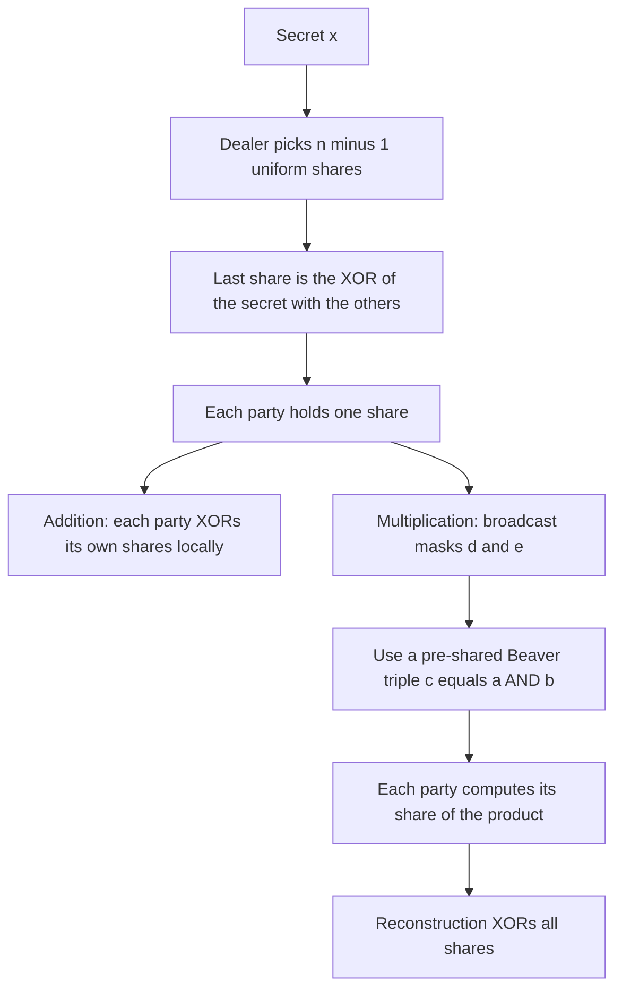
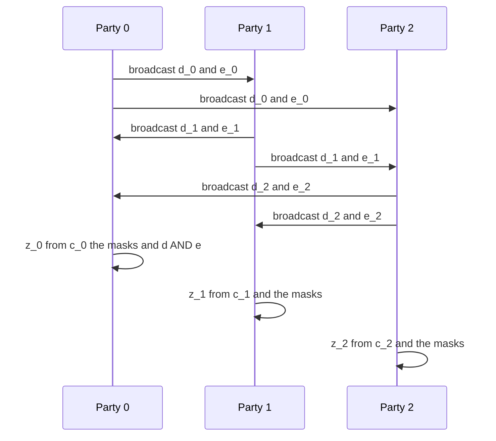
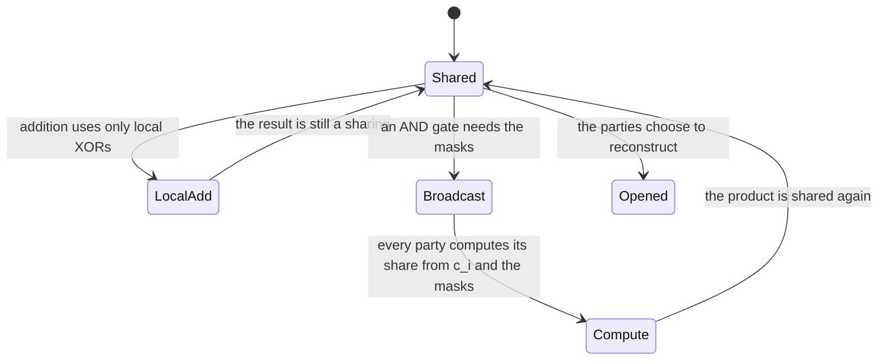

# 758 — Implement secure multiparty computation: basic XOR-sharing demo

> **Tier:** Expert · **CTCI chapter:** Beyond — Security & Privacy
> **Task spec:** [758-implement-secure-multiparty-computation-basic-xor-sharing-demo.md](../../../tasks/expert/758-implement-secure-multiparty-computation-basic-xor-sharing-demo.md)
> **Solutions:** [Python](../../../solutions/python/expert/758-implement-secure-multiparty-computation-basic-xor-sharing-demo/solution.py) ·
> [Java](../../../solutions/java/expert/758-implement-secure-multiparty-computation-basic-xor-sharing-demo/Solution.java) ·
> [JavaScript](../../../solutions/javascript/expert/758-implement-secure-multiparty-computation-basic-xor-sharing-demo/solution.js) ·
> [C#](../../../solutions/csharp/expert/758-implement-secure-multiparty-computation-basic-xor-sharing-demo/Solution.cs)

## 1. Problem restatement

Implement XOR (additive mod 2) secret sharing and a small semi-honest computation on top of it.

**Sharing.** To share a `w`-bit value `x` among `n` parties the dealer picks `n-1` uniform shares and
gives the last party `x XOR (all the others)`, so every share alone is uniform and only the full set
reconstructs `x`.

**Local operations.** XOR of two shared values and XOR with a public constant are free: each party
XORs its own shares, with no communication at all. `NOT` is XOR with the all-ones constant.

**Multiplication.** This is where the parties must talk. With a pre-shared Beaver triple
`(a, b, c = a AND b)` each party `i` broadcasts `dᵢ = xᵢ XOR aᵢ` and `eᵢ = yᵢ XOR bᵢ`, then computes

```text
zᵢ = cᵢ XOR (d AND bᵢ) XOR (e AND aᵢ) XOR (d AND e if i = 0 else 0)
```

so that `XORᵢ zᵢ = (a XOR d) AND (b XOR e) = x AND y`, because XOR over the shares of `d` and `e`
reconstructs those masks. The public values `d` and `e` are uniform masks of the secrets, which is why
the transcript reveals nothing. On top of that the file implements the local operations, a per-bit AND
for multi-bit operands, and a full GMW evaluation of a small shared Boolean circuit.

Concrete behaviour the checks assert:

- Correctness is exhaustive for 1-bit and 2-bit operands, the bitwise AND is exact for every tested
  width (`1`, `2`, `4`, `8`), and the shared circuit `(and 0 1)`, `(and 2 3)`, `(xor 4 5)` agrees with a
  plaintext evaluation for **all 16 input assignments**.
- The protocol works for 2, 3, 4 and 5 parties, each party ending with its own share of the product.
- **Privacy is checked exactly, not approximately.** For the sharing, the checks enumerate every
  completion of the other parties' shares and verify that the number of completions is the same for
  every secret — perfect privacy of the marginal view. For the AND gate, they enumerate every pair of
  triple-share profiles and verify that the distribution of the transcript `(d, e)` is identical and
  uniform for every pair of secrets.
- Reconstruction is exact: `reconstruct([])` and out-of-domain shares are rejected with `ValueError`,
  and a two-party sharing of `5` puts a mask on party 0 (`single[0] != 5`).
- Malformed parameters raise: a secret outside the declared width, a single party, mismatched share
  vectors, a public constant outside the width, and an unknown gate name.
- The dealer is deterministic given the PRNG state, so two runs of `share` with the same state produce
  the same shares, and both reconstruct to the same secret — while never handing the whole secret to a
  single party.

## 2. Intuition

Sharing a secret as a *sum* rather than as a value is the trick that makes computation possible: the
secret disappears into `n` pieces, and every operation becomes something the parties can do locally or
with a tiny exchange.

- **Addition is free** because XOR is linear over the shares: `(x XOR y)ᵢ = xᵢ XOR yᵢ`, computed
  independently by each party. No party ever learns anything, and no message is sent.
- **Multiplication is not linear**, so it needs communication. The Beaver-triple trick converts it into
  additions and local ANDs: the parties reveal `d = x XOR a` and `e = y XOR b`, which are *masks* of the
  secrets (uniform, because `a` and `b` are uniform), and then reconstruct the product from the
  pre-shared `c = a AND b` plus their own shares and the public masks.
- **Privacy is a statement about distributions**, not about individual messages. In the semi-honest
  model the proof obligation is: the transcript plus the corrupt party's own shares is independent of the
  secret. With additive sharing the marginal view of any strict subset of shares is uniform, and that is
  something the checks can enumerate exhaustively at these sizes.



## 3. Algorithm

1. `share(state, secret, parties, width)`: draw `parties - 1` uniform `width`-bit shares from the
   `splitmix64` PRNG, and set the last share to the XOR of the secret with all of them, so
   `reconstruct` returns the secret exactly.
2. `reconstruct(shares, width)`: reject an empty vector or a share outside the `width`-bit domain,
   XOR all shares and return the result.
3. `local_xor(shares_x, shares_y, width)`: party-wise XOR — no communication.
4. `local_constant(shares, constant, width)`: XOR a public constant into party 0's share (or into every
   share, depending on the convention the file uses), leaving the reconstructed value unchanged except
   for the constant.
5. `beaver_and_bit(state, shares_x, shares_y, parties, width)`:
   - draw a fresh Beaver triple `(a, b, c = a AND b)` and share each of the three values;
   - each party broadcasts `dᵢ = xᵢ XOR aᵢ` and `eᵢ = yᵢ XOR bᵢ`, and the public masks `d` and `e` are the
     XOR of those broadcasts;
   - each party computes `zᵢ = cᵢ XOR (d AND bᵢ) XOR (e AND aᵢ)`, and party 0 additionally XORs
     `d AND e`;
   - the resulting vector is a sharing of `x AND y`.
6. `beaver_and_bitwise(...)`: apply the per-bit protocol to each bit of multi-bit operands, so the
   same machinery handles widths up to `MAX_WIDTH = 8`.
7. `gmw_circuit(state, shares, circuit, parties, width)`: evaluate a small circuit given as a list of
   gates `("and", i, j)` and `("xor", i, j)` over shared inputs, returning the shared output; unknown
   gate names raise.
8. The checks compare against a plaintext evaluator (`plain_circuit`) for all input assignments, and
   enumerate the marginal and transcript distributions to verify the privacy claims.

```text
function share(state, secret, parties, width)
    shares ← empty list
    for party from 1 to parties - 1 do
        draw a uniform width-bit share r and append it
    append the secret XORed with every drawn share
    return the share vector

function reconstruct(shares, width)
    if shares is empty then reject
    if any share does not fit into width bits then reject
    return the XOR of all shares

function beaver_and_bit(state, shares_x, shares_y, parties, width)
    draw a, b, c equal to a AND b and share all three
    for each party i do
        broadcast d_i equal to shares_x[i] XOR a_i
        broadcast e_i equal to shares_y[i] XOR b_i
    d ← XOR of all d_i ; e ← XOR of all e_i
    for each party i do
        z_i ← c_i XOR (d AND b_i) XOR (e AND a_i)
        if i is the first party then z_i ← z_i XOR (d AND e)
    return the vector of z_i, which shares the product

procedure privacy_check_sharing(width, parties)
    for each secret, for each party do
        count how many completions of the other shares reconstruct to a value whose
        view is consistent with that party's share
    verify the count is the same for every secret

procedure privacy_check_and(width, parties)
    for every pair of secret pairs and every triple-share profile do
        record the transcript pair d and e
    verify the transcript distribution is identical and uniform for every secret pair
```



## 4. Worked example

**Part A — sharing.** Two-party sharing of `x = 6` in 3 bits. The dealer draws a uniform first share
(the example uses `5`) and sets the second to `6 XOR 5 = 3`.

| Party | Share | Alone it reveals | Reconstruct |
| --- | --- | --- | --- |
| 0 | `5` | nothing: every value is equally likely | `5 XOR 3` |
| 1 | `3` | nothing: it is exactly the mask of the secret | `= 6` |

**Part B — a Beaver AND of two bits.** Take the secrets `x = 1` and `y = 0` with a pre-shared triple
`a = 1`, `b = 1`, `c = a AND b = 1`, each shared among two parties. Use the shares
`x = (1, 0)`, `y = (0, 0)`, `a = (1, 0)`, `b = (1, 0)`, `c = (1, 0)`.

| Step | Party 0 | Party 1 | Public value |
| --- | --- | --- | --- |
| `dᵢ = xᵢ XOR aᵢ` | `1 XOR 1 = 0` | `0 XOR 0 = 0` | `d = 0 XOR 0 = 0` (indeed `x XOR a = 1 XOR 1 = 0`) |
| `eᵢ = yᵢ XOR bᵢ` | `0 XOR 1 = 1` | `0 XOR 0 = 0` | `e = 1 XOR 0 = 1` (indeed `y XOR b = 0 XOR 1 = 1`) |
| `zᵢ` | `c₀ XOR (d AND b₀) XOR (e AND a₀) XOR (d AND e)` = `1 XOR 0 XOR 1 XOR 0 = 0` | `c₁ XOR (d AND b₁) XOR (e AND a₁)` = `0 XOR 0 XOR 0 = 0` | — |
| product | — | — | `z₀ XOR z₁ = 0 = x AND y` |

The transcript is `(d, e) = (0, 1)`, two public bits. Crucially, `(0, 1)` is also achievable for *any*
other secret pair by choosing a different triple profile — for example with `a = 0`, `b = 0`, `c = 0` and
the same shares of `x` and `y`, party 0 broadcasts `d₀ = 1 XOR 0 = 1` and `e₀ = 0 XOR 0 = 0`, giving a
different transcript. That is exactly what the privacy check enumerates: for every secret pair, the
number of triple profiles producing each transcript is the same, so the transcript distribution is
uniform and secret-independent.



## 5. Complexity

Let `n` be the number of parties, `w` the width in bits and `g` the number of gates.

| Operation | Communication | Local work | Reason |
| --- | --- | --- | --- |
| `share` | none (dealer to parties) | O(n · w) XORs | the dealer draws `n - 1` random shares |
| `reconstruct` | O(n · w) bits opened | O(n · w) | one XOR chain |
| `local_xor`, `local_constant`, `NOT` | none | O(n · w) | XOR is linear over the shares |
| one AND gate | O(n · w) bits broadcast (`d` and `e`) | O(n · w) | the two masks are the only opened values |
| bitwise AND of width `w` | O(n · w) | O(n · w) | one gate per bit |
| circuit with `g` gates | O(g · n · w) | O(g · n · w) | only AND gates communicate; XOR gates do not |
| privacy check for the sharing | — | O(2^(w·(n-2))) per party | enumeration of the other parties' completions |
| AND transcript check | — | O(2^(w·(n-2))) over triple profiles | the enumeration the checks perform |

The two structural facts to remember: XOR gates are free, and every AND gate costs one round of
broadcasts sized by the number of parties and the width. That is why GMW-style protocols minimise the
number of ANDs in the circuit.

## 6. Pitfalls and edge cases

- **The semi-honest model is assumed.** No commitments, no monitoring, no detection of a party that
  deviates: the checks verify the honest-but-curious guarantee (transcripts reveal nothing) and say so.
- **The Beaver triples come from a trusted dealer here.** Real protocols generate them by
  oblivious transfer or correlated randomness, which is a much larger piece of machinery.
- **A sharing must never hand the whole secret to one party.** The checks assert
  `first != [0x2A, 0, 0, 0]` for a 4-party sharing of `0x2A`, because an all-masked-but-one sharing would
  be a trivial (and broken) "sharing".
- **`reconstruct` rejects malformed input**: an empty share vector and shares outside the declared width
  both raise `ValueError`, so a party cannot smuggle a wider value past the protocol.
- **Parameter validation matters**: a secret too wide for the declared width, a party count of one,
  share vectors of different lengths, a public constant outside the width, and an unknown gate name all
  raise — each is a check.
- **The transcript must be the *only* thing that is public.** The checks verify that no private share
  appears in the transcript, which is the operational form of "nothing was leaked by accident".
- **Two-party sharing is a boundary, not a secure protocol.** With `n = 2` each party's view is still
  uniform, but the checks treat `n = 2` as a mechanism test rather than as evidence of anything more.
- **Widths are toy.** Secrets are a few bits (`MAX_WIDTH = 8`) and never real key material; the point is
  an exhaustively checkable protocol, not a deployable one.
- **Privacy is verified by enumeration, not by a proof.** At these sizes the checks can count every
  completion and every transcript outcome. That is a much stronger statement than sampling — and it is
  only possible at toy sizes.
- **Probing the `beaver_and_bit` formula:** the extra `d AND e` term belongs to exactly one party; adding
  it twice double-counts and corrupting the reconstruction, which the exhaustive correctness check
  catches immediately.

## 7. Variants and follow-ups

- **Beaver triples without a trusted dealer** are produced by OT-based preprocessing or correlated
  randomness; that is the operational half of the protocol.
- **Malicious security** adds commitments, MACs and consistency checks so deviations are detectable —
  and typically multiplies the communication per gate.
- **Boolean circuit evaluation (GMW)** versus **arithmetic sharing** (BGW, Shamir-based) is the usual
  divide: XOR/AND versus addition/multiplication over a ring, with different cost profiles per gate.
- **Preprocessing models** (SPDZ-style) move all the expensive work into an offline phase so the online
  phase is a handful of multiplications per gate.
- Related work in this repository: the BFT consensus simulation in
  [759-implement-byzantine-fault-tolerant-consensus-small-simulation-pb.md](../../../tasks/expert/759-implement-byzantine-fault-tolerant-consensus-small-simulation-pb.md)
  handles *malicious* participants in a different setting — equal-valued messages rather than secret
  shares — the XOR-sharing idea reappears as a masking primitive in the constant-time work of
  [756-implement-side-channel-resistant-constant-time-modular-exponenti.md](../../../tasks/expert/756-implement-side-channel-resistant-constant-time-modular-exponenti.md),
  and the integrity auditing in
  [760-implement-distributed-snapshot-based-auditing-for-integrity.md](../../../tasks/expert/760-implement-distributed-snapshot-based-auditing-for-integrity.md)
  is the complementary "detect tampering after the fact" tool.

## 8. Check yourself

<details><summary>Show answer</summary>
**Why does XOR sharing give perfect privacy for a single share?**

Because `n - 1` shares are uniform and independent, and the last share is determined by the secret. Given
any one share, every secret remains equally likely — the checks confirm this by counting, for each
secret, how many completions of the remaining shares are consistent with the observed share, and getting
the same count in every case.
</details>

<details><summary>Show answer</summary>
**Why is addition free but multiplication not?**

XOR is linear over the shares, so each party can add its own shares without knowing the others'. AND is
not linear: `(x AND y)ᵢ` cannot be computed from `xᵢ` and `yᵢ` alone, so the parties must exchange the
masked values `d = x XOR a` and `e = y XOR b` and use a pre-shared triple to reconstruct the product's
shares.
</details>

<details><summary>Show answer</summary>
**What makes the public values `d` and `e` safe to broadcast?**

They are masks: `d = x XOR a` where `a` is a uniform secret sharing of an unknown triple element, so `d`
is uniform and independent of `x`. The checks enumerate the triple profiles and confirm that the
distribution of `(d, e)` is identical and uniform for every pair of secrets.
</details>

<details><summary>Show answer</summary>
**Why does exactly one party add the `d AND e` term?**

The reconstruction identity needs `d AND e` to appear once in the XOR of all `zᵢ`. Each party's formula
covers its own share contributions, and the public cross term is assigned to a single designated party so
that the sum is exactly `(a XOR d) AND (b XOR e)`.
</details>

<details><summary>Show answer</summary>
**What is the difference between what this demo proves and what a deployment would need?**

The demo proves, exhaustively at toy widths, that reconstruction is exact and that the marginal views and
the AND transcript are secret-independent — a semi-honest privacy statement. A deployment additionally
needs OT-based triple generation, malicious-security mechanisms (commitments, MACs), fixed-width
arithmetic and an actual network layer; none of those are modelled here.
</details>
