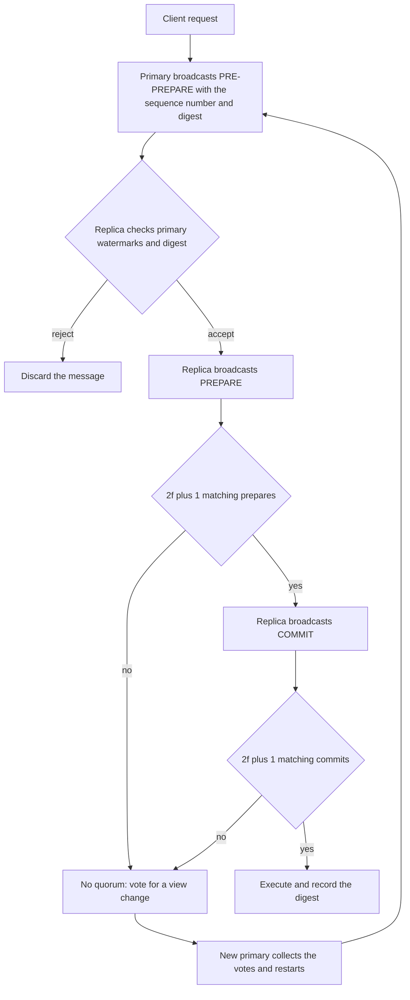
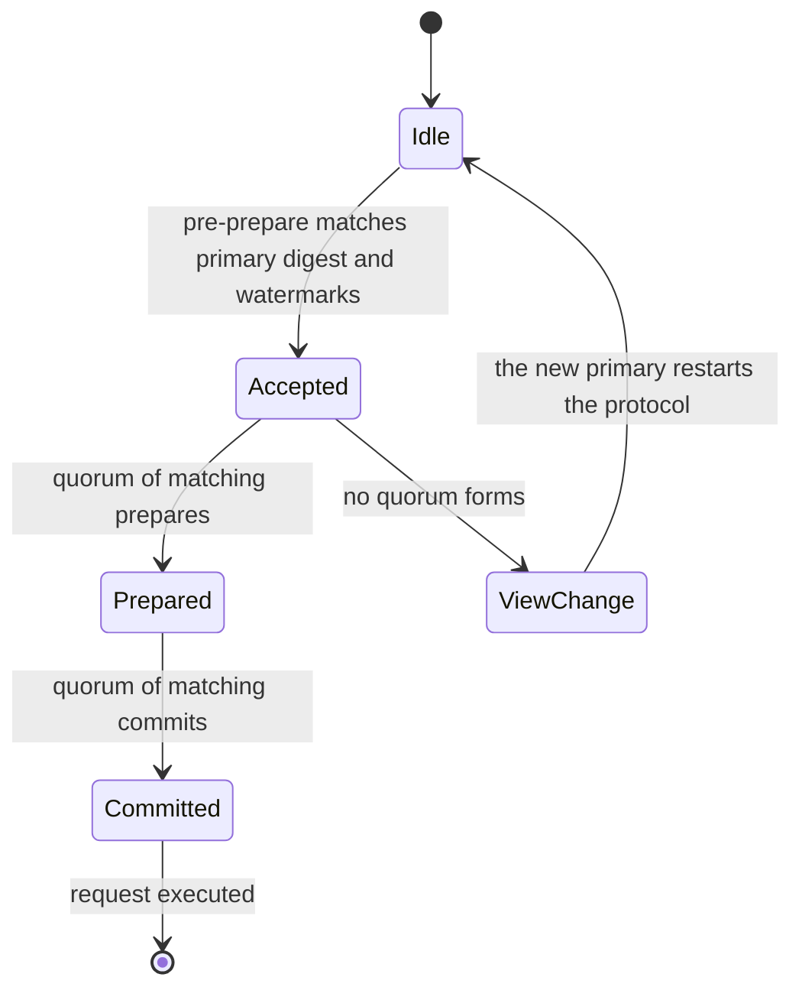
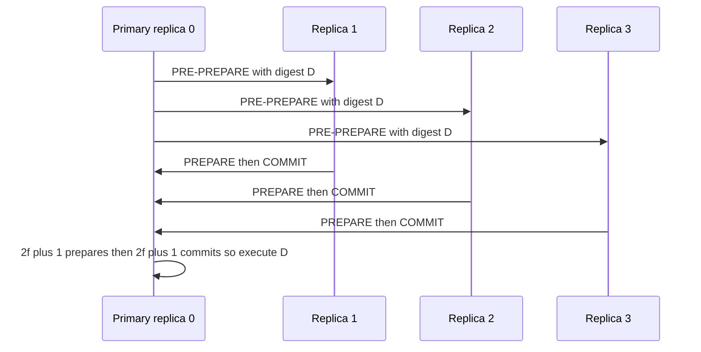

# 759 — Implement Byzantine fault tolerant consensus: a small PBFT simulation

> **Tier:** Expert · **CTCI chapter:** Ch 9 — System Design and Scalability
> **Task spec:** [759-implement-byzantine-fault-tolerant-consensus-small-simulation-pb.md](../../../tasks/expert/759-implement-byzantine-fault-tolerant-consensus-small-simulation-pb.md)
> **Solutions:** [Python](../../../solutions/python/expert/759-implement-byzantine-fault-tolerant-consensus-small-simulation-pb/solution.py) ·
> [Java](../../../solutions/java/expert/759-implement-byzantine-fault-tolerant-consensus-small-simulation-pb/Solution.java) ·
> [JavaScript](../../../solutions/javascript/expert/759-implement-byzantine-fault-tolerant-consensus-small-simulation-pb/solution.js) ·
> [C#](../../../solutions/csharp/expert/759-implement-byzantine-fault-tolerant-consensus-small-simulation-pb/Solution.cs)

## 1. Problem restatement

PBFT tolerates `f` Byzantine replicas with `n = 3f + 1` replicas, because any two quorums of `2f + 1`
replicas must overlap in at least `f + 1` replicas — so at least one shared replica is correct, and a
correct replica never accepts two different values for the same sequence number. The simulation
implements the three phases for a single client request:

| Phase | What the primary/replica does | Acceptance condition |
| --- | --- | --- |
| 1. PRE-PREPARE | the primary, which is replica `view mod n`, assigns a sequence number and broadcasts the digest of the request | accepted only from the current primary, only inside the watermarks `[low, high]`, and only if the digest equals the one the replica computed **itself** |
| 2. PREPARE | every replica that accepted the pre-prepare broadcasts its own prepare and counts prepares, including its own | at `2f + 1` matching prepares it becomes *prepared* and broadcasts a commit |
| 3. COMMIT | every replica counts commits, including its own | at `2f + 1` matching commits it executes the request and records the digest |

If a round quiesces without a commit, the replicas vote for the next view (`view-change`), the new
primary collects `2f + 1` votes and starts the protocol again — the liveness fallback for a silent or
equivocating primary. Digests come from a deterministic `splitmix`-based toy hash, and the checks
recover the classic results instead of assuming them. Concrete behaviour they assert:

- The quorum-intersection lemma is verified **exhaustively** over all quorum pairs and all Byzantine
  sets of size at most `f`, and the safety/liveness bound `n ≥ 3f + 1` is confirmed by exhaustion for
  `f = 1, 2, 3`.
- On the happy path with `n = 4`, `f = 1` and quorum `2f + 1 = 3`, **all four** replicas commit, and
  every committed digest equals the digest of the client request.
- With one silent replica the remaining three replicas still commit (3 commits); with a forged digest
  the forgery is **ignored**; with an equivocating primary the round fails and a view change to view 1
  gathers the votes and commits.
- All correct replicas that commit a given sequence number commit the same digest, in every fault
  model tested (honest, silent, equivocating primary, digest-forging replica, replica that never got
  the request).
- Duplicate deliveries are idempotent: re-delivering the same prepare or commit does not change the
  quorum counts, and no second digest appears.
- Watermarks: sequence numbers `0` and `200` outside `[10, 20]` are ignored, while `15` commits.
- A partition that leaves only two of four replicas reachable produces **no commit** — two replicas are
  not a quorum, so nothing is committed and no incorrect digest is ever asserted.
- The whole simulation is deterministic: two runs of the same request with the same fault list produce
  identical message counts and identical commit logs.

## 2. Intuition

Crash-fault consensus reasons about missing messages; Byzantine consensus has to reason about *lying*
replicas, which changes the arithmetic of quorums. If a faulty replica can say anything, then two
disjoint groups could both believe they have a majority and both commit different values — the system
would fork. The defence is to make quorums large enough that they must overlap, and to make correct
replicas refuse to accept two different values for the same slot.

Two ideas carry the design:

1. **Quorum intersection.** With `n = 3f + 1` replicas and a quorum size of `2f + 1`, two quorums share
   at least `f + 1` replicas, and at most `f` of those can be faulty, so at least one shared replica is
   honest. An honest replica signs (here: accepts) only one value per sequence number, so conflicting
   commits cannot both collect a quorum.
2. **Never trust a digest you did not compute.** A pre-prepare carries a digest, but a replica accepts it
   only if that digest matches the one it derives from the request it received from the client. An
   equivocating primary that sends different digests to different replicas therefore cannot assemble a
   quorum, and a forging replica is ignored outright.

The watermarks and the view-change vote are the operational parts: they bound how far ahead a primary
may push a sequence number, and they give the system a way forward when the primary stalls.



## 3. Algorithm

1. `digest_of(payload)`: a deterministic `splitmix`-based digest of the request bytes. It identifies the
   request; the solution header is explicit that it makes **no cryptographic claim**.
2. `Replica(index, behavior, n, quorum, low, high)`: holds the current view, the watermark window, the
   per-request state (`prepares`, `commits` keyed by view, sequence number and digest), the set of
   committed digests, the vote set, and the reply counter. The behaviour selects the fault model.
3. `propose(queue)` (the primary): broadcast a PRE-PREPARE carrying the current view, the sequence
   number and the digest. An equivocating primary sends *different* digests to different replicas.
4. `on_pre_prepare(...)`: accept only if the sender is the primary of the current view, the sequence
   number lies inside `[low, high]`, and the digest equals the one computed locally from the client
   request. Otherwise discard. A digest marked `BAD_MARK` (forged) is discarded by every correct
   replica.
5. On acceptance, broadcast a PREPARE and count matching prepares (view, sequence number, digest) across
   the messages the replica has seen, including its own. At `quorum = 2f + 1` prepares the replica is
   *prepared* and broadcasts a COMMIT.
6. On `quorum = 2f + 1` matching commits execute the request and store the digest in
   `committed[(view, seq, digest)]`. Duplicate deliveries are absorbed by the set semantics of the
   counters, which is what the idempotence checks verify.
7. `drain(queue, replicas)`: process the message queue until it is empty, so every replica sees the same
   deliveries in the same order.
8. `view_change(replicas)`: when a round quiesces without a commit, each replica votes for the next view;
   the new primary collects `2f + 1` votes and restarts the protocol for the still-pending request.
9. `quorums(nodes, size)` and the exhaustive checks enumerate every quorum and every Byzantine set of
   size at most `f`, verifying the intersection lemma and the `n ≥ 3f + 1` bound directly rather than
   quoting them.

```text
function digest_of(payload)
    state ← a fixed constant
    for each byte of payload do
        state ← state XOR byte then mixed by splitmix64
    return the state formatted as sixteen hexadecimal digits

procedure on_pre_prepare(replica, message)
    if message.view is not replica.view then discard
    if message.sender is not replica.view mod n then discard
    if message.sequence is outside replica watermarks then discard
    if message.digest is not the digest replica computed for the request then discard
    record the pre-prepare and broadcast a PREPARE

procedure on_prepare(replica, message)
    if the message matches the replica view and digest then record it
    if the count of matching prepares is at least the quorum then
        broadcast a COMMIT

procedure on_commit(replica, message)
    if the message matches the replica view and digest then record it
    if the count of matching commits is at least the quorum then
        execute the request and record the digest as committed

procedure view_change(replicas)
    for each replica do vote for the next view
    the new primary collects the votes
    when at least quorum votes are collected then restart the protocol for the pending request
```



## 4. Worked example

Request `transfer 5 to alice`, `n = 4` replicas, `f = 1`, quorum `2f + 1 = 3`, watermarks `[1, 64]`,
view `0`, so the primary is replica `0 mod 4 = 0`. Let `D` be the digest of the request.

**Happy path.**

| Step | Message | Who reacts | Replica state |
| --- | --- | --- | --- |
| 1 | `PRE-PREPARE(view 0, seq 1, D)` from replica 0 | all four replicas check the primary, the watermark and their own digest of the request | accepted by all four |
| 2 | `PREPARE(view 0, seq 1, D)` from every replica | each replica counts matching prepares including its own | at 3 prepares every replica becomes prepared |
| 3 | `COMMIT(view 0, seq 1, D)` from every replica | each replica counts matching commits | at 3 commits every replica executes |
| 4 | `committed[(0, 1, D)] = D` | all four replicas | 4 commits, all with the same digest |

**Fault models, one at a time.** Every row is a separate run of `run(request, behaviors)`.

| Fault model | Behaviour of the faulty replica | Result |
| --- | --- | --- |
| honest | none | 4 commits, digest `D` |
| silent | broadcasts nothing | 3 commits — the remaining replicas still reach the quorum of 3 |
| equivocating primary | sends different digests to different replicas | no quorum in view 0; a view change to view 1 collects the votes and commits |
| digest forging | sends a digest marked `#forged` | ignored: the forged digest never reaches a commit |
| never got the request | cannot compute the digest itself | it simply cannot accept the pre-prepare; the correct replicas commit |

The `silent` row is the interesting arithmetic: losing one replica still leaves exactly `2f + 1 = 3`
live replicas, which is precisely the quorum the protocol requires. Losing two leaves only two, which
is below the quorum — and the checks assert that nothing is committed in that case, rather than a
"best effort" attempt.

| Partition | Reachable replicas | Quorum needed | Outcome |
| --- | --- | --- | --- |
| replicas 2 and 3 unreachable | 2 | 3 | no commit at all |



## 5. Complexity

Let `n` be the number of replicas, `f` the Byzantine bound and `m` the number of messages exchanged.

| Quantity | Bound | Reason |
| --- | --- | --- |
| messages per phase | O(n²) | every replica broadcasts to every other replica |
| matching counters per replica | O(n) per phase | the quorum test scans the replica's message log |
| one protocol round | O(n²) messages | three phases, each all-to-all |
| memory per replica | O(n) per pending request | prepares and commits keyed by view, sequence number and digest |
| quorum size | `2f + 1` of `n = 3f + 1` | required so two quorums intersect in at least `f + 1` replicas |
| quorum-intersection check | all pairs of quorums, all Byzantine sets of size at most `f` | the exhaustive test the checks perform, cheap at these sizes |
| view change | O(n) votes plus one restart | no certificates are transferred in this simplification |

The `O(n²)` message complexity is the price of Byzantine agreement without signatures: every replica has
to hear from every other replica. Production systems reduce the constant with aggregation, batching and
optimistic paths, but the all-to-all core remains.

## 6. Pitfalls and edge cases

- **The digest must be recomputed locally.** Accepting a pre-prepare without comparing its digest against
  the one derived from the client request is what makes an equivocating primary dangerous; the
  equivocation test exists precisely to catch that.
- **Sequence numbers outside the watermarks are discarded.** Both extremes are tested: `0` and `200`
  outside `[10, 20]` are ignored, while `15` commits, so the window check cannot be "always accept" or
  "always reject".
- **Duplicate deliveries must be idempotent.** Re-delivering a prepare or a commit must not change the
  quorum counts nor introduce a second digest; otherwise a replaying faulty replica could double-count
  itself into a quorum.
- **A quorum is not a majority of the reachable set.** Two reachable replicas out of four are not a
  quorum of three, and the correct behaviour is *no commit* — the safety property (never commit a value
  that conflicts) wins over liveness.
- **Safety must hold across fault models.** The assertion is per sequence number: all replicas that
  commit a given sequence number commit the same digest — including when one replica is silent, when one
  forges and when the primary equivocates.
- **Forged digests must never reach a commit.** The `#forged` marker is discarded at the pre-prepare
  check, so a faulty replica cannot inject a value that nobody computed.
- **`n = 2` with quorum `2` is a mechanism test, not Byzantine tolerance.** Below `3f + 1` the
  intersection argument does not hold, and the checks treat that run as exercising the code path only.
- **Determinism.** The message queue and the delivery order are deterministic, so two identical runs
  produce identical message counts and commit logs; without that, the fault-model comparisons would not
  be controlled experiments.
- **Simplifications versus the paper.** No view-change certificates or prepared-certificate transfer — a
  new view simply restarts the protocol for the pending request — no checkpoints or garbage collection,
  no signatures (messages are trusted to come from the replica the model labels them with), one
  outstanding client request at a time, and immediate execution.

## 7. Variants and follow-ups

- **View-change certificates** transfer the prepared state so requests survive a primary change without
  being re-proposed from scratch; that is the biggest gap between this simulation and the paper.
- **Checkpoints and garbage collection** bound the memory of prepares and commits in a long-running
  system.
- **Signatures or MACs** turn the "trusted sender label" of this model into a real authentication
  mechanism, at the cost of per-message cryptography.
- **Batching and optimistic execution** (as in modern BFT systems) reduce the `O(n²)` constant, and
  threshold signatures compress the quorum certificates.
- Related work in this repository: the linearizability checker
  [618-implement-linearizability-checker-for-concurrent-histories.md](../../../tasks/expert/618-implement-linearizability-checker-for-concurrent-histories.md)
  verifies the history-level safety property this protocol protects, the consistent-snapshot simulation
  [617-implement-consistent-snapshot-across-shards-simulation.md](../../../tasks/expert/617-implement-consistent-snapshot-across-shards-simulation.md)
  addresses a related distributed-state problem, and the integrity auditing in
  [760-implement-distributed-snapshot-based-auditing-for-integrity.md](../../../tasks/expert/760-implement-distributed-snapshot-based-auditing-for-integrity.md)
  supplies the tamper-evidence a real deployment would add on top.

## 8. Check yourself

<details><summary>Show answer</summary>
**Why does PBFT need `n = 3f + 1` rather than `2f + 1`?**

Because two quorums of `2f + 1` must share at least `f + 1` replicas so that one shared replica is
correct. With `n = 2f + 1`, quorums can be disjoint (or share only faulty replicas), so two different
values could each collect a quorum and the system could fork.
</details>

<details><summary>Show answer</summary>
**What precisely stops an equivocating primary from breaking safety?**

Each replica accepts a digest only if it matches the digest that replica computed from the client's
request. If the primary sends different digests to different replicas, at least `f + 1` replicas have a
digest that disagrees with their own computation, so no quorum forms — the round fails and a view change
is needed instead of a conflicting commit.
</details>

<details><summary>Show answer</summary>
**Why does losing one of four replicas not stop the protocol?**

Because one lost replica still leaves three live replicas, which is exactly the quorum `2f + 1 = 3` for
`n = 4, f = 1`. Losing two leaves only two, which the checks show is below quorum — and then the correct
behaviour is to commit nothing rather than to guess.
</details>

<details><summary>Show answer</summary>
**What role do the watermarks play?**

They bound how far ahead of the current progress a primary may assign a sequence number. A number outside
`[low, high]` is discarded, which prevents a faulty primary from pushing a request arbitrarily far into
the log. The checks test both sides of the window (`0` and `200` rejected, `15` accepted).
</details>

<details><summary>Show answer</summary>
**What safety property do the checks assert across all fault models?**

For any sequence number, every correct replica that commits it commits the *same digest*. That is the
agreement property Byzantine consensus exists to provide, and the simulation verifies it for the honest,
silent, equivocating, forging and request-less fault models in one shared assertion.
</details>
