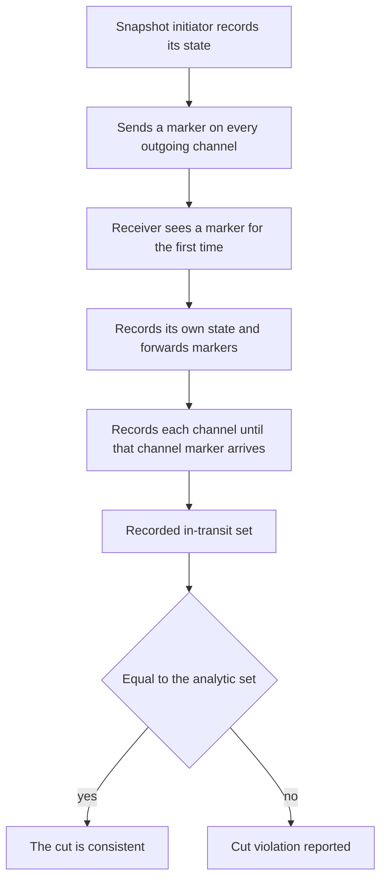
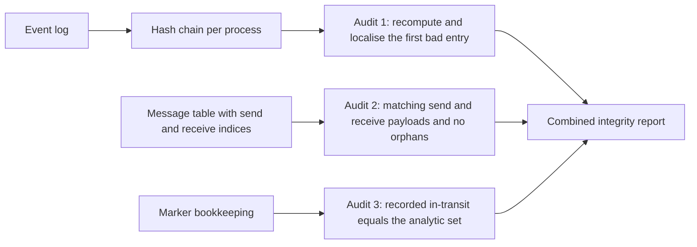
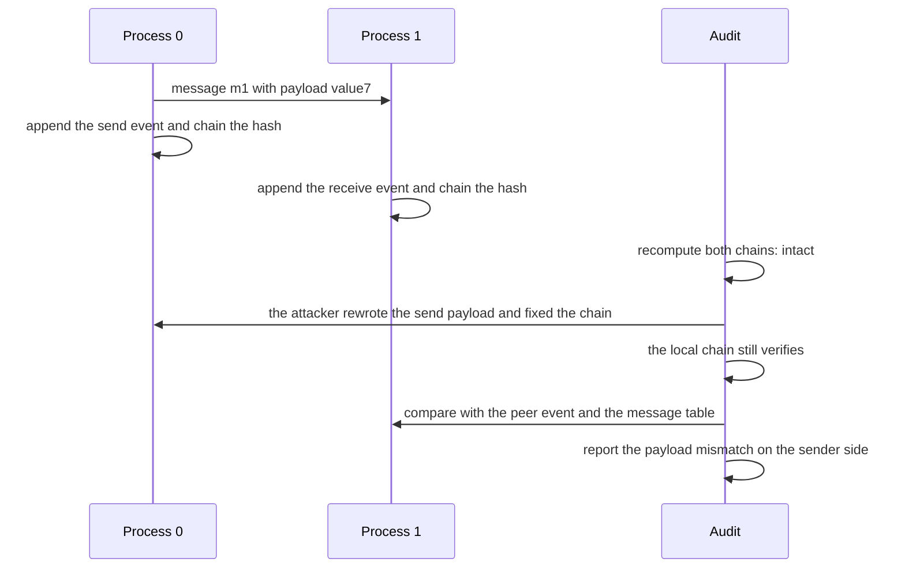

# 760 — Implement distributed snapshot-based auditing for integrity

> **Tier:** Expert · **CTCI chapter:** Ch 9 — System Design and Scalability
> **Task spec:** [760-implement-distributed-snapshot-based-auditing-for-integrity.md](../../../tasks/expert/760-implement-distributed-snapshot-based-auditing-for-integrity.md)
> **Solutions:** [Python](../../../solutions/python/expert/760-implement-distributed-snapshot-based-auditing-for-integrity/solution.py) ·
> [Java](../../../solutions/java/expert/760-implement-distributed-snapshot-based-auditing-for-integrity/Solution.java) ·
> [JavaScript](../../../solutions/javascript/expert/760-implement-distributed-snapshot-based-auditing-for-integrity/solution.js) ·
> [C#](../../../solutions/csharp/expert/760-implement-distributed-snapshot-based-auditing-for-integrity/Solution.cs)

## 1. Problem restatement

**Chandy-Lamport** gives a *consistent cut* of a distributed computation without stopping it: a process
that takes a snapshot records its own state and sends a **marker** on every outgoing channel; a process
that receives a marker for the first time records its state, forwards markers, and starts recording each
channel until that channel's marker arrives — so the messages recorded on a channel are exactly the
messages that were sent before the sender's snapshot and received after the receiver's. This task
combines that algorithm with **per-process hash chains**: every event (a local step, a send, a receive)
is appended together with `H(previous_hash ‖ seq ‖ kind ‖ detail)`, so a process's log carries a
tamper-evident state digest, and the snapshot records the chain head at the cut.

The audit then has three independent parts:

1. **Chain audit** — recompute every chain and localise the first entry that does not match its recorded
   hash.
2. **Link audit** — the send and receive events of one message id must exist in the two logs and agree
   on the payload, and no receive may refer to a message id nobody sent ("orphan").
3. **Cut audit** — the recorded in-transit set must equal the set computed independently from the event
   indices, and no receive may sit inside the cut while its send is outside.

Concrete behaviour the checks assert (`build(seed=0x5EED, count=3, snapshot_at=12, steps=40)` by
default):

- The chain is sensitive to order and payload: rewriting one event's detail changes every later hash and
  `verify_chain` returns the index of the first mismatch (`-1` when the log is intact).
- The **classic limitation** is demonstrated, not hidden: an attacker who edits an event *and*
  recomputes the rest of that process's chain passes part (1) completely — but part (2) fails, because
  the peer's log still holds the original payload. The combined audit reports `("send", mid, 0)` and
  `report["ok"]` is false while the untouched peer log stays perfectly consistent.
- A forged receive appended to a log (with the chain fixed up) is caught as an orphan:
  `("orphan", "m9999", 2)`, while the appended entry itself is a valid chain entry.
- The recorded in-transit set equals the analytic set; in-transit messages are attributed to the right
  channel and are a subset of the messages sent inside the cut; every in-transit id is a real message.
- Determinism: two runs with the same seed produce identical logs, identical snapshots and identical
  message payloads, and the audit of a healthy run is clean.
- Boundaries: a single process (no channels at all) still takes a snapshot, has an empty in-transit set
  and audits clean; a snapshot before any event records `count == 0` and head `GENESIS`; a snapshot at
  the very last step is still consistent. Both boundary snapshots audit clean and agree with the
  analytic in-transit set.

## 2. Intuition

Two different questions are being asked at once, and it matters that they are separate.

**"Is this cut consistent?"** A distributed snapshot is only meaningful if no message is counted on both
sides of the cut (received inside but sent outside) — that would be a state the system never had. The
marker algorithm records exactly the right set: for each channel, the messages sent before the sender's
snapshot that arrive after the receiver's. The task's cut audit re-derives that set analytically from
event indices and compares, so the algorithm's bookkeeping has an independent oracle.

**"Has anyone tampered with the log?"** A hash chain makes local edits detectable: entry `i`'s hash
depends on entry `i-1`'s hash, so changing an early event invalidates every later hash. But a chain is
only tamper-*evident* against an attacker who cannot rewrite the whole chain. If they can, the local
audit passes — and the *only* thing left is the evidence recorded elsewhere: the peer's log, which still
holds the original payload. That is why the link audit exists, and why the solution is explicit that a
real deployment needs a trusted head or a MAC.



## 3. Algorithm

1. `chain_hash(previous, kind, detail, seq)`: a deterministic toy hash of the string
   `seq | kind | detail`, mixed into the previous head with `splitmix64`. Chained, order-sensitive and
   payload-sensitive, and — as the header states — **not a cryptographic claim**.
2. `Process.record(kind, detail)`: append `(seq, kind, detail, hash)` where `seq` is the event index and
   `hash` chains from the previous head; the process's `head` is the current tip.
3. `Process.start_snapshot(step)`: store `{"count": len(events), "head": head, "step": step}` and start
   recording channels.
4. Send: `record("send", "mid:payload")` on the sender and schedule the message; receive:
   `record("recv", "mid:payload")` on the receiver and mark `recv_event`. Message ids and payloads are
   also stored in the simulation's `messages` table, which plays the role of independently recorded
   evidence.
5. Markers: `send_marker` and `receive_marker`. On the first marker a process records its state, sends a
   marker on every other outgoing channel, and adds every other channel to its recording set; each later
   marker removes that channel from the recording set (the messages seen on it meanwhile are the
   in-transit messages for that channel).
6. `verify_chain(process)`: walk the log, checking that `seq` equals the position and that the
   recomputed hash matches the stored one; return the first failing index or `-1`. The position check is
   what catches deletions and insertions even when the attacker recomputes hashes.
7. `verify_links(processes, messages)`: for each message id, compare the expected `mid:payload` string
   with the send and receive entries; then scan every `recv` entry and report an orphan when its message
   id is unknown.
8. `audit(simulation)`: combine the chain audit, the link audit and the cut audit
   (`recorded_in_transit()` versus `expected_in_transit()`, plus `cut_violations()`) into one report with
   an `ok` flag.
9. `expected_in_transit()`: the analytic oracle — for each message, "sent inside the sender's cut and
   received outside the receiver's cut" — grouped by sender and sorted, which is exactly the shape the
   recorded set is normalised to.

```text
procedure record(kind, detail)
    seq ← the number of events already in the log
    head ← chain_hash(head, kind, detail, seq)
    append (seq, kind, detail, head) to the log

procedure start_snapshot(step)
    recorded ← count of events so far, head, step
    recording ← the set of every other process

procedure receive_marker(sender, receiver)
    if this is the first marker seen by the receiver then
        start_snapshot
        for every other process do send a marker
    else
        remove the sender from the receiver recording set

function verify_chain(process)
    head ← GENESIS
    for index, entry in process log do
        if entry.seq is not index then return index
        head ← chain_hash(head, entry.kind, entry.detail, index)
        if head is not entry.hash then return index
    return minus one

function expected_in_transit(simulation)
    expected ← empty map from channel to message ids
    for each message do
        send_inside ← message.send_event is before the sender cut count
        receive_inside ← message.receive_event is before the receiver cut count
        if send_inside and not receive_inside then add the message to the sender channel
    return the map with sorted id lists

function audit(simulation)
    chains ← verify_chain for every process
    links ← verify_links of the process logs against the message table
    cut ← recorded in-transit compared with the analytic set, plus the cut violations
    return a report that is ok only when all three parts are clean
```



## 4. Worked example

### Part A — the cut audit

Take a message `m1` with `payload = value7`, sent by process 0 at event index 2 and received by process 1
at event index 5. Suppose process 0's snapshot recorded `count = 4` and process 1's recorded `count = 3`.

| Question | Computation | Answer |
| --- | --- | --- |
| was the send inside the cut? | `2 < 4` | yes |
| was the receive inside the cut? | `5 < 3` | no |
| is `m1` in transit on channel `0 → 1`? | sent inside and not received inside | yes |

That is exactly the analytic rule, and the recorded set — built from the marker bookkeeping — must agree
channel by channel. The reverse combination (receive inside, send outside) is a `cut_violation`, which is
the inconsistency the snapshot must never contain.

### Part B — the chain audit, and what it cannot see

The log of a process is a chain: each entry's hash depends on the previous head, so editing one event
changes every later hash.

| Attack | Local chain audit | Link audit |
| --- | --- | --- |
| edit one event's detail, keep the stored hashes | fails at the edited index | also fails |
| edit one event **and recompute the rest of the chain** | **passes** — the chain verifies locally | fails: the peer's log still holds the original payload |
| append a forged receive and fix up the chain | passes — the appended entry is a valid chain entry | fails: the message id was never sent (orphan) |

The second row is the documented limitation, and it is the reason the audit is three parts rather than
one: the chain alone cannot detect a full rewrite by an attacker who controls the log. The evidence that
catches it lives in the **peer's** log — which is why the checks assert that the untouched peer stays
perfectly consistent while the sender's side is flagged with `("send", mid, 0)`.



## 5. Complexity

Let `e` be the number of events per process, `p` the number of processes, `m` the number of messages and
`c` the number of channels.

| Operation | Time | Space | Reason |
| --- | --- | --- | --- |
| `record` | O(length of the detail string) | O(1) per entry | one chained hash over the entry text |
| `verify_chain` | O(e) | O(1) | one pass, one hash per entry |
| `verify_links` | O(m + total receive entries) | O(m) | one comparison per send/receive pair plus an orphan scan |
| `expected_in_transit` | O(m) | O(m) | one classification per message from its event indices |
| `recorded_in_transit` | O(c + recorded messages) | O(m) | merging the per-process channel recordings |
| `audit` | O(p · e + m) | O(m) | the three parts are additive and none repeats work |
| whole simulation | O(steps + m) | O(p · e + m) | a deterministic step loop plus message delivery |

The important property is that the cut audit is *cheap and independent*: recomputing the in-transit set
from event indices costs one pass over the messages, so it can be run as an oracle against the marker
bookkeeping rather than being trusted as the only source of truth.

## 6. Pitfalls and edge cases

- **A chain is not tamper-proof, only tamper-evident.** An attacker who can rewrite the whole chain of a
  process defeats the local audit; the check *demonstrates* this (`verify_chain(peer) == -1` after the
  rewrite) instead of claiming otherwise.
- **The position check matters.** `verify_chain` also requires `seq` to equal the entry's index, so
  deleting, inserting or reordering entries is detected even when hashes are recomputed.
- **Orphans are a distinct finding.** A receive whose message id nobody sent is reported as
  `("orphan", id, process)`, which is how a fabricated delivery is caught once the chain has been
  "repaired".
- **Do not confuse the two in-transit directions.** Only "sent inside the cut and received outside" is in
  transit; "received inside and sent outside" is a violation, and the checks keep the two apart.
- **Snapshot boundaries must work.** A snapshot before any event records `count == 0` with head
  `GENESIS`, and a snapshot at the very last step still has to agree with the analytic set — both are
  asserted, because off-by-one errors live exactly there.
- **A single process has no channels.** The snapshot still happens, the in-transit set is empty and the
  audit is clean; code that assumes at least one channel would fail this case.
- **Channel attribution.** In-transit messages are grouped by *sender*, so a message must appear on
  exactly the channel it was sent on, and the checks verify that in-transit ids are a subset of the
  messages sent inside the cut and that every recorded id is a real message.
- **Determinism of the schedule.** Delivery is scheduled deterministically and channels are FIFO by
  construction, so the whole pipeline — logs, snapshots, payloads — is reproducible; otherwise the
  tamper tests would be flaky.
- **No cryptographic claim.** The hash is a deterministic `splitmix`-based toy function, payloads are
  short demo strings, and the message table stands in for independently recorded evidence. A real
  deployment needs SHA-256 and signed checkpoints; the header says so.
- **No failure model.** There is no crash or recovery: the audit assumes the processes that did not fail
  produced their logs honestly, which is exactly the gap a trusted head or MAC would close.

## 7. Variants and follow-ups

- **Signed checkpoints or a trusted head** (a root hash published to an external log) are what make a
  rewrite detectable without relying on a peer's copy — the standard fix for the demonstrated
  limitation.
- **Merkle trees instead of hash chains** allow logarithmic proofs for a single event, which matters when
  a verifier does not want to re-hash the whole log.
- **Authenticated snapshot transfer** (MACs on the recorded channel contents) extends tamper evidence to
  the in-transit sets themselves.
- **Snapshot algorithms with bounded overhead** (rolling snapshots, vector-clock based cuts) reduce the
  marker traffic in larger systems, and **consistent hashing plus leases** are the usual companions in a
  real deployment.
- Related work in this repository: the consistent-snapshot simulation
  [617-implement-consistent-snapshot-across-shards-simulation.md](../../../tasks/expert/617-implement-consistent-snapshot-across-shards-simulation.md)
  covers the same cut-consistency idea for sharded state, the BFT consensus simulation in
  [759-implement-byzantine-fault-tolerant-consensus-small-simulation-pb.md](../../../tasks/expert/759-implement-byzantine-fault-tolerant-consensus-small-simulation-pb.md)
  produces the ordered log this audit could be attached to, and the formal happens-before model in
  [619-implement-formal-model-for-happens-before-and-verify.md](../../../tasks/expert/619-implement-formal-model-for-happens-before-and-verify.md)
  supplies the event ordering the cut is defined against.

## 8. Check yourself

<details><summary>Show answer</summary>
**What exactly makes a cut consistent?**

No message may be counted on both sides in a way the system never experienced: for every channel the
recorded in-transit messages must be precisely those sent before the sender's snapshot and received after
the receiver's. A receive inside the cut whose send is outside would be a violation.
</details>

<details><summary>Show answer</summary>
**Why does the marker algorithm not need to stop the computation?**

Because a marker on a channel separates "before" from "after" on that channel, and a process's own state
is recorded at a single point. Messages that cross the separation are exactly the channel contents, so the
cut can be assembled from per-process states plus in-flight recordings while computation continues.
</details>

<details><summary>Show answer</summary>
**An attacker rewrites an event and recomputes the chain. What catches them, and what does not?**

The local chain audit does **not** catch them: every hash verifies. The link audit does, because the peer
process's log still contains the original payload for that message id, so the send and receive entries
disagree — provided the peer's log was not rewritten too. This is why the header insists a chain without a
trusted head or MAC cannot detect a full rewrite on its own.
</details>

<details><summary>Show answer</summary>
**Why does `verify_chain` check the sequence number as well as the hash?**

Because an attacker who controls the log can recompute hashes after deleting or inserting an entry. The
sequence number must equal the entry's position, so a log that is not a contiguous sequence starting at
zero fails immediately, which catches exactly those structural edits.
</details>

<details><summary>Show answer</summary>
**What is the point of computing the in-transit set twice — from the markers and from the event
indices?**

Independence. The marker bookkeeping is the algorithm under test; the analytic set is a simple
re-derivation from the recorded indices. Comparing them turns the audit into a self-check of the snapshot
implementation rather than trusting its own bookkeeping, and the checks also confirm that in-transit ids
are a subset of the messages sent inside the cut.
</details>
