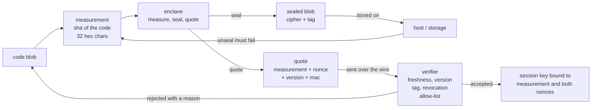
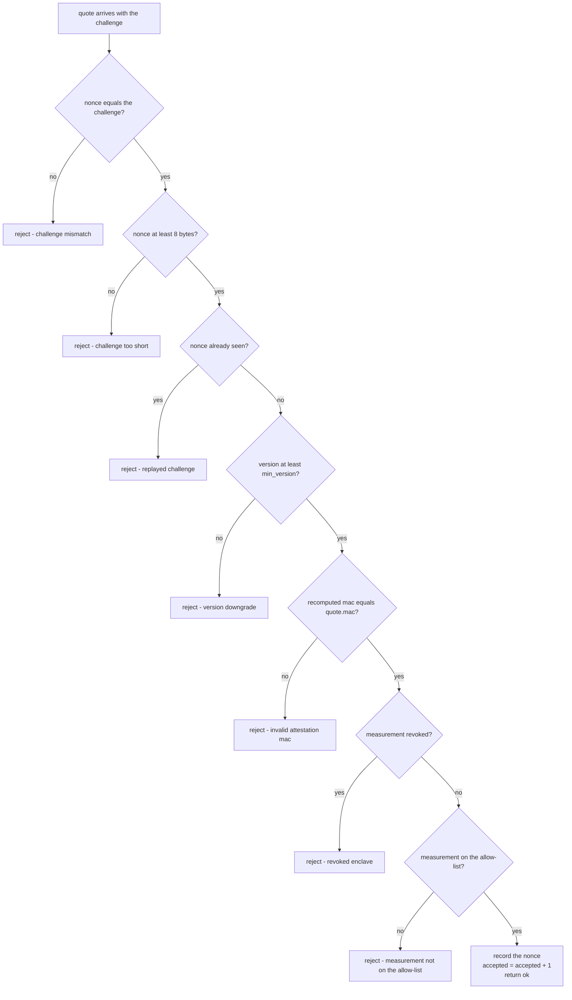
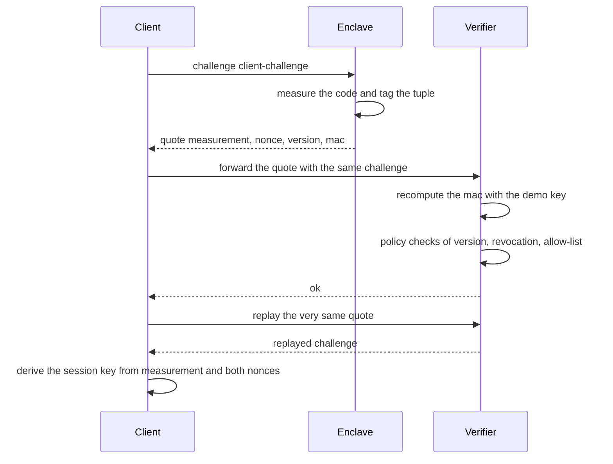

# 761 — Implement trusted execution environment simulation (attestation sketch)

> **Tier:** Expert · **CTCI chapter:** Beyond — Security & Privacy
> **Task spec:** [761-implement-trusted-execution-environment-simulation-attestation-s.md](../../../tasks/expert/761-implement-trusted-execution-environment-simulation-attestation-s.md)
> **Solutions:** [Python](../../../solutions/python/expert/761-implement-trusted-execution-environment-simulation-attestation-s/solution.py) ·
> [Java](../../../solutions/java/expert/761-implement-trusted-execution-environment-simulation-attestation-s/Solution.java) ·
> [JavaScript](../../../solutions/javascript/expert/761-implement-trusted-execution-environment-simulation-attestation-s/solution.js) ·
> [C#](../../../solutions/csharp/expert/761-implement-trusted-execution-environment-simulation-attestation-s/Solution.cs)

## 1. Problem restatement

A trusted execution environment (TEE) attests *which code is running*: the enclave measures its own
code, signs a **quote** that binds that measurement to a fresh challenge (nonce) and a version, and a
remote verifier decides whether to trust it. The four solution files expose the same pieces:

| Piece | Meaning |
| --- | --- |
| `measure(code)` | identity of the enclave: 32 hex characters of a SHA-256-based hash of the code |
| `Enclave.seal(payload)` / `unseal(blob)` | sealed storage: payload encrypted under a key derived from the measurement, authenticated by a tag |
| `Enclave.quote(challenge)` | `(measurement, nonce, version, mac)` — the tag is a keyed hash over exactly those fields |
| `verify(quote, challenge)` | freshness → version policy → tag → revocation list → allow-list, then record the nonce |
| `session_key(measurement, enclave_nonce, client_nonce)` | channel binding to the attested identity plus both nonces |

Input: a code blob, a challenge of at least `NONCE_LENGTH = 8` bytes, a version (`VERSION = 2`).
Output: an accepted/rejected verdict with a reason string, and a sealed blob that only an enclave with
the same measurement can open.

Concrete outcomes the checks assert:

- Honest flow: `verify(good.quote(b"client-challenge"), b"client-challenge")` is `True` with reason
  `"ok"`, and both sides derive the *same* `session_key`.
- Replay: verifying the same quote again gives `(False, "replayed challenge")`.
- Tampering with **any** attested field (measurement, version or nonce) gives
  `(False, "invalid attestation mac")`.
- A quote minted with the attacker key for an otherwise approved measurement gives
  `(False, "invalid attestation mac")`; a quote minted with the *demo* key for unapproved code still
  gives `(False, "measurement not on the allow-list")` — attestation and authorisation are separate.
- Sealing round-trips `b""`, `b"k"` and a 96-byte payload, and a one-bit ciphertext flip is rejected.

## 2. Intuition

The naive design is a *single* check: "if the quote verifies, let the enclave in". That is wrong in two
independent ways, and the solution splits them into two phases:

1. **Attestation** answers *is this really an enclave running measurement `M`, answering this
   challenge now?* It needs a secret only the hardware has (here a demo key standing for the
   hardware-protected attestation key), a hash over the *whole* tuple so no field can be swapped, and
   a challenge that is never accepted twice, otherwise a recorded quote can be replayed.
2. **Authorisation** answers *do I care?* A cryptographically perfect quote for a measurement that is
   not on the allow-list, or that has been revoked, must still be refused. Version policy is the third
   axis: a genuine but downgraded enclave must not be trusted.

Sealed storage is the mirror image: `seal` encrypts with a keystream derived from
`(key, measurement, nonce)` and authenticates the ciphertext, so the host can neither read the payload
nor modify it undetected — and an enclave with a *different* measurement cannot open it even though it
shares the key.



Because the tag covers `measurement`, `nonce` and `version` *together*, a replayed ciphertext, a
downgraded version or a swapped measurement all destroy the tag — the verification order in section 3
just makes the *reason* precise.

## 3. Algorithm

`verify` is deliberately a fixed sequence of gates, cheapest and most attack-relevant first:

1. **Challenge binding** — `quote.nonce != challenge` → reject `"challenge mismatch"`, so a quote can
   only ever answer the challenge it was produced for.
2. **Length policy** — `len(quote.nonce) < NONCE_LENGTH` → reject `"challenge too short"`; the enclave
   itself refuses to attest such a challenge.
3. **Freshness** — the nonce is in `seen` → reject `"replayed challenge"`.
4. **Version policy** — `quote.version < min_version` → reject `"version downgrade"`.
5. **Authenticity** — recompute `mac(DEMO_KEY, measurement, nonce, version)` and compare → reject
   `"invalid attestation mac"`.
6. **Revocation** — `measurement in revoked` → reject `"revoked enclave"`.
7. **Allow-list** — `measurement not in allowed` → reject `"measurement not on the allow-list"`.
8. **Accept** — record the nonce in `seen`, increment `accepted`, return `(True, "ok")`.

```text
function sha(parts)
    digest ← new SHA256
    for part in parts do
        digest.update(length(part) as 4 bytes big endian)
        digest.update(part)
    end
    return digest.bytes

function measure(code)
    return hex(sha(code))[0 .. 31]

function mac(key, parts)
    return hex(sha(key, parts))[0 .. 31]

function keystream(key, measurement, nonce, length)
    out ← empty
    counter ← 0
    while length(out) < length do
        out ← out + sha(key, bytes(measurement), nonce, counter as 4 bytes)
        counter ← counter + 1
    end
    return out[0 .. length - 1]

procedure Enclave.seal(data, nonce)
    if nonce is none then nonce ← next_nonce()
    cipher ← xor_bytes(data, keystream(key, measurement, nonce, size(data)))
    tag ← mac(key, bytes(measurement), nonce, cipher)
    return record with measurement, nonce, cipher, tag

procedure unseal(blob, measurement, key)
    if blob.measurement ≠ measurement then
        fail "the blob was sealed for a different enclave"
    expected ← mac(key, bytes(measurement), blob.nonce, blob.cipher)
    if expected ≠ blob.tag then
        fail "the authentication tag does not match (host tampering?)"
    return xor_bytes(blob.cipher, keystream(key, measurement, blob.nonce, size(blob.cipher)))

procedure Enclave.quote(challenge)
    if length(challenge) < NONCE_LENGTH then
        fail "the challenge must be at least 8 bytes"
    tag ← mac(key, bytes(measurement), challenge, bytes([version]))
    return record with measurement, nonce = challenge, version, mac = tag

procedure verify(quote, challenge, policy)
    if quote.nonce ≠ challenge then return reject "challenge mismatch"
    if length(quote.nonce) < NONCE_LENGTH then return reject "challenge too short"
    if quote.nonce in policy.seen then return reject "replayed challenge"
    if quote.version < policy.min_version then return reject "version downgrade"
    expected ← mac(DEMO_KEY, bytes(quote.measurement), quote.nonce, bytes([quote.version]))
    if expected ≠ quote.mac then return reject "invalid attestation mac"
    if quote.measurement in policy.revoked then return reject "revoked enclave"
    if quote.measurement not in policy.allowed then return reject "measurement not on the allow-list"
    policy.seen.add(quote.nonce)
    policy.accepted ← policy.accepted + 1
    return accept "ok"

function session_key(measurement, enclave_nonce, client_nonce)
    return hex(sha(DEMO_KEY, bytes(measurement), enclave_nonce, client_nonce))[0 .. 31]
```



## 4. Worked example

The demo builds `good = Enclave(b"load /srv/app; verify signatures; serve")`,
`evil = Enclave(b"load /srv/app; exfiltrate keys")` and
`verifier = Verifier([good.measurement], revoked=(), min_version=1)`. Write `M_good` and `M_evil` for
the two 32-hex-character measurements; the checks assert `M_good != M_evil`, that a fresh enclave with
the same code measures identically, and `len(M_good) == 32`.

| Step | Call | State before | Result |
| --- | --- | --- | --- |
| 1 | `measure(good_code)` twice | — | same `M_good`; `M_good != M_evil` |
| 2 | `good.quote(b"client-challenge")` | `seal_counter = 0` | quote `(M_good, client-challenge, 2, mac)` |
| 3 | `verify(quote, b"client-challenge")` | `seen = {}`, `accepted = 0` | `(True, "ok")`, `seen = {client-challenge}` |
| 4 | `session_key` on both sides | — | `server_key == client_key` |
| 5 | `verify(quote, b"client-challenge")` again | `seen` already holds that nonce | `(False, "replayed challenge")` |
| 6 | `verify(good.quote(b"second-challenge"), b"third-challenge")` | — | `(False, "challenge mismatch")` |
| 7 | `tampered = quote(b"tamper-challenge")` with `measurement = M_evil` | — | `(False, "invalid attestation mac")` |
| 8 | `bumped` with `version = 3` | — | `(False, "invalid attestation mac")` |
| 9 | `retagged` with `nonce = b"other-nonce-8"` | — | `(False, "invalid attestation mac")` |
| 10 | `forge_quote(M_good, b"forged-challenge", 2)` with the attacker key | — | `(False, "invalid attestation mac")` |
| 11 | `policy.verify(evil.quote(b"evil-challenge"), b"evil-challenge")` | allow-list `[M_good]` | `(False, "measurement not on the allow-list")` |
| 12 | `revoked.verify(evil.quote(...), ...)` | allow-list `[M_good, M_evil]`, revoked `[M_evil]` | `(False, "revoked enclave")` |
| 13 | `strict.verify(good.quote(b"old-challenge"), b"old-challenge")` | `min_version = 3` | `(False, "version downgrade")` |
| 14 | `verifier.verify(short_quote, b"short")` | nonce `b"short"` is 5 bytes | `(False, "challenge too short")` |
| 15 | `good.seal(b"top secret material")` then `unseal` | `seal_counter` advanced | payload round-trips; `blob.cipher != payload` |
| 16 | flip the last ciphertext bit, `unseal(flipped, M_good)` | — | `AttestationError("the authentication tag does not match (host tampering?)")` |

Note how steps 7-9 all land on the *same* reason: the tag is a hash over the concatenation with
length prefixes, so there is no field of the quote that can be edited independently.



Sealing trace, showing the keystream dependency:

| Operation | Inputs to the keystream | Effect |
| --- | --- | --- |
| `seal(b"")` | `(key, M_good, nonce)` | empty ciphertext, tag still computed → round-trips |
| `seal(b"k")` | `(key, M_good, nonce)` | one byte ciphertext `plaintext XOR stream[0]` |
| `seal(96 bytes)` | `(key, M_good, nonce)` | counter mode consumes 3 SHA-256 blocks of 32 bytes |
| `evil.unseal(blob_sealed_by_good)` | — | measurement mismatch → refused before the tag is even checked |
| forced nonce reuse | same `(key, M_good, nonce)` twice | `cipher1 XOR cipher2 == plain1 XOR plain2`, which is why the nonce must never repeat |

## 5. Complexity

Let `n` be the code length, `m` the sealed payload length and `q` the number of quotes verified.

| Operation | Best | Average | Worst | Why the bound holds |
| --- | --- | --- | --- | --- |
| `measure` | O(n) | O(n) | O(n) | one linear hash pass with 4-byte length prefixes per part |
| `quote` | O(1) | O(1) | O(1) | one keyed hash over 3 short fields |
| `verify` | O(1) | O(1) | O(1) | up to 7 constant-time comparisons plus a hash and two set lookups |
| `seal` / `unseal` | O(m) | O(m) | O(m) | counter mode generates `ceil(m / 32)` SHA-256 blocks and XORs `m` bytes |
| `session_key` | O(1) | O(1) | O(1) | one hash over fixed-size fields |
| Space | O(1) | O(1) | O(q) | the verifier keeps the set of accepted nonces, so memory grows with the number of sessions |

Alternatives, and why the checks use this one:

| Approach | Forge a quote | Replay | Leakage |
| --- | --- | --- | --- |
| Send the measurement in the clear | trivial | trivial | the code hash is public |
| Hash-based MAC over the whole tuple (this task) | needs the hardware key | blocked by the nonce set | equality of measurements is visible, by design |
| Real ECDSA over a TPM quote | needs the endorsement key chain | blocked by the nonce | verifiable provenance of the key |
| Encrypt-then-MAC with a real AEAD | needs the key | blocked by a unique nonce | index-level leakage like here |

## 6. Pitfalls and edge cases

- **Nonce reuse in the stream cipher.** `keystream` depends on `(key, measurement, nonce)` only, so
  sealing twice under one nonce makes the XOR of the ciphertexts equal the XOR of the plaintexts — the
  file's checks demonstrate exactly this. The deterministic `next_nonce` counter exists only so the
  demo is reproducible; a real enclave draws nonces from a CSPRNG.
- **Short challenges are a policy decision, not a nicety.** `quote` refuses `b"tiny"` (4 bytes) and
  `verify` answers `"challenge too short"` for a 5-byte nonce; the minimum is `NONCE_LENGTH = 8`.
- **Empty payloads.** `seal(b"")` produces an empty ciphertext but still a tag over that ciphertext, so
  the round-trip and the tamper check both work; the assertion `blob["cipher"] != payload or
  payload == b""` spells out that the empty case cannot be tested for encryption.
- **A MAC is not a signature.** The header states this explicitly: a hash-based MAC with a shared demo
  key stands in for the hardware attestation key. Anyone holding `DEMO_KEY` can mint a quote — the
  check `honest_forgery` accepts it and documents that fact.
- **Order of the rejections.** Freshness before the tag, and the tag before policy: a replayed quote is
  reported as a replay rather than as an invalid MAC, and an unapproved-but-genuine enclave is reported
  as a policy failure rather than as a forgery. `Verifier.rejected` counts each reason separately.
- **Sealed blobs are measurement-bound.** `unseal` compares `blob["measurement"]` with the caller's
  measurement *first*; an enclave with a different measurement cannot open it, even with the right key.
- **`seen` grows forever.** The verifier keeps every accepted nonce; a production verifier would expire
  them by a time window. That growth is the O(q) space entry in section 5.
- **Unicode and binary payloads.** Everything is bytes, and `sha` prefixes each part with its 4-byte
  length, so concatenation is unambiguous: `(b"ab", b"c")` and `(b"a", b"bc")` hash differently.

## 7. Variants and follow-ups

- **Alternatives to `seal`**: an AEAD with a real random nonce replaces the counter-mode keystream;
  the measurement then has to be bound as associated data, which is what `tag` does here.
- **Revocation by version instead of by measurement**: keep `min_version` per measurement rather than a
  global floor — the same gate, a richer policy table.
- **Attesting more than code**: extend the measurement to configuration and the initial data, exactly as
  [760 — distributed snapshot based auditing for integrity](../../../tasks/expert/760-implement-distributed-snapshot-based-auditing-for-integrity.md)
  chains hashes of successive states.
- **Encrypting the index instead of the payload** is the subject of
  [762 — searchable encryption demo](../../../tasks/expert/762-implement-searchable-encryption-simple-demo-deterministic-encryp.md),
  which quantifies the leakage that a deterministic scheme of this kind leaves behind.
- **Authenticated data structures** generalise the tag from a flat tuple to a proof over a tree, as in
  [902 — self-verifying distributed logs with Merkle trees](../../../tasks/master/902-implement-self-verifying-distributed-logs-with-merkle-trees-and.md).

## 8. Check yourself

<details><summary>Show answer</summary>

**Q1.** Why does `verify` check freshness *before* recomputing the tag?

Because replay is the cheapest attack and the only one that a perfect quote does not defend against:
the tag of a recorded quote is by construction valid, so it must be the nonce set that stops it. Doing
this first also yields the precise reason `"replayed challenge"` instead of a confusing success.

</details>

<details><summary>Show answer</summary>

**Q2.** A quote has a valid MAC, the measurement is on the allow-list, the version is fine, but the
enclave was revoked. What does the verifier return, and why is that ordering deliberate?

`(False, "revoked enclave")`. Revocation is checked *before* the allow-list so that an entry that is
still present in the allow-list but has been revoked cannot slip through; the revocation list is the
authoritative override.

</details>

<details><summary>Show answer</summary>

**Q3.** Why can `unseal` reject a blob before it even looks at the tag?

Because `blob["measurement"] != measurement` is a *cheaper* and *stronger* statement: the keystream was
derived from that measurement, so the payload is undecryptable for this enclave regardless of the tag.
The tag check that follows protects against a tampering host.

</details>

<details><summary>Show answer</summary>

**Q4.** The file seals twice under the same nonce and shows
`cipher1 XOR cipher2 == plain1 XOR plain2`. What breaks, and what is the fix?

The counter-mode keystream is a pure function of `(key, measurement, nonce)`, so identical nonces give
identical streams and the XOR of two ciphertexts cancels the stream. The fix is a nonce that is unique
per sealing operation (`next_nonce` in the demo, a CSPRNG in production).

</details>

<details><summary>Show answer</summary>

**Q5.** `session_key` takes the measurement plus *both* nonces. What does each nonce contribute?

The client nonce prevents an attacker from replaying a key agreement from an earlier session; the
enclave nonce (the challenge inside the quote) binds the key to this specific attested enclave instance,
so two enclaves with the same measurement still derive different session keys.

</details>
