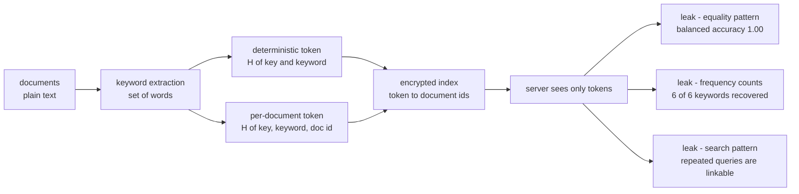
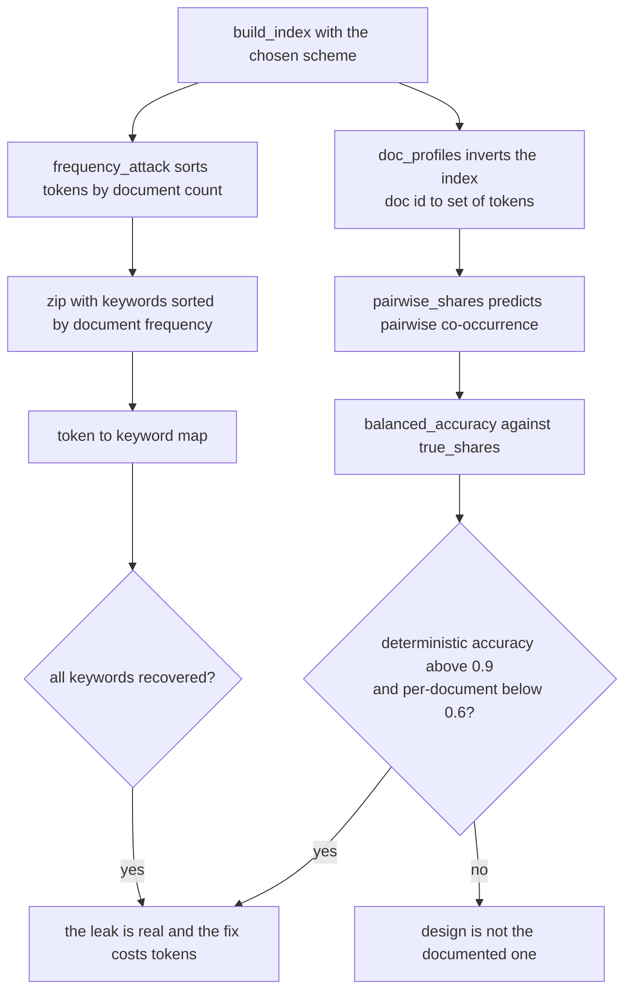
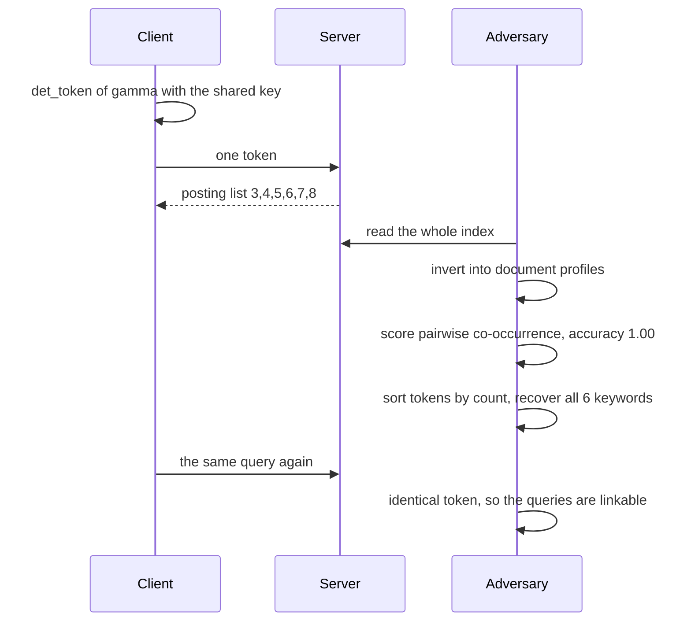

# 762 — Implement searchable encryption simple demo (deterministic encryption with leakage analysis)

> **Tier:** Expert · **CTCI chapter:** Beyond — Security & Privacy
> **Task spec:** [762-implement-searchable-encryption-simple-demo-deterministic-encryp.md](../../../tasks/expert/762-implement-searchable-encryption-simple-demo-deterministic-encryp.md)
> **Solutions:** [Python](../../../solutions/python/expert/762-implement-searchable-encryption-simple-demo-deterministic-encryp/solution.py) ·
> [Java](../../../solutions/java/expert/762-implement-searchable-encryption-simple-demo-deterministic-encryp/Solution.java) ·
> [JavaScript](../../../solutions/javascript/expert/762-implement-searchable-encryption-simple-demo-deterministic-encryp/solution.js) ·
> [C#](../../../solutions/csharp/expert/762-implement-searchable-encryption-simple-demo-deterministic-encryp/Solution.cs)

## 1. Problem restatement

Searchable encryption lets a server answer keyword queries over documents it cannot read. The cheapest
construction is also the classic cautionary tale: encrypt each **keyword** deterministically and use
that token as the index key. The four solution files implement it and then *run the adversaries*
instead of merely describing the leaks.

| Piece | Meaning |
| --- | --- |
| `token(key, parts)` | truncated SHA-256 → 16 hex characters; the "encryption" of a keyword |
| `det_token(keyword)` | `token(key, keyword)` — the same keyword always maps to the same index key |
| `doc_token(doc_id, keyword)` | `token(key, keyword, "doc", doc_id)` — one token per (document, keyword) pair |
| `rand_token(keyword, nonce)` | `token(key, keyword, "rand", nonce)` — salted, so equality is hidden |
| `build_index(documents, scheme)` | token → sorted document ids |
| `search(index, keyword, doc_ids, scheme)` | the deterministic scheme needs 1 token, per-document needs `len(doc_ids)` |
| `pairwise_shares` / `true_shares` / `balanced_accuracy` | the co-occurrence adversary and its score |
| `frequency_attack(index)` | the adversary that knows the corpus statistics |

The demo corpus is 9 documents (`0:` empty, `1: "alpha"`, …, `8:` the same as 7), with 6 keywords
whose document frequencies `8, 7, 6, 5, 4, 3` are pairwise distinct — that is what makes the frequency
attack exact and the check `len(set(counts.values())) == len(counts) and len(counts) == 6` meaningful.

Concrete results the checks assert:

- Search equals a brute-force scan for every in-corpus keyword; an absent keyword and the empty query
  both return `[]`; the deterministic scheme touches exactly **one** token per query.
- Tokens are deterministic, injective on the corpus, key-dependent, and collision free over
  **500** synthetic keywords.
- Equality leak: the co-occurrence adversary scores **balanced accuracy = 1.0**, and the number of
  distinct document keyword-sets is leaked exactly.
- Frequency leak: the token → keyword mapping is recovered for **all 6** keywords (`recovered ==
  true_map`), and the documents-per-token multiset equals the document-frequency multiset.
- Per-document tokens: balanced accuracy ≤ 0.6, at least 0.4 below the deterministic scheme, but the
  query sends **9** tokens instead of 1 and the server sees the exact result set.

## 2. Intuition

The naive idea is "encrypt the documents, keep a list of encrypted keywords, look the keyword up". The
problem is what the *index* itself reveals when the encryption is deterministic (a plain hash of the
keyword with no randomness). Three distinct leaks follow, and each needs its own adversary to measure:

1. **Equality pattern** — two documents share a keyword exactly when they share a token, so the
   adversary reconstructs the whole co-occurrence matrix. Measured as the balanced accuracy of its
   pairwise "shares a keyword" predictions: perfect (1.0) here.
2. **Frequency distribution** — the number of documents behind a token *is* the document frequency of
   the keyword, so sorting tokens by count and zipping with the known keyword counts recovers the
   keyword behind every token. Exact for this corpus because the 6 counts are distinct.
3. **Search pattern** — the same query always produces the same token, so the server sees repeated
   queries as equal.

What deterministic encryption does *not* leak is *order*: tokens are hashes, so the token order is
uncorrelated with the alphabetical order of the keywords (`|spearman| < 0.6`).



Two fixes exist, and the demo measures both. **Per-document tokens** break equality (two documents no
longer share a token for the same keyword) but cost one token per document per query and hand the
server the exact result set. **Randomized tokens** break equality completely but also break search: a
deterministic query token can never find a randomized index entry.

## 3. Algorithm

1. **Tokenize** — `keywords_of(text)` splits on whitespace and keeps a *set*, so a keyword repeated
   inside one document is indexed once.
2. **Build the index** — for each document id in sorted order and each keyword, compute the token of
   the chosen scheme and append the document id to `index[token]`; sort every posting list.
3. **Derive the query token(s)** — deterministic: one token, independent of the document set;
   per-document: one token *per candidate document id*, then intersect with the index.
4. **Answer** — return the posting list, or `[]` when the token is absent.
5. **Attack 1 (equality)** — invert the index into `doc_profiles` (doc id → set of tokens), predict
   "shares a keyword" for each pair as "shares a token", score against the true keyword overlap with
   balanced accuracy = ½ (TPR + TNR).
6. **Attack 2 (frequency)** — sort `(token, document count)` descending, sort `(keyword, document
   count)` descending, and pair them position by position.
7. **Compare schemes** — repeat step 5 on the per-document index and require a gap of at least 0.4.

```text
function token(key, parts)
    digest ← new SHA256 with the key
    for part in parts do
        digest.update(length(part) as 4 bytes big endian)
        digest.update(part)
    end
    return hex(digest)[0 .. 15]

function det_token(keyword, key)
    return token(key, bytes(keyword))

function doc_token(doc_id, keyword, key)
    return token(key, bytes(keyword), b"doc", bytes(doc_id))

procedure build_index(documents, scheme)
    index ← empty map
    for doc_id in sorted(documents) do
        for keyword in keywords_of(documents[doc_id]) do
            if scheme = "deterministic" then entry ← det_token(keyword)
            else entry ← doc_token(doc_id, keyword)
            append doc_id to index[entry]
    for entry in index do sort(index[entry])
    return index

procedure search(index, keyword, doc_ids, scheme)
    if scheme = "deterministic" then
        entry ← det_token(keyword)
        return index.get(entry, empty list), [entry]
    tokens ← [doc_token(doc_id, keyword) for doc_id in doc_ids]
    hits ← [doc_id for doc_id, entry in zip(doc_ids, tokens) if entry in index]
    return sorted(hits), tokens

function balanced_accuracy(predictions, truth)
    positives ← pairs whose true answer is true
    negatives ← pairs whose true answer is false
    tpr ← fraction of positives predicted true
    tnr ← fraction of negatives predicted false
    return 0.5 * (tpr + tnr)

procedure frequency_attack(index)
    observed ← [(number of documents behind entry, entry) sorted descending]
    known ← [(document frequency of keyword, keyword) sorted descending]
    return map entry → keyword for each aligned pair

function spearman(left, right)
    rank the elements of each sequence
    return the Pearson correlation of the two rank sequences
```



## 4. Worked example

Corpus (document id → text), with the document frequencies the checks compute:

| doc | text | contributes |
| --- | --- | --- |
| 0 | `""` | nothing (never matches any query) |
| 1 | `alpha` | alpha |
| 2 | `alpha beta` | alpha, beta |
| 3 | `alpha beta gamma` | alpha, beta, gamma |
| 4 | `alpha beta gamma delta` | + delta |
| 5 | `alpha beta gamma delta epsilon` | + epsilon |
| 6 | `alpha beta gamma delta epsilon zeta` | + zeta |
| 7 | same as 6 | same set |
| 8 | same as 6 | same set |

Document frequencies: alpha 8, beta 7, gamma 6, delta 5, epsilon 4, zeta 3 — six distinct values.

Trace of the deterministic index and the two attacks:

| Step | Action | Observation |
| --- | --- | --- |
| 1 | `build_index(DOCUMENTS)` | 6 tokens, posting list of `det_token("alpha")` is `[1,2,3,4,5,6,7,8]` |
| 2 | `search(index, "gamma", doc_ids)` | hits `[3,4,5,6,7,8]`, one token touched |
| 3 | `search(index, "not-in-corpus", doc_ids)` | `[]` — a token that is simply absent |
| 4 | `doc_profiles(index)` | doc 0 → `{}`, docs 6,7,8 → identical token sets |
| 5 | `pairwise_shares` vs `true_shares` | balanced accuracy exactly 1.0 |
| 6 | `frequency_attack(index)` | counts `8,7,6,5,4,3` align with `alpha,beta,gamma,delta,epsilon,zeta` |
| 7 | rebuild with `scheme="per-document"` | 33 tokens (0 + 1 + 2 + 3 + 4 + 5 + 6 + 6 + 6, one per (doc, keyword) pair) |
| 8 | `search(per_doc, "gamma", doc_ids, "per-document")` | same hits, but 9 tokens sent |
| 9 | per-document balanced accuracy | ≤ 0.6, at least 0.4 below step 5 |
| 10 | randomized tokens for 3 docs × 2 words | 6 distinct entries; a deterministic query finds none |

The trace of one query under each scheme makes the cost difference concrete:

| Scheme | Tokens derived per query | Tokens found in the index | What the server learns |
| --- | --- | --- | --- |
| deterministic | 1 | that one token's posting list | keyword equality, frequencies, search pattern |
| per-document | 9 (one per candidate document) | exactly the result set | the answer itself, nothing about other documents |
| randomized | 1 | none | equality is hidden and so is the answer |



The frequency attack in detail for this corpus:

| Rank | Observed (documents behind the token) | Known (keyword document frequency) | Recovered pair |
| --- | --- | --- | --- |
| 1 | 8 | 8 | alpha |
| 2 | 7 | 7 | beta |
| 3 | 6 | 6 | gamma |
| 4 | 5 | 5 | delta |
| 5 | 4 | 4 | epsilon |
| 6 | 3 | 3 | zeta |

## 5. Complexity

Let `D` be the number of documents, `W` the total number of (document, keyword) postings, `K` the
number of distinct keywords and `n` the documents' total text length.

| Operation | Best | Average | Worst | Why the bound holds |
| --- | --- | --- | --- | --- |
| `build_index` | O(n) | O(W + D log D) | O(W log W) | one hash and one append per posting; the final sort of each posting list dominates |
| `search` deterministic | O(1) | O(1 + output) | O(output log output) | a single dictionary lookup, output already sorted by construction |
| `search` per-document | O(D) | O(D) | O(D) | one token per candidate document, then a set membership test each |
| `frequency_attack` | O(K log K) | O(K log K) | O(K log K) | sorting the observed counts and the known keyword counts |
| `pairwise_shares` | O(D²) | O(D² · avg profile) | O(D² · K) | every document pair is scored against the token sets |
| `balanced_accuracy` | O(D²) | O(D²) | O(D²) | one pass over the pair table, TPR and TNR separately |
| Space | O(W) | O(W) | O(W) | the index stores one entry per posting; the per-document scheme is the widest at `W` entries |

Alternative schemes, as the header frames them:

| Scheme | Search cost | Equality leak | Frequency leak | Notes |
| --- | --- | --- | --- | --- |
| Deterministic (this demo) | 1 token | yes, 1.00 accuracy | yes, exact | cheapest and least private |
| Per-document tokens | D tokens | no (≤ 0.6, chance level) | tokens are not per keyword, so no | the server sees the result set and the index size |
| Randomized / salted | 1 token, finds nothing | no | no | searchable only with a trapdoor the demo does not implement |
| A real SSE scheme (literature) | one trapdoor | hidden | hidden | needs forward privacy and an encrypted index; out of scope here |

## 6. Pitfalls and edge cases

- **Truncated hashes are not encryption with a key schedule.** `token` is a keyed hash truncated to 16
  hex characters; the header states plainly that there is no trapdoor, no ORAM and no forward privacy,
  and that the index is a plain dictionary in memory.
- **The empty document must never match.** Document `0` has no keywords, so `search(index, "alpha")`
  must not contain `0`; the check asserts exactly that.
- **Duplicates inside a document.** `duplicate[9] = "alpha alpha beta"` still yields
  `index[det_token("alpha")] == [1,2,3,4,5,6,7,8,9]` — `keywords_of` returns a set.
- **An empty corpus** builds an empty index and every query returns `[]`.
- **Absent and empty queries** both return `[]`: there is no token for a keyword that was never
  indexed, and `keywords_of("")` is empty.
- **Collisions would silently merge keywords.** The checks require injectivity on the corpus and no
  collisions over 500 synthetic keywords; a collision would turn one token into two keywords' postings.
- **A different index key changes every token.** `det_token("alpha", b"other-key") != det_token("alpha")`
  — the leak analysis assumes the adversary has the index and the statistics, but not the key.
- **Balanced accuracy, not accuracy.** With few positive pairs, plain accuracy flatters the adversary;
  the mean of TPR and TNR is the honest score, and chance is 0.5 (the per-document variant sits at or
  below 0.6).
- **`frequency_attack` reads the module-level corpus.** It is written against `DOCUMENTS` on purpose:
  the adversary is given the true corpus statistics, the strongest possible case.
- **The deterministic scheme's `spearman` sanity checks** are exact on known inputs (`+1` for identical
  orders, `-1` for reversed) before the correlation of the token list is trusted.

## 7. Variants and follow-ups

- **Add a trapdoor** — the standard upgrade is a searchable-symmetric-encryption construction where the
  client sends a per-query trapdoor instead of a hash; the leakage analysis of section 4 stays the same,
  but the server can no longer replay a token.
- **Per-document tokens as a filter** — use them as a *prefilter* over candidate ids and finish with a
  deterministic index for the ranking, trading some equality leakage for far fewer tokens per query.
- **Encrypt the index itself** with an oblivious structure, as in
  [757 — ORAM oblivious RAM sketch for simple access patterns](../../../tasks/expert/757-implement-oram-oblivious-ram-sketch-for-simple-access-patterns.md),
  which hides the *access* pattern that the deterministic scheme exposes.
- **Bind the index to attested hardware** so only an approved measurement may read it — see
  [761 — trusted execution environment simulation](../../../tasks/expert/761-implement-trusted-execution-environment-simulation-attestation-s.md).
- **Scale the corpus** to a full end-to-end pipeline with sharding and a privacy budget in
  [886 — end-to-end encrypted search for a large document corpus](../../../tasks/master/886-implement-end-to-end-encrypted-search-for-large-document-corpus.md).

## 8. Check yourself

<details><summary>Show answer</summary>

**Q1.** Why can the frequency attack recover *every* keyword in this corpus?

Because the six document frequencies `8, 7, 6, 5, 4, 3` are pairwise distinct, the sorted order of the
observed token counts matches the sorted order of the known keyword counts one-to-one. With ties the
adversary could only narrow each token to a set of keywords, and the check
`len(set(counts.values())) == len(counts)` makes the corpus a worst case on purpose.

</details>

<details><summary>Show answer</summary>

**Q2.** Deterministic and per-document tokens share the same key and hash. Why does one leak equality
and the other not?

`det_token` hashes only the keyword, so equal keywords always produce equal tokens. `doc_token` mixes
the document id in, so the token for `alpha` in document 3 differs from the token for `alpha` in
document 4. An adversary can therefore not conclude that two documents share a *keyword*, only that a
document has some keyword.

</details>

<details><summary>Show answer</summary>

**Q3.** What is the price of the per-document fix, and how does the demo show it?

One token per candidate document per query instead of one (9 instead of 1 in this corpus), and the set
of tokens the server sees is *exactly* the result set. The checks assert
`len(tokens_sent) == len(doc_ids)` and `len(observed_hits) == len(hits)`.

</details>

<details><summary>Show answer</summary>

**Q4.** A randomized index hides equality perfectly. Why can the demo still not use it as a searchable
index?

A deterministic query token and a randomized index entry can never coincide, so
`search(randomized, "alpha", ...)` returns `[]` — the check states it as
"a deterministic query token cannot find a randomized index entry". Searchability needs a trapdoor,
which the demo deliberately does not implement.

</details>
