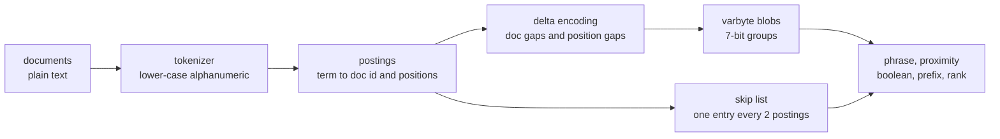
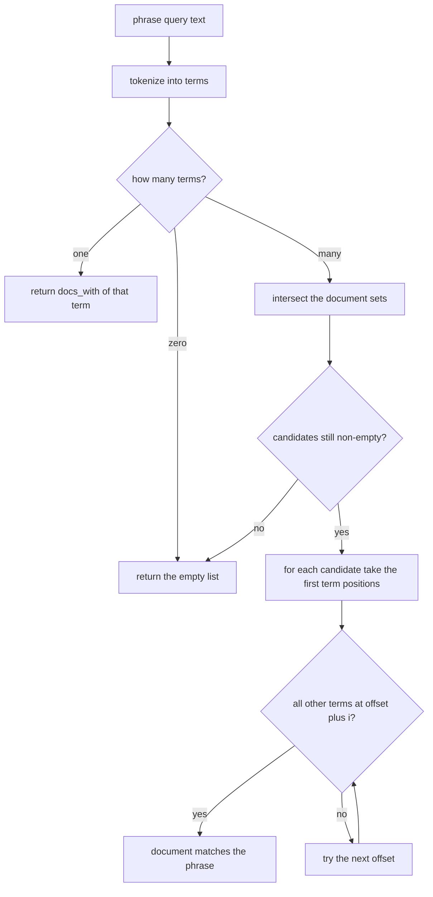
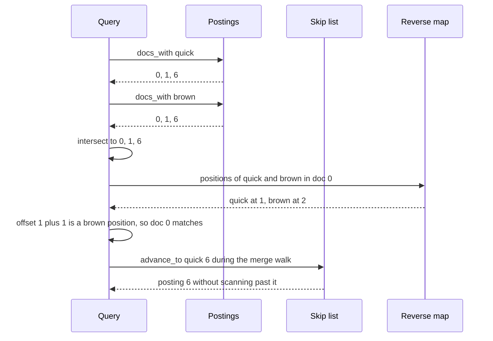
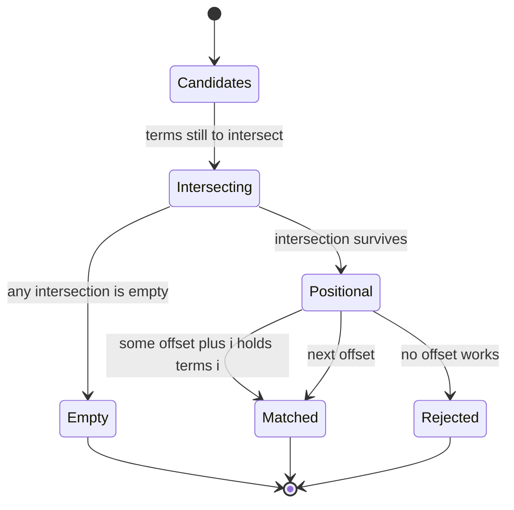

# 763 — Implement advanced index structures for full-text search (inverted index with positional info)

> **Tier:** Expert · **CTCI chapter:** Beyond — Machine Learning & AI
> **Task spec:** [763-implement-advanced-index-structures-for-full-text-search-inverte.md](../../../tasks/expert/763-implement-advanced-index-structures-for-full-text-search-inverte.md)
> **Solutions:** [Python](../../../solutions/python/expert/763-implement-advanced-index-structures-for-full-text-search-inverte/solution.py) ·
> [Java](../../../solutions/java/expert/763-implement-advanced-index-structures-for-full-text-search-inverte/Solution.java) ·
> [JavaScript](../../../solutions/javascript/expert/763-implement-advanced-index-structures-for-full-text-search-inverte/solution.js) ·
> [C#](../../../solutions/csharp/expert/763-implement-advanced-index-structures-for-full-text-search-inverte/Solution.cs)

## 1. Problem restatement

Build a **positional inverted index**: every term maps to the sorted list of documents containing it,
and for each document to the *positions* where the term occurs. Positions are what turn a
bag-of-words index into a search engine — a phrase query becomes an intersection plus a positional
check, and a proximity query becomes a check with a distance bound.

| Component | API |
| --- | --- |
| postings | `posting_list(term)`, `docs_with(term)`, `decode(term)` |
| compressed storage | `encode_postings` / `decode_postings` (delta + varbyte), `blobs[term]` |
| skipping | `skips_for(term)`, `advance_to(term, target)`, oracle `linear_advance` |
| boolean | `and_docs`, `or_docs`, `not_docs` |
| positional | `phrase(text)`, `proximity(left, right, distance)` |
| vocabulary | `prefix(prefix)` — binary search over the sorted term list |
| ranking | `score(term, doc_id)`, `rank(terms, limit)` — toy TF-IDF |

Input: 8 documents (`0:` the quick brown fox…, …, `5:` the empty string, `7:` `"dog dog dog lazy dog"`),
`SKIP_STEP = 2`. Output: exact postings, exact query answers, and postings that survive an
encode → decode round-trip.

Concrete results asserted by the checks:

- `tokenize("brown bears and black dogs")` has length 5 and `tokenize("") == []`;
  `reverse["jumps"][4] == [0, 1, 2]`.
- `decode_postings(index.blobs[term]) == index.postings[term]` for every term, and
  `len(index.blobs["the"]) < 16` — the delta encoding really shrinks the postings.
- Varbyte round-trips include the multi-byte boundaries `127, 128, 16383, 16384, 2097151, 2097152, 2**31`.
- `advance_to(term, target) == linear_advance(term, target)` for 5 terms × targets 0..8, and
  `index.hops > 0` — the skip list is genuinely used.
- `phrase("quick quick brown") == [6]`, `phrase("dog dog") == [7]`, `phrase("") == []`.
- `proximity("quick", "fox", 100) == and_docs(["quick", "fox"])`, `3 not in proximity("quick", "fox", 1)`.
- `prefix("do") == ["dog", "dogs"]`, `prefix("") == index.vocabulary`.
- `rank(["quick", "brown"], 3)` returns `[6, 0, 1]` with non-increasing scores.

## 2. Intuition

The naive search is a scan: for a phrase of `m` tokens, walk every document and compare token windows.
That is O(total tokens) per query. A **forward** index (document → its token list) does not help.
The **inverted** index flips it: term → documents, so a conjunction of rare terms touches only their
posting lists. But a plain inverted index cannot answer `"quick brown"`, because it does not know
*where* the words were; hence the positions.

Storing raw positions costs a lot, so an on-disk engine stores each posting list as a **delta-encoded
varbyte blob**: document ids are stored as gaps from the previous id, positions as gaps from the
previous position, and every integer is written in 7-bit groups. Small gaps (which dominate) need one
byte, so the common case is cheap while the structure stays exactly decodable. A **skip list** — one
entry every `SKIP_STEP = 2` postings — lets a merge/intersection jump over blocks instead of scanning
them.



The documented simplifications: everything lives in memory, there is no compression beyond varbyte
deltas, no front-coded term dictionary, no WAND/block-max skipping, no scoring beyond a toy TF-IDF, and
no stemming or stop-word list — the tokenizer is a lower-casing alphanumeric split, and a second,
independent `re.findall` tokenizer is used as the posting oracle.

## 3. Algorithm

1. **Tokenize** each document; position `p` is the token offset in that document.
2. **Build** `reverse[term][doc_id] = [positions]` in document order, then
   `postings[term] = sorted(docs.items())` and `vocabulary = sorted(postings)`.
3. **Encode** each posting list: for every document emit `doc_delta, count`, then the position deltas;
   each integer becomes 7-bit varbytes with the high bit set on continuation bytes.
4. **Decode** by reversing that walk; a trailing continuation bit means a truncated blob.
5. **Skip list** — `skips_for(term)` takes every `SKIP_STEP`-th posting; `advance_to(term, target)`
   walks the skips while `skip_doc <= target`, then scans linearly from the last accepted skip.
6. **Boolean** — `and_docs` intersects the document sets, `or_docs` unions them, `not_docs` complements
   against all document ids.
7. **Phrase** — intersect the candidates, then check that for some offset `o` in the first term's
   positions, `o + i` is a position of term `i` for every `i`.
8. **Proximity** — documents containing both terms where some pair of positions is within `distance`.
9. **Prefix** — `bisect_left` on the sorted vocabulary, then a linear walk while the term still starts
   with the prefix.
10. **Rank** — `(1 + log(tf)) * log(N / df)` summed over the query terms, sorted by descending score and
    then ascending document id, truncated to `limit`.

```text
procedure build(documents)
    reverse ← empty map of term to map of doc id to position list
    for doc_id in sorted(documents) do
        for position, term in enumerate(tokenize(documents[doc_id])) do
            append position to reverse[term][doc_id]
    postings ← sorted doc id and position pairs for every term
    vocabulary ← sorted terms of postings
    for term in postings do blobs[term] ← encode_postings(postings[term])

procedure encode_postings(postings)
    numbers ← empty list
    previous_doc ← 0
    for doc_id, positions in postings do
        append doc_id - previous_doc to numbers
        previous_doc ← doc_id
        append length(positions) to numbers
        previous_position ← 0
        for position in positions do
            append position - previous_position to numbers
            previous_position ← position
    return encode_numbers(numbers)

procedure encode_numbers(numbers)
    out ← empty byte buffer
    for number in numbers do
        if number < 0 then fail "varbyte encoding needs non-negative integers"
        while true do
            chunk ← number AND 0x7F
            number ← number >> 7
            if number ≠ 0 then append chunk OR 0x80 to out
            else append chunk to out and break

function advance_to(term, target)
    postings ← posting_list(term)
    start ← 0
    for doc_id, entry_index in skips_for(term) do
        if doc_id <= target then start ← entry_index
        else break
    index ← start
    while index < length(postings) do
        if postings[index].doc_id >= target then return postings[index]
        index ← index + 1
    return none

function phrase(text)
    terms ← tokenize(text)
    if length(terms) = 0 then return empty list
    if length(terms) = 1 then return docs_with(terms[0])
    candidates ← intersection of docs_with(term) over terms
    matches ← empty list
    for doc_id in sorted(candidates) do
        for offset in positions of terms[0] in doc_id do
            if offset + i is a position of terms[i] in doc_id for every i then
                append doc_id to matches and break
    return matches

function score(term, doc_id)
    positions ← reverse.get(term, {}).get(doc_id)
    if positions is empty then return 0.0
    return (1 + log(length(positions))) * log(number of documents / postings[term].size)

function rank(terms, limit)
    scores ← empty map
    for doc_id in or_docs(terms) do
        total ← sum of score(term, doc_id) over distinct terms
        if total > 0 then scores[doc_id] ← total
    return the first limit entries sorted by descending score then ascending doc id
```



## 4. Worked example

The eight documents, tokenized and numbered by position:

| doc | tokens with positions |
| --- | --- |
| 0 | the0 quick1 brown2 fox3 jumps4 over5 the6 lazy7 dog8 |
| 1 | quick0 brown1 foxes2 leap3 over4 lazy5 dogs6 |
| 2 | the0 fox1 and2 the3 dog4 are5 friends6 |
| 3 | brown0 bears1 and2 black3 dogs4 |
| 4 | jumps0 jumps1 over2 the3 fence4 |
| 5 | (empty) |
| 6 | a0 quick1 quick2 brown3 fox4 |
| 7 | dog0 dog1 dog2 lazy3 dog4 |

The blob is the 11 numbers `[0,2,0,6, 2,2,0,3, 2,1,3]`; every value is below 128, so each takes one
byte and `len(index.blobs["the"]) == 11 < 16`, matching the check. Decoding walks the same structure
backwards and reproduces `[(0,[0,6]), (2,[0,3]), (4,[3])]` exactly.

Query traces, all cross-checked against the brute-force oracles:

| Query | Candidates after intersection | Positional check | Result |
| --- | --- | --- | --- |
| `phrase("quick brown")` | `{0, 1, 6}` | doc 0 offset 1, doc 1 offset 0, doc 6 offset 2 | `[0, 1, 6]` |
| `phrase("brown quick")` | `{0, 1, 6}` | no offset matches | `[]` |
| `phrase("dog dog")` | `{0, 2, 7}` | doc 7 has `0,1,2,4` | `[7]` |
| `phrase("quick quick brown")` | `{0, 1, 6}` | doc 6 has `quick` at 1 and 2 | `[6]` |
| `proximity("quick", "fox", 1)` | `{0, 6}` | gaps 2 and 2/3 | `[]` |
| `proximity("quick", "fox", 3)` | `{0, 6}` | gaps 2 and 2/3 | `[0, 6]` |
| `proximity("quick", "fox", 100)` | `{0, 6}` | window covers everything | `[0, 6]` = `and_docs(["quick","fox"])` |
| `proximity("brown", "bears", 2)` | `{3}` | gap 1 in doc 3 | `[3]` |
| `prefix("do")` | binary search lands on `dog` | walk stops at `dogs` | `["dog", "dogs"]` |
| `rank(["quick", "brown"], 3)` | — | doc 6 has `quick` twice | `[(6, s6), (0, s0), (1, s1)]` |

Ranking detail: `quick` occurs once in documents 0 and 1 and twice in 6, while `brown` occurs once in
0, 1 and 6, so document 6 wins on term frequency and 0 ties with 1 on score — the tie is broken by
document id, which is why the result is `[6, 0, 1]`. `score("jumps", 4) > score("jumps", 0)` for the
same reason: three occurrences against one.





## 5. Complexity

Let `T` be the total number of tokens, `V` the vocabulary size, `P` the length of the longest posting
list, `m` the number of query terms and `k` the requested top-`k`.

| Operation | Best | Average | Worst | Why the bound holds |
| --- | --- | --- | --- | --- |
| `advance_to` | O(1) | O(P / SKIP_STEP) | O(P) | skips jump in blocks of `SKIP_STEP`; the tail is scanned linearly |
| `and_docs` / `or_docs` | O(m) | O(sum of posting lengths) | O(m · P) | set algebra over the posting lists |
| `phrase` | O(m) | O(m + candidates × positions) | O(m · P) | one intersection then a positional check per candidate |
| `proximity` | O(m) | O(candidates × p₁ × p₂) | O(D · p₁ · p₂) | every pair of positions in the two lists is compared |
| `prefix` | O(1) | O(log V + matches) | O(V) | `bisect_left` over the sorted vocabulary, then a contiguous run |
| `rank` | O(m) | O(m · P + hits log hits) | O(m · P + D log D) | one score per (term, document) pair then a sort |
| Space | O(T) | O(T) | O(T) | one position per token in `reverse`, one blob entry per posting |

## 6. Pitfalls and edge cases

- **Varbyte boundaries.** `127, 128, 16383, 16384, 2097151, 2097152, 2**31` are all round-tripped: the
  value `128` needs two bytes, and getting the continuation bit wrong corrupts every later number.
- **The empty document contributes nothing.** `doc_lengths[5] == 0` and it never appears in a posting
  list, so `docs_with("the") == [0, 2, 4]` and no query can ever return document 5.
- **Empty queries.** `phrase("")` and `phrase("   ")` return `[]` (the first has no terms, the second
  tokenizes to nothing); `and_docs([]) == []` but `not_docs([]) == sorted(DOCUMENTS)`.
- **An absent term.** `advance_to("absent-term", 0) is None`, `and_docs` with an absent term is empty,
  `or_docs` keeps the present one, and `score("zebra", 0) == 0.0`.
- **Repeated tokens inside a phrase.** `phrase("quick quick brown")` must find document 6, where the
  positions are 1 and 2; a naive "positions + i" check that reuses one position list would miss it.
- **A limit larger than the result set** is clamped: `rank(["quick"], 99)` returns exactly
  `len(docs_with("quick"))` entries.
- **Tokenization of punctuation.** `tokenize` splits on non-alphanumerics and lower-cases, so `"foxes"`
  and `"fox"` are different terms; an independent `re.findall` tokenizer is used as the other oracle.

## 7. Variants and follow-ups

- **Score the same postings** with BM25 instead of the toy TF-IDF, including document-length
  normalisation — see
  [764 — ranking functions TF-IDF + BM25 with evaluation](../../../tasks/expert/764-implement-ranking-functions-tf-idf-bm25-simple-scoring-and-evalu.md).
- **Compress the postings harder** with a succinct bitvector and rank/select, as in
  [608 — BWT-based full-text index with fast locate](../../../tasks/expert/608-implement-bwt-based-full-text-index-with-fast-locate.md)
  and [605 — FM-index with rank/select structures](../../../tasks/expert/605-implement-fm-index-full-search-with-rank-select-structures.md).
- **Union the posting lists of many terms** with bitmap indexes, which trade space for very fast
  AND/OR — see
  [652 — bitmap index and fast AND/OR operations](../../../tasks/expert/652-implement-bitmap-index-and-fast-and-or-operations.md).
- **Rank the shortlist** with a learned model rather than TF-IDF, as in
  [767 — online re-ranking with features and click simulation](../../../tasks/expert/767-implement-online-re-ranking-with-features-and-click-simulation-l.md).
- **Scale the same structure** to vector search when terms become embeddings — see
  [765 — approximate nearest neighbor with IVF+PQ](../../../tasks/expert/765-implement-approximate-nearest-neighbor-for-embeddings-at-scale-w.md).

## 8. Check yourself

<details><summary>Show answer</summary>

**Q1.** Why can a plain inverted index *not* answer the phrase `"quick brown"`?

Because it only records *which* documents contain each term, not where. The intersection of the posting
lists gives candidate documents, but in document 1 `quick` is at 0 and `brown` at 1 (a match) while in
another document they could be far apart (not a match), and the index cannot tell the difference.

</details>

<details><summary>Show answer</summary>

**Q2.** The blob for `the` is `[0,2,0,6, 2,2,0,3, 2,1,3]`. What does each group mean, and why is the
blob 11 bytes and not more?

Each group is `doc delta, position count, position deltas` for one document: `(0, 2, [0, 6])`,
`(2, 2, [0, 3])`, `(4, 1, [3])`. Every number is below 128, so it fits in one varbyte; the deltas — not
the absolute document ids and positions — are what keep the values small.

</details>

<details><summary>Show answer</summary>

**Q3.** `advance_to` uses a skip list of one entry every `SKIP_STEP = 2` postings. What does that buy,
and how is the claim verified?

It lets the search jump over whole blocks instead of scanning them, so an intersection can seek forward
cheaply. The checks verify equivalence with `linear_advance` over 5 terms × targets 0..8 *and* assert
`index.hops > 0`, so the skip list cannot be silently bypassed.

</details>

<details><summary>Show answer</summary>

**Q4.** Why does `rank(["quick", "brown"], 3)` put document 6 first?

Because `quick` occurs twice there, so its term frequency is 2 while in documents 0 and 1 it is 1;
`(1 + log(tf))` is larger for document 6, and `brown` contributes the same amount everywhere since it
has `df = 3` in all of them. Documents 0 and 1 tie exactly and are ordered by document id.

</details>