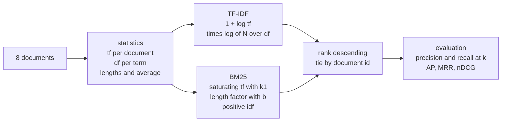
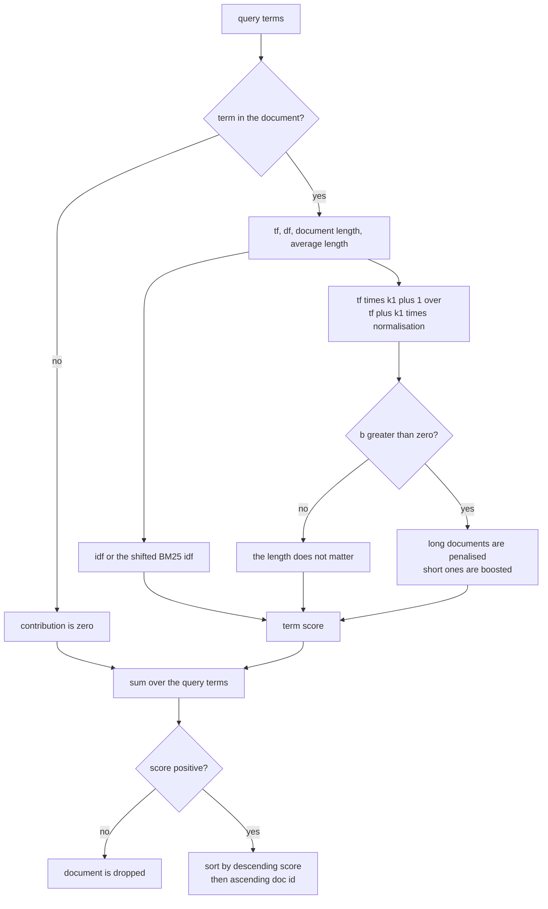
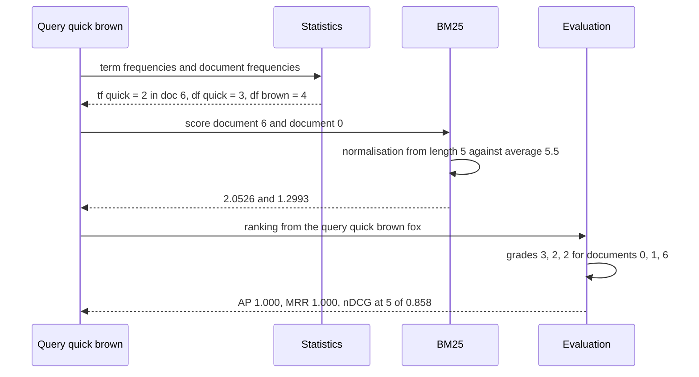

# 764 — Implement ranking functions TF-IDF + BM25 simple scoring and evaluation

> **Tier:** Expert · **CTCI chapter:** Beyond — Machine Learning & AI
> **Task spec:** [764-implement-ranking-functions-tf-idf-bm25-simple-scoring-and-evalu.md](../../../tasks/expert/764-implement-ranking-functions-tf-idf-bm25-simple-scoring-and-evalu.md)
> **Solutions:** [Python](../../../solutions/python/expert/764-implement-ranking-functions-tf-idf-bm25-simple-scoring-and-evalu/solution.py) ·
> [Java](../../../solutions/java/expert/764-implement-ranking-functions-tf-idf-bm25-simple-scoring-and-evalu/Solution.java) ·
> [JavaScript](../../../solutions/javascript/expert/764-implement-ranking-functions-tf-idf-bm25-simple-scoring-and-evalu/solution.js) ·
> [C#](../../../solutions/csharp/expert/764-implement-ranking-functions-tf-idf-bm25-simple-scoring-and-evalu/Solution.cs)

## 1. Problem restatement

Implement two classic bag-of-words rankers over the same inverted statistics, plus the standard offline
evaluation measures:

| Component | Definition |
| --- | --- |
| TF-IDF | `(1 + log tf) * log(N / df)`, summed over the query terms |
| BM25 | `idf * tf * (k1 + 1) / (tf + k1 * (1 - b + b * len(d) / avg_len))` with `idf = log(1 + (N - df + 0.5) / (df + 0.5))` |
| `Ranker.rank(query, limit, model, k1, b)` | sort by descending score, then ascending document id |
| `precision_at_k`, `recall_at_k` | hits inside the top `k`, over `k` and over all relevant documents |
| `average_precision`, `reciprocal_rank` | precision at each hit; inverse rank of the first hit |
| `ndcg_at_k(ranking, grades, k)` | graded gains `(2^grade - 1) / log2(position + 1)`, divided by the ideal ordering |

Input: the same 8-document corpus used by the sibling index task (`5:` is the empty string),
`k1 = 1.2`, `b = 0.75`. Output: scores, rankings, and metric values.

Concrete results, all from the solutions' own assertions and printed summary:

- Statistics: `document_frequency["jumps"] == 2`, `document_frequency["quick"] == 3`,
  `lengths[4] == 6`, `lengths[5] == 0`, `total == 8`, average length **5.50**, vocabulary **18**.
- `idf("jumps") == log(4.0)` because `N / df = 8 / 2`; the BM25 idf stays **positive** for every term
  (`log(1 + 5.5/3.5)` for `df = 3`).
- BM25 equals an independently transcribed formula for every (term, document) pair tested
  (terms `quick`, `jumps`, `dog`, `bears` × all 8 documents).
- Saturation: doubling the term frequency multiplies the score by less than **1.5**, while `k1 = 1000`
  makes it linear (ratio **2.0** within 0.01).
- Ranking `"quick brown"`: documents `6, 1, 0` with scores `2.0526, 1.4732, 1.2993`; TF-IDF gives
  document 6 `2.3538`.
- nDCG: the ideal order scores exactly 1.0, the reversed order more than 0.2 lower.
- Whole-run evaluation: `AP = 1.000`, `MRR = 1.000`, `nDCG@5 = 0.858`.

## 2. Intuition

Scoring a document is "how often does it contain the query terms, and how rare are those terms?". The
naive version is the raw count: score = sum of `tf`. Two things break it. A word that appears ten times
should not be worth ten times a word that appears once, and a word that appears in *every* document
tells you nothing about which document to return.

TF-IDF fixes both with `(1 + log tf)` — sublinear in the count — times `log(N / df)`, the inverse
document frequency. Its weakness is the length of the document: a long document contains more of
everything, and TF-IDF does not care.

BM25 adds two knobs. `k1` controls **saturation**: the factor `tf * (k1 + 1) / (tf + k1 * …)` rises
quickly for small `tf` and flattens out, so the second occurrence of a word matters much more than the
tenth. `b` controls **length normalisation**: the denominator grows with `len(d) / avg_len`, so long
documents are penalised, and at `b = 0` the length does not matter at all.



Because both models are sums of independent per-term contributions, "the score of a multi-term query is
the sum of the term scores" is not just a claim in the comments — it is a check. The same additivity
makes the model easy to debug: one term at a time.

## 3. Algorithm

1. **Statistics** — tokenize every document by whitespace on the lower-cased text; build
   `frequencies[doc][term]`, `document_frequency[term]` (documents, *not* occurrences) and
   `lengths[doc]`, then `average_length = sum(lengths) / N`.
2. **TF-IDF term score** — `0` if the term is absent, else `(1 + log tf) * log(N / df)`.
3. **BM25 term score** — `0` if absent, else
   `log(1 + (N - df + 0.5) / (df + 0.5)) * tf * (k1 + 1) / (tf + k1 * normalisation)` with
   `normalisation = 1 - b + b * len / avg_len`. If `avg_len == 0`, the ratio is taken as 1.
4. **Document score** — sum the term scores over the query (duplicates in the query are summed too,
   because the model is a plain sum over the term list).
5. **Rank** — drop documents with score ≤ 0 (so the empty document and non-matching documents vanish),
   sort by `(-score, doc_id)` and cut to `limit` if given.
6. **Evaluate** — `precision_at_k` and `recall_at_k` over the top `k`, `average_precision` averaging
   the precision at each hit, `reciprocal_rank` for the first hit, and `ndcg_at_k` with graded gains.

```text
function build_statistics(documents)
    frequencies ← empty map of doc id to map of term to count
    for doc_id, text in documents do
        for word in tokenize(text) do
            frequencies[doc_id][word] ← frequencies[doc_id][word] + 1
    document_frequency ← empty map
    for counts in frequencies do
        for word in counts do
            document_frequency[word] ← document_frequency[word] + 1
    lengths ← map doc id to the sum of its counts
    return frequencies, document_frequency, lengths

function idf(term)
    documents_with_term ← document_frequency.get(term, 0)
    if documents_with_term = 0 then return 0.0
    return log(total / documents_with_term)

function bm25_idf(term)
    documents_with_term ← document_frequency.get(term, 0)
    return log(1 + (total - documents_with_term + 0.5) / (documents_with_term + 0.5))

function tf_idf_score(term, doc_id)
    count ← frequencies[doc_id].get(term, 0)
    if count = 0 then return 0.0
    return (1 + log(count)) * idf(term)

function bm25_term(term, doc_id, k1, b)
    count ← frequencies[doc_id].get(term, 0)
    if count = 0 then return 0.0
    if average_length = 0 then ratio ← 1.0 else ratio ← lengths[doc_id] / average_length
    normalisation ← 1 - b + b * ratio
    return bm25_idf(term) * (count * (k1 + 1)) / (count + k1 * normalisation)

function score(terms, doc_id, model, k1, b)
    if model = "bm25" then
        return sum of bm25_term(term, doc_id, k1, b) over terms
    return sum of tf_idf_score(term, doc_id) over terms

function rank(terms, limit, model, k1, b)
    if terms is empty then return empty list
    scored ← [(doc_id, score(terms, doc_id, model, k1, b)) for doc_id in sorted documents]
    scored ← entries of scored whose score is positive
    sort scored by descending score then ascending doc id
    return the first limit entries if limit is given else scored

function ndcg_at_k(ranking, grades, k)
    if k <= 0 or grades is empty then return 0.0
    gains ← [power(2, grades.get(doc, 0)) - 1 for doc in the first k entries of ranking]
    ideal ← the k largest values of power(2, grade) - 1 over grades
    if sum(ideal) = 0 then return 0.0
    return discounted_gain(gains) / discounted_gain(ideal)

function discounted_gain(gains)
    return sum of gain / log2(position + 1) over positions starting at 1
```



## 4. Worked example

Corpus statistics (documents as in the positional-index task, average length 5.5):

| doc | length | terms contributing to the queries used below |
| --- | --- | --- |
| 0 | 9 | quick 1, brown 1, fox 1 |
| 1 | 7 | quick 1, brown 1 |
| 2 | 7 | fox 1 |
| 3 | 5 | brown 1 |
| 4 | 6 | jumps 3 |
| 5 | 0 | — |
| 6 | 5 | quick 2, brown 1, fox 1 |
| 7 | 5 | — |

Document frequencies: `quick = 3`, `fox = 3`, `brown = 4`, `jumps = 2`, `the = 3`. So
`idf("jumps") = log(8/2) = log 4` and `bm25_idf("quick") = log(1 + (8 - 3 + 0.5) / (3 + 0.5)) =
log(2.5714)`.

Term-by-term trace for the query `"quick brown"` in document 6 (length 5, average 5.5):

| Step | Computation | Value |
| --- | --- | --- |
| normalisation | `1 - 0.75 + 0.75 * 5 / 5.5` | 0.9318 |
| `quick` factor | `2 * 2.2 / (2 + 1.2 * 0.9318)` | 1.4111 |
| `bm25_idf("quick")` | `log(1 + 5.5 / 3.5)` | 0.9445 |
| `quick` contribution | `0.9445 * 1.4111` | 1.3331 |
| `brown` factor | `1 * 2.2 / (1 + 1.2 * 0.9318)` | 1.0387 |
| `bm25_idf("brown")` | `log(1 + 4.5 / 4.5)` | 0.6931 |
| `brown` contribution | `0.6931 * 1.0387` | 0.7199 |
| document score | `1.3331 + 0.7199` | **2.0527** |

The printed ranking matches: `bm25("quick brown") -> [(6, 2.0526), (1, 1.4732), (0, 1.2993)]`. Document
1 beats document 0 purely through length normalisation — both contain `quick` and `brown` exactly once,
but document 1 has 7 tokens against document 0's 9, so its normalisation is smaller
(`0.25 + 0.75 * 7/5.5 = 1.2045` against `1.4773`). Under TF-IDF there is no length term at all, so those
two documents tie and are ordered by id: the same query gives `[(6, 2.3538), (0, …), (1, …)]`, which is
the "the two models must not be the same function of the statistics" check.

Graded nDCG on `grades = {0: 3, 1: 2, 2: 1, 6: 2}` with the ideal order `[0, 1, 6, 2]`:

| position | doc | grade | gain `2^g - 1` | discount `log2(pos+1)` | discounted gain |
| --- | --- | --- | --- | --- | --- |
| 1 | 0 | 3 | 7 | 1.0000 | 7.0000 |
| 2 | 1 | 2 | 3 | 1.5850 | 1.8928 |
| 3 | 6 | 2 | 3 | 2.0000 | 1.5000 |
| 4 | 2 | 1 | 1 | 2.3219 | 0.4307 |
| | | | | **DCG** | **10.8235** |

The ideal order divides by itself, so `nDCG@4 = 1.0` exactly. The reversed order `[2, 6, 1, 0]` gives
`1 + 1.8928 + 1.5 + 3.0147 = 7.4075`, so `nDCG@4 = 0.6844` — a gap of **0.3156**, comfortably more than
the 0.2 the check demands.



## 5. Complexity

Let `N` be the number of documents, `T` the total number of tokens, `V` the vocabulary size, `q` the
query length and `k` the cut-off.

| Operation | Best | Average | Worst | Why the bound holds |
| --- | --- | --- | --- | --- |
| `build_statistics` | O(T) | O(T) | O(T) | one hash increment per token, one per distinct term per document |
| `idf` / `bm25_idf` | O(1) | O(1) | O(1) | one dictionary lookup and one logarithm |
| `tf_idf_score` / `bm25_term` | O(1) | O(1) | O(1) | no iteration over the document |
| `score` | O(q) | O(q) | O(q) | sums one term score per query term |
| `rank` | O(N log N) | O(N · q + N log N) | O(N q + N log N) | scores every document then sorts; the sort dominates for short queries |
| `precision_at_k` / `recall_at_k` | O(1) | O(k) | O(k) | slices the first `k` entries |
| `average_precision` | O(1) | O(len(ranking)) | O(N) | one pass, accumulating precision at each hit |
| `ndcg_at_k` | O(k) | O(k log k) | O(k log k) | gains over the top `k`, plus a sort of the ideal gains |
| Space | O(T + V) | O(T + V) | O(T + V) | tf per (document, term) pair, df per term |

## 6. Pitfalls and edge cases

- **`df` counts documents, not occurrences.** `document_frequency["jumps"] == 2` although `jumps`
  occurs five times overall (three times in document 4); counting occurrences would inflate the idf and
  collapse the ranking to "longest document wins".
- **The classic TF-IDF idf can be zero.** `log(N / df)` is 0 when a term is in every document; the BM25
  variant `log(1 + (N - df + 0.5)/(df + 0.5))` stays positive, which the checks assert for *every* term
  of the corpus.
- **`b = 0` must remove the length factor entirely.** The check is an exact equality
  (`< 1e-12`), because a leftover `b * ratio` term would be invisible in a comparison test.
- **`k1` controls saturation, not ranking order.** With `k1 = 1000` the ratio between tf = 1 and tf = 2
  becomes 2.0 (linear); with the default 1.2 it is 1.375. Both are correct BM25 — the check pins the
  behaviour of both extremes.
- **Absent terms contribute nothing in either model.** `score(["quick", "zebra"], 6) ==
  score(["quick"], 6)` and both `bm25_term("zebra", …) == 0.0` and `tf_idf_score("zebra", …) == 0.0`.
- **The empty document never scores.** `lengths[5] == 0`, `score("the", 5) == 0.0`, and `5` never appears
  in a ranking; it also keeps `average_length` finite.
- **An empty average length.** If every document were empty, `average_length` is 0 and the length ratio
  is taken as 1 instead of dividing by zero.
- **Empty and hitless queries.** `rank("") == []`, `rank([]) == []` and `rank("zebra") == []` — the
  "drop non-positive scores" step is what makes the last one empty.
- **Query term order must not matter.** `rank("jumps over")` and `rank("over jumps")` produce the same
  document order, though a repeated query term is summed twice.
- **Ties.** `(-score, doc_id)` is a total order, so equal scores are always broken by id and the output
  is reproducible; the checks compare two independent `Ranker` instances.
- **Metrics must handle degenerate inputs.** An empty ranking or an empty relevant set scores 0.0;
  `precision_at_k` divides by the *window* length, so `precision_at_k([], {0}, 3) == 0.0` rather than an
  error; `ndcg_at_k` returns 0.0 for `k = 0`, for no grades, and when every graded document is missing
  from the ranking.

## 7. Variants and follow-ups

- **Rebuild these statistics from a positional index** so phrases and BM25 share one structure — see
  [763 — advanced index structures with positional information](../../../tasks/expert/763-implement-advanced-index-structures-for-full-text-search-inverte.md).
- **Replace the hand-tuned formula with a learned ranking model** over the same features, as in
  [767 — online re-ranking with features and click simulation](../../../tasks/expert/767-implement-online-re-ranking-with-features-and-click-simulation-l.md).
- **Learn `k1` and `b`** per field instead of using 1.2 / 0.75, which is what a tuned production ranker
  does; the corpus here is too small for that, so the defaults are fixed and asserted.
- **Rank vectors instead of terms** when documents are embeddings — see
  [765 — approximate nearest neighbor with IVF+PQ](../../../tasks/expert/765-implement-approximate-nearest-neighbor-for-embeddings-at-scale-w.md)
  — and then re-rank the shortlist with BM25 or a learned model.
- **Serve the same scores from a distributed index** with sharding and a merge step, as in
  [815 — real-time vector search at billion-vector scale](../../../tasks/master/815-implement-real-time-vector-search-at-billion-vector-scale-with-s.md).

## 8. Check yourself

<details><summary>Show answer</summary>

**Q1.** Why is the TF-IDF term frequency `1 + log(tf)` and not just `tf`?

Because relevance is sublinear in the count: a document that repeats a word ten times is not ten times
more about that word than a document that says it once. The logarithm compresses the tail while keeping
the first occurrences nearly linear, and `1 +` keeps the value positive at `tf = 1`.

</details>

<details><summary>Show answer</summary>

**Q2.** Document 1 (7 tokens) and document 0 (9 tokens) contain `quick` and `brown` once each. Why does
BM25 rank document 1 first while TF-IDF ties them?

BM25's denominator `tf + k1 * (1 - b + b * len/avg_len)` grows with the document length, so the 7-token
document keeps more of its score (`normalisation` 1.2045 against 1.4773). TF-IDF has no length term, so
the two scores are identical and the tie is broken by document id.

</details>

<details><summary>Show answer</summary>

**Q3.** What do `k1` and `b` each control, and how do the checks pin them down?

`k1` controls the saturation of the term frequency: with `k1 = 1000` the score becomes linear in `tf`
(the check requires a ratio of 2.0 ± 0.01 when `tf` doubles), with the default 1.2 it is 1.375. `b`
controls length normalisation: at `b = 0` the same term frequency in a 3-token and a 31-token document
must score *exactly* equal, at `b = 0.75` the longer document must lose, at `b = 1.0` the short document
must gain over `b = 0`.

</details>

<details><summary>Show answer</summary>

**Q4.** The ideal order gives nDCG exactly 1.0. What is the value for the reversed order, and why is
`average_precision` a better signal than `precision@k` for the evaluation run?

The reversed order gives `7.4075 / 10.8235 = 0.6844`. Average precision rewards *where* the relevant
documents are, so moving them down the list lowers it even when the top-`k` count of hits is unchanged,
whereas `precision@k` only counts hits in the window. In the whole-run check the ranker reaches
`AP = 1.000` with `MRR = 1.000` and `nDCG@5 = 0.858`.

</details>
