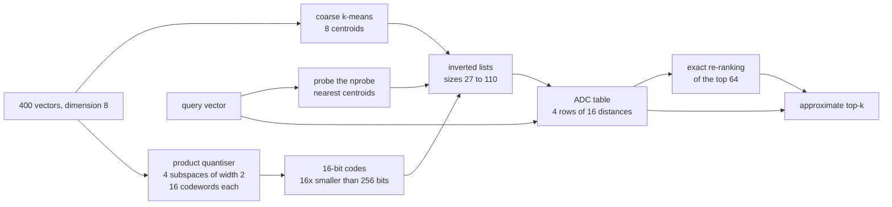
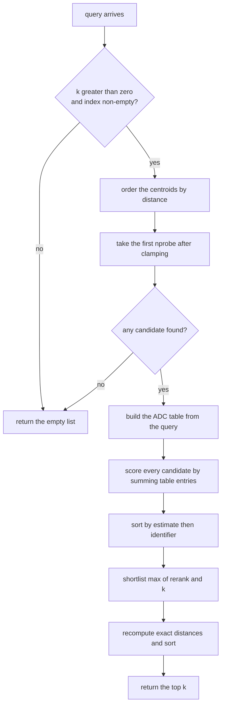
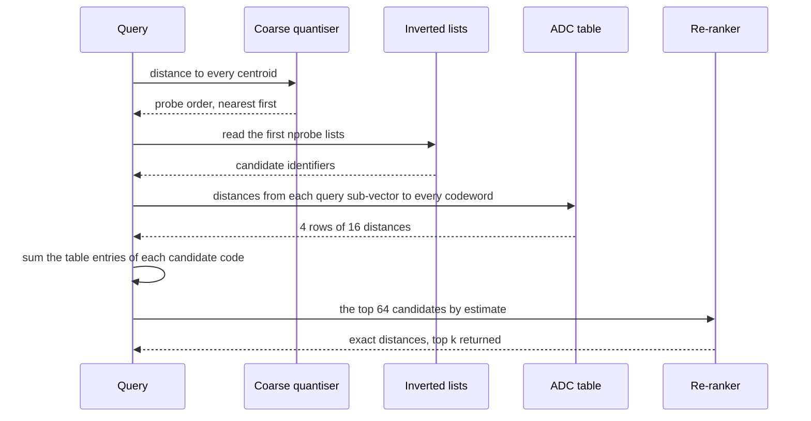

# 765 — Implement approximate nearest neighbor for embeddings at scale with IVF+PQ

> **Tier:** Expert · **CTCI chapter:** Beyond — Advanced Data Structures & Algorithms
> **Task spec:** [765-implement-approximate-nearest-neighbor-for-embeddings-at-scale-w.md](../../../tasks/expert/765-implement-approximate-nearest-neighbor-for-embeddings-at-scale-w.md)
> **Solutions:** [Python](../../../solutions/python/expert/765-implement-approximate-nearest-neighbor-for-embeddings-at-scale-w/solution.py) ·
> [Java](../../../solutions/java/expert/765-implement-approximate-nearest-neighbor-for-embeddings-at-scale-w/Solution.java) ·
> [JavaScript](../../../solutions/javascript/expert/765-implement-approximate-nearest-neighbor-for-embeddings-at-scale-w/solution.js) ·
> [C#](../../../solutions/csharp/expert/765-implement-approximate-nearest-neighbor-for-embeddings-at-scale-w/Solution.cs)

## 1. Problem restatement

Answer `top-k nearest neighbour` queries over a large vector set without touching every vector. Two
independent compressions make that possible and the solutions implement both:

| Stage | What it does |
| --- | --- |
| **IVF** (inverted file) | k-means over the raw vectors gives a *coarse quantiser*; each vector is stored in the inverted list of its nearest centroid, so a query visits only the `nprobe` nearest lists |
| **PQ** (product quantisation) | split a `d`-dimensional vector into `m` sub-vectors of width `d/m` and replace each by the index of the nearest of `2^b` codewords trained on that subspace |
| **ADC** | build one lookup table of distances from each query sub-vector to every codeword, then a code's distance is the sum of `m` table entries |
| **Re-ranking** | take the top `rerank` candidates by ADC and recompute their exact distances |

Input: 400 deterministic clustered vectors of dimension `DIM = 8` (`make_vectors` uses a splitmix64
stream, 8 well-separated centres plus noise in `[-3, 3]`, coordinates inside `[-25, 25]`) and 20
queries. Output: an approximate top-`k` with real distances.

Concrete values from the solutions' own assertions and printed summary:

- Lists `LISTS = 8`, sizes `[27, 52, 94, 22, 34, 23, 38, 110]`; k-means objective `13547.3 → 13395.5`
  over 12 iterations, non-increasing and deterministic.
- PQ is `4 subspaces × 16 codewords = 16 bits` against `8 × 32 = 256` raw bits — **16× smaller** — with
  reconstruction MSE **13.69**; a finer quantiser with 64 codewords reconstructs strictly better.
- Probing all 8 lists with exact distances reproduces brute force **exactly** (`recall = 1.0`).
- `recall@10` with exact ranking inside the lists: `{1: 0.925, 2: 1.0, 4: 1.0, 8: 1.0}` — the check
  requires `≥ 0.9` at `nprobe = 4`.
- End-to-end with PQ codes and re-ranking: `{1: 0.895, 2: 0.97, 4: 0.97, 8: 0.97}` — `≥ 0.8` at
  `nprobe = 4`, and never above the exact-distance curve.
- Boundaries: `k = 0` → `[]`, `nprobe = 0` → `[]`, `nprobe = 999` clamped to 8, `k = 1000` returns all
  400 vectors, a query equal to vector 7 returns `(0.0, 7)`.

## 2. Intuition

The baseline is exact search: 400 distance computations of 8 multiplications each. At a billion vectors
that is hopeless, so the two compressions attack two different costs.

- **Fewer candidates (IVF).** If similar vectors live in the same list, the query only needs the lists
  whose centroid is close. Probing 1 of 8 lists in the worst case reads an eighth of the data — and the
  measured `recall@10` shows the price: `0.895` at one probe, `0.97` from two probes on.
- **Cheaper comparisons (PQ).** Even inside a list, comparing full float vectors is expensive, so each
  vector is stored as `m` small codes. The trick that makes codes *usable* is the **ADC** table: because
  the sub-vectors are independent, the distance to a code is a sum of `m` precomputed lookups — no
  arithmetic per candidate beyond `m` additions.
- **Recover accuracy (re-rank).** ADC is an *estimate* of the distance to the decoded vector, so the top
  `rerank` candidates are re-scored exactly. This is what the check "re-ranking the whole probed set
  must return the exact best candidate" pins down.



The documented simplifications: float coordinates in a few dimensions, **one** coarse level (no
IVF-HNSW, no residual encoding, no residual quantisation), plain Lloyd k-means with a deterministic
initialisation instead of k-means++, no SIMD-friendly memory layout, no training on a held-out subset,
and no early-termination heuristics. The `heapq` import is kept only for API parity with a real ANN
library; the search itself is a scan of the probed lists.

## 3. Algorithm

Training:

1. **Coarse quantiser** — `kmeans(vectors, LISTS)` with centroids initialised at every
   `len(points) // k`-th point, `iterations = 12` Lloyd steps, recording the objective after each step.
2. **Product quantiser** — for each of the 4 subspace blocks, take that block of every vector and run
   its own k-means with 16 codewords; `bits = (codewords - 1).bit_length()` so 16 codewords fit in 4 bits.
3. **Assignment** — every vector goes into `lists[nearest(centroids, vector)]` and its code is stored in
   `codes[id]`.

Search for a query:

4. **Probe order** — sort the centroids by `(distance to the query, index)`; take the first `nprobe`
   after clamping to `[0, len(centroids)]`.
5. **Candidates** — concatenate the probed lists (the union may contain every vector when all lists are
   probed).
6. **ADC table** — one row per subspace, one entry per codeword: the squared distance from that query
   sub-vector to each codeword.
7. **Rank by estimate** — sum the table entries of each code, sort by `(estimate, id)`.
8. **Shortlist and re-rank** — keep the first `max(rerank, k)` entries and recompute exact distances,
   then return the first `k`.

```text
function kmeans(points, k, iterations)
    if points is empty then fail "k-means needs points"
    if k < 1 or k > length(points) then fail "k must be within [1, len(points)]"
    centroids ← [copy of points[(index * length(points)) // k] for index in range(k)]
    history ← empty list
    repeat iterations times do
        groups ← k empty lists
        for point in points do
            append point to groups[nearest(centroids, point)]
        for index, group in groups do
            if group is not empty then
                centroids[index] ← coordinate-wise mean of group
        append objective(points, centroids) to history
    return centroids, history

procedure ProductQuantizer.train(points, subspaces, codewords, iterations)
    if length(points[0]) mod subspaces ≠ 0 then fail "the dimension must be divisible by subspaces"
    width ← length(points[0]) / subspaces
    bits ← bit_length(codewords - 1)
    for block in range(subspaces) do
        sub_vectors ← [point[block * width .. (block + 1) * width - 1] for point in points]
        codebooks[block] ← first result of kmeans(sub_vectors, codewords, iterations)

function encode(vector)
    codes ← empty list
    for block in range(subspaces) do
        sub ← vector[block * width .. (block + 1) * width - 1]
        append nearest(codebooks[block], sub).index to codes
    return codes

function table(query)
    rows ← empty list
    for block in range(subspaces) do
        sub ← query[block * width .. (block + 1) * width - 1]
        append [squared_distance(sub, codeword) for codeword in codebooks[block]] to rows
    return rows

function estimate(codes, table)
    return sum of table[block][codes[block]] over blocks

procedure IVFIndex.train(vectors, lists)
    pq ← new ProductQuantizer trained on vectors
    centroids ← first result of kmeans(vectors, lists)
    for identifier, vector in enumerate(vectors) do
        assigned ← nearest(centroids, vector).index
        append identifier to inverted_lists[assigned]
        codes[identifier] ← pq.encode(vector)

function probe_order(query)
    return centroid indexes sorted by squared_distance(centroid, query) then by index

function candidates(query, nprobe)
    probes ← first max(0, min(nprobe, number of centroids)) entries of probe_order(query)
    found ← concatenation of inverted_lists[probe] over probes
    return probes, found

function search(query, k, nprobe, rerank, exact_ranking)
    if k <= 0 or vectors is empty then return empty list
    probes, found ← candidates(query, nprobe)
    if found is empty then return empty list
    if exact_ranking then
        scored ← [(squared_distance(vectors[id], query), id) for id in found]
    else
        lookup ← table(query)
        scored ← [(estimate(codes[id], lookup), id) for id in found]
    sort scored by distance then by identifier
    shortlist ← first max(rerank, k) entries of scored if rerank is given else scored
    reranked ← sorted [(squared_distance(vectors[id], query), id) for entry in shortlist]
    return first k entries of reranked
```



## 4. Worked example

The index in numbers, as printed by the solutions:

| Quantity | Value |
| --- | --- |
| database | 400 vectors, dimension 8 |
| coarse lists | 8, sizes `[27, 52, 94, 22, 34, 23, 38, 110]` |
| k-means | objective `13547.3 → 13395.5` over 12 iterations |
| PQ | 4 subspaces, width 2, 16 codewords, 4 bits each → 16 bits per vector |
| compression | `8 × 32 = 256` bits → 16 bits, **16×** |
| reconstruction MSE | 13.69 (16 codewords) vs strictly lower with 64 codewords |

The five checks that pin the pipeline down, traced on one query:

| Step | Action | Asserted outcome |
| --- | --- | --- |
| 1 | `index.assignment_ok()` | every vector sits in the list of its nearest centroid, no vector lost or doubled, list sizes not all equal |
| 2 | probe all 8 lists with `exact_ranking=True` | `recall@10 = 1.0` and the ranking equals `brute_force` |
| 3 | `pq.encode` on ids 0, 37, 74, … | each code is the nearest codeword of its subspace, codes in `[0, 16)` |
| 4 | `pq.estimate(codes, table(query))` vs `squared_distance(query, pq.decode(codes))` | equal to `1e-9` — the ADC identity |
| 5 | `search(query, k=1, nprobe=4, rerank=len(found))` | the exact best vector inside the probed set |
| 6 | `search(query, k=1, nprobe=4, rerank=1)` | the ADC argmin is returned, without any exact re-ranking |

Recall as a function of how much of the database is probed, measured over the 20 queries:

| `nprobe` | exact distances inside the lists | PQ estimates plus re-ranking |
| --- | --- | --- |
| 1 | 0.925 | 0.895 |
| 2 | 1.000 | 0.970 |
| 4 | 1.000 | 0.970 |
| 8 | 1.000 | 0.970 |

Two facts stand out. Recall with exact distances is monotone in `nprobe` and reaches 1.0 as soon as two
lists are probed, because the clustered generator puts the true neighbours in the same coarse cells.
And the PQ curve sits strictly below the exact one at every `nprobe` — quantisation can lose a
neighbour that was already inside the probed lists, which the check
`plain[8] >= recalls[8]` states as an inequality.



## 5. Complexity

Let `N` be the database size, `d` the dimension, `m` the number of subspaces, `C` the codewords per
subspace, `p` the number of probes and `L` the list count.

| Operation | Best | Average | Worst | Why the bound holds |
| --- | --- | --- | --- | --- |
| `encode` | O(d) | O(m C d / m) | O(m C d / m) | nearest codeword per subspace |
| build the index | O(N d) | O(N m d / m) | O(N m C d / m) | one assignment plus one encoding per vector |
| ADC table | O(d) | O(m C width) | O(m C width) | one row per subspace, one distance per codeword |
| `search` | O(k) | O(p N / L + candidates · m + candidates log candidates) | O(N m + N log N) when every list is probed | the probe set bounds the candidates; the shortlist bounds the exact re-scoring |
| Space | O(N m b) | O(N m b / 8 + L d) | O(N m b / 8) | codes are `m · b` bits per vector instead of `d` floats |

## 6. Pitfalls and edge cases

- **`k = 0` and an empty index.** `search(query, k=0) == []` and `IVFIndex([])` keeps `LISTS` empty lists
  and returns `[]` for every query; both are checked before any distance is computed.
- **`nprobe = 0`** returns `[]` (no candidate at all), and `nprobe = 999` is **clamped** to the number of
  centroids rather than raising, so a caller cannot accidentally scan out of range.
- **`k` larger than the database** returns everything: `search(query, k=1000, nprobe=8)` has length 400.
- **Invalid training parameters raise.** `kmeans(vectors, 0)`, `kmeans(vectors, 5000)` (more clusters
  than points), `kmeans([], 2)` and `ProductQuantizer(vectors, subspaces=5)` (8 is not divisible by 5)
  all raise `ValueError`.
- **Determinism is load-bearing.** Centroid initialisation is "every `N/k`-th point" rather than random,
  so `kmeans` twice returns identical centroids; the checks require the rebuilt index to have equal
  centroids, lists, codes and search results.
- **Ties in a distance.** Every sort is by `(distance, identifier)`, so equal distances produce a stable,
  reproducible order instead of an arbitrary one.
- **The ADC estimate is not the true distance.** It equals the distance to the *decoded* vector exactly
  (the identity the checks verify to `1e-9`), but the decoded vector is not the original, so the estimate
  differs from the exact distance — that is precisely why the re-ranking stage exists.
- **Quantisation must actually lose something.** `coarse_error > 0` is asserted; a zero MSE would mean
  the codebooks memorised the data, and the "more codewords reconstruct better" check would then be
  meaningless.

## 7. Variants and follow-ups

- **Replace the coarse quantiser with a graph** — IVF-HNSW probes a navigable small world instead of
  `nprobe` nearest centroids, which is the subject of
  [766 — dense vector index with HNSW and quantization integration](../../../tasks/expert/766-implement-dense-vector-index-with-hnsw-and-quantization-integrat.md).
- **Add residual quantisation** so the PQ codes encode the offset from the centroid instead of the raw
  vector; recall improves at the same number of bits.
- **Scale out to billions of vectors** with sharding, a merge step and recall guarantees — see
  [779 — approximate nearest neighbor with quantization for billion-scale](../../../tasks/expert/779-implement-approximate-nearest-neighbor-with-quantization-for-bil.md)
  and [815 — real-time vector search at billion-vector scale](../../../tasks/master/815-implement-real-time-vector-search-at-billion-vector-scale-with-s.md).
- **Re-rank with a real scoring model** once the shortlist is available, for example BM25 over the
  candidate metadata — see
  [764 — ranking functions TF-IDF + BM25](../../../tasks/expert/764-implement-ranking-functions-tf-idf-bm25-simple-scoring-and-evalu.md).
- **Feed the shortlist into a learned re-ranker** with features and click feedback, as in
  [767 — online re-ranking with features and click simulation](../../../tasks/expert/767-implement-online-re-ranking-with-features-and-click-simulation-l.md).

## 8. Check yourself

<details><summary>Show answer</summary>

**Q1.** Probing all 8 lists with exact distances gives recall 1.0. Why is that check useful at all?

Because it isolates the plumbing from the approximation: if a vector were missing from the list of its
nearest centroid, or duplicated, the full-probe search would differ from `brute_force`. The check
therefore proves the inverted file is *correct*, not merely fast, before any approximation is measured.

</details>


<details><summary>Show answer</summary>

**Q3.** Why is recall measured twice, once with `exact_ranking=True` and once with PQ codes?

The two curves separate the two error sources. The exact-distance curve measures what the coarse
quantiser loses by not probing every list (`0.925` at one probe, `1.0` from two). The PQ curve measures
quantisation loss on top of it (`0.895` then `0.97`), and the check `plain[8] >= recalls[8]` states that
quantisation can only lose recall relative to exact distances inside the same probed set.

</details>

<details><summary>Show answer</summary>

**Q4.** `search(query, k=1, nprobe=4, rerank=1)` returns the ADC argmin. What does
`search(query, k=1, nprobe=4, rerank=len(found))` return instead, and why is that a guarantee?

It returns the true nearest vector *inside the probed set*, because every candidate is re-scored exactly
before the final sort. The first call documents what the estimate alone would pick; the second
documents that re-ranking the whole shortlist is exact within the candidate set.

</details>

<details><summary>Show answer</summary>

**Q5.** PQ turns 256 bits into 16 bits — a 16× smaller index. Name the two costs that come with it.

Quantisation error (MSE 13.69 at 16 codewords; a 64-codeword quantiser reconstructs better at the price
of more bits per vector) and the extra work per query: building the ADC table costs `m × C` distance
computations, which is `4 × 16 = 64` here — cheap once, but it is paid on every query.

</details>