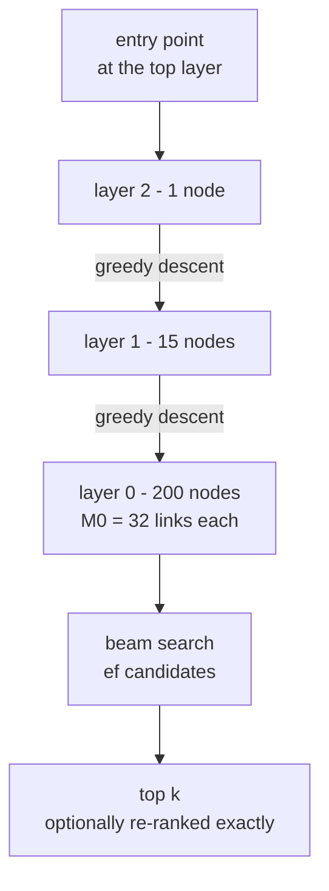
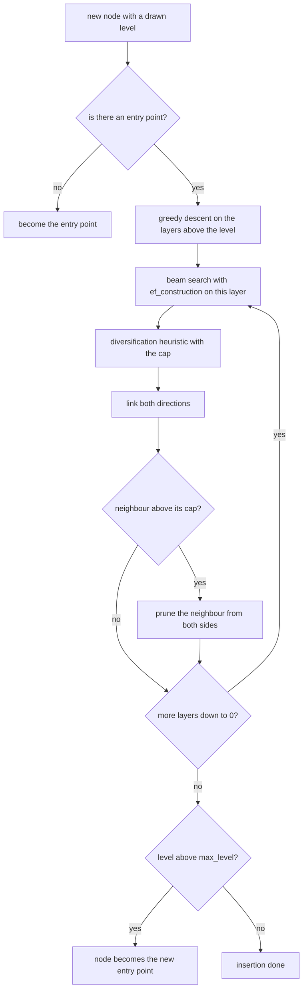
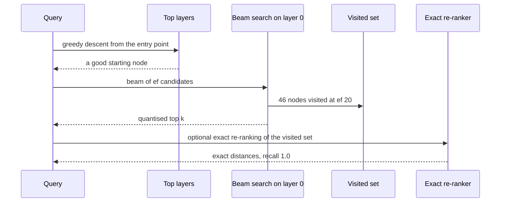

# 766 — Implement dense vector index with HNSW and quantization integration

> **Tier:** Expert · **CTCI chapter:** Beyond — Advanced Data Structures & Algorithms
> **Task spec:** [766-implement-dense-vector-index-with-hnsw-and-quantization-integrat.md](../../../tasks/expert/766-implement-dense-vector-index-with-hnsw-and-quantization-integrat.md)
> **Solutions:** [Python](../../../solutions/python/expert/766-implement-dense-vector-index-with-hnsw-and-quantization-integrat/solution.py) ·
> [Java](../../../solutions/java/expert/766-implement-dense-vector-index-with-hnsw-and-quantization-integrat/Solution.java) ·
> [JavaScript](../../../solutions/javascript/expert/766-implement-dense-vector-index-with-hnsw-and-quantization-integrat/solution.js) ·
> [C#](../../../solutions/csharp/expert/766-implement-dense-vector-index-with-hnsw-and-quantization-integrat/Solution.cs)

## 1. Problem restatement

Build **HNSW** (Hierarchical Navigable Small World) over dense vectors, with scalar quantisation
integrated into the storage layer:

| Piece | Meaning |
| --- | --- |
| level sampling | node level drawn from a geometric distribution with `mL = 1 / ln(M)`; layer 0 holds every node, upper layers hold exponentially fewer |
| `insert(node)` | descend greedily through the layers above the node's level, then an `ef_construction` beam search picks neighbours on each layer the node belongs to |
| `select_neighbours` | the **diversification heuristic**: keep a candidate only if it is closer to the base point than to any already kept neighbour; then top up to the cap so the graph stays connected |
| `prune(node, level)` | when a node exceeds its cap (`M0 = 2M` on layer 0, `M` above), keep the heuristic selection and drop the rest from **both** sides |
| `search(query, k, ef, exact_rerank)` | greedy descent through the upper layers, then a beam search with `ef` candidates on layer 0 |
| `ScalarQuantizer` | per-dimension 8-bit codes learned from the data (`low`, `high`, `step = (high - low) / 255`) |

Input: 200 deterministic clustered 8-dimensional vectors (same `make_vectors` generator as the IVF+PQ
task) plus 20 queries, `M = 16`, `M0 = 32`, `ef_construction = 16`. Output: a graph plus top-`k`
answers in either the quantised or the exact metric.

Concrete values from the solutions' assertions and printed summary:

- Structure: `layer sizes [200, 15, 1]`, `max_level = 2`, `mL = 0.3607`, `visited_count(query, 20) = 46`
  of 200 nodes, `graph_bits() = 176832`.
- `links_symmetric()`, `levels_are_nested()`, `connected()` and the per-layer caps all hold; with
  `M = 8` the graph is **not** connected on this data — hence `M = 16`.
- With `ef = N` the beam search visits the whole graph, `recall@10` with exact re-ranking is **1.0**,
  and without re-ranking (quantised metric) it is **0.995**.
- `recall@10`: quantised `{10: 0.995, 20: 0.995, 40: 0.995}`, re-ranked `{10: 1.0, 20: 1.0, 40: 1.0}`,
  full precision **1.000**; `plain[20] ≥ 0.9` and `reranked[20] ≥ 0.95`.
- Quantisation: max per-dimension error **0.0745** against the bound **0.0882**, and **4×** less vector
  space (`8 × 8` bits against `32 × 8`).
- Boundaries: empty index, one-node index, 12 duplicate vectors, `k > N`, `k = 0`, a query equal to an
  indexed vector (`distance == 0.0`), and a constant dimension that the quantiser refuses.

## 2. Intuition

An exhaustive scan is exact but linear. IVF+PQ (the sibling task) reduces the *number* of candidates and
the *cost* of each comparison; HNSW takes the other route — it makes the search sublinear by giving the
data a navigable graph and a hierarchy.

1. **A hierarchy gives long-range hops.** Layer 0 contains every node, layer 1 a fifteenth of them,
   layer 2 a single node here (`[200, 15, 1]`). A query first walks greedily through the sparse upper
   layers — each hop covers a large distance — and only then drops into layer 0 for a fine-grained
   beam search.
2. **A beam search on layer 0 gives quality control.** `ef` is the size of the candidate frontier: the
   larger the beam, the more of the neighbourhood is explored. With `ef = 20` the search visits 46 of
   200 nodes and still reaches `recall@10 = 0.995`; with `ef = N` it visits everything and is exact.
3. **The diversification heuristic gives connectivity.** Keeping only the `M` closest neighbours makes
   dense clusters (the "wet" part of the name) and disconnects the graph from the rest. Keeping a
   candidate only if it is closer to the base than to any kept neighbour spreads links *outwards*.
   The check makes this concrete: with `M = 8` the pruned graph splits, with `M = 16` it does not.
4. **Quantisation is storage, not search.** The index keeps 8-bit codes instead of floats, and distances
   stay *asymmetric*: the query is a float, the database side is decoded. Re-ranking the visited set
   with exact distances recovers the loss exactly (`0.995 → 1.0`).



Documented simplifications versus hnswlib/FAISS: a few hundred vectors in 8 dimensions, plain lists of
neighbour sets instead of blocked adjacency tables, no early-termination or link-removal heuristics on
delete, per-dimension scalar quantisation instead of product quantisation, and no SIMD kernels. What is
*not* simplified is the algorithm: the same level sampling, the same heuristic neighbour selection, the
same beam search, and the same two-phase (approximate, then exact) retrieval.

## 3. Algorithm

Insertion:

1. **Draw a level** from `splitmix64`, `uniform = (r + 1) / 2^64`, `level = int(-ln(uniform) * mL)`.
2. **Create the node** in every layer up to its level; the first node becomes the entry point.
3. **Descend** greedily from the entry point through the layers above the node's level.
4. **Per layer from `min(level, max_level)` down to 0**: run a beam search with `ef_construction`, take
   the candidates, apply the diversification heuristic with the layer's cap, and make every chosen link
   **bidirectional** — then `prune` the neighbour if it now exceeds its cap.
5. If the new level exceeds `max_level`, the node becomes the new entry point.

Search:

6. **Descend** greedily through the layers above 0 (`greedy_descent` keeps moving while any neighbour is
   closer).
7. **Beam search** on layer 0 with `beam = max(ef or 20, k)`: a min-heap of candidates and a max-heap of
   the current results, stopping when the best candidate is farther than the `ef`-th result.
8. **Return** the `found` list, or — with `exact_rerank` — the exactly re-scored `visited` set, both
   truncated to `k`.

```text
function draw_level()
    state, r ← splitmix64(state)
    uniform ← (r + 1) / 18446744073709551616.0          // 2 raised to 64
    return int(-log(uniform) * mL)

function distance(query, node)
    return squared_distance(query, stored[node])      // query float, database decoded

function exact_distance(query, node)
    return squared_distance(query, vectors[node])

function select_neighbours(node, candidates, cap)
    ordered ← unique candidates sorted by distance to node, then by identifier
    keep ← empty list
    for candidate in ordered do
        if length(keep) >= cap then break
        if distance(vectors[candidate], other) > distance(vectors[node], candidate) for all other in keep then
            append candidate to keep
    for candidate in ordered do                          // top up for connectivity
        if length(keep) >= cap then break
        if candidate not in keep then append candidate to keep
    return keep

function search_layer(query, entries, ef, level)
    visited ← set of entries
    candidates ← min-heap of (distance, node) for the entries
    results ← max-heap of (-distance, node) for the entries
    while candidates is not empty do
        measure, node ← smallest entry of candidates
        if length(results) >= ef and -top(results) < measure then break
        for neighbour in neighbours of node on level do
            if neighbour in visited then continue
            add neighbour to visited
            candidate_distance ← distance(query, neighbour)
            if length(results) < ef or candidate_distance < -top(results) then
                push (candidate_distance, neighbour) on candidates
                push (-candidate_distance, neighbour) on results
                if length(results) > ef then discard the farthest result
    return results sorted by increasing distance, visited

function greedy_descent(query, start, level)
    current ← start
    current_distance ← distance(query, current)
    improved ← true
    while improved do
        improved ← false
        for neighbour in neighbours of current on level do
            measure ← distance(query, neighbour)
            if measure < current_distance then
                current, current_distance, improved ← neighbour, measure, true
    return current

procedure insert(node)
    level ← draw_level()
    add node to every layer up to level
    if entry is none then entry ← node, max_level ← level, return
    current ← entry
    for layer from max_level down to level + 1 do
        current ← greedy_descent(vectors[node], current, layer)
    for layer from min(level, max_level) down to 0 do
        found ← first result of search_layer(vectors[node], [current], ef_construction, layer)
        candidates ← neighbours of found except node itself
        chosen ← select_neighbours(node, candidates, cap_for(layer))
        link node to chosen and chosen back to node
        for neighbour in chosen do
            if links of neighbour exceed cap_for(layer) then prune(neighbour, layer)
        if found is not empty then current ← found[0].node
    if level > max_level then max_level ← level, entry ← node

function search(query, k, ef, exact_rerank)
    if entry is none or k <= 0 then return empty list
    beam ← max(ef if ef is given else 20, k)
    current ← entry
    for layer from max_level down to 1 do
        current ← greedy_descent(query, current, layer)
    found, visited ← search_layer(query, [current], beam, 0)
    if exact_rerank then
        return the k smallest (exact_distance(query, node), node) over visited
    return the first k entries of found
```



## 4. Worked example

The trained index: layer sizes `[200, 15, 1]`, `M = 16`, `M0 = 32`, `mL = 0.3607`, `max_level = 2`, 46 of 200
nodes visited at `ef = 20`, 176832 graph bits, and a max per-dimension error of 0.0745 against the 0.0882
bound (4× less vector space). Recall readings: 0.995 quantised at every `ef`, 1.000 with exact re-ranking,
1.000 at full precision. The facts the checks pin down:

- **Monotonicity**: `plain[40] ≥ plain[10]` and `reranked[ef] ≥ plain[ef]` — a larger beam, and exact
  re-ranking, can never return a worse neighbour.
- **Exactness of re-ranking inside the visited set**: for the first five queries,
  `search(query, k=1, ef=20, exact_rerank=True)` has exactly the smallest `exact_distance` over the
  nodes the beam search visited, and `search(query, k=1, ef=20)` has exactly the smallest *quantised*
  distance over the same set.
- **Whole-graph equivalence**: with `ef = N` the beam visits all 200 nodes, and re-ranking then
  reproduces brute force exactly (`recall = 1.0`).

Insertion trace for one node, say node 137 with a drawn level of 1 (its 2 links on layer 1, `M = 16`
links on layer 0):

| Step | Action | Effect |
| --- | --- | --- |
| 1 | `draw_level()` | level 1, so the node is created on layers 0 and 1 |
| 2 | greedy descent | from the entry point on layer 2 down to layer 1 |
| 3 | `search_layer(..., ef_construction = 16, layer 1)` | 16 candidates that are the best found so far |
| 4 | `select_neighbours` | diversified subset of size ≤ 16, then topped up |
| 5 | bidirectional linking | each chosen neighbour also links back to node 137 |
| 6 | `prune` | any neighbour pushed above 16 links on layer 1 is re-selected by the same heuristic |
| 7 | layer 0 | the same steps with `cap = 32` |



The connectivity experiment, which is why `M = 16` and not `M = 8`:

| Setting | `connected()` | Consequence |
| --- | --- | --- |
| `M = 8` | **false** | the diversity heuristic prunes the bridges between clusters, so a breadth-first walk from the entry point misses nodes |
| `M = 16` (`M0 = 32`) | true | every node is reachable in layer 0, so a large beam really does explore everything |

## 5. Complexity

Let `N` be the number of nodes, `M` the link cap, `ef` the beam width and `D` the dimension.

| Operation | Best | Average | Worst | Why the bound holds |
| --- | --- | --- | --- | --- |
| `distance` (quantised) | O(D) | O(D) | O(D) | decode-free asymmetric comparison of `D` coordinates |
| `greedy_descent` per layer | O(1) | O(M) | O(N) | keeps moving while a neighbour improves |
| `search_layer` | O(ef) | O(ef · M · log ef) | O(N) | the beam keeps at most `ef` results and expands their neighbours |
| `search` | O(k) | O(log N · M + ef · M log ef) | O(N) | the upper layers shrink geometrically, so the descent is short |
| `insert` | O(M log N) | O(ef_construction · M log ef_construction) | O(N) | one descent plus one beam search per layer of the new node |
| Space | O(N M + N b D) | O(N M + N b D) | O(N M + N 8 D) | links on both layers plus 8-bit codes per dimension |

## 6. Pitfalls and edge cases

- **A small `M` can disconnect the graph.** The check
  `not narrow.connected()` for `M = 8` documents that the diversity heuristic prunes inter-cluster
  bridges on this data; `M = 16` restores connectivity, and `connected()` is asserted again.
- **Levels must nest.** A node with level 2 must exist on layers 0, 1 and 2 (`levels_are_nested`), and
  the layer sizes must shrink upwards (`[200, 15, 1]`).
- **Duplicates**: 12 copies of the same vector keep the graph connected and symmetric, and
  `search(vectors[0], k=5, ef=20)` still returns 5 entries — the true tie order decides which.
- **`k` larger than the reachable set** is clamped: `k = 1000` returns all 200 nodes when the beam visits
  everything, but never more than the index holds.
- **A query equal to an indexed point** must return distance `0.0` — with quantisation and re-ranking
  enabled this only works if the exact distances are used for the final ordering.
- **A constant dimension cannot be quantised** (`high == low`): `ScalarQuantizer` raises `ValueError`
  instead of dividing by a zero step.
- **Determinism.** Levels come from a seeded `splitmix64` stream, so two indexes built from the same
  vectors have identical levels, identical layers and identical search results — all asserted.

## 7. Variants and follow-ups

- **Product quantisation instead of scalar quantisation** over the same graph — the IVF+PQ task builds
  the quantiser side in detail: [765 — approximate nearest neighbor with IVF+PQ](../../../tasks/expert/765-implement-approximate-nearest-neighbor-for-embeddings-at-scale-w.md).
- **A sketch-level HNSW** that describes the same structure without the full checks is
  [702 — advanced approximate nearest neighbor via HNSW sketch](../../../tasks/expert/702-implement-advanced-approximate-nearest-neighbor-via-hnsw-sketch.md).
- **Distributed construction** with per-shard graphs and a merge strategy is
  [864 — distributed HNSW graph builder with merge strategy](../../../tasks/master/864-implement-distributed-hnsw-graph-builder-with-merge-strategy-and.md).
- **Deletion and link repair** are left out here; `prune` is the hook where a removal heuristic would go.
- **Re-rank the returned shortlist** with a learned model, as in
  [767 — online re-ranking with features and click simulation](../../../tasks/expert/767-implement-online-re-ranking-with-features-and-click-simulation-l.md).

## 8. Check yourself

<details><summary>Show answer</summary>

**Q1.** Why does the search visit only 46 of 200 nodes at `ef = 20`, and what makes `ef = N` exact?

The hierarchy descends greedily to a good start, and the beam keeps only the `ef` best results, expanding
their neighbours — so nodes far from the query are never touched. With `ef = N` the stopping rule can
never trigger, the beam visits the whole layer-0 graph, and the check
`visited_count(query, len(vectors)) == len(vectors)` confirms it; exact re-ranking of that visited set is
then brute force.

</details>

<details><summary>Show answer</summary>

**Q2.** What does the diversification heuristic keep that a plain "nearest M" rule would not?

Candidates that are far from the *already kept* neighbours, i.e. links that point in different
directions. That spreads the neighbourhood over the space instead of filling it with near-duplicates from
one cluster, which is what keeps the graph connected (and is why `M = 8` fails the connectivity check
while `M = 16` passes).

</details>

<details><summary>Show answer</summary>

**Q3.** Quantisation lowers recall from 1.0 to 0.995 at `ef = 20`. Why does re-ranking recover it?

The graph traversal uses the quantised metric (`distance` decodes the stored code), so 0.5% of the true
top-10 fall outside the visited set or lose the ordering. Re-ranking reorders only the *visited* set with
exact distances, so any neighbour that was visited but mis-ranked by the codes is restored — the checks
show `reranked[ef] ≥ plain[ef]` at every `ef`, reaching exactly 1.0.

</details>

<details><summary>Show answer</summary>

**Q4.** Why is the distance computed asymmetrically instead of quantising the query too?

Because the query arrives in full precision and quantising it would add a second error term for no
storage benefit. Asymmetric comparison keeps the query exact and the database side decoded, which is why
`search(query, k=1, ef=20, exact_rerank=True)` can return distance `0.0` for a query equal to an indexed
vector.

</details>