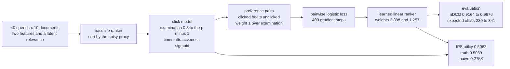
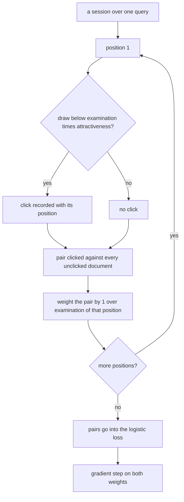
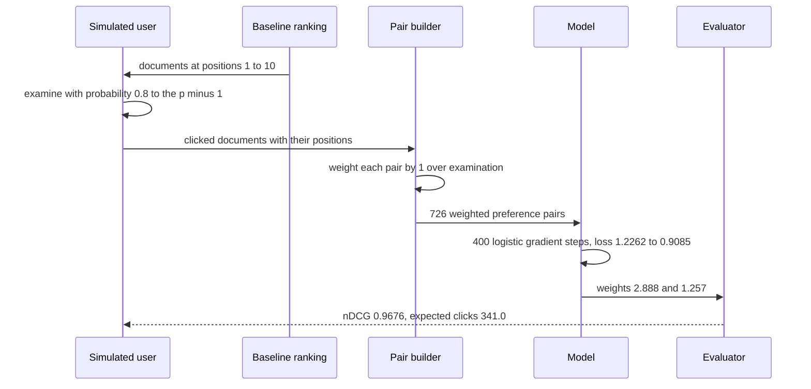

# 767 — Implement online re-ranking with features and click simulation (learning-to-rank)

> **Tier:** Expert · **CTCI chapter:** Beyond — Machine Learning & AI
> **Task spec:** [767-implement-online-re-ranking-with-features-and-click-simulation-l.md](../../../tasks/expert/767-implement-online-re-ranking-with-features-and-click-simulation-l.md)
> **Solutions:** [Python](../../../solutions/python/expert/767-implement-online-re-ranking-with-features-and-click-simulation-l/solution.py) ·
> [Java](../../../solutions/java/expert/767-implement-online-re-ranking-with-features-and-click-simulation-l/Solution.java) ·
> [JavaScript](../../../solutions/javascript/expert/767-implement-online-re-ranking-with-features-and-click-simulation-l/solution.js) ·
> [C#](../../../solutions/csharp/expert/767-implement-online-re-ranking-with-features-and-click-simulation-l/Solution.cs)

## 1. Problem restatement

Learn a re-ranker from **clicks** rather than from labelled relevance, and measure how much of the
signal survives the fact that clicks are biased by position. The pipeline the solutions build:

| Stage | Detail |
| --- | --- |
| dataset | 40 queries × 10 documents; per document two features `(proxy, quality)` and a latent relevance `1.0 · semantic + 0.6 · quality` |
| grades | `relevance ≥ 1.20 → 4`, `≥ 0.95 → 3`, `≥ 0.70 → 2`, `≥ 0.45 → 1`, else `0` |
| click model | position-based: document at position `p` is examined with probability `eta^(p-1)`, `eta = 0.8`, and clicked with probability `sigmoid(4 · (relevance - 0.8))` |
| baseline ranker | sort by the noisy retrieval proxy `proxy = semantic + (noise - 0.5) · 0.5` |
| learned ranker | linear `w0 · proxy + w1 · quality`, trained with the pairwise logistic (RankNet) loss |
| IPS | weight each observed click by `1 / examination(position)` to correct the position bias |

Concrete results from the solutions' own assertions and printed summary:

- dataset: **40 queries × 10 documents**, grades in `0..4`, proxy positively correlated with the truth
  but disagreeing with it on more than half of the queries.
- baseline `nDCG@10 = 0.9164`, learned `nDCG@10 = 0.9676` — the learned ranker must beat the baseline and
  stay within 5% of the ranker built from the **true** weights.
- Click model: the click rate is decreasing in position
  (`click_rate[0] > click_rate[4] > click_rate[9]`) and the top position exceeds 0.2.
- Training: **726** IPS-weighted pairs, loss **1.2262 → 0.9085** (a drop of more than 15%), monotone
  because the logistic loss is convex; both weights positive, `w0 / w1 = 2.888 / 1.257 = 2.30 > 1`.
- Clicks over **1200** impressions: baseline **333**, learned **332**, analytic expectations **330.1**
  vs **341.0** — the simulation tracks its expectation within 10%.
- Utility: truth **0.5039**, naive click rate **0.2758** (biased low), IPS **0.5062** (within 10% of the
  truth and closer than the naive estimate).

## 2. Intuition

Training on clicks looks like free supervision, but a click is not a relevance judgement: it is the
product of two hidden events. The user must *examine* the document — which happens mostly at the top —
and the document must be *attractive* enough to click. So the observed click rate is
`examination × attractiveness`, and `examination` falls off geometrically with the position.

That has two consequences the demo measures rather than assumes:

1. **A click-based objective is biased low.** Averaging clicks over impressions mixes in the low-ranked
   documents the user never looked at, so the estimate of the true utility is 0.2758 against a truth of
   0.5039. **Inverse propensity scoring** divides each click by the probability that the position was
   examined, which reweights low positions upwards and recovers 0.5062.
2. **Preference pairs must be weighted too.** "A clicked document beats an unclicked one" is only fair if
   both were equally likely to be seen, so each pair carries the weight `1 / examination(position)`.
   Unweighted pairs still train a usable model (both are checked), but the weighted model lands closer to
   the true feature ratio `1.0 / 0.6 = 1.67`.



Documented simplifications: two features instead of hundreds, a linear model instead of a
gradient-boosted forest, one global `eta` in a position-based model instead of a cascade or a
factorised model, no exploration (no epsilon-greedy, no interleaving), no counterfactual training beyond
the IPS weighting, and only a few hundred simulated sessions. What is genuine: the unbiasedness
argument, the loss, the position bias, and the baseline-versus-learned comparison in both nDCG and
simulated clicks.

## 3. Algorithm

1. **Build the dataset** — for each query, draw `semantic`, `quality` and `noise` uniformly; set
   `relevance = 1.0 · semantic + 0.6 · quality`, `proxy = semantic + (noise - 0.5) · 0.5`, and the grade.
2. **Baseline ranking** — `rank_by(documents, baseline_key)` sorts by the proxy, ties by document index.
3. **Simulate a session** — walk positions `1..10`, draw a uniform, click when
   `draw < examination(p) · attractiveness(relevance)`, and record both the clicked index and its position.
4. **Build pairs** — every clicked document beats every unclicked document in the same list, with weight
   `1 / examination(position)` when IPS is on, `1` otherwise.
5. **Train** — 400 gradient steps of `loss = log(1 + exp(-margin)) · weight` with
   `factor = -weight · sigmoid(-margin)`, learning rate 0.8 and L2 0.001, normalising the gradient by the
   number of pairs and recording the mean loss per iteration.
6. **Evaluate** — mean `nDCG@10` over the queries for each key function, and the *analytic* expectation
   `sum examination(p) · attractiveness(relevance)` which the simulation must track.
7. **Estimate utility three ways** — `truth_utility` (average attractiveness of the ranked lists),
   `naive_utility` (clicks over impressions) and `ips_utility` (clicks weighted by `1 / examination`,
   averaged over impressions).

```text
function sigmoid(value)
    if value < -60 then return 0.0
    if value > 60 then return 1.0
    return 1.0 / (1.0 + exp(-value))

function grade_of(relevance)
    if relevance >= 1.20 then return 4
    if relevance >= 0.95 then return 3
    if relevance >= 0.70 then return 2
    if relevance >= 0.45 then return 1
    return 0

procedure build_dataset(queries, documents_per_query, seed)
    state ← seed
    for query in range(queries) do
        documents ← empty list
        for document in range(documents_per_query) do
            state, semantic ← uniform(state)
            state, quality ← uniform(state)
            state, noise ← uniform(state)
            relevance ← 1.0 * semantic + 0.6 * quality
            proxy ← semantic + (noise - 0.5) * 0.5
            append ((proxy, quality), relevance, grade_of(relevance)) to documents
        append documents to dataset
    return dataset, state

function attractiveness(relevance)
    return sigmoid(4.0 * (relevance - 0.8))

function examination(position)
    return ETA to the power (position - 1)

function simulate_session(ranking, documents, state)
    clicks ← empty list
    for position, index in enumerate(ranking) do
        state, draw ← uniform(state)
        if draw < examination(position) * attractiveness(documents[index].relevance) then
            append index to clicks
    return clicks, state

function rank_by(documents, key)
    return document indexes sorted by descending key then ascending index

procedure build_pairs(dataset, state, weight_ips)
    pairs ← empty list
    for documents in dataset do
        ranking ← rank_by(documents, baseline_key)
        clicks, state ← simulate_session(ranking, documents, state)
        clicked ← set of clicks
        for index in clicked do
            position ← the position of index in ranking
            if weight_ips then weight ← 1.0 / examination(position) else weight ← 1.0
            for other in ranking do
                if other not in clicked then
                    append (features[index], features[other], weight) to pairs
    return pairs, state

function train(pairs, iterations, rate, l2)
    weights ← [0.0, 0.0]
    for iteration in range(iterations) do
        gradient ← [0.0, 0.0]
        loss ← 0.0
        for positive, negative, weight in pairs do
            margin ← sum of weights[k] * (positive[k] - negative[k])
            loss ← loss + weight * log(1 + exp(-clamp(margin, -60, 60)))
            factor ← -weight * sigmoid(-margin)
            for k in range(2) do
                gradient[k] ← gradient[k] + factor * (positive[k] - negative[k])
        for k in range(2) do
            weights[k] ← weights[k] - rate * (gradient[k] / max(1, length(pairs)) + l2 * weights[k])
        append loss / max(1, length(pairs)) to history
    return weights, history

function ndcg_at_k(ranking, documents, k)
    if k <= 0 then return 0.0
    gains ← [power(2, documents[index].grade) - 1 for index in the first k of ranking]
    ideal ← the k largest such gains over all documents
    if sum(ideal) = 0 then return 0.0
    return discounted_gain(gains) / discounted_gain(ideal)

function ips_utility(dataset, key, sessions, seed)
    total ← 0.0
    count ← 0
    for session in range(sessions) do
        for documents in dataset do
            for position, index in enumerate(rank_by(documents, key)) do
                draw ← next uniform
                if draw < examination(position) * attractiveness(documents[index].relevance) then
                    total ← total + 1.0 / examination(position)
                count ← count + 1
    return total / count
```



## 4. Worked example

The whole run, as the solutions print it:

| Quantity | Value |
| --- | --- |
| dataset | 40 queries × 10 documents = 400 documents |
| baseline `nDCG@10` | 0.9164 |
| learned `nDCG@10` | 0.9676 |
| training pairs | 726 IPS-weighted pairs |
| loss | 1.2262 → 0.9085 |
| learned weights | `(2.888, 1.257)`, ratio 2.30 against the true 1.67 |
| impressions | 1200 (400 documents × 3 sessions) |
| clicks | baseline 333, learned 332 |
| analytic expectations | baseline 330.1, learned 341.0 |
| utility | truth 0.5039, naive 0.2758, IPS 0.5062 |

Position bias in the click model: `examination(p) = 0.8^(p-1)`, so 1.000 at the top, 0.800 at position 2,
0.410 at position 5 and 0.134 at position 10. The checks require the measured click rate to fall across
positions (`click_rate[0] > click_rate[4] > click_rate[9]`) and the top rate to exceed 0.2.

The check is not "IPS is close" but "IPS is closer than the naive one" *and* within 10% of the truth:
`|0.5062 - 0.5039| = 0.0023 < |0.2758 - 0.5039| = 0.2281`.



## 5. Complexity

Let `Q` be the number of queries, `D` documents per query, `S` sessions, `P` the number of training pairs
and `I` the number of gradient iterations.

| Operation | Best | Average | Worst | Why the bound holds |
| --- | --- | --- | --- | --- |
| `build_pairs` | O(Q D log D) | O(Q D²) | O(Q D²) | each clicked document is paired with every unclicked one |
| `train` | O(I P) | O(I P) | O(I P) | two gradient components per pair per iteration, no matrix algebra |
| `ndcg_at_k` | O(D log D) | O(D log D) | O(D log D) | graded gains plus a sort of the ideal gains |
| `ips_utility` | O(S Q D) | O(S Q D) | O(S Q D) | one draw and one division per shown document |
| Space | O(Q D + P) | O(Q D + P) | O(Q D + P) | the dataset plus the pair list, which dominates |

## 6. Pitfalls and edge cases

- **Position bias is the whole problem.** Ranking by the learned model raises the *expected* clicks from
  330.1 to 341.0 analytically, but the *simulated* counts are 333 against 332 — a difference of 1 in 1200
  impressions. The checks therefore assert the analytic ordering strictly and require the simulated gap
  to stay inside `0.15 · impressions`, so a noisy run cannot be mistaken for a regression.
- **The naive estimate is biased, and by a lot** (0.2758 against a truth of 0.5039). It is asserted to be
  strictly below the truth, not merely different.
- **Propensity weighting changes the model.** `naive_weights != weights` and the IPS model must land
  closer to the true ratio `1.67` than the unweighted one — with 726 pairs, the weighted ratio is 2.30.
- **Convexity shows up in the curve.** Every loss value must be ≥ the next one
  (`history[i] >= history[i+1] - 1e-9`); a non-monotone curve would indicate a learning-rate bug.
- **Empty training set.** `train([])` returns `[0.0, 0.0]` and a history of `{0.0}` — no division by zero
  on the pair count.
- **Grade-zero documents.** A set where every document has grade 0 has `sum(ideal) == 0`, and `nDCG` is
  *defined* as 0.0 rather than 0/0.
- **`sigmoid` is clamped** at ±60 so `exp` cannot overflow; the logistic loss clamps its margin the same
  way — reached only for extreme weights, but it keeps the training loop total.
- **Determinism.** The data, the click simulation, the trained weights and the click counts are all
  reproducible from fixed seeds (0x5EED for the dataset, 0xBEEF for the pairs, 0xC0FFEE for the sessions).

## 7. Variants and follow-ups

- **Score the candidates with a real retrieval model first**, then re-rank — BM25 over the shortlist is
  [764 — ranking functions TF-IDF + BM25](../../../tasks/expert/764-implement-ranking-functions-tf-idf-bm25-simple-scoring-and-evalu.md)
  and the vector shortlist comes from
  [766 — dense vector index with HNSW](../../../tasks/expert/766-implement-dense-vector-index-with-hnsw-and-quantization-integrat.md).
- **Add exploration** (epsilon-greedy or interleaving) so the logging policy stops hiding the documents
  it never showed; that is the standard fix for the bias this task measures.
- **Replace the linear model with a forest** over more features, keeping the same pairwise loss.
- **Re-rank at scale** with sharding, warm-up and a serving pipeline — see
  [815 — real-time vector search at billion-vector scale with sharding and reranking](../../../tasks/master/815-implement-real-time-vector-search-at-billion-vector-scale-with-s.md).
- **Model the user rather than the position** with a cascade or factorised examination model; the IPS
  weighting then uses the propensity of the *model*, not of a single global `eta`.

## 8. Check yourself

<details><summary>Show answer</summary>

**Q1.** Why is the naive click rate biased *low* rather than merely noisy?

Because it divides all clicks by all impressions, including the impressions at positions the user never
examined. `examination(p) = 0.8^(p-1)` is 0.134 at the last position, so those documents contribute to the
denominator with almost no chance of contributing to the numerator — that is the 0.2758 against a truth
of 0.5039.

</details>

<details><summary>Show answer</summary>

**Q2.** What is the IPS estimate, and why is dividing by the examination probability the right correction?

Weight each observed click by `1 / examination(position)`: a click from position 10 counts about 7.5× as
much as a click from position 1, because it had to overcome a much smaller chance of being seen. In
expectation each document then contributes `attractiveness(relevance)` regardless of its position, which
is why the estimate recovers 0.5062 against a truth of 0.5039.

</details>

<details><summary>Show answer</summary>

**Q3.** The learned nDCG is 0.9676 and the baseline 0.9164. What is the extra check that stops this from
being a fluke?

`learned_ndcg >= 0.95 · evaluate(dataset, learned_key(TRUE_WEIGHTS))` — the learned weights must produce a
ranking within 5% of the ranking derived from the *true* latent weights, so the improvement has to come
from the right direction, not from noise in the proxy.

</details>

<details><summary>Show answer</summary>

**Q4.** Simulated clicks are 333 baseline against 332 learned, yet the analytic expectation is 330.1
against 341.0. Is the improvement real?

Yes: the analytic figure is the exact expectation of the click model over all documents, and the
simulation is a single noisy draw of 1200 Bernoulli trials — one click of difference is well inside
sampling noise. The checks assert the analytic ordering strictly and the simulated difference only within
`0.15 · impressions`, precisely because the difference is small relative to the noise.

</details>