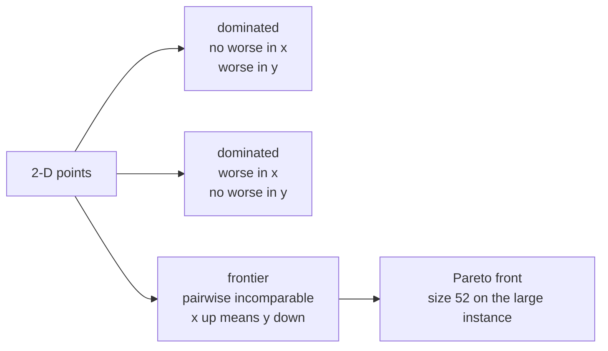
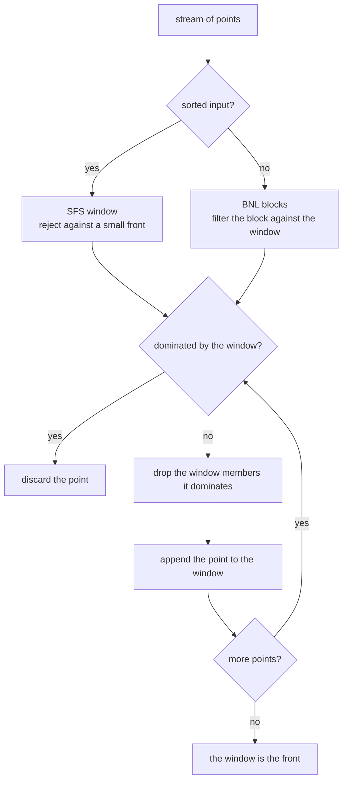
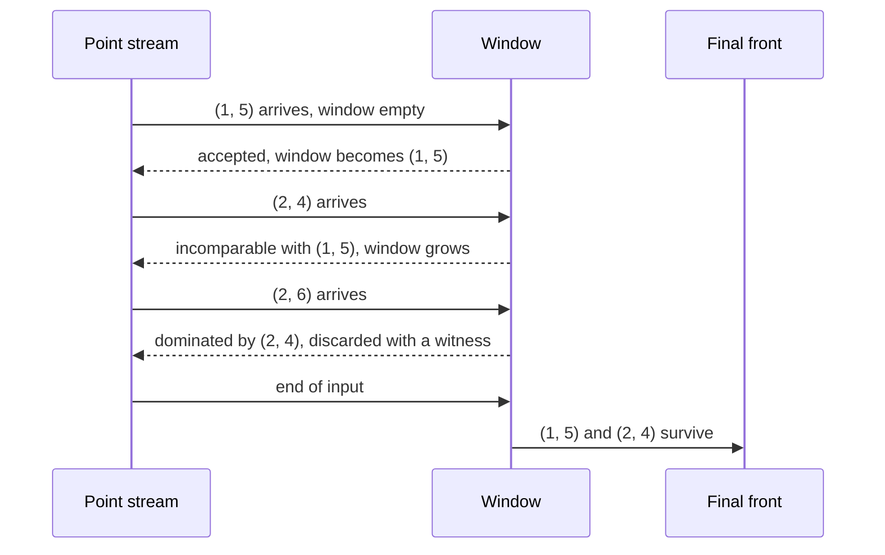

# 768 — Implement skyline queries in multi-criteria optimization (Pareto front)

> **Tier:** Expert · **CTCI chapter:** Ch 8 — Recursion and Dynamic Programming
> **Task spec:** [768-implement-skyline-queries-in-multi-criteria-optimization-pareto.md](../../../tasks/expert/768-implement-skyline-queries-in-multi-criteria-optimization-pareto.md)
> **Solutions:** [Python](../../../solutions/python/expert/768-implement-skyline-queries-in-multi-criteria-optimization-pareto/solution.py) ·
> [Java](../../../solutions/java/expert/768-implement-skyline-queries-in-multi-criteria-optimization-pareto/Solution.java) ·
> [JavaScript](../../../solutions/javascript/expert/768-implement-skyline-queries-in-multi-criteria-optimization-pareto/solution.js) ·
> [C#](../../../solutions/csharp/expert/768-implement-skyline-queries-in-multi-criteria-optimization-pareto/Solution.cs)

## 1. Problem restatement

Point `p` **dominates** point `q` when `p[i] <= q[i]` for every criterion and `p[j] < q[j]` for at least
one. The **skyline** (Pareto front) is the subset of points that no other point dominates; its members
are pairwise incomparable, i.e. an antichain. Ties in a single coordinate count as "no worse", so two
copies of the same point never dominate each other and **both** survive — multiset semantics, kept
identical in all four implementations.

| Algorithm | Idea |
| --- | --- |
| `brute_force_skyline` | the `O(n²)` filter over the whole set; the reference oracle, counting comparisons |
| `bnl_skyline(points, block_size)` | block nested loop: a window holds the skyline of the points seen so far; a block is filtered against the window, then the window is filtered against the block |
| `sfs_skyline(points)` | sort-filter-skyline: the same window, but the input is sorted lexicographically first, so dominated points are rejected early by a small window |
| `SkylineMaintainer` | incremental: `add(p)` returns whether `p` joined the front |

Input: deterministic integer point sets generated by `splitmix64` (`random_points(count, dims, high, seed)`).
Output: the front, plus the number of dominance tests performed.

Concrete results from the solutions' output and assertions:

- Boundary: an empty input gives `[]` with **0** dominance tests for all three algorithms; a single point
  is its own skyline; three copies of `(2, 2)` all survive.
- 1-D: `[(3,), (1,), (2,), (1,)]` → `[(1,), (1,)]` — the skyline is exactly the minima.
- The staircase `[(0,0)] + [(i,i) for i in 1..5]` → `[(0, 0)]`, a frontier of size one.
- Cross-verification on random 2-D/3-D/4-D data: SFS and BNL agree with brute force on every trial;
  window costs summed per dimension: `dims2 = 1050`, `dims3 = 2340`, `dims4 = 6497` comparisons.
- Invariants: every result is an antichain and every rejected point has a dominance **witness** in the
  returned front; **280** witnesses checked.
- Split invariance: `skyline(A ∪ B) == non-dominated(skyline(A) ∪ skyline(B))`, also for two-stage SFS.
- Incremental maintenance equals a from-scratch skyline after **every** insertion (50 points, 3-D).
- Large instance, 400 points in 4 dimensions: brute force **48329** comparisons, SFS **4818**, BNL
  **12345**, all three agreeing on a front of size **52**.

## 2. Intuition

The naive answer is a quadratic filter: for each point, scan the whole set looking for a dominator. That
is exactly what `brute_force_skyline` does, and it is the oracle — but it re-scans points that have
already been eliminated.

The key insight is that **a point which survived the points seen so far needs to be compared only with
the current front, not with all history**: if `p` were dominated by some earlier point `q`, then either
`q` is still on the front, or `q` itself was dominated by something that is. So a *window* holding the
running front is enough. That is the BNL/SFS family, and it is why the check
"every rejected point must be dominated by a returned skyline point" holds: the witness chain always
terminates on the final front.

Sorting first (SFS) makes the window small early: in lexicographic order a point only has to be compared
against fronts of points that are lexicographically smaller, and those already reject most points before
the window grows. The measured effect on the 400-point instance is 4818 tests against 48329.



Documented simplifications versus the paper: the SFS window is a plain Python list (no bitmap or
quadtree index over the window) and the maintainer adds one point at a time, so the quadratic worst case
is kept. What is verified is **exactness and the invariants**, not a speedup bound.

## 3. Algorithm

1. **`dominates(a, b)`** — walk the coordinates: return `False` as soon as `a[i] > b[i]`, remember whether
   some coordinate was strictly smaller, and return that flag at the end. Equal points are therefore
   incomparable.
2. **Brute force** — for every `p`, scan all `q` and drop `p` if any dominates it; count every test.
3. **SFS** — sort the input lexicographically; for each point, reject it if some window member dominates
   it; otherwise drop the window members it dominates and append it.
4. **BNL** — process the input in blocks of `block_size`: filter the block against the window, keep the
   block's non-dominated points in `accepted`, then remove the window members dominated by any accepted
   point and concatenate.
5. **Incremental maintainer** — compare the new point with the front; if nothing dominates it, keep the
   front members it does not dominate and append it.

```text
function dominates(a, b)
    better ← false
    for index in range(length(a)) do
        if a[index] > b[index] then return false
        if a[index] < b[index] then better ← true
    return better

function brute_force_skyline(points)
    skyline ← empty list
    comparisons ← 0
    for p in points do
        dominated ← false
        for q in points do
            comparisons ← comparisons + 1
            if dominates(q, p) then
                dominated ← true
                break
        if not dominated then append p to skyline
    return skyline, comparisons

function sfs_skyline(points)
    window ← empty list
    comparisons ← 0
    for p in sorted(points) do
        dominated ← false
        for q in window do
            comparisons ← comparisons + 1
            if dominates(q, p) then
                dominated ← true
                break
        if dominated then continue
        survivors ← empty list
        for q in window do
            comparisons ← comparisons + 1
            if not dominates(p, q) then append q to survivors
        append p to survivors
        window ← survivors
    return window, comparisons

function bnl_skyline(points, block_size)
    window ← empty list
    for start from 0 to length(points) - 1 step block_size do
        accepted ← empty list
        for p in points[start .. start + block_size - 1] do
            if no q in window dominates p and no q in accepted dominates p then
                accepted ← members of accepted not dominated by p
                append p to accepted
        survivors ← window members not dominated by any point of accepted
        window ← survivors concatenated with accepted
    return window, comparisons

procedure SkylineMaintainer.add(p)
    for q in front do
        if dominates(q, p) then return false
    survivors ← front members not dominated by p
    append p to survivors
    front ← survivors
    return true
```



## 4. Worked example

Degenerate sets, all three algorithms agreeing:

| Input | Result | Why |
| --- | --- | --- |
| `[]` | `[]`, 0 comparisons | nothing to compare |
| `[(3, 4)]` | `[(3, 4)]` | a single point is never dominated |
| `[(2, 2)] * 3` | `[(2, 2), (2, 2), (2, 2)]` | equal points are incomparable, so copies all survive |
| `[(3,), (1,), (2,), (1,)]` | `[(1,), (1,)]` | in 1-D only the minima survive |
| `[(0,0), (1,1), (2,2), (3,3), (4,4), (5,5)]` | `[(0, 0)]` | every other point is dominated by the first |
| `[(1,5), (2,6), (2,4)]` | `[(1, 5), (2, 4)]` | `(2, 6)` loses on y and does not win on x |

SFS trace on `[(2, 6), (1, 5), (2, 4)]` (sorted to `[(1, 5), (2, 4), (2, 6)]`):

| Step | Point | Window before | Decision | Window after |
| --- | --- | --- | --- | --- |
| 1 | `(1, 5)` | `[]` | nothing dominates it | `[(1, 5)]` |
| 2 | `(2, 4)` | `[(1, 5)]` | `(1, 5)` does not dominate it (`5 > 4`), and it does not dominate `(1, 5)` (`2 > 1`) | `[(1, 5), (2, 4)]` |
| 3 | `(2, 6)` | `[(1, 5), (2, 4)]` | `(2, 4)` dominates it (`2 <= 2`, `4 < 6`) | `[(1, 5), (2, 4)]` |

The cross-verification runs, with the window costs as printed:

| dimensions | trials | points per trial | summed window comparisons |
| --- | --- | --- | --- |
| 2 | 6 | 40, 47, 54, 61, 68, 75 | 1050 |
| 3 | 6 | 40 … 75 | 2340 |
| 4 | 6 | 40 … 75 | 6497 |

Two structural facts the checks pin down:

- **Antichain + witness**: every pair on the front is incomparable, and every rejected point is dominated
  by some point *on the front* — 280 witnesses verified over five 3-D instances of 60 points.
- **2-D monotonicity**: on the frontier, increasing `x` must come with strictly decreasing `y`, otherwise
  one point would dominate the other. This is the "staircase" shape of a 2-D Pareto front.

Large-instance comparison on 400 points in 4 dimensions (front size 52):

| Algorithm | Dominance tests |
| --- | --- |
| brute force oracle | 48329 (more than `n² / 6 = 26666`, asserted) |
| SFS | 4818 — at least 4× fewer, asserted |
| BNL (`block_size = 8`) | 12345 |



## 5. Complexity

Let `n` be the number of points, `d` the number of dimensions, `f` the front size and `b` the BNL block
size.

| Operation | Best | Average | Worst | Why the bound holds |
| --- | --- | --- | --- | --- |
| `dominates` | O(1) | O(d) | O(d) | stops at the first coordinate where `a` is worse |
| brute force | O(n) | O(n²) | O(n²) | every point is compared with every other (measured: 48329 on `n = 400`) |
| SFS | O(n f) | O(n f) | O(n²) | one test against each window member per point; the sort is O(n log n) |
| BNL | O(n) | O(n f + n² / b) | O(n²) | each block is filtered against the window and the window against the block |
| maintainer `add` | O(1) | O(f) | O(f) | two passes over the current front |
| `as_set` | O(f log f) | O(f log f) | O(f log f) | deduplication and sorting of the front for comparison |
| Space | O(n) | O(n + f) | O(n) | the input plus the window; the oracle stores a copy of the front |

Measured on 400 four-dimensional points (front of size 52):

| Algorithm | Dominance tests | Ratio to brute force |
| --- | --- | --- |
| brute force | 48329 | 1.0 |
| SFS | 4818 | 10.0× fewer |
| BNL (`block_size = 8`) | 12345 | 3.9× fewer |

The checks assert `brute_cost > n² / 6` and `brute_cost >= 4 · sfs_cost`, so the window algorithms must be
*substantially* cheaper, not just different. Because the window is a plain list, the worst case stays
quadratic; the simplification note in the solutions says explicitly that what is verified is exactness
and the invariants, not an asymptotic speedup.

## 6. Pitfalls and edge cases

- **Ties are "no worse", not "strictly better".** `dominates` needs a strictly smaller coordinate
  somewhere, so `(2, 2)` never dominates `(2, 2)`: three copies of the same point are all returned.
- **Empty input** must give `[]` **and** cost zero dominance tests — for all three algorithms, which
  catches a loop that compares against a `None` placeholder.
- **A single point** is always its own skyline, including the zero point `(0, 0)`.
- **1-D input** degenerates to "the minima": `[(3,), (1,), (2,), (1,)]` returns both `(1,)` copies, again
  because of the non-strict tie rule.
- **A fully dominated staircase** returns one point; the check uses
  `[(0,0)] + [(i,i) for i in 1..5]`, where `(0, 0)` dominates everything else.
- **Ties in a single coordinate** (`[(1,5), (2,6), (2,4)]`) must be resolved by strict dominance only, so
  `(2, 6)` is dropped but `(1, 5)` and `(2, 4)` stay.
- **Multiset semantics.** The algorithms return a *list*, and `as_set` is used only for cross-algorithm
  comparison — a duplicate that is undominated must appear as many times as it occurs in the input.
- **The witness property.** Every rejected point needs a dominator *on the returned front*, otherwise the
  window logic lost information. The checks verify that for 280 rejected points.
- **Split invariance.** `skyline(A ∪ B) == non-dominated(skyline(A) ∪ skyline(B))`, and the same for a
  two-stage SFS — the property that makes a distributed skyline merge correct.
- **Incremental maintenance.** After *every* insertion the maintained front must equal the from-scratch
  skyline of the prefix, and `add(p)` must report exactly whether `p` is on that front.
- **2-D monotonicity.** On a frontier, larger `x` implies strictly smaller `y`; a violation would mean two
  frontier points dominate each other.
- **Determinism.** `random_points` is seeded, and re-running SFS on the 400-point instance gives the same
  multiset with the same length.

## 7. Variants and follow-ups

- **Divide and conquer** for 2-D/3-D skylines recurses on halves and merges the two frontiers; the split
  invariance checked here is exactly what makes that merge valid — see
  [322 — skyline by divide and conquer](../../../tasks/intermediate/322-implement-algorithm-to-find-skyline-divide-conquer.md).
- **Merge two frontiers with a multiset** in linear time instead of re-filtering them, as in
  [394 — skyline merging with multiset](../../../tasks/intermediate/394-implement-skyline-merging-with-multiset-detailed.md).
- **Answer skyline queries repeatedly** from an indexed structure rather than from scratch — see
  [335 — data structure for skyline queries (segment tree variant)](../../../tasks/intermediate/335-implement-data-structure-for-skyline-queries-segment-tree-varian.md).
- **Index the window** with a bitmap or quadtree to get a sub-quadratic filter, the optimisation this task
  deliberately leaves out; the succinct-structure tasks
  [652 — bitmap index and fast AND/OR operations](../../../tasks/expert/652-implement-bitmap-index-and-fast-and-or-operations.md)
  build the same primitive.
- **Approximate the front** when the point set is huge by keeping only an epsilon-approximation of the
  Pareto set — related to
  [771 — epsilon-kernel for approximate convex hull](../../../tasks/expert/771-implement-epsilon-kernel-for-approximate-convex-hull-coresets.md).
- **Dynamic skyline maintenance** under insertions and deletions generalises `SkylineMaintainer`; the
  deletion side needs the witness of every front member.
- **Ranking with multiple criteria** (learning to rank collapses the criteria into one score) is the
  complement of the skyline view; see
  [767 — online re-ranking with features and click simulation](../../../tasks/expert/767-implement-online-re-ranking-with-features-and-click-simulation-l.md).

## 8. Check yourself

<details><summary>Show answer</summary>

**Q1.** Why do three copies of `(2, 2)` all appear in the skyline?

Because domination requires a *strictly* smaller coordinate somewhere, and equal points never provide
one. Ties are "no worse", so equal points are incomparable, and an incomparable point cannot be removed.
The multiset semantics is asserted for all three algorithms.

</details>

<details><summary>Show answer</summary>

**Q2.** The window algorithms only compare a new point against the *current* front. Why is that not a
loss of information?

Because if an earlier point `q` dominated the new point `p` but `q` is no longer in the window, then `q`
itself was dominated by some point `q'` that is either still in the window or was dominated in turn.
Following that chain terminates on the final front, and every point on the chain that could dominate `p`
would have been tested. The checks make this concrete with the witness assertion: every rejected point is
dominated by a point of the returned front (280 witnesses).

</details>

<details><summary>Show answer</summary>

**Q3.** SFS and BNL use the same window. What does the lexicographic sort buy?

Early rejection. In sorted order a point only has to be tested against points that are lexicographically
smaller, and those already reject most candidates before the window grows. On the 400-point 4-D instance
that is 4818 dominance tests for SFS against 12345 for block-wise BNL and 48329 for the quadratic filter.

</details>

<details><summary>Show answer</summary>

**Q4.** A frontier in 2-D shows `x` increasing while `y` decreases. Why must that hold?

If two frontier points had both coordinates increasing together, the one with the smaller `x` would also
have the smaller `y` and would dominate the other — contradicting the antichain property. The check walks
all front pairs and asserts the monotone trade-off.

</details>
