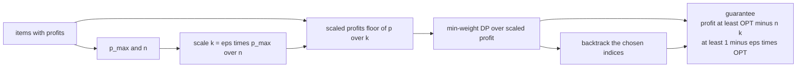
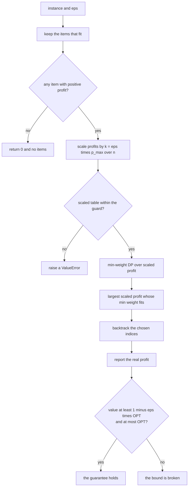
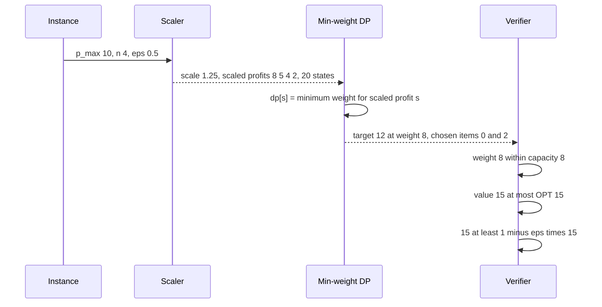

# 769 — Implement knapsack approximation PTAS idea demonstration

> **Tier:** Expert · **CTCI chapter:** Ch 8 — Recursion and Dynamic Programming
> **Task spec:** [769-implement-knapsack-approximation-ptas-idea-demonstration.md](../../../tasks/expert/769-implement-knapsack-approximation-ptas-idea-demonstration.md)
> **Solutions:** [Python](../../../solutions/python/expert/769-implement-knapsack-approximation-ptas-idea-demonstration/solution.py) ·
> [Java](../../../solutions/java/expert/769-implement-knapsack-approximation-ptas-idea-demonstration/Solution.java) ·
> [JavaScript](../../../solutions/javascript/expert/769-implement-knapsack-approximation-ptas-idea-demonstration/solution.js) ·
> [C#](../../../solutions/csharp/expert/769-implement-knapsack-approximation-ptas-idea-demonstration/Solution.cs)

## 1. Problem restatement

0/1 knapsack: choose a subset of items with total weight `<= capacity` maximising total profit. The
exact capacity DP costs `O(n · capacity)` and is only *pseudo-polynomial*; the **scaled-profit FPTAS**
replaces every profit by `p'_i = floor(p_i / k)` with `k = eps · p_max / n` and then runs a DP indexed by
**profit** instead of capacity.

| Function | Returns |
| --- | --- |
| `brute_force_knapsack(items, capacity)` | best value and mask by enumerating all `2^n` subsets (`n <= 18`); the independent oracle |
| `exact_knapsack(items, capacity)` | value and chosen indices from the capacity DP with back-pointers |
| `fptas_knapsack(items, capacity, eps)` | value, chosen indices, and the size of the scaled table |
| `greedy_half(items, capacity)` | the classic 1/2-approximation baseline: free items, then decreasing profit/weight ratio, or the best single item |
| `random_instance(count, seed, weight_high, profit_high)` | deterministic `(weight, profit)` pairs with capacity ≈ 45% of the total weight |

Guarantee (the header's derivation): the DP is exact on the scaled profits and each rounding drops less
than `k` per item, so the reconstructed set satisfies

`profit >= k · OPT' >= OPT - n·k >= (1 - eps) · OPT`.

Concrete results, taken from the solutions' assertions and printed summary:

- Hand instance `[(5,10), (4,7), (3,5), (2,3)]` with capacity 8: the optimum is **15** at weight **8**.
- The capacity DP is cross-checked against exhaustive enumeration on **8** random instances.
- The PTAS guarantee is verified on **20** (eps, instance) pairs for `eps ∈ {0.5, 0.3, 0.2, 0.1, 0.05}`:
  feasible, distinct indices, `value <= OPT` and `value >= (1 - eps) · OPT`; the measured worst ratio is
  **1.0000**.
- With `eps = 0.5 / p_max` (so `eps · p_max < 1`) the FPTAS reproduces the **exact** optimum, and its table
  stays below `2 n² p_max + 1`.
- Table sizes stay polynomial: for `n = 16`, `states <= 16 · floor(16/eps) + 1`; measured **1163** states at
  `eps = 0.1` on a 14-item instance.
- The greedy baseline is never better than OPT and always reaches `OPT/2` on **5** instances.

## 2. Intuition

Exact knapsack is only pseudo-polynomial: the DP is `O(n · capacity)`, so a capacity of `10^9` (with small
profits) breaks it, while the profit-indexed DP is `O(n · sum of profits)`, which fails for large profits.
Neither dimension is small in general, so something has to give — and the FPTAS gives *precision*.

The insight is that profits can be rounded **coarsely, but slightly**:

1. **Scale** every profit by `k = eps · p_max / n` and take the floor. Each item loses less than one unit
   of scaled profit, i.e. less than `k` real profit, so any set loses less than `n · k = eps · p_max`.
2. **Search by profit.** The min-weight DP over the *scaled* profits is exact for the scaled instance, and
   its table has `sum_i floor(p_i / k) + 1 <= n · floor(n / eps) + 1` states — polynomial in `n` and `1/eps`.
3. **Recover the guarantee.** If `OPT'` is the scaled optimum, then
   `profit >= k · OPT' >= OPT - n·k >= (1 - eps) · OPT`, so the loss is proportional to `eps` while the
   work is polynomial — the trade-off that defines an FPTAS.



Documented simplifications: the DP is written with plain lists and rebuilt per instance (no
divide-and-conquer / SMAWK speed-ups), and `eps >= 0.05` is kept in the checks so the table stays small. A
documented guard `MAX_SCALED_STATES = 2_000_000` raises `ValueError` when a scaled table would be too
large. **The approximation guarantee itself is not simplified**: every returned set is checked to be
feasible (distinct indices, weight `<= capacity`, reported value equal to the sum of its profits), to be
at most `OPT`, and to reach at least `(1 - eps) · OPT`, with `eps -> 0` recovering the exact optimum.

## 3. Algorithm

1. **Capacity DP (`exact_knapsack`)** — `dp[c]` is the best profit with budget `c`, filled by iterating
   `c` from `capacity` down to `w` for each item; a `take[i][c]` byte records the decision so the set can
   be rebuilt by walking the items backwards.
2. **Filter** the items to those with `w <= capacity` (the unusable ones can never be chosen) and keep
   their original indices.
3. **Scale** — `k = eps · p_max / n`, `scaled[i] = floor(p_i / k)`; `total = sum(scaled)` and the table
   size is `total + 1`.
4. **Min-weight DP** — `dp[i][s]` is the minimum weight achieving scaled profit `s` with the first `i`
   feasible items; `dp[i][s] = min(dp[i-1][s], dp[i-1][s - gain_i] + w_i)` with `INF = infinity` for
   unreachable states.
5. **Target** — the largest `s` with `dp[count][s] <= capacity`.
6. **Backtrack** — walk `i` from `count` down to 1; if `dp[i][s] != dp[i-1][s]` the item is in the set and
   `s` drops by its scaled gain.
7. **Report** — the *real* profit summed over the chosen indices, which is the value the guarantee bounds.

```text
function exact_knapsack(items, capacity)
    if capacity < 0 then return 0, empty list
    dp ← array of capacity + 1 zeros
    take ← byte grid of size items by capacity + 1
    for index, (weight, profit) in enumerate(items) do
        if weight > capacity then continue
        for budget from capacity down to weight do
            candidate ← dp[budget - weight] + profit
            if candidate > dp[budget] then
                dp[budget] ← candidate
                take[index][budget] ← 1
    chosen ← empty list
    budget ← capacity
    for index from length(items) - 1 down to 0 do
        if take[index][budget] = 1 then
            append index to chosen
            budget ← budget - items[index].weight
    return dp[capacity], sorted(chosen)

function fptas_knapsack(items, capacity, eps)
    if eps <= 0 then fail "the PTAS needs a positive precision"
    feasible ← [(index, w, p) for (w, p) in items if w <= capacity]
    if capacity < 0 or feasible is empty then return 0, empty list, 0
    p_max ← largest profit among feasible items
    if p_max <= 0 then return 0, empty list, 1
    scale ← eps * p_max / length(feasible)
    scaled ← [floor(p / scale) for each feasible item]
    total ← sum(scaled)
    if total + 1 > MAX_SCALED_STATES then fail "scaled-profit table would be too large for this eps"
    dp ← grid of (count + 1) rows of total + 1 infinities
    dp[0][0] ← 0
    for i from 1 to count do
        weight, gain ← feasible[i - 1]
        for s from 0 to total do
            best ← dp[i - 1][s]
            if s >= gain then
                alternate ← dp[i - 1][s - gain] + weight
                if alternate < best then best ← alternate
            dp[i][s] ← best
    target ← the largest s with dp[count][s] <= capacity
    chosen ← empty list
    s ← target
    for i from count down to 1 do
        if dp[i][s] = dp[i - 1][s] then continue
        append feasible[i - 1].index to chosen
        s ← s - scaled[i - 1]
    return sum of items[index].profit over chosen, sorted(chosen), total + 1

function greedy_half(items, capacity)
    chosen ← items with weight 0 and positive profit
    weight, value ← the totals of chosen
    for index in items with positive weight sorted by decreasing profit over weight do
        if weight + weight(index) <= capacity then
            append index to chosen
            weight, value ← weight + weight(index), value + profit(index)
    best_single ← the largest profit of an item that fits
    return max(value, best_single)
```



## 4. Worked example

The hand-checked instance `items = [(5, 10), (4, 7), (3, 5), (2, 3)]`, `capacity = 8`:

| Subset | weight | profit |
| --- | --- | --- |
| `{0, 1}` | 9 | 17 — does not fit |
| `{0, 2}` | 8 | **15** |
| `{0, 3}` | 7 | 13 |
| `{1, 2}` | 7 | 12 |
| `{1, 3}` | 6 | 10 |

The capacity DP returns value **15** with weight **8**, which the check states as
`value == 15 and set_value(hand, chosen) == (15, 8)`.

The same instance through the FPTAS with `eps = 0.5`: `n = 4`, `p_max = 10`, so
`k = 0.5 · 10 / 4 = 1.25` and the scaled profits are `floor(10/1.25) = 8`, `floor(7/1.25) = 5`,
`floor(5/1.25) = 4`, `floor(3/1.25) = 2` — `total = 19`, so the table has **20** states.

Minimum weight per scaled profit for every reachable subset:

| Subset | weight | scaled profit |
| --- | --- | --- |
| `{}` | 0 | 0 |
| `{3}` | 2 | 2 |
| `{2}` | 3 | 4 |
| `{1}` | 4 | 5 |
| `{2,3}` | 5 | 6 |
| `{1,3}` | 6 | 7 |
| `{0}` | 5 | 8 |
| `{1,2}` | 7 | 9 |
| `{0,3}` | 7 | 10 |
| `{1,2,3}` | 9 | 11 |
| `{0,2}` | **8** | **12** |
| `{0,1}` | 9 | 13 |
| `{0,2,3}` | 10 | 14 |
| `{0,1,3}` | 11 | 15 |
| `{0,1,2}` | 12 | 17 |
| all four | 14 | 19 |

The largest scaled profit whose minimum weight is `<= 8` is **12** at weight 8, and backtracking returns
`{0, 2}` — the true optimum, with `profit = 15 >= k · 12 = 15`. Even with a coarse `eps = 0.5` the rounding
is harmless here, which is why the measured worst ratio over all 20 guarantee checks is 1.0000.

The guarantee chain in numbers, for a case where the FPTAS is *not* exact:

| Step | Statement | Bound |
| --- | --- | --- |
| 1 | each item loses less than `k` profit | `< n · k` overall |
| 2 | the scaled DP is exact for scaled profits | `profit >= k · OPT'` |
| 3 | combine | `profit >= OPT - n·k` |
| 4 | substitute `k = eps · p_max / n` | `profit >= (1 - eps) · OPT` |



## 5. Complexity

Let `n` be the number of items, `C` the capacity, `P` the largest profit and `S` the number of scaled
states.

| Operation | Best | Average | Worst | Why the bound holds |
| --- | --- | --- | --- | --- |
| `brute_force_knapsack` | O(2^n) | O(n 2^n) | O(n 2^n) | every subset is enumerated with a per-subset weight/profit scan |
| `exact_knapsack` | O(n C) | O(n C) | O(n C) | one descending pass over the capacity per item |
| `fptas_knapsack` | O(n S) | O(n S) | O(n S) | one row per feasible item over `S = total + 1` states |
| table size `S` | 1 | `n · floor(n / eps) + 1` | `sum_i floor(p_i / k) + 1` | scaling by `k = eps · p_max / n` bounds every item's scaled profit by `n / eps` |
| `greedy_half` | O(n log n) | O(n log n) | O(n log n) | one sort by profit/weight ratio |
| Space | O(C) exact | O(n C) exact, O(n S) FPTAS | O(n S) | the exact DP keeps a `take` grid; the FPTAS keeps the value grid |

Measured: **1163** states at `eps = 0.1` on a 14-item instance, inside the asserted bound
`n · floor(n / eps) + 1 = 16 · 160 + 1 = 2561` for the 16-item case.

Comparison of the methods on the same instances: brute force is exact but `O(2^n)` (only usable for
`n <= 18`), the capacity DP is exact but needs a small capacity, the **FPTAS** trades precision for size
(`>= (1 - eps) · OPT` in `O(n² / eps)` states), and `greedy_half` is `O(n log n)` with a fixed `OPT / 2`
bound and no knob.

## 6. Pitfalls and edge cases

- **Zero capacity.** `exact_knapsack([(3, 9)], 0) == 0` and `fptas_knapsack([(3, 9)], 0, 0.2) == 0`, but
  `exact_knapsack([(0, 5), (3, 1)], 0) == 5` — a *zero-weight* item fits in zero capacity.
- **Items heavier than the capacity** are unusable: `[(9, 9), (8, 4)]` with capacity 5 gives 0 from both
  the DP and the FPTAS, and the FPTAS filters them out before computing `p_max`.
- **Everything fits.** `[(2, 4), (3, 6), (1, 1)]` with capacity 10 gives 11 (the whole profit), from the
  exact DP and from the FPTAS with `eps = 0.5`.
- **Single item**, fitting and non-fitting: capacity 4 with `(4, 8)` gives 8, capacity 3 gives 0; an empty
  item list gives 0 as well, and so do all-zero profits (no division by zero).
- **`eps <= 0` must fail loudly** — `check(0 < eps, ...)` raises, because the scaling would divide by zero.
- **The returned set must be feasible.** The checks verify distinct indices, weight `<= capacity`, and
  that the reported value equals the sum of the chosen items' profits; a rounding bug would show up as a
  mismatch between the reported value and the set.
- **Never better than OPT.** `value <= optimum` is asserted on all 20 guarantee checks — an approximation
  that "beats" the exact optimum indicates a broken oracle or a feasibility bug.
- **Smaller `eps` cannot hurt**: `coarse <= medium <= fine` for `eps = 0.4, 0.15, 0.05` on the same
  instance, because the scaling only gets finer.
- **`eps -> 0` is exact**: with `eps = 0.5 / p_max` the rounding loss `n·k = eps · p_max < 1` is below one
  profit unit, so integrality of the optimum makes the bound tight and the FPTAS returns OPT.
- **The table guard and determinism.** A tiny `eps` on a large instance would blow up `total + 1`; the
  documented `MAX_SCALED_STATES = 2_000_000` turns that into a `ValueError` instead of an out-of-memory crash,
  and the FPTAS returns the same triple on repeated calls with the same instance and `eps`.

## 7. Variants and follow-ups

- **The exact reconstruction DP** without scaling — capacity-indexed with back-pointers — is
  [295 — 0/1 knapsack DP with reconstruction](../../../tasks/intermediate/295-0-1-knapsack-dp-with-reconstruction.md).
- **The fractional relaxation** solved greedily by profit/weight ratio gives a useful *upper bound* on OPT;
  see [296 — fractional knapsack greedy](../../../tasks/intermediate/296-fractional-knapsack-greedy.md).
- **Smarter exact DP** for large capacities: divide-and-conquer / SMAWK bring the capacity DP to
  `O(n C / M)` work, which the simplifications here deliberately skip.
- **Other approximation schemes** with the same "round the objective" trick appear in
  [705 — Steiner forest approximations on large graphs](../../../tasks/expert/705-implement-steiner-forest-approximations-large-graphs.md)
  and [707 — multi-commodity flow approximate algorithm outline](../../../tasks/expert/707-implement-multi-commodity-flow-approximate-algorithm-outline.md).
- **Multi-criteria selection** (profit *and* weight as Pareto objectives rather than one constraint) is the
  skyline problem of
  [768 — skyline queries in multi-criteria optimization](../../../tasks/expert/768-implement-skyline-queries-in-multi-criteria-optimization-pareto.md).

## 8. Check yourself

<details><summary>Show answer</summary>

**Q1.** Why is the capacity DP not enough, and what does indexing by profit change?

The capacity DP is `O(n · capacity)`, so it explodes when the capacity is large — even if every profit is
tiny. The profit-indexed DP is `O(n · sum of profits)`, which is small exactly in the case where the
capacity DP is large. Neither is polynomial in the *input size* alone, but *rounding* the profits makes the
profit dimension small on purpose: the table has at most `n · floor(n / eps) + 1` states.

</details>

<details><summary>Show answer</summary>

**Q2.** Where does `k = eps · p_max / n` come from?

The rounding loss per item must be amortised over all `n` items so the total loss stays below
`eps · p_max <= eps · OPT`. Choosing `k = eps · p_max / n` gives `n · k = eps · p_max`, and since every item's
scaled profit is then at most `n / eps`, the table is polynomially bounded in `n` and `1/eps`.

</details>

<details><summary>Show answer</summary>

**Q3.** In the worked example the scaled optimum equals the true optimum. Is that guaranteed?

No — it is a coincidence of this instance, where the scaling happens to preserve the optimal set. The
guarantee is the inequality `k · OPT' >= OPT - n·k >= (1 - eps) · OPT`, not equality; what the checks *do*
guarantee is that with `eps · p_max < 1` the rounding cannot lose a whole profit unit, so the answer must
equal OPT.

</details>

<details><summary>Show answer</summary>

**Q4.** Why must a smaller `eps` never produce a worse value?

Because the scaled instance only gets finer as `eps` shrinks: `k = eps · p_max / n` decreases, so every
scaled profit is a finer multiple of the same real profit and the DP's reachable set only grows. The check
`coarse <= medium <= fine` asserts exactly this monotonicity for `eps = 0.4, 0.15, 0.05`.

</details>
