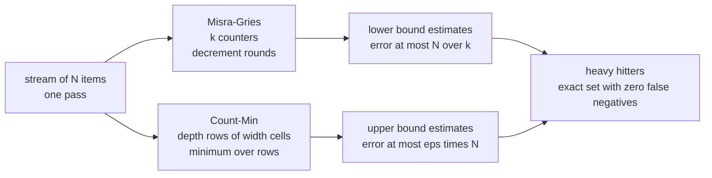
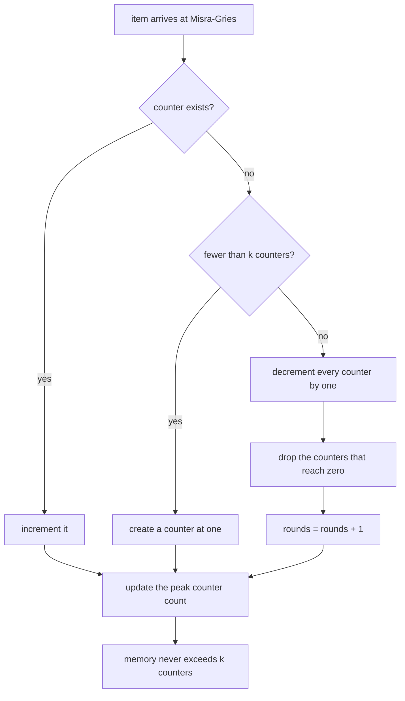
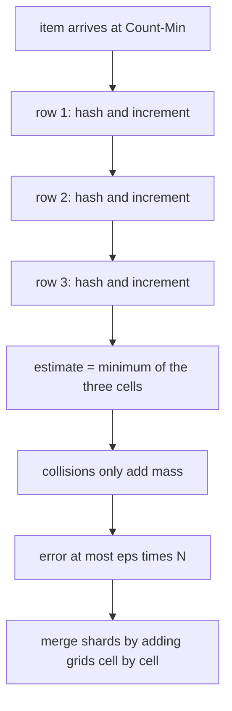
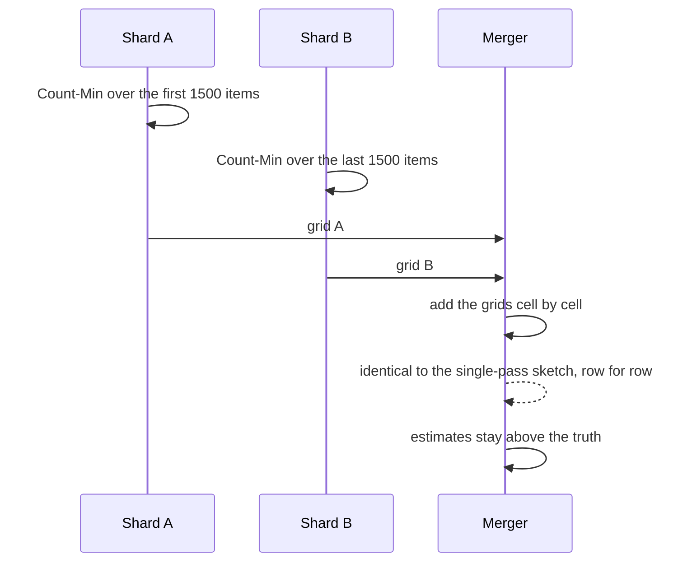

# 770 — Implement streaming algorithms for heavy hitters under memory constraints

> **Tier:** Expert · **CTCI chapter:** Beyond — Advanced Data Structures & Algorithms
> **Task spec:** [770-implement-streaming-algorithms-for-heavy-hitters-under-memory-co.md](../../../tasks/expert/770-implement-streaming-algorithms-for-heavy-hitters-under-memory-co.md)
> **Solutions:** [Python](../../../solutions/python/expert/770-implement-streaming-algorithms-for-heavy-hitters-under-memory-co/solution.py) ·
> [Java](../../../solutions/java/expert/770-implement-streaming-algorithms-for-heavy-hitters-under-memory-co/Solution.java) ·
> [JavaScript](../../../solutions/javascript/expert/770-implement-streaming-algorithms-for-heavy-hitters-under-memory-co/solution.js) ·
> [C#](../../../solutions/csharp/expert/770-implement-streaming-algorithms-for-heavy-hitters-under-memory-co/Solution.cs)

## 1. Problem restatement

Find the frequent items of a stream in **one pass** with **O(1) memory per counter** and no storage of
the stream. Two sketches, both with provable one-sided errors:

| Sketch | Structure | Guarantee |
| --- | --- | --- |
| **Misra-Gries** (`MisraGries(k)`) | at most `k` counters; an unseen key either takes a free counter or triggers a *decrement round* | `f_i - N/k <= est_i <= f_i`, so every item with `f_i > N/k` stays monitored and no unmonitored item has `f_i > N/k` |
| **Count-Min** (`CountMinSketch(width, depth)`) | `depth × width` counters; a key hashes to one cell per row and the estimate is the **minimum** over rows | `0 <= est_x - f_x <= eps · N` with `width = ceil(e/eps)`, `depth = ceil(ln(1/delta))` |

Inputs: `zipf_stream(length, distinct, alpha, seed)` (deterministic Zipf(α): weight of rank `i` is
`(i+1)^-α`), `uniform_stream`, `exact_counts` as the oracle. Outputs: estimates, the monitored set, and
the number of decrement rounds.

Concrete results, all asserted by the checks:

- Zipf stream `N = 3000`, `120` distinct keys, `α = 1.0`; `k = 16` gives the bound `N/k = 187.5`, and the
  stream really contains `3` heavy hitters (`f > 187.5`), all still monitored.
- MG performs **137** decrement rounds and never holds more than `k = 16` counters (checked after *every*
  insert); every estimate is a lower bound with error `<= N/k`.
- Count-Min at `eps = 0.01`, `delta = 0.05` → **272 × 3 = 816** cells, `eps · N = 30`, measured worst error
  **0**; never-seen keys estimate to zero for most keys, with collisions for some.
- A deliberately tiny sketch (`eps = 0.2`) → **14 × 3 = 42** cells, worst error **403** against the
  `eps · N = 600` budget: the bound is visible but not violated.
- Exactness limit: a single row whose hash is injective on the key set estimates every frequency exactly.
- Mergeability: `sketch(A) + sketch(B) == sketch(A ++ B)` row by row, and summed MG shard estimates stay
  lower bounds with error `<= N/k` over the union.

## 2. Intuition

Exact counting needs a dictionary of every distinct key — memory proportional to the *cardinality*, not to
the stream. The two sketches trade exactness for bounded memory in opposite ways.

**Misra-Gries** keeps at most `k` counters and never stores anything else. The trick is what happens when
a new key arrives and all `k` counters are taken: instead of evicting blindly, it decrements **every**
counter by one and drops the zeros. A decrement round therefore removes `k` units of total count from the
sketch, and since the stream has `N` items, at most `N/k` rounds can ever occur. That yields the guarantee
`f_i - N/k <= est_i <= f_i` in one line: a key's counter is short by at most the total mass destroyed by
rounds.

**Count-Min** never evicts; it hashes the key into one cell per row and increments, so collisions *add
mass that is not there*. The estimate must handle that, and taking the **minimum over rows** does: a
collision must happen in every row to inflate the answer, which is why `width = ceil(e/eps)` with
`depth = ceil(ln(1/delta))` bounds the error by `eps · N` with probability `1 - delta`.



Documented simplifications: the hash family is a **fixed** `splitmix64`-based mixing function instead of a
randomly chosen 2-universal family, so the Count-Min guarantee is verified empirically on the tested
streams rather than invoked as a probability statement; and the streams are kept to a few thousand items
so the exact oracle stays cheap.

## 3. Algorithm

Misra-Gries:

1. Increment `seen`. If the key has a counter, increment it.
2. Else if fewer than `k` counters are held, create one with value 1.
3. Else run a **decrement round**: subtract 1 from every counter, delete the zeros, and count the round
   (the total mass removed per round is exactly `k`).
4. Track `max_size`, the largest counter count ever observed, as a memory witness.
5. `estimate(key)` is the counter value, `0` if evicted; `error_bound()` is `seen / k`.

Count-Min:

6. `add(key, count)` — for each row `r`, increment `rows[r][mix(key, r + 1) % width]`.
7. `estimate(key)` — the minimum over rows (one cell each), which can only over-estimate.
8. `merge(other)` — require identical geometry, then add the grids cell by cell.
9. `cms_geometry(eps, delta)` — `width = ceil(e/eps)`, `depth = ceil(ln(1/delta))`.

```text
procedure MisraGries.add(key)
    seen ← seen + 1
    if key in counters then
        counters[key] ← counters[key] + 1
    else if number of counters < k then
        counters[key] ← 1
    else
        for monitored in copy of the counter keys do
            counters[monitored] ← counters[monitored] - 1
            if counters[monitored] = 0 then delete counters[monitored]
        rounds ← rounds + 1
    max_size ← max(max_size, number of counters)
    return counters.get(key, 0)

function MisraGries.estimate(key)
    return counters.get(key, 0)

function MisraGries.error_bound()
    return seen / k

procedure CountMinSketch.add(key, count)
    for row in range(depth) do
        rows[row][mix(key, row + 1) mod width] ← rows[row][mix(key, row + 1) mod width] + count

function CountMinSketch.estimate(key)
    return the minimum over rows of rows[row][mix(key, row + 1) mod width]

function CountMinSketch.merge(other)
    if width ≠ other.width or depth ≠ other.depth then fail "geometries must match"
    merged ← new sketch of the same geometry
    merged.rows[row][column] ← rows[row][column] + other.rows[row][column] for every cell
    return merged

function cms_geometry(eps, delta)
    return ceil(e / eps), ceil(ln(1 / delta))
```





## 4. Worked example

The Zipf experiment, `N = 3000`, `120` distinct keys, `α = 1.0`, `k = 16`:

| Quantity | Value |
| --- | --- |
| stream length `N` | 3000 |
| distinct keys | 120 |
| Misra-Gries counters `k` | 16 |
| error bound `N/k` | 187.5 |
| true heavy hitters (`f > 187.5`) | 3 |
| decrement rounds | 137 |
| peak counter count | **≤ 16** after every insert |

Misra-Gries trace on a tiny stream with `k = 2`, stream `a a b c c c`:

| Step | Item | Counters before | Action | Counters after |
| --- | --- | --- | --- | --- |
| 1 | `a` | `{}` | free counter | `{a: 1}` |
| 2 | `a` | `{a: 1}` | increment | `{a: 2}` |
| 3 | `b` | `{a: 2}` | free counter | `{a: 2, b: 1}` |
| 4 | `c` | `{a: 2, b: 1}` | all counters taken → decrement round | `{a: 1}` (`b` hit 0 and was dropped) |
| 5 | `c` | `{a: 1}` | free counter | `{a: 1, c: 1}` |
| 6 | `c` | `{a: 1, c: 1}` | increment | `{a: 1, c: 2}` |

At the end `N = 6`, `N/k = 3`, and the estimates are `a: 1`, `c: 2` — both below the true counts (2 and 3)
by less than 3. The true heavy hitters here are only those with `f > 3`, of which there are none, so nothing
is falsely reported.

Count-Min on the same Zipf stream, `eps = 0.01`, `delta = 0.05`:

| Quantity | Value |
| --- | --- |
| width `ceil(e/eps)` | 272 |
| depth `ceil(ln(1/delta))` | 3 |
| cells | 816 |
| budget `eps · N` | 30 |
| measured worst error over all keys | **0** |

And the deliberately tight sketch, where the bound becomes visible:

| Quantity | Tiny sketch | |
| --- | --- | --- |
| `eps` | 0.2 | 14 × 3 = 42 cells |
| budget `eps · N` | 600 | measured worst error **403** |
| one-sidedness | — | every estimate is `>= f`, asserted |

The exactness limit: searching for a single-row width whose hash is injective on the 120 keys gives a
sketch with `depth = 1` that reproduces every frequency exactly — the smallest instance of the fact that
Count-Min is exact when there are no collisions.



## 5. Complexity

Let `N` be the stream length, `d` the distinct keys, `k` the MG counter budget, `w` the CM width and `r`
the CM depth.

| Operation | Best | Average | Worst | Why the bound holds |
| --- | --- | --- | --- | --- |
| `MisraGries.add` | O(1) | O(1) | O(k) | an increment, a fresh counter, or one pass over `k` counters |
| `MisraGries.estimate` | O(1) | O(1) | O(1) | one dictionary lookup |
| decrement rounds | 0 | `< N/k` | `N/k` | each round destroys exactly `k` units of counted mass |
| `CountMinSketch.add` | O(r) | O(r) | O(r) | one hash and one increment per row |
| `CountMinSketch.estimate` | O(r) | O(r) | O(r) | one cell read per row plus a minimum |
| `merge` | O(w r) | O(w r) | O(w r) | cell-wise addition of the two grids |
| exact oracle (`exact_counts`) | O(N) | O(N) | O(d) memory | it is the thing the sketches avoid |
| Space | O(k) MG | O(w r) CM | O(min(d, r w)) | counters or cells, independent of `N` |

Comparison of the two sketches and the oracle:

| Method | Memory | Error direction | Error bound | Mergeable |
| --- | --- | --- | --- | --- |
| Exact dictionary | O(d) | none | 0 | no (needs the keys) |
| Misra-Gries (this task) | O(k) | under-estimate | `N/k`, only keys with `f > N/k` guaranteed present | approximately, by summing shard estimates |
| Count-Min (this task) | O(w r) | over-estimate | `eps · N` with `width = ceil(e/eps)`, `depth = ceil(ln(1/delta))` | exactly, by adding grids |
| Count-Min with an injective row | O(d) | none | 0 | yes |

## 6. Pitfalls and edge cases

- **An empty stream** must have no counters and an error bound of **0.0** — `seen / k` with `seen = 0`, not
  a division error.
- **`k = 1` is brutal and correct**: after `add(5)` the counter holds `5`, and a second distinct key `6`
  forces the only counter to be decremented to zero and dropped, so `monitored() == []` and
  `estimate(5) == 0`.
- **`k >= distinct keys` degenerates to exact counting**, and the checks require `max_size` to equal the
  distinct count — the budget must actually be used, not under-allocated.
- **Memory is checked after every insert**, not only at the end: `len(counters) > k` would be a violation
  even briefly (137 rounds happened, and never with more than 16 counters held).
- **Zero false negatives.** Every key with `f > N/k` must still be monitored: the check iterates over the
  true heavy hitters and asserts `key in heavy.counters`.
- **No false heavy hitters.** Conversely, every *unmonitored* key must satisfy `f <= N/k`; on an
  all-distinct stream (`400` keys with `f = 1`, bound `8`) that means nothing may be reported as heavy.
- **MG estimates are lower bounds**; `heavy.estimate(key) <= exact[key]` is asserted for monitored keys and
  for every heavy hitter.
- **Count-Min may only over-estimate.** `est >= f` for every key, at both `eps = 0.01` and `eps = 0.2`.
- **Never-seen keys are not free.** An unseen key estimates to the collision mass in its cells; the checks
  require `est <= eps · N` and also `est <= min(max(row))`, the rigorous ceiling for a minimum over rows,
  and require that *some* collisions occur (816 cells for 120 keys on a 3000-item stream) while most unseen
  keys still estimate to zero.
- **The tiny sketch must show real error.** `worst_error > 0` for 42 cells, proving the bound is not
  satisfied vacuously by an over-sized sketch.
- **Merging needs identical geometry.** `merge` raises unless width and depth match, and the merged grid
  must equal the single-pass grid row for row.
- **Summed MG shard estimates degrade gracefully**: for a heavy hitter, `est_a + est_b <= f` and
  `f - (est_a + est_b) <= (seen_a + seen_b) / k`, i.e. the bound holds with the union's `N`.
- **Determinism**: the mixing function is fixed, so both sketches produce identical state on a repeated
  pass, and the Zipf/uniform generators are seeded `splitmix64` streams.

## 7. Variants and follow-ups

- **Merge sketches across shards** in a distributed aggregator with a merge tree, as in
  [847 — heavy-hitter detection with distributed mergeable sketches](../../../tasks/master/847-implement-heavy-hitter-detection-with-distributed-sketches-merge.md).
- **Add error guarantees and mergeability to a probabilistic structure** for the same problem, including a
  comparison of the space/error trade-off — see
  [911 — probabilistic data structure for heavy hitters](../../../tasks/master/911-implement-probabilistic-data-structure-for-heavy-hitters-with-er.md).
- **Filter before counting** with a Bloom filter when most of the stream is known to be irrelevant: the
  insertion side is
  [254 — Bloom filter insert/check](../../../tasks/intermediate/254-implement-bloom-filter-insert-check-probabilistic.md).
- **Sample instead of count** when the goal is a uniform random subset rather than frequencies — see
  [165 — reservoir sampling for k items from a stream](../../../tasks/beginner/165-reservoir-sampling-for-k-items-from-stream.md)
  and its mergeable variant
  [780 — distributed sampling reservoir with merge operation](../../../tasks/expert/780-implement-distributed-sampling-reservoir-with-merge-operation.md).
- **Use the heavy hitters to prune a join or a query plan**, as in
  [649 — Bloom join filter application and benchmarking](../../../tasks/expert/649-implement-bloom-join-filter-application-and-benchmarking.md).

## 8. Check yourself

<details><summary>Show answer</summary>

**Q1.** Why can Misra-Gries afford to destroy `k` units of count in one round, and what does that cost?

Because each round pays `k` units to evict at most the keys that have no counter, and the stream only holds
`N` units of total count, so at most `N/k` rounds can happen. The cost is the accuracy of what remains: any
counter is short by at most the mass destroyed, which is why `f_i - est_i <= N/k`. In the experiment, `137`
rounds at `k = 16` and a bound of `187.5`.

</details>

<details><summary>Show answer</summary>

**Q2.** Why is the Count-Min estimate the *minimum* over rows rather than the average?

Because every collision only adds mass, so each row is an over-estimate: `est_r >= f` for every row. The
minimum is then the tightest over-estimate, and an error of more than `eps · N` would require a collision in
*every* row simultaneously — which is what the choice `width = ceil(e/eps)` makes improbable. An average
would be inflated by a single bad row.

</details>

<details><summary>Show answer</summary>

**Q3.** What makes the two sketches mergeable in different ways?

Count-Min is linear in the counters: `sketch(A) + sketch(B)` cell by cell equals `sketch(A ++ B)` exactly, so
a distributed aggregator can sum grids (asserted row for row). Misra-Gries is not linear — its evictions
depend on the arrival order — so merging is only *approximate*: summing shard estimates keeps the lower-bound
property and the error bound `N/k` computed over the union, which the checks verify for the heavy hitters.

</details>

<details><summary>Show answer</summary>

**Q4.** In the all-distinct stream of 400 keys, `N/k = 8` and every frequency is 1. What must the sketch
report?

Nothing above the budget: no key has `f > 8`, so the true heavy-hitter set is empty, and every evicted key
satisfies `f <= 8`. The check also requires `est <= 1` for every key, i.e. the sketch must not invent
frequency for keys it only saw once.

</details>
