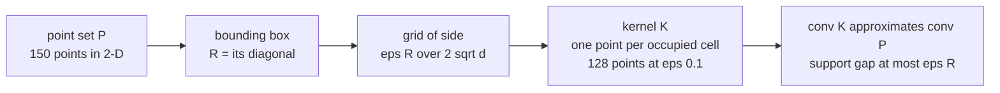
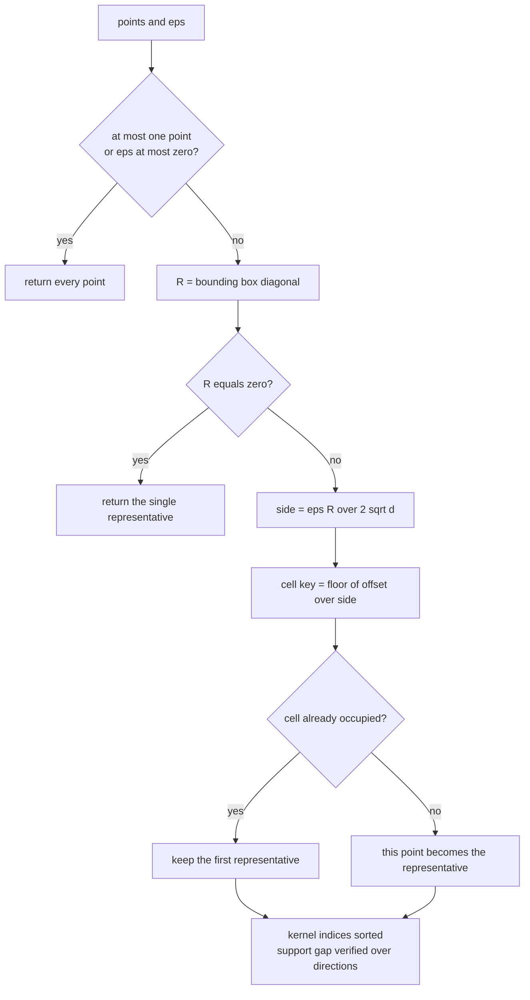
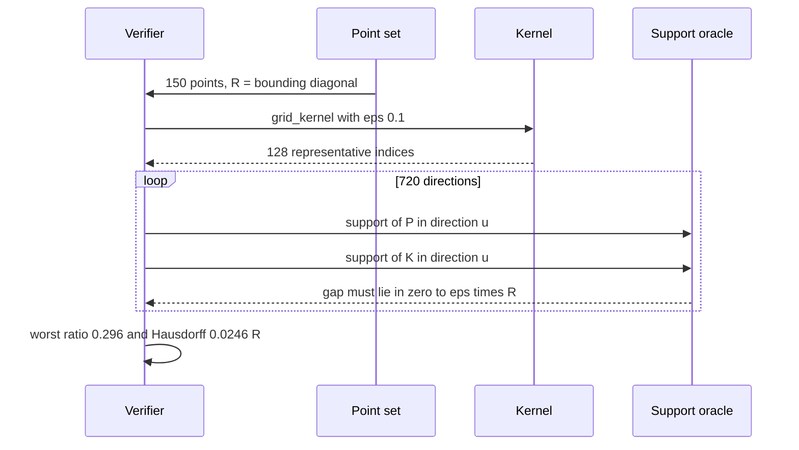

# 771 — Implement epsilon-kernel for approximate convex hull (coresets)

> **Tier:** Expert · **CTCI chapter:** Beyond — Numerical & Scientific Computing
> **Task spec:** [771-implement-epsilon-kernel-for-approximate-convex-hull-coresets.md](../../../tasks/expert/771-implement-epsilon-kernel-for-approximate-convex-hull-coresets.md)
> **Solutions:** [Python](../../../solutions/python/expert/771-implement-epsilon-kernel-for-approximate-convex-hull-coresets/solution.py) ·
> [Java](../../../solutions/java/expert/771-implement-epsilon-kernel-for-approximate-convex-hull-coresets/Solution.java) ·
> [JavaScript](../../../solutions/javascript/expert/771-implement-epsilon-kernel-for-approximate-convex-hull-coresets/solution.js) ·
> [C#](../../../solutions/csharp/expert/771-implement-epsilon-kernel-for-approximate-convex-hull-coresets/Solution.cs)

## 1. Problem restatement

An **eps-kernel** of a point set `P` with diameter `R` is a small subset `K ⊆ P` whose convex hull
approximates the hull of `P` in *every* direction:

`for every unit vector u:  h_P(u) - eps · R <= h_K(u) <= h_P(u)`

where `h(u) = max_{p in P} <u, p>` is the support function. Equivalently, the directed Hausdorff distance
from `conv(P)` to `conv(K)` is at most `eps · R`, so `conv(K)` can replace `conv(P)` wherever only support
queries matter.

| Function | Role |
| --- | --- |
| `grid_kernel(points, eps)` | the kernel: bounding box → grid of side `eps · R / (2 · sqrt(d))` → one representative per occupied cell |
| `bounding_diagonal(points)` | `R`: the axis-aligned bounding-box diagonal, an upper bound on the diameter |
| `support(points, u)` | exact support function by brute force; the oracle |
| `convex_hull_2d`, `hull_area_2d`, `hull_perimeter_2d` | monotone-chain hull plus the measures used for the implied bounds |
| `distance_to_hull(p, hull_points)` | directed Hausdorff witness for 2-D |

Input: deterministic points in `[0, 1)^d` (`random_points` streams 30-bit fractions) and dense direction
sets. Output: the kernel indices and the measured guarantee ratios.

Concrete results, printed and asserted by the checks:

- **8640** direction checks (720 directions × 4 values of `eps` × 3 trials in 2-D); the worst measured
  `gap / (eps · R)` is **0.296** — the guarantee holds with about 70% of the budget to spare.
- Directed Hausdorff distance from `conv(P)` to `conv(K)`: **0.0246 · R** at `eps = 0.1`, i.e. 25% of the
  `eps · R` budget.
- On 150 points with `eps = 0.1`: kernel size **128**, area gap **0.00469** against the
  `perimeter · t + pi · t²` budget with `t = eps · R / 2`.
- The kernel is always a **subset** of `P` (distinct indices, the actual input points), never larger than
  the input, and `eps = 0` keeps every point.
- Size bound `(2 · sqrt(d) / eps + 2)^d` respected, coarsening monotone (`2 · eps` cannot grow the kernel),
  and `eps = 10` collapses it to a single point.

## 2. Intuition

Computing an exact hull in high dimensions is hopeless, but *support queries* are all that most
applications need — and a support query asks only for the extreme point in one direction. So the goal is
not to reproduce the hull exactly, but to keep enough points that every direction's extreme value is
nearly preserved.

The grid kernel gets that with a rounding argument. Cover the bounding box with cells of side
`delta = eps · R / (2 · sqrt(d))`, keep one point per occupied cell, and observe:

1. Two points in the same cell differ by at most `delta · sqrt(d) = eps · R / 2` in Euclidean distance.
2. For any unit vector `u`, `<u, q> >= <u, p> - ||q - p|| >= <u, p> - eps · R / 2`.
3. Apply that to the maximiser `p*` of the direction: `h_P(u) = <u, p*> <= <u, q*> + eps · R / 2` where
   `q*` is the representative of `p*`'s cell, hence `h_P(u) - h_K(u) <= eps · R / 2 <= eps · R`.

That is the whole guarantee, and the hidden constant (`1/2`) is the documented one. The number of cells is
bounded by `(2 · sqrt(d) / eps + 2)^d`, exponential in the dimension — the price of a *general* direction
guarantee.



Documented simplifications versus the literature: the cells are aligned to the bounding box (no shifted
grids for the constant-factor improvement), the representative is simply the **first** point that landed
in the cell, and the size bound is the naive one. What is **not** simplified is the guarantee: it is
checked numerically by enumerating dense direction sets in 1-D, 2-D and 3-D against an exact
support-function oracle, plus the exact 2-D hull for the implied Hausdorff and area bounds.

## 3. Algorithm

1. **`bounding_diagonal`** — per coordinate, `max - min`; `R` is the square root of the sum of squares.
2. **`grid_kernel`** — if the input has at most one point or `eps <= 0`, return everything; if `R == 0`,
   return the single point. Otherwise `side = eps · R / (2 · sqrt(d))`, `low` is the per-coordinate minimum,
   and each point maps to the integer cell `floor((p[i] - low[i]) / side)`. **The first point seen in a
   cell becomes its representative**, and the representative indices are returned sorted.
3. **Guarantee test** — for a direction `u`, compare `support(P, u)` with `support(K, u)`; the gap must lie
   in `[0, eps · R]`. Directions come from `unit_directions_2d(720)` (a full circle) or
   `unit_directions_nd(count, dims, seed)` (normalised random vectors).
4. **Hausdorff test (2-D)** — every hull vertex of `P` must be within `eps · R` of `conv(K)`, measured with
   `distance_to_hull` (inside points count as 0).
5. **Area test (2-D)** — with `t = eps · R / 2`, the area lost must satisfy
   `hull_area(P) - hull_area(K) <= perimeter(P) · t + pi · t²`.
6. **Size and monotonicity** — `|K| <= (2 · sqrt(d) / eps + 2)^d`, and `grid_kernel(2 · eps)` can never
   return more points than `grid_kernel(eps)` because doubling `eps` halves the side and thus coarsens the
   grid exactly by a factor of 2 per axis.

```text
function bounding_diagonal(points)
    dims ← length(points[0])
    extents ← [max over p of p[i] - min over p of p[i] for i in range(dims)]
    return sqrt(sum of extent squared)

function grid_kernel(points, eps)
    if length(points) <= 1 or eps <= 0 then
        return copy of points, all indexes
    dims ← length(points[0])
    diagonal ← bounding_diagonal(points)
    if diagonal = 0 then return [points[0]], [0]
    side ← eps * diagonal / (2.0 * sqrt(dims))
    low ← per-coordinate minimum over points
    cells ← empty map
    for index, p in enumerate(points) do
        key ← tuple of int((p[i] - low[i]) / side) for i in range(dims)
        if key not in cells then cells[key] ← index          // first point wins
    indexes ← sorted values of cells
    return [points[i] for i in indexes], indexes

function support(points, direction)
    if points is empty then fail "support function of an empty set is undefined"
    return max over p of dot(direction, p)

function convex_hull_2d(points)
    unique ← sorted distinct points
    if length(unique) <= 2 then return unique
    lower ← monotone chain that pops while cross(lower[-2], lower[-1], p) <= 0
    upper ← the same chain over the reversed input
    return lower without its last point concatenated with upper without its last point

function hull_area_2d(points)
    hull ← convex_hull_2d(points)
    if length(hull) < 3 then return 0.0
    return absolute shoelace sum / 2.0

procedure verify_support_guarantee(points, eps, directions)
    radius ← bounding_diagonal(points)
    kernel ← first result of grid_kernel(points, eps)
    for u in directions do
        gap ← support(points, u) - support(kernel, u)
        if gap < -1e-12 then fail "the kernel support must never exceed the exact support"
        if gap > eps * radius + 1e-12 then fail "support gap exceeds eps times R"
```



## 4. Worked example

The exact-hull oracle sanity checks (unit square with two interior points):

| Input | Measure | Value |
| --- | --- | --- |
| `[(0,0), (1,0), (1,1), (0,1), (0.5,0.5), (0.2,0.8)]` | hull vertices | 4 |
| same | area | 1.0 |
| same | perimeter | 4.0 |
| `[(0,0), (1,1), (2,2)]` | hull vertices | 2 (collinear → segment) |

Boundary behaviour of the kernel:

| Input | `eps` | Kernel |
| --- | --- | --- |
| `[]` | 0.1 | `([], [])` |
| `[(0.3, 0.7)]` | 0.1 | index `[0]` — one point is its own kernel |
| `[(0.5, 0.5)] * 6` | 0.01 | **1** point — identical points collapse |
| `[(0.1, 0.1), (0.9, 0.9)]` | 0.0 | `[0, 1]` — `eps = 0` keeps everything |

The guarantee measurement in 2-D, over **720** directions and 4 values of `eps` × 3 trials:

| `eps` | trials | points per trial | directions per trial | worst `gap / (eps · R)` |
| --- | --- | --- | --- | --- |
| 0.5, 0.2, 0.1, 0.05 | 3 | 90, 100, 110 | 720 | **0.296** overall |

So on this data the kernel uses less than a third of its error budget — the factor-`1/2` constant in
`delta` is conservative.

The implied geometric bounds at `eps = 0.1` on 150 points:

| Bound | Formula | Measured |
| --- | --- | --- |
| directed Hausdorff `conv(P)` → `conv(K)` | `<= eps · R` | `0.0246 · R` |
| area loss | `<= perimeter(P) · t + pi · t²`, `t = eps · R / 2` | `0.00469` |
| kernel size | `<= (2 · sqrt(2) / eps + 2)² = 1136` | **128** |

Coarsening and the extreme case:

| `eps` | kernel size | Comment |
| --- | --- | --- |
| 0.5 | largest | coarsest grid |
| 0.2 | smaller or equal | halving the side can only merge cells |
| 0.1 | 128 | the reference measurement |
| 10.0 | **1** | an `eps` far above the diameter collapses the kernel |



## 5. Complexity

Let `n` be the number of points, `d` the dimension and `e` the chosen precision.

| Operation | Best | Average | Worst | Why the bound holds |
| --- | --- | --- | --- | --- |
| `bounding_diagonal` | O(n d) | O(n d) | O(n d) | two passes per coordinate |
| `grid_kernel` | O(n) | O(n d) | O(n d) | one cell key per point, dictionary insertion |
| `support` | O(n d) | O(n d) | O(n d) | a dot product per point; `O(|K| d)` on the kernel |
| `convex_hull_2d` | O(n) | O(n log n) | O(n log n) | monotone chain after sorting |
| `hull_area_2d` / `hull_perimeter_2d` | O(h) | O(h) | O(h) | one pass over `h` hull vertices |
| `distance_to_hull` | O(h) | O(h) | O(h) | inside test plus one point-segment distance per edge |
| Space | O(|K|) | O(`(2 sqrt(d)/e + 2)^d`) | O(n) | the cell dictionary is bounded by the number of occupied cells |

Comparison of what the kernel replaces:

| Object | Size | Support query | Guarantee |
| --- | --- | --- | --- |
| full point set | O(n) | O(n d) exact | exact |
| exact hull (2-D only) | O(h) | O(log h) | exact, but `d`-dimensional hulls explode |
| **eps-kernel** (this task) | `(2 sqrt(d)/e + 2)^d` | O(|K| d) | support gap `<= e · R` in **every** direction |
| uniform random sample | `m` | O(m d) | no worst-case bound in any direction |

## 6. Pitfalls and edge cases

- **Empty input** gives an empty kernel, but `support([], u)` deliberately raises `ValueError`: the support
  function of an empty set is undefined, and silently returning 0 would corrupt every gap measurement.
- **A single point** is its own kernel, and six identical points collapse to **one** representative — the
  grid cannot distinguish them, and there is no need to.
- **`eps <= 0` keeps every point** (`grid_kernel([(0.1,0.1), (0.9,0.9)], 0.0) == [0, 1]`) instead of
  dividing by zero in the cell size.
- **A zero bounding diagonal** (all points identical) short-circuits to a single representative.
- **The kernel must be a subset of the input.** The checks assert distinct indices and
  `points[i] == kernel[j]`, so a kernel cannot contain synthesised cell centres — it is a coreset, not a
  compressed grid.
- **The kernel support can never exceed the exact support**, `gap >= -1e-12`: a grid representative is one
  of the original points, so `h_K(u) <= h_P(u)` is structural, and the check catches a sign error.
- **`eps = 0` versus `eps -> 0`.** Zero means "return the input"; a tiny positive `eps` produces a huge
  table, which is the exponential-in-`d` price of a general guarantee.
- **Collinear input.** 40 collinear points still respect the bound, and both the input hull and the kernel
  hull have area exactly `0.0` — a degenerate hull must not break the area formula.
- **1-D has only two directions**, `+1` and `-1`; the checks verify both, plus that the kernel nearly keeps
  the global min and max.
- **Coarsening monotonicity** (`2 · eps` cannot grow the kernel) is a cheap invariant that catches a
  mis-scaled cell size, and `eps = 10` must collapse to a single point.
- **Floating-point tolerance.** Every inequality is asserted with `1e-12` slack, because both sides are
  sums of products of 30-bit fractions.
- **Determinism.** `grid_kernel(points, 0.1)` returns the identical pair on repeated calls.

## 7. Variants and follow-ups

- **Shifted grids** with the median-based alignment give the constant-factor improvement the solution notes
  it omits; the same guarantee argument applies with a smaller multiplier.
- **Dynamic convex hull maintenance** when points are inserted over time — see
  [735 — advanced geometric data structures: dynamic convex hull](../../../tasks/expert/735-implement-advanced-geometric-data-structures-dynamic-convex-hull.md).
- **Exact geometric predicates** so that hull construction is not derailed by floating-point orientation
  errors: [745 — robust predicates for computational geometry](../../../tasks/expert/745-implement-robust-predicates-for-computational-geometry-exact-ari.md).
- **Related coresets** in the repository: the skyline/Pareto front of
  [768 — skyline queries in multi-criteria optimization](../../../tasks/expert/768-implement-skyline-queries-in-multi-criteria-optimization-pareto.md)
  is the discrete analogue of "keep only the undominated/necessary points".
- **Approximation with a guaranteed factor** beyond geometry: the FPTAS of
  [769 — knapsack approximation PTAS idea demonstration](../../../tasks/expert/769-implement-knapsack-approximation-ptas-idea-demonstration.md)
  is the same "trade precision for size" pattern.

## 8. Check yourself

<details><summary>Show answer</summary>

**Q1.** Why is the cell side `eps · R / (2 · sqrt(d))` and not `eps · R`?

Because the guarantee needs the *Euclidean* distance between two points in one cell, and a `d`-dimensional
cube of side `delta` has diagonal `delta · sqrt(d)`. Choosing `delta = eps · R / (2 · sqrt(d))` makes that
diagonal `eps · R / 2`, and the factor of 2 is what leaves headroom when the support function's maximiser is
compared with its cell representative.

</details>

<details><summary>Show answer</summary>

**Q2.** What exactly does the direction check verify, and what would a failure look like?

For every unit vector `u` it compares `support(P, u)` with `support(K, u)` and asserts
`0 <= gap <= eps · R`. A negative gap would mean the kernel supports more than the input (impossible if the
kernel is a subset — so it indicates an oracle bug), and a gap above `eps · R` would mean the grid lost the
extreme point of that direction by too much. Worst measured ratio on 8640 checks: 0.296.

</details>

<details><summary>Show answer</summary>

**Q3.** The kernel has 128 points out of 150 at `eps = 0.1`. Why is it not smaller?

Because uniform random points in the unit square spread across many cells when the cell side is about
`0.1 / (2 · sqrt(2)) ≈ 0.035`: a 2-D grid with about 28 cells per axis is finer than the point set itself.
The useful regime for a kernel is *high dimension with large `n`*, where many points share cells — the same
constant produces a much stronger reduction there, and the size bound is exponential in `d` either way.

</details>

<details><summary>Show answer</summary>

**Q4.** Why does the area bound use `perimeter · t + pi · t²`?

Because shrinking a convex body by moving every supporting line inward by `t` removes a strip of area, and
the standard bound for the strip is the perimeter times the offset plus the extra allowance `pi · t²` for
the rounded corners. With `t = eps · R / 2` (half the allowed support slack) the measured loss `0.00469` sits
well inside the budget.

</details>

<details><summary>Show answer</summary>

**Q5.** Why is a kernel better than taking a uniform random sample of the same size?

Because the guarantee is *worst case in every direction*. A random sample can miss a single extreme point
that defines the hull in one narrow direction, and nothing bounds that loss; the grid kernel keeps a
representative in **every** occupied cell, so no direction can be off by more than `eps · R`. The cost is the
exponential cell bound `(2 · sqrt(d) / eps + 2)^d`, which is why kernels are used in low-to-moderate
dimensions.

</details>
