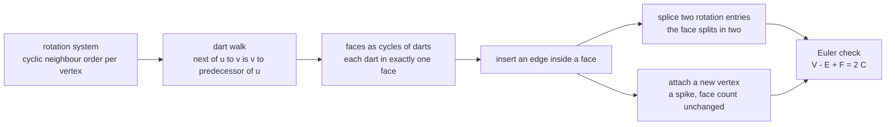
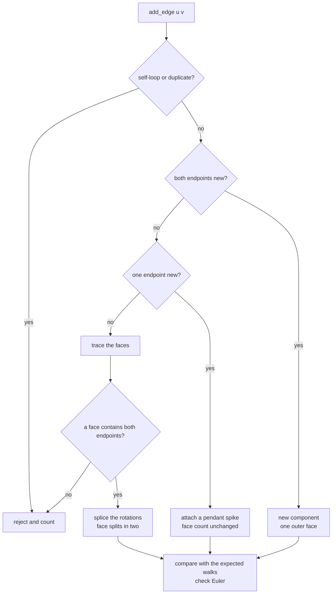
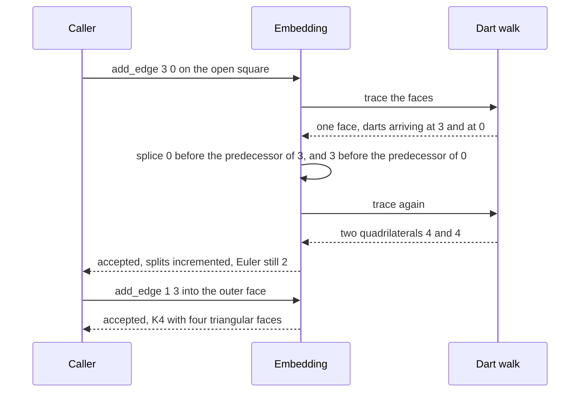

# 772 — Implement dynamic planar graph algorithms (face updates) outline

> **Tier:** Expert · **CTCI chapter:** Ch 4 — Trees and Graphs
> **Task spec:** [772-implement-dynamic-planar-graph-algorithms-face-updates-outline.md](../../../tasks/expert/772-implement-dynamic-planar-graph-algorithms-face-updates-outline.md)
> **Solutions:** [Python](../../../solutions/python/expert/772-implement-dynamic-planar-graph-algorithms-face-updates-outline/solution.py) ·
> [Java](../../../solutions/java/expert/772-implement-dynamic-planar-graph-algorithms-face-updates-outline/Solution.java) ·
> [JavaScript](../../../solutions/javascript/expert/772-implement-dynamic-planar-graph-algorithms-face-updates-outline/solution.js) ·
> [C#](../../../solutions/csharp/expert/772-implement-dynamic-planar-graph-algorithms-face-updates-outline/Solution.cs)

## 1. Problem restatement

Maintain the **faces** of a dynamically growing planar embedding. An edge can only be inserted when both
endpoints already lie on the boundary of one common face — then it can be drawn inside that face and
splits the face in two.

| Piece | Meaning |
| --- | --- |
| rotation system | `rot[u]` = the neighbours of `u` in cyclic (clockwise) order |
| dart | an oriented edge `(tail, head)`; every dart belongs to exactly one face |
| dart walk | `next(u -> v) = (v -> predecessor of u in rot[v])` — one face is one cycle of darts |
| `add_edge(u, v)` | rejects self-loops and duplicates; both endpoints fresh → a new component; one fresh → a *pendant spike*; both existing → locate a common face and split it |
| chord update | splice `v` into `rot[u]` immediately **before** `r` and `u` into `rot[v]` immediately before `z`, where `r`, `z` are the tails of the darts arriving at `u` and `v` along the face |
| Euler check | `V - E + F = 2C` (components `C`; isolated vertices are not tracked) |
| `triangulation_step()` | add one chord across any face with at least four sides |

Input: a sequence of `add_edge` calls (deterministic scripts plus `random.Random(20240607)` trials).
Output: the rotation system, the traced faces, and the update counters `splits`, `spikes`, `rejected`.

Concrete results asserted by the checks:

- An empty embedding has no darts and no faces; `add_edge(3, 3)` is rejected, the first edge is accepted,
  and a single edge has **one** face made of exactly **two** darts with `Euler = 2`.
- A chain of 6 edges has `spikes == 5`, `splits == 0` and `face_count() == 1`; a tree never splits a face.
- Closing the square splits one face into two quadrilaterals (`[4, 4]`); both diagonals then fit (K4), and
  K4 has 4 triangular faces, `E == 3V - 6 = 6` and `rejected == 1` from a duplicate.
- Triangulating a hexagon: `v = 6`, `e = 12`, `f = 8`, `splits = 7`, `spikes = 4`, **six** chords, every face
  a triangle, `E == 3V - 6` and `F == 2V - 4`.
- **K5 stops at 9 edges** (`3V - 6`), the remaining insertions are rejected, and the graph is fully
  triangulated with `F = 2V - 4 = 6`.
- Six random trials of 60 insertions over 9 vertices keep `Euler == 2 · components` after every accepted
  edge and match the expected face update each time.
- An edge between two components is rejected — it belongs to no common face.

## 2. Intuition

A planar embedding is not just which edges exist; it is *how they are drawn*. The compact way to store
that is the **rotation system**: for each vertex, the cyclic order of its neighbours. Everything else is
derived. The face-walk rule

`next(u -> v) = (v -> predecessor of u in rot[v])`

turns the rotation system into a dart permutation whose cycles are exactly the faces — so faces need no
separate storage and cannot silently disagree with the embedding. A face boundary is a cycle of darts, and
every dart belongs to exactly one face.

Inserting an edge inside a face is then a **local** rotation edit. If the face walk arrives at `u` from `r`
and at `v` from `z`, putting `v` immediately before `r` in `rot[u]` and `u` immediately before `z` in
`rot[v]` makes the walk rule carve the old cycle into exactly two: one boundary through the new dart
`(u -> v)` and the arc from `z` to `r`, the other through `(v -> u)` and the arc from `r` to `z`. The
solution computes those two expected walks at insertion time and compares them with the traced faces after
**every** edge — that is what makes this more than a picture.



What is documented as *simplified* (the task is an outline): faces are located by an `O(E)` walk instead of
a logarithmic point-location structure, the endpoints must be identified by the caller (no geometric
input), and an edge between two vertices that share no face is **rejected** rather than re-embedded, so the
embedding never changes during a step. What is **not** simplified: the rotation-system update and the face
split are real, and they are verified against the dart-walk tracer after every single edge, along with
Euler's formula, the maximal-planar counts `E = 3V - 6` and `F = 2V - 4`, triangularity, and the rejection
of a non-planar insertion.

## 3. Algorithm

1. **Reject early** — self-loops (`u == v`) and duplicates (the frozenset is already in `edges`).
2. **Both endpoints fresh** — create both rotation entries, add the edge, increment `components`, and clear
   `last_expected_faces` (a new component simply adds one outer face).
3. **Exactly one endpoint fresh** — `_attach_pendant(anchor, fresh)`: find the first face walk that arrives
   at the anchor from some `z`, insert `fresh` into `rot[anchor]` immediately before `z`, and record the
   expected walk with the two new darts spliced in. Face count is unchanged: the pendant edge is a *spike*.
4. **Both endpoints existing** — trace the faces, then for each walk find the index of a dart whose head is
   `u` and one whose head is `v`; the first face containing both is the split face.
5. **`_insert_chord`** — with `r = dart_u.tail`, `z = dart_v.tail`: insert `v` before `r` in `rot[u]` and
   `u` before `z` in `rot[v]`, add the edge, and build the two expected walks
   `[(u,v)] + arc(z..r)` and `[(v,u)] + arc(r..z)`; increment `splits`.
6. **No common face** — count a rejection and leave the embedding untouched (that is why `Euler` always
   holds after a failed insertion).
7. **`triangulation_step`** — take the first face with at least four darts and add a chord between two
   non-adjacent vertices of its walk.

```text
function trace_faces(rot)
    next_dart ← empty map
    for (u, v) in all darts in sorted order do
        ring ← rot[v]
        next_dart[(u, v)] ← (v, ring[index of u in ring - 1])
    faces ← empty list
    visited ← empty set
    for start in all darts in sorted order do
        if start in visited then continue
        walk ← empty list
        current ← start
        while current not in visited do
            add current to visited
            append current to walk
            current ← next_dart[current]
        append walk to faces
    return faces

function canonical(walk)
    return the lexicographically smallest rotation of the cyclic walk

procedure add_edge(u, v)
    if u = v then rejected ← rejected + 1, return false
    key ← unordered pair (u, v)
    if key in edges then rejected ← rejected + 1, return false
    if u and v are both new then
        rot[u] ← [v], rot[v] ← [u], add key to edges, components ← components + 1
        return true
    if exactly one of u and v is new then
        return attach_pendant(anchor = the existing one, fresh = the new one)
    walks ← trace_faces(rot)
    for face_index, walk in enumerate(walks) do
        index_u ← the index of a dart of walk whose head is u, if any
        index_v ← the index of a dart of walk whose head is v, if any
        if index_u is none or index_v is none then continue
        insert_chord(walks, face_index, index_u, index_v)
        return true
    rejected ← rejected + 1
    return false

procedure attach_pendant(anchor, fresh)
    walks ← trace_faces(rot)
    for face_index, walk in enumerate(walks) do
        for index, dart in enumerate(walk) do
            if dart.head = anchor then
                z ← dart.tail
                ring ← rot[anchor]
                insert fresh into ring immediately before z
                rot[fresh] ← [anchor]
                add the edge to edges
                expected ← walks with walk replaced by
                           walk[0 .. index] + [(anchor, fresh), (fresh, anchor)] + walk[index + 1 ..]
                last_expected_faces ← canonical set of expected
                spikes ← spikes + 1
                return true
    rejected ← rejected + 1
    return false

procedure insert_chord(walks, face_index, index_u, index_v)
    walk ← walks[face_index]
    r ← walks[face_index][index_u].tail, u ← walks[face_index][index_u].head
    z ← walks[face_index][index_v].tail, v ← walks[face_index][index_v].head
    insert v into rot[u] immediately before r
    insert u into rot[v] immediately before z
    add the edge (u, v) to edges
    arc_v_to_u ← the cyclic arc of walk from index_v to index_u
    arc_u_to_v ← the cyclic arc of walk from index_u to index_v
    expected ← walks with walk replaced by [(u, v)] + arc_v_to_u without its first dart,
               and [(v, u)] + arc_u_to_v without its first dart appended
    last_expected_faces ← canonical set of expected
    splits ← splits + 1

function triangulation_step()
    walks ← trace_faces(rot)
    for face_index, walk in enumerate(walks) do
        if length(walk) < 4 then continue
        for i in range(length(walk)) do
            for j in range(i + 2, length(walk)) do
                u, v ← heads of walk[i] and walk[j]
                if u = v or the pair is already an edge then continue
                insert_chord(walks, face_index, i, j)
                return (u, v)
    return none
```



## 4. Worked example

Building the chain `0-1, 1-2, … , 5-6` gives `spikes == 5`, `splits == 0`, `face_count() == 1` and
`Euler == 2` after every step — a tree keeps a single face, which is the degenerate case that catches a
wrong "every edge splits" assumption.

The square and its diagonals, where the counters change:

| Step | Edge | Faces | `splits` | Layout |
| --- | --- | --- | --- | --- |
| 1–3 | `0-1, 1-2, 2-3` | 1 | 0 | open path, one face of 8 darts |
| 4 | `3-0` | **2** | 1 | the cycle closes: faces `[4, 4]` |
| 5 | `0-2` | **3** | 2 | diagonal splits one quadrilateral: faces `[3, 3, 4]` |
| 6 | `1-3` | **4** | 3 | the second diagonal goes into the *outer* face (K4): faces `[3, 3, 3, 3]` |

`E == 3V - 6 = 6` for K4, so the single duplicate insertion is rejected and `rejected == 1`.




## 5. Complexity

Let `V`, `E`, `F` be the current counts and `C` the number of tracked components.

| Operation | Best | Average | Worst | Why the bound holds |
| --- | --- | --- | --- | --- |
| `darts` | O(E) | O(E) | O(E) | two darts per edge, enumerated in sorted order |
| `trace_faces` | O(E) | O(E) | O(E) | each dart is visited once; `rot.index` costs O(deg) per dart |
| `add_edge` (fresh/fresh) | O(1) | O(1) | O(1) | two dictionary inserts |
| `add_edge` (pendant) | O(1) | O(E) | O(E) | needs the faces to find a boundary dart at the anchor |
| `add_edge` (chord) | O(E) | O(E + F) | O(E + F · deg) | face location by walk, then two list splices |
| Space | O(V + E) | O(V + E) | O(V + E) | the rotation system plus the edge set |

## 6. Pitfalls and edge cases

- **Self-loops are rejected**, and so are duplicates; both increment `rejected`, and the embedding is left
  untouched so `Euler` still holds afterwards.
- **The first edge of a component is not a split.** It creates a component and one face with exactly two
  darts; `last_expected_faces` is cleared because a new outer face is added outside the previous
  bookkeeping.
- **A tree never splits a face.** On the 6-edge chain, `splits == 0` and `spikes == 5` — a pendant edge
  adds two darts *inside* an existing face walk and leaves the face count at 1.
- **Closing a face is a split.** The fourth square edge turns one 8-dart face walk into two 4-dart walks;
  the check compares the canonicalised walks with the expected pair, not just the counts.
- **The second diagonal of K4 fits.** After `0-2` the faces are `[3, 3, 4]`; `1-3` goes into the outer
  quadrilateral and yields four triangles — a naive "the graph already has a diagonal" test would reject it.
- **Only maximal planar graphs saturate the bounds.** K4 reaches `E = 3V - 6 = 6`; the hexagon
  triangulation reaches `E = 12` and `F = 2V - 4 = 8` with **six** chords.
- **Non-planarity stops the algorithm.** K5 accepts exactly 9 edges and every further pair is refused; no
  explicit planarity test is needed, because an edge whose endpoints share no face cannot be drawn.
- **An edge across components is refused** even though it is planar in the abstract: the two components
  have no common face in the tracked embedding. After the rejection `edge_count()` still 2.
- **Euler's formula is `V - E + F = 2C`**, not `2`. Two disjoint edges give `Euler == 4`, and the random
  trials assert `Euler == 2 · components` after every accepted insertion.
- **Face walks must chain correctly.** For every face and every dart, `dart.head == next dart's tail`, and
  no face may contain a self-loop — checked on all random-trial faces.
- **Isolated vertices are not tracked**, so `vertices()` only lists vertices with at least one edge, which
  is what keeps Euler's formula clean.
- **Determinism**: two embeddings fed the same edges have identical `rot` dictionaries and identical
  canonical face sets.

## 7. Variants and follow-ups

- **Replace the `O(E)` face walk** with a point-location structure (or a face handle passed by the caller)
  to get logarithmic updates; the rotation splice itself does not change.
- **Dynamic connectivity without the embedding** — the sibling approach for the same "can I add this edge"
  question — is [703 — dynamic graph connectivity with link-cut trees](../../../tasks/expert/703-implement-dynamic-graph-connectivity-with-link-cut-trees-in-prac.md)
  and [704 — offline dynamic connectivity with divide and conquer and rollback](../../../tasks/expert/704-implement-offline-dynamic-connectivity-with-divide-conquer-uf-ro.md).
- **Deletions** are the hard direction: removing a chord merges two faces, which requires the rotation
  splice to be undone and the merged walk rebuilt.
- **Geometric embeddings** that supply the cyclic order from coordinates are built on constrained
  triangulations — see
  [743 — constrained Delaunay triangulation outline](../../../tasks/expert/743-implement-constrained-delaunay-triangulation-outline.md)
  and the robust predicates of
  [745 — robust predicates for computational geometry](../../../tasks/expert/745-implement-robust-predicates-for-computational-geometry-exact-ari.md).
- **Dynamic convex hull maintenance** uses the same "local structure, global invariant" idea for a
  different combinatorial structure — see
  [735 — advanced geometric data structures: dynamic convex hull](../../../tasks/expert/735-implement-advanced-geometric-data-structures-dynamic-convex-hull.md).

## 8. Check yourself

<details><summary>Show answer</summary>

**Q1.** Why does the algorithm need no explicit planarity test?

Because an embedding is maintained, not a graph: an edge can only be added inside one face. If the two
endpoints share no face, no placement exists in the current embedding, and the insertion is refused. For K5
that happens exactly after 9 edges, which is the `3V - 6` bound for `V = 5`.

</details>

<details><summary>Show answer</summary>

**Q2.** Why must `v` be spliced immediately *before* `r` in the rotation of `u`?

Because the dart walk goes to `(v -> predecessor of u in rot[v])` when leaving `u -> v`. Placing `v` right
before `r` (the neighbour the face arrived from) makes the walk from the new dart continue along the old
face boundary, so the old cycle becomes exactly the two cycles the code computes as `F1` and `F2`. Any other
position would put the new edge in a different face.

</details>

<details><summary>Show answer</summary>

**Q3.** A pendant edge adds an edge but not a face. How can that be, given `V - E + F = 2C`?

The new vertex also raises `V` by one, so `V` and `E` both increase by 1 and `F` stays constant: the two new
darts appear twice in the *same* face walk, so the walk gets longer (a spike) rather than splitting. The
resulting walk is the expected one spliced in at the attachment point, which the checks compare after each
pendant step — 5 spikes on the 6-edge chain and no splits.

</details>

<details><summary>Show answer</summary>

**Q4.** After adding `0-2` to the square, the faces are `[3, 3, 4]`. Why does `1-3` still fit?

Because the outer face is still a quadrilateral (4 darts): the first diagonal split the *inner* face, leaving
the outer boundary intact with four sides. Adding `1-3` there splits the outer face into two triangles, which
is why K4 ends up with four triangular faces and `E = 6 = 3V - 6`.

</details>