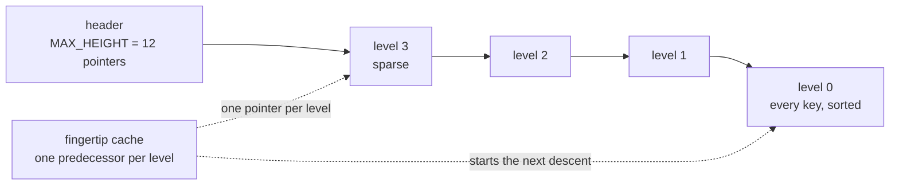
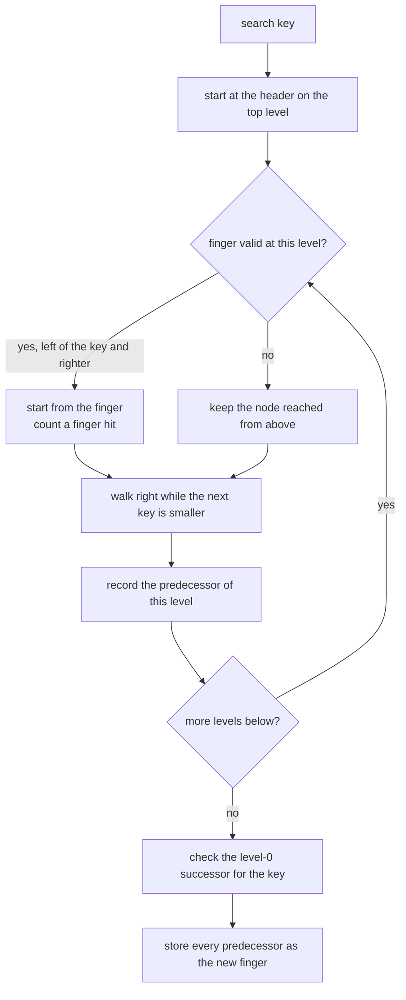
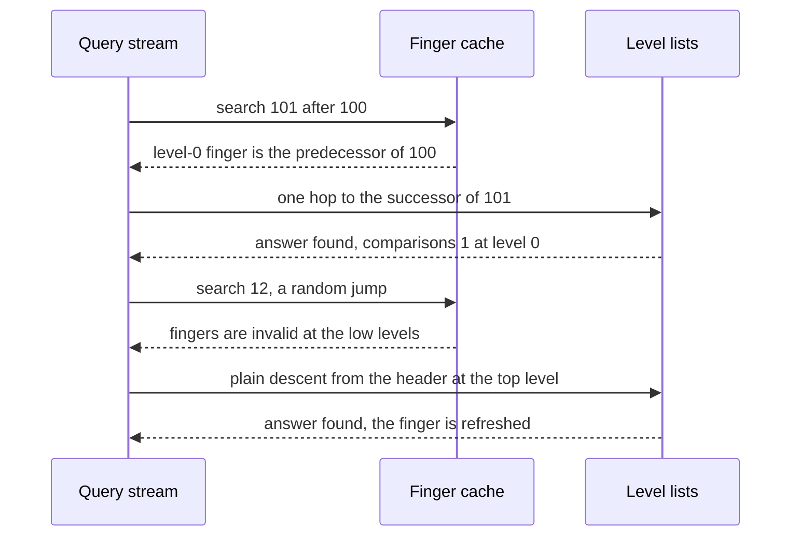
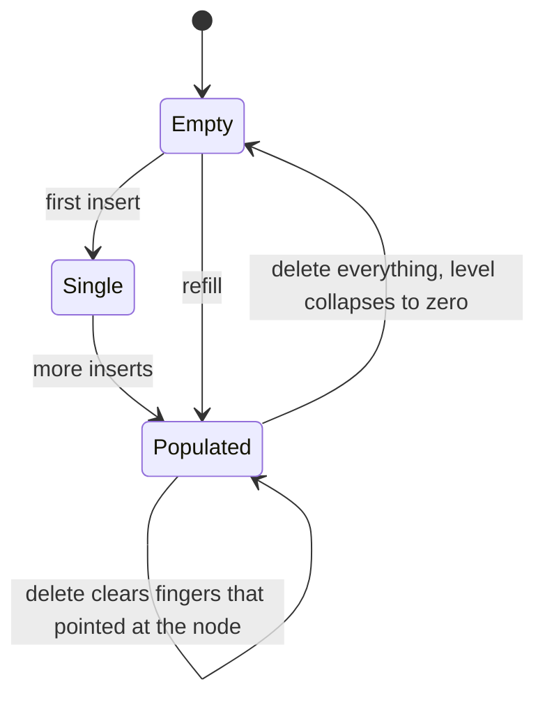

# 773 — Implement self-adjusting skip lists with locality heuristics

> **Tier:** Expert · **CTCI chapter:** Beyond — Advanced Data Structures & Algorithms
> **Task spec:** [773-implement-self-adjusting-skip-lists-with-locality-heuristics.md](../../../tasks/expert/773-implement-self-adjusting-skip-lists-with-locality-heuristics.md)
> **Solutions:** [Python](../../../solutions/python/expert/773-implement-self-adjusting-skip-lists-with-locality-heuristics/solution.py) ·
> [Java](../../../solutions/java/expert/773-implement-self-adjusting-skip-lists-with-locality-heuristics/Solution.java) ·
> [JavaScript](../../../solutions/javascript/expert/773-implement-self-adjusting-skip-lists-with-locality-heuristics/solution.js) ·
> [C#](../../../solutions/csharp/expert/773-implement-self-adjusting-skip-lists-with-locality-heuristics/Solution.cs)

## 1. Problem restatement

A skip list is a stack of sorted linked lists: a node has height `h`, participates in levels `0..h-1`, and
every level is a sorted subsequence of the level below. Here the height comes from a **hash of the key** —
`h = 1 + (number of trailing one bits)`, so `P(h > k) = 2^-k` — which makes two differently tuned skip lists
structurally identical and therefore directly comparable.

The self-adjusting part is a **fingertip cache**: after every descent the list remembers, per level, the
right-most node visited on that level (the predecessor of the searched key), and the next descent starts each
level from the better of two positions — the node reached from the level above, or the remembered finger.

| API | Behaviour |
| --- | --- |
| `search(key)` | value or `None`; increments the node's access count |
| `insert(key, value)` | insert or update; returns `True` only when the key is new |
| `delete(key)` | removes the key and returns whether it was present; **clears any finger pointing at it** |
| `keys_at(level)` | the keys on one level, in order |
| `check_invariants(expected)` | sortedness, subsequence nesting, `height` vs actual appearances, `size` vs level-0 length, and equality with a dict oracle |
| counters | `comparisons`, `finger_hits`, `searches`, `size`, `level` |

Concrete measurements, straight from the solutions' printed summary:

- Skewed, locality-free Zipf stream (6000 queries over 200 keys): plain descent **73328** comparisons,
  fingertip cache **71599** with **1533** finger hits — no regression, as required.
- Neighbourhood (range-scan) stream (6000 queries, radius 3, 22% random): plain **91981**, fingertip
  **65148** — a **29%** saving, against a required `<= 0.85 ×` the plain cost.
- Repeated access to one hot key: **9.00** comparisons per access warm against **17.00** cold, with the
  structure at `level == 8`.
- 300 interleaved random inserts/deletes over 60 keys agree with a dict oracle after every mutation, and no
  finger ever points at a deleted node.
- The height is insertion-order independent: building `0..99` forwards and backwards gives the same `level`
  and identical top-level keys.

## 2. Intuition

A skip list is fast on average but *rigid*: the search path depends only on the keys, so every query pays the
same expected `O(log n)`. Real workloads are not uniform — range scans walk keys in order, hot keys are asked
repeatedly — so a cache that remembers where the last descent ended can start the next one much closer.

The obstacle is that a sorted structure may **not** reorder its nodes: move-to-front and transposition, the
classic self-organising rules, would destroy the ordering that makes skipping possible. The honest analogue
is therefore a **finger**: a pointer per level to the predecessor of the last answer. Two effects fall out:

1. **Key-space locality.** If the next key is near the previous one, the level-0 finger is already just left of
   it, so the walk is a couple of hops instead of a full descent — measured as 65148 against 91981.
2. **Temporal locality.** A repeated access finds the level-0 finger immediately before the previous answer, so
   the second and later searches are nearly free at the bottom level — measured as 9.00 against 17.00
   comparisons per access.

The cache is used only when it is *valid*: the finger must still lie strictly left of the query key and be
righter than the current node. That single condition is what keeps correctness — a stale finger can only cost
comparisons, never a wrong answer.



Documented simplifications: **single-threaded**, no demotion or aging of statistics, and the cache holds one
pointer per level (`O(log n)` memory). A bias-based alternative was implemented and measured too — "re-assign
every height from the access counts" — and it *inflates* the level lists over the hot prefix and costs more
comparisons on these workloads, so it is not used and that negative result is reported rather than hidden.

## 3. Algorithm

1. **Height** — `height_of(key)` hashes the key with `splitmix64`, shifts off one bit, and counts trailing
   one bits up to `MAX_HEIGHT = 12`.
2. **Descent (`_search`)** — from `level` down to 0: if the fingertip cache is enabled and the stored finger
   at this level exists, still lies within its own height, is strictly less than the key, and is to the right
   of the node reached from above, start from the finger and count a finger hit. Then walk while
   `node.nxt[level].key < key`, recording `node` as `predecessors[level]`.
3. **Cache update** — after the descent, store each `predecessors[level]` as the new finger, or `None` when it
   is the header (a header finger is useless).
4. **Insert** — plain descent, check whether the level-0 successor already has the key (then it is an update),
   otherwise splice the new node into every level below its height, raise `level` if needed, and bump `size`.
5. **Delete** — plain descent, unlink the target from all its levels, decrement `size`, shrink `level` while the
   header's top pointer is `None`, and **clear every finger that pointed at the removed node**.
6. **Invariant check** — level 0 sorted and of length `size`; every higher level sorted and a subset of level 0;
   nothing above `level`; the number of levels a node appears on equals its `height`; level 0 equals the
   oracle's sorted key list.

```text
function height_of(key)
    bits ← hash_key(key) shifted right by one
    height ← 1
    while height < MAX_HEIGHT and bits is odd do
        bits ← bits shifted right by one
        height ← height + 1
    return height

function search(key)
    predecessors, node ← descend(key)
    if node is not none and node.key = key then
        node.count ← node.count + 1
        return node.value
    return none

function descend(key)
    predecessors ← array of MAX_HEIGHT entries initialised to the header
    node ← header
    for level from current level down to 0 do
        if finger_search then
            finger ← fingers[level]
            if finger is not none and level < finger.height and key > finger.key
                    and (node is the header or node.key < finger.key) then
                node ← finger
                finger_hits ← finger_hits + 1
        while node.nxt[level] is not none do
            comparisons ← comparisons + 1
            if node.nxt[level].key < key then
                node ← node.nxt[level]
            else
                break
        predecessors[level] ← node
    if finger_search then
        for level from 0 to current level do
            fingers[level] ← none if predecessors[level] is the header else predecessors[level]
    return predecessors, node

function insert(key, value)
    predecessors, node ← plain descent for key
    candidate ← node.nxt[0]
    if candidate is not none and candidate.key = key then
        candidate.value ← value
        return false
    height ← height_of(key)
    fresh ← new node with the key, the value and the height
    for level from 0 to height - 1 do
        fresh.nxt[level] ← predecessors[level].nxt[level]
        predecessors[level].nxt[level] ← fresh
    if height - 1 > current level then current level ← height - 1
    size ← size + 1
    return true

function delete(key)
    predecessors, node ← plain descent for key
    target ← node.nxt[0]
    if target is none or target.key ≠ key then return false
    for level from 0 to target.height - 1 do
        predecessors[level].nxt[level] ← target.nxt[level]
    size ← size - 1
    while current level > 0 and header.nxt[current level] is none do
        current level ← current level - 1
    for level from 0 to MAX_HEIGHT - 1 do
        if fingers[level] is target then fingers[level] ← none
    return true
```



## 4. Worked example

Structural invariants after every mutation (300 random operations over 60 keys):

| Invariant | Check |
| --- | --- |
| level 0 sorted, length `size` | `level_zero == sorted(level_zero)` and `len == size` |
| level `L+1` is a subsequence of level `L` | `set(keys_at(L+1)) <= set(keys_at(L))`, both sorted |
| nothing above the top level | `header.nxt[level] is None` for `level > self.level` |
| node height equals its appearances | counted across all levels and compared with `node.height` |
| oracle agreement | level 0 equals `sorted(oracle.keys())` |
| finger safety | every finger is `None` or points at a key still in the oracle |

Why the Zipf stream barely improves: it is skewed but **locality free** — consecutive queries jump across the
key range, so the finger is usually invalid and the descent falls back to the plain path. That is exactly the
control case the check needs: a heuristic that helped everywhere would be suspicious.

Fingertip trace on the neighbourhood stream (keys `0..199`, `level == 8`):

| Query | Level-0 finger before | Finger valid? | Level-0 walking |
| --- | --- | --- | --- |
| 100 (first) | none | no | full descent, finger set to the predecessor of 100 |
| 101 | predecessor of 100 | yes | one hop — a finger hit and one comparison |
| 104 | predecessor of 101 | yes | three hops |
| 103 | predecessor of 104 | **no** (finger is right of the key) | restart from the arrival node at that level |
| 12 (random jump) | predecessor of 103 | yes at the top levels only | the low-level finger is far left, so the walk is longer |





## 5. Complexity

Let `n` be the number of keys, `L` the current top level and `h` a node's height.

| Operation | Best | Average | Worst | Why the bound holds |
| --- | --- | --- | --- | --- |
| `height_of` | O(1) | O(1) | O(MAX_HEIGHT) | trailing-one-bit count, capped at 12 |
| `search` | O(1) | O(log n) warm, O(log n) cold | O(n) | descent plus one comparison of the successor's key |
| `insert` | O(1) | O(log n + h) | O(n) | one descent plus `h` splices |
| `delete` | O(1) | O(log n + h) | O(n) | one descent plus `h` unlinks plus the finger scan over `MAX_HEIGHT` |
| `keys_at` | O(1) | O(n) | O(n) | walk one level from the header |
| `check_invariants` | O(n L) | O(n L) | O(n L) | visits every level and every node once |
| Space | O(n) | O(n) | O(n) | each node stores `h` pointers, `E[h] = 2` |
| Cache | O(1) | O(log n) | O(MAX_HEIGHT) | exactly one pointer per level |

## 6. Pitfalls and edge cases

- **A finger must be *strictly* left of the key.** The validity test is `key > finger.key`, so an exact hit
  starts from the arrival node instead; otherwise the walk could skip the answer.
- **A finger must not be left of the arrival node.** `node is the header or node.key < finger.key` keeps the
  start monotone — using a finger that is behind the current position would be a wasted restart.
- **Duplicate insert updates, it does not add.** `insert(7, 70)` then `insert(7, 99)` returns `False` the second
  time and `search(7) == 99`, with `size == 1`.
- **Empty and single-key lists.** Every query misses, every delete fails, and invariants hold with an empty
  expected list.
- **Insertion order must not matter.** `build(list(range(100)))` and `build(reversed(...))` give the same
  `level` and identical top-level keys, because heights come from the key hash.
- **The biased-skip-list alternative is a documented negative result.** Re-assigning heights from access counts
  inflates the level lists over the hot prefix and costs more comparisons on these workloads; reporting that is
  part of the task, not an omission.
- **Determinism.** Two adaptive lists fed the same 400 queries have identical `comparisons` and identical
  finger keys.

## 7. Variants and follow-ups

- **A cached finger for range scans** is the natural extension: keep the last returned node and iterate from it,
  which is what the neighbourhood workload simulates.
- **Concurrent skip lists** need the same "no reordering" property plus atomic splices — the concurrent
  B-tree task [774 — concurrent B-tree with latch-free readers](../../../tasks/expert/774-implement-concurrent-b-tree-with-latch-free-readers-reader-write.md)
  walks the same design space for a different node layout.
- **The plain skip list** (insert/search/delete without the cache) is
  [251 — skip list insert/search/delete](../../../tasks/intermediate/251-implement-skip-list-insert-search-delete.md).
- **Learned or biased heights** as an alternative to finger caching: the measured negative result here is a
  useful warning, and the learned-index idea appears in
  [895 — learned index replacement for B-tree with fallback correctness checks](../../../tasks/master/895-implement-learned-index-replacement-for-b-tree-with-fallback-cor.md).
- **Succinct alternatives to pointers** for the same "sorted set with levels" role are the dynamic succinct
  trees of [610 — succinct tree representations (DFUDS)](../../../tasks/expert/610-implement-succinct-tree-representations-dfuds-and-navigation-ops.md).

## 8. Check yourself

<details><summary>Show answer</summary>

**Q1.** Why is a fingertip cache the right adaptation for a sorted structure, and not move-to-front?

Because the ordering *is* the data structure: move-to-front or transposition would reorder keys and destroy the
level subsequences that make skipping work. A finger changes nothing about the order — it only remembers where
the last descent stopped, which is pure read-only information. Measured effect on a range-scan workload: 65148
comparisons against 91981.

</details>

<details><summary>Show answer</summary>

**Q2.** When is a stored finger *invalid*, and what happens then?

When it is `None` (no previous descent at that level), when it is not strictly left of the key
(`key > finger.key` fails), when its height does not cover the level, or when it is not righter than the node
reached from above. In all those cases the descent simply keeps the arrival node; the finger can only cost a
missed optimisation, never a wrong answer or an endless walk.

</details>

<details><summary>Show answer</summary>

**Q3.** The Zipf stream is skewed yet saves only 2.4%. Why is that the right result?

Because Zipf skew is a *frequency* property, not a locality one: consecutive requests jump between popular keys
scattered across the key range, so the finger is usually invalid. The check therefore only demands *no
regression* (`finger <= plain`) there, and reserves the strict 15% requirement for the neighbourhood stream,
which actually has key-space locality.

</details>

<details><summary>Show answer</summary>

**Q4.** What breaks if `delete` does not clear fingers, and how is it detected?

A finger would point at a node that has been unlinked, so `nxt` lookups through it would traverse a detached
chain — silently missing keys or looping. Detection is explicit: after the random trial every finger must be
`None` or point at a key still present in the dict oracle.

</details>

<details><summary>Show answer</summary>

**Q5.** The heights come from a hash of the key. What does that buy, and what does it cost?

It makes the structure **deterministic and insertion-order independent** — two lists built in opposite orders
have the same `level` and the same top-level keys — which is what allows a fair A/B comparison of the two
descent strategies on the same structure. The cost is that an adversary who knows the hash could craft keys
that all land on one level, degenerating the list; with the fixed `splitmix64` mixing used here, the trials show
`level == 8` for 200 keys, close to the expected `log2 200 ≈ 7.6`.

</details>