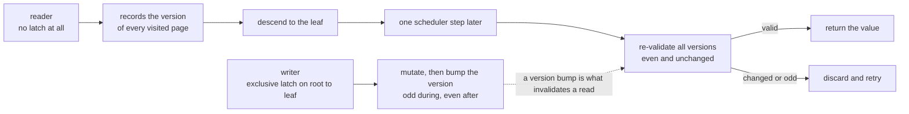
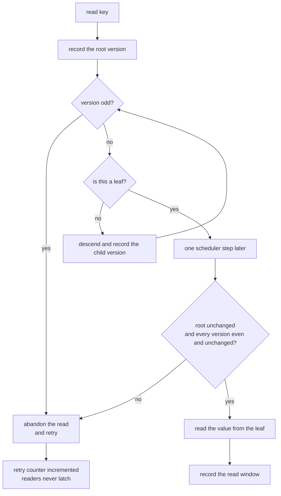
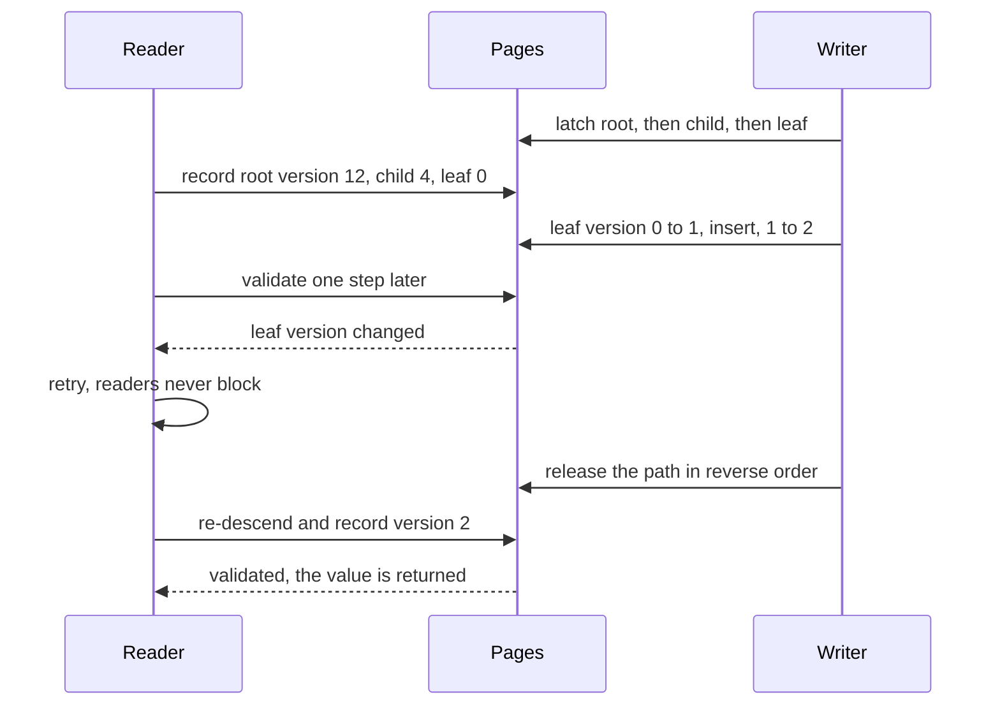

# 774 — Implement concurrent B-tree with latch-free readers (reader-writer locks)

> **Tier:** Expert · **CTCI chapter:** Ch 14 — Databases
> **Task spec:** [774-implement-concurrent-b-tree-with-latch-free-readers-reader-write.md](../../../tasks/expert/774-implement-concurrent-b-tree-with-latch-free-readers-reader-write.md)
> **Solutions:** [Python](../../../solutions/python/expert/774-implement-concurrent-b-tree-with-latch-free-readers-reader-write/solution.py) ·
> [Java](../../../solutions/java/expert/774-implement-concurrent-b-tree-with-latch-free-readers-reader-write/Solution.java) ·
> [JavaScript](../../../solutions/javascript/expert/774-implement-concurrent-b-tree-with-latch-free-readers-reader-write/solution.js) ·
> [C#](../../../solutions/csharp/expert/774-implement-concurrent-b-tree-with-latch-free-readers-reader-write/Solution.cs)

## 1. Problem restatement

Build a B-tree whose **readers take no latches at all** while writers serialize with reader-writer latches.
Every page carries a **version counter**: a writer increments it when its critical section opens (making it
odd), mutates, and increments again when the section closes (even again). A reader is optimistic — it records
the version of every page it visits while descending, then re-checks all recorded versions **a scheduler step
later**. If a version changed, or is odd, the read is discarded and retried.

| Component | Detail |
| --- | --- |
| `Page` | keys, children or values, `leaf`, `version`, `nxt` (the leaf chain for scans), `pid` |
| order | `MAX_KEYS = 3`, `MIN_KEYS = 1` — an order-4 B-tree |
| `LatchManager` | non-blocking `granted_exclusive` / `release`, plus the invariant that a page is never latched both ways |
| `BTree.put` / `insert_into` | single-threaded wrapper and the generator that yields mid-write so the scheduler can interleave |
| `_split_up` | splits every overflowing page on the latched path, growing a new root when level 0 splits |
| `check_structure` | sorted keys, even versions, occupancy `[1, 3]`, uniform depth, `children == keys + 1`, sorted leaf chain |

Concrete measurements from the solutions' output and assertions:

- Contended schedule (3 readers × 24 lookups, 2 writers × 24 keys): **4129** scheduler steps, **9** splits,
  **8** leaves, final **depth 3**, **71** reader retries, **3532** writer waits, **96** reads,
  **26** reads checked for linearizability, **24** keys, **71** stale versions observed, **0** odd versions.
- `reader_latch_calls == 0`: readers never acquire a latch, and the contended phase must force
  `contended_retries > 0` while the quiet pass afterwards must add **no** retries.
- Both rejection paths of the validator are checked directly: a read of a page with an **open write** is
  rejected, and a page **changed after the read** is rejected.
- The 24-key tree built by pure inserts keeps every key through **> 4** splits, and the simulated tree matches
  the writer oracle exactly.
- A contention-free schedule of 9 reads validates on the first attempt with **0** retries.

## 2. Intuition

The classic cost of a B-tree under concurrency is that readers must latch the pages they touch, so a writer
holding a page blocks every reader on the path. The optimistic alternative removes the read latch entirely and
buys correctness with a **version counter plus a delayed re-check**.

1. **Readers record and re-validate.** During the descent the reader stores `(page, version)` for every page it
   visits. Validation happens one scheduler step later, which is exactly the window in which a writer could
   have landed — so a torn read, a page mid-split or a moved child pointer all show up as a changed or odd
   version.
2. **Writers latch top-down.** A writer takes the root, then the child, then the grandchild; since every writer
   acquires in the same order, a latch cycle (hence a deadlock) is impossible. It holds the whole path until
   the upward splits are finished, which is why the root latch effectively serializes writers while readers
   keep running.
3. **A reader may repeat, never block.** The only failure mode is a retry, which is why the design is worth it:
   measured 71 retries against 3532 writer waits.



Documented simplifications: **one process with a scheduler** instead of threads or memory barriers, **no
deletion** (merging is out of scope), and **no B-link right-links** — a reader racing a split is caught by
re-validation. The latch protocol, the version-validated reads and the split logic are real.

## 3. Algorithm

**Writer path.**

1. `latch_path(key, holder)` — latch the root exclusively; if it was swapped or is busy, release and retry a
   step later. Then descend latching each child; on any failure release everything held, count a wait, retry.
2. `insert_into(path, key, value)` — update the value if the key is present, otherwise splice it in.
   `start_write` makes the version odd, the generator **yields** (mid-write, data already in place), then
   `end_write` makes it even again.
3. `_split_up(path)` — split every overflowing page on the path: a **leaf** keeps a copy of its median, so the
   separator is the *right* leaf's minimum and the leaves are linked through `nxt`; an **internal** page moves
   its median up. A level-0 split grows a fresh root, and each split yields so it is a multi-step change.
4. Release the path in reverse order and record the commit in the oracle and the timeline.

**Reader path.**

5. `lookup(key)` — record the root's version; if it is odd the read is doomed; otherwise descend recording
   `(page, version)` per level, yielding between levels.
6. One step later, validate: no odd version seen, the root is *still* the same object, every version unchanged
   and even. On success look the key up in the leaf and record `(key, value, start, end)`; otherwise retry.

```text
procedure insert(key, value)
    holder ← a fresh writer identity
    path ← latch_path(key, holder)
    step, yield
    yield from insert_into(path, key, value)
    step, yield
    release every page of path in reverse order
    oracle[key] ← value
    timeline[key].append((step, value))

function latch_path(key, holder)
    while true do
        page ← root
        if not granted_exclusive(page.pid, holder) or page is not root then
            release(page.pid, holder)
            writer_waits ← writer_waits + 1
            step, yield
            continue
        path ← [page]
        complete ← true
        while page is not a leaf do
            page ← child_of(page, key)
            if not granted_exclusive(page.pid, holder) then
                complete ← false
                break
            append page to path
        if complete then return path
        release every page of path
        writer_waits ← writer_waits + 1
        step, yield

procedure insert_into(path, key, value)
    leaf ← last page of path
    index ← first position with leaf.keys[index] >= key
    start_write(leaf)                      // version becomes odd
    if the key is already there then
        leaf.values[index] ← value
        yield
        end_write(leaf)
        return
    insert the key and value at index
    yield
    end_write(leaf)                        // version even again
    if leaf.keys length > MAX_KEYS then
        yield from split_up(path)

procedure split_up(path)
    level ← last index of path
    while level >= 0 and path[level].keys length > MAX_KEYS do
        page ← path[level]
        start_write(page)
        median_index ← length(page.keys) / 2
        right ← new page with the same leaf flag
        if page is a leaf then
            separator ← page.keys[median_index + 1]      // the right leaf keeps its minimum
            move keys and values after median_index to right
            keep the first median_index + 1 entries on the left
            link the leaf chain: right.nxt ← page.nxt, page.nxt ← right
        else
            separator ← page.keys[median_index]          // the median moves up
            move the keys after median_index and the children after it to right
        end_write(page), start_write(right), end_write(right)
        splits ← splits + 1
        if level = 0 then
            new_root ← new internal page
            start_write(new_root)
            new_root.keys ← [separator]
            new_root.children ← [page, right]
            end_write(new_root)
            root ← new_root
            return
        parent ← path[level - 1]
        start_write(parent)
        insert separator at the position of page in parent's children and right after it
        end_write(parent)
        level ← level - 1
        yield

function lookup(key)
    while true do
        step ← step + 1
        start ← step, versions ← empty list, page ← root, saw_odd ← false
        while true do
            append (page, page.version) to versions
            if page.version is odd then
                saw_odd ← true
                odd_versions_seen ← odd_versions_seen + 1
                break
            if page is a leaf then break
            page ← child_of(page, key)
            yield
        step ← step + 1
        yield                                  // writers may land here
        step ← step + 1
        end ← step
        valid ← not saw_odd and root is versions[0].page and versions_valid(versions)
        if page is a leaf and valid then
            return the value of key in page, recording (key, value, start, end)
        if not saw_odd then stale_versions_seen ← stale_versions_seen + 1
        reader_retries ← reader_retries + 1
        yield

function versions_valid(versions)
    return every recorded version is even and still equal to the page's current version
```




## 4. Worked example

The contended run in numbers (3 readers × 24 lookups, 2 writers × 24 keys, then 24 quiet reads):

| Quantity | Value | Quantity | Value |
| --- | --- | --- | --- |
| scheduler steps | 4129 | splits / leaves / depth | 9 / 8 / 3 |
| reader retries | 71 | writer waits | 3532 |
| reads / verified linearizable | 96 / 26 | keys in the final tree | 24 |
| stale versions | 71 | odd versions | 0 |

The order-4 split arithmetic: a leaf split at `[1,2,3,4]` sends `keys[3] = 4` up as the separator and keeps
`[1,2,3]` on the left with a copy of `4` in the right leaf; an internal split sends `keys[2] = 3` up, leaving
`[1,2]` with three children on the left and `[4]` with two on the right.

The retry path, traced on a reader that is invalidation-hit rather than torn: it records `(root, 12)` and
descends; a writer latches the path and bumps the leaf `0 → 1`, then `1 → 2`; the reader validates one step
later, finds a changed version, counts a stale version and retries; the second attempt records `(leaf, 2)` and
returns the value.

Note the honest detail in the measurements: in this schedule `odd_versions_seen == 0` — readers never
descended onto a page while its write was open — and all 71 retries came from stale versions. Both paths are
therefore also tested directly with a `probe` tree that starts a write and validates a read set by hand.



## 5. Complexity

Let `n` be the number of keys, `h` the tree height, `P` the number of pages and `R` the number of reads.

| Operation | Best | Average | Worst | Why the bound holds |
| --- | --- | --- | --- | --- |
| reader descent | O(1) | O(h) | O(h) | one page per level, no latching and no waiting |
| writer `latch_path` | O(h) | O(h) | O(h + waits) | one latch attempt per level; a busy child forces a full release and retry |
| `_split_up` | O(1) | O(h) | O(h) | splits cascade upward, each creating one page and inserting into the parent |
| Space | O(n) | O(n) | O(n) | pages hold at most 3 keys, so `P = O(n / MIN_KEYS)` |

Comparison of the reader/writer protocols: the classic latch-coupling protocol latches every page on the
descent (readers block each other and writers); this task takes no reader latch and re-validates; a B-link tree
instead chases right-links and may read a stale link, re-descending; and without latches a single writer would
simply exclude readers.

## 6. Pitfalls and edge cases

- **The delayed validation is the whole trick.** Without the intervening scheduler step, a reader would
  validate a set of versions it never gave a writer the chance to change — the check `stale_versions_seen > 0`
  proves the window is real. A reader that arrives *mid-write* is rejected immediately by the odd version;
  both paths exist and are unit-tested with the `probe` tree.
- **The root can be swapped under a reader.** Validation compares the *root object identity*, not only the
  version: after a root split the reader must restart even if the old page is untouched, and a writer that
  finds the root changed releases its attempt instead of retrying with a stale path.
- **Writers latch top-down**, which is what rules out deadlock; the budget check
  (`step > 20000` → "possible deadlock or livelock") turns a broken protocol into a loud failure, and a writer
  that fails mid-path releases everything it had latched before retrying.
- **Split arithmetic differs for leaves and internal pages.** A leaf keeps a copy of its median and the
  separator is the *right* leaf's minimum; an internal page moves the median up. Using the leaf rule on an
  internal page (or the reverse) would break the order invariant, and the checks assert page keys are sorted
  and `children == keys + 1`.
- **Occupancy bounds.** Every non-root page keeps `MIN_KEYS = 1` to `MAX_KEYS = 3` keys (the root is exempt),
  and `check_structure` requires all leaves at exactly one depth — the invariant a botched split breaks first.
- **Linearizability as a data check.** Every validated read must have returned a value the key really held at
  some moment in the read window, using the writer timeline; 26 reads were checked this way, and a read before
  the first commit must return `None`.
## 7. Variants and follow-ups

- **Speculative inserts and conflict resolution** push the same optimistic idea into the writer path — see
  [775 — speculative B-tree inserts with conflict resolution](../../../tasks/expert/775-implement-speculative-b-tree-inserts-with-conflict-resolution.md).
- **Optimistic rebalancing** replaces the top-down latch-and-hold protocol with a restart-on-conflict
  strategy: [776 — optimistic B-tree rebalancing algorithm sketch](../../../tasks/expert/776-implement-optimistic-b-tree-rebalancing-algorithm-sketch.md).
- **Copy-on-write pages** give readers a stable snapshot without versions at all — see
  [806 — fully persistent B-tree with copy-on-write pages and concurrency](../../../tasks/master/806-implement-fully-persistent-b-tree-with-copy-on-write-pages-and-c.md).
- **Deletion and merging** are deliberately out of scope; they are the hard case, because two pages must be
  latched at once and the leaf chain must be re-linked.

## 8. Check yourself

<details><summary>Show answer</summary>

**Q1.** Why can a reader afford to take no latch at all?

Because it does not trust what it read: it records the version of every page it visits and validates the whole
set a scheduler step later. A writer that touched any of those pages — or that is still inside its critical
section, which shows as an odd version — invalidates the read, and the reader simply starts over: measured
71 retries against 3532 writer waits.

</details>

<details><summary>Show answer</summary>

**Q2.** Why must validation happen *later* rather than immediately after the descent?

Because a window is needed for the writer to land. Validating instantly could record versions, validate them,
and only then have the leaf mutated — the read would be accepted although the value was already stale. The
one-step delay makes every interfering write observable, and `stale_versions_seen > 0` proves the window is
exercised.

</details>

<details><summary>Show answer</summary>

**Q3.** A leaf split and an internal split differ — how?

A leaf keeps a **copy** of the median in the left page, and the separator promoted to the parent is the *right*
leaf's minimum, because the key must stay searchable at the leaf level. An internal page **moves** the median up
and out, splitting keys around it. The checks assert sorted keys, `children == keys + 1` and a sorted leaf
chain, which all detect a mix-up.

</details>