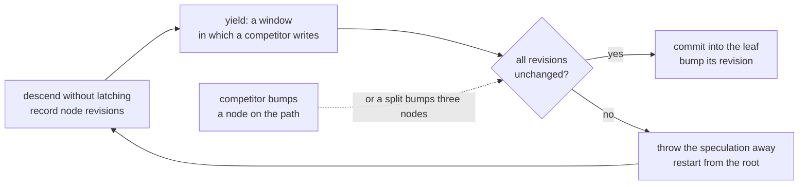
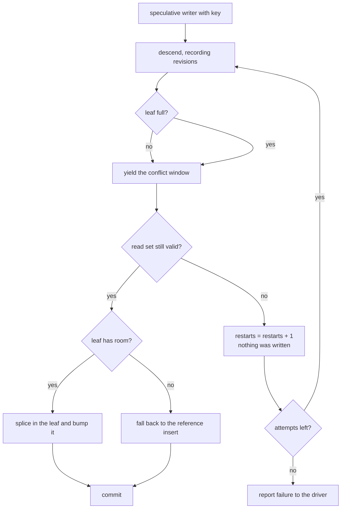
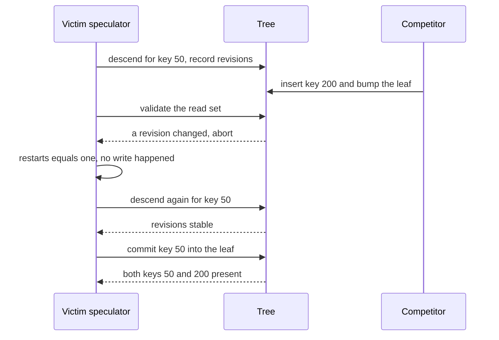
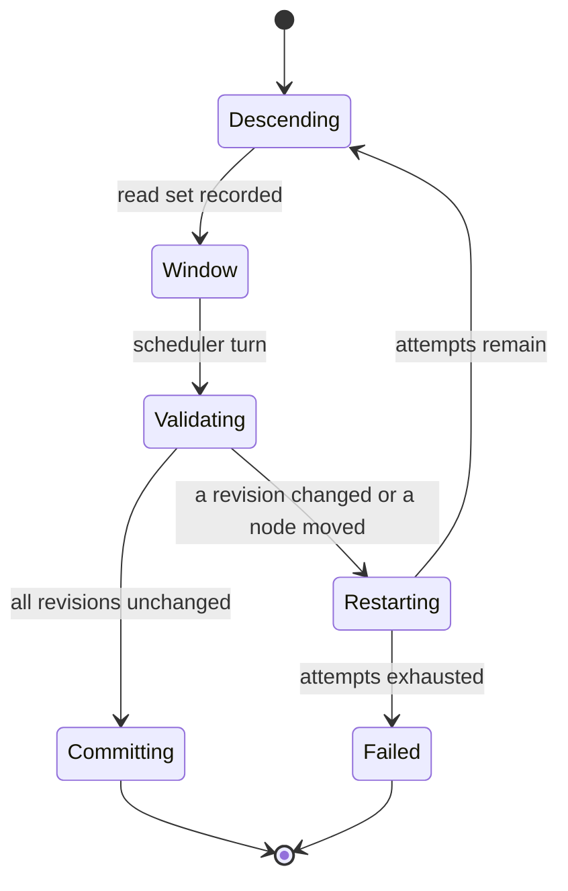

# 775 — Implement speculative B-tree inserts with conflict resolution

> **Tier:** Expert · **CTCI chapter:** Ch 14 — Databases
> **Task spec:** [775-implement-speculative-b-tree-inserts-with-conflict-resolution.md](../../../tasks/expert/775-implement-speculative-b-tree-inserts-with-conflict-resolution.md)
> **Solutions:** [Python](../../../solutions/python/expert/775-implement-speculative-b-tree-inserts-with-conflict-resolution/solution.py) ·
> [Java](../../../solutions/java/expert/775-implement-speculative-b-tree-inserts-with-conflict-resolution/Solution.java) ·
> [JavaScript](../../../solutions/javascript/expert/775-implement-speculative-b-tree-inserts-with-conflict-resolution/solution.js) ·
> [C#](../../../solutions/csharp/expert/775-implement-speculative-b-tree-inserts-with-conflict-resolution/Solution.cs)

## 1. Problem restatement

**Speculative insertion**: a writer latches **nothing** while it looks for the leaf that should receive its
key. It descends optimistically collecting a read set of `(node, revision)` pairs and validates that set only
when it reaches the leaf. If every revision is unchanged the guess is still true and the insertion applies
(with a preemptive split when the leaf is full); otherwise — a concurrent writer moved a key, split a node or
turned a leaf into an internal node — the speculation is **thrown away and restarted from the root**.

| Component | Detail |
| --- | --- |
| page limits | `MAX_KEYS = 5`, `MIN_KEYS = 2` |
| `BTree.insert` | the reference path: preemptive splits on the way down, returns whether the key is new |
| `SpeculativeWriter.speculate` | a generator: descend, `yield` a window, validate, commit or restart (at most `max_attempts = 8` attempts) |
| `_valid` | every recorded revision still matches |
| `snapshot()` | SHA-256 digest of `(nid, leaf, keys, revision)` over the whole tree, used to prove an abort changed nothing |
| `structure_ok()` | sorted unique keys per node, occupancy `[2, 5]`, `children == keys + 1`, all leaves at one depth |
| `contended_run` | round-robin scheduler over speculative writers plus competing writers |

Concrete measurements, printed and asserted:

- Contended run (8 seed keys, 4 speculative writers, 2 competitors): final **12** keys, **11** restarts,
  **3** splits, `depth == 2`.
- Uncontended speculation commits on the first attempt: **0** restarts; the aborted victim restarts exactly
  **once**.
- An aborted speculation leaves the tree **byte-identical** (`snapshot()` unchanged) and the key unwritten
  (`find(50) is None`), and the retried attempt still commits.
- The validator rejects a bumped revision and accepts a fresh read set.
- The speculative path and the plain path produce the **same items and the same snapshot**.
- Restart counts and results reproduce exactly on a second run of the same schedule.

## 2. Intuition

The classic write path latches root, child, grandchild on the way down, which blocks readers and other
writers on the same path. Speculation inverts the order of operations: **guess first, verify later**.

1. **Descend without latching**, recording the revision of every node visited. This is only a *guess* about
   which leaf owns the key, but it costs no exclusive access.
2. **Validate after a window.** The scheduler inserts a step in which a competitor may write. If nothing
   changed, the descent is still true by construction, and the mutation is applied to the leaf — bumping its
   revision so other speculators notice.
3. **Discard, do not repair.** A failed speculation has **no side effects at all**: nothing was written yet.
   The check proves that by digesting the whole structural state before and after the abort and requiring the
   same digest — a claim that is easy to make and hard to fake.
4. **Conflicts are expected, not exceptional.** With four speculators and a competitor hammering the same
   neighbourhood, the run records 11 restarts — and still ends with the same 12 keys as a dict oracle.



Documented simplifications: **one process with a deterministic scheduler** (no threads, no memory barriers —
revisions are plain counters), a speculator holds **no latch at all**, and a stale speculation is resolved
only by **restarting** (no helping or commit-wait protocol is modelled).

## 3. Algorithm

**Reference insert (`BTree.insert`).**

1. If the root holds `MAX_KEYS` keys, create a new root over it and split the old root.
2. Descend: at each internal node pick the child by `key >= keys[index]`; if that child is **full**, split it
   first and re-check the index. Insert or overwrite in the leaf and bump its revision.

**Split (`split_child`).**

3. Create the right sibling; for a **leaf**, the separator is `keys[MAX_KEYS // 2 + 1]` and the left leaf keeps
   a copy of the median; for an **internal** node the separator is `keys[MAX_KEYS // 2]` and it moves up.
   Insert the separator into the parent and bump parent, child and right.

**Speculative insert (`SpeculativeWriter.speculate`).**

4. `_descend` walks from the root to the leaf, appending `(node, node.revision)` at every step, and returns the
   leaf plus the insertion index.
5. **Yield** — this is the conflict window; an optional `interleave()` hook runs a competing write inside it.
6. `_valid(read_set)` checks every revision; if valid, `_commit` either inserts/overwrites in the leaf
   (bumping it) or, when the leaf is full, calls the reference `insert` because the stale guess cannot be
   repaired in place.
7. If invalid, increment `restarts` and try again, up to `max_attempts = 8`; the driver `drive` asserts that
   every speculation eventually commits.

```text
function descend(key)
    read_set ← empty list
    node ← root
    while true do
        append (node, node.revision) to read_set
        if node is a leaf then break
        index ← 0
        while index < length(node.keys) and key >= node.keys[index] do index ← index + 1
        node ← node.children[index]
    index ← 0
    while index < length(node.keys) and node.keys[index] < key do index ← index + 1
    return read_set, node, index

function valid(read_set)
    return every node in read_set still has its recorded revision

procedure commit(leaf, index, key, value)
    if length(leaf.keys) < MAX_KEYS then
        if leaf.keys[index] = key then leaf.values[index] ← value
        else insert key and value at index
        leaf.bump()
        return
    reference_insert(key, value)              // the guess was stale: do it the safe way

procedure speculate(key, value, interleave, max_attempts)
    for attempt in range(max_attempts) do
        read_set, leaf, index ← descend(key)
        yield                                  // conflict window: a competitor may write here
        if interleave is not none then run interleave()
        if valid(read_set) then
            commit(leaf, index, key, value)
            return true
        restarts ← restarts + 1
        yield
    return false

procedure split_child(parent, index)
    child ← parent.children[index]
    right ← new node with the same leaf flag
    if child is a leaf then
        separator ← child.keys[MAX_KEYS / 2 + 1]        // the left leaf keeps a copy
        right.keys ← child.keys from MAX_KEYS / 2 + 1 onwards
        right.values ← child.values from the same offset
        child.keys ← child.keys up to that offset
        child.values ← child.values up to that offset
    else
        separator ← child.keys[MAX_KEYS / 2]            // an internal median moves up
        right.keys ← child.keys from MAX_KEYS / 2 + 1 onwards
        right.children ← child.children from that offset
        child.keys ← child.keys before MAX_KEYS / 2
        child.children ← child.children up to MAX_KEYS / 2
    insert separator into parent.keys at index
    insert right into parent.children at index + 1
    bump parent, child and right
    splits ← splits + 1

procedure reference_insert(key, value)
    if length(root.keys) = MAX_KEYS then
        old_root ← root
        new_root ← new internal node with old_root as its only child
        root ← new_root
        split_child(new_root, 0)
    node ← root
    while node is not a leaf do
        index ← child index for key
        if the child is full then
            split_child(node, index)
            if key >= node.keys[index] then index ← index + 1
        node ← node.children[index]
    insert or overwrite the key in the leaf
    node.bump()
```



## 4. Worked example

The reference tree, checked before any concurrency:

| Case | Operation | Result |
| --- | --- | --- |
| empty tree | `items()`, `depth()` | `[]`, depth 1, structure valid |
| single key | `insert(5, "a")` then `insert(5, "b")` | `True` then `False`; `items() == [(5, "b")]` |
| growth | 20 sequential inserts | all 20 keys present, `splits > 3`, `depth >= 3` |

The conflict sequence, traced step by step on the `victim` writer (key 50) with a competitor writing key 200:

| Scheduler turn | Actor | Effect | Victim state |
| --- | --- | --- | --- |
| 1 | victim: `next(generator)` | descent of attempt 1, read set recorded | attempt 1 in flight |
| 2 | competitor | `insert(200, "boom")` bumps the leaf (and a parent if it split) | `snapshot()` captured **before** validation |
| 3 | victim: validation | a revision differs → `restarts == 1` | `snapshot()` still equal to step 2's digest |
| 4 | victim | `find(50) is None` — **nothing was written** | attempt 2 starts |
| 5 | victim: attempt 2 | validates, commits | `find(50) == "victim"`, both 50 and 200 present, `structure_ok()` |

The contended run (8 seed keys `0..7` with value `key * 11`, 4 speculators for keys `40..43` with value
`("spec", key)`, 2 competitors for keys `5` and `6` with value `("hot", key)`):


And the equivalence between the two write paths: inserting `[3, 1, 4, 1, 5, 9, 2, 6]` with `("v", key)` values
through the speculative path gives items **and snapshot** identical to the plain path — speculation must not
change the resulting structure, only the route to it.





## 5. Complexity

Let `n` be the number of keys, `h = O(log n)` the tree height and `c` the number of conflicting writes.

| Operation | Best | Average | Worst | Why the bound holds |
| --- | --- | --- | --- | --- |
| `_descend` | O(1) | O(h · MAX_KEYS) | O(h · MAX_KEYS) | one node per level, small linear scan inside each |
| `_valid` | O(1) | O(h) | O(h) | one revision comparison per recorded node |
| `_commit` (room in the leaf) | O(MAX_KEYS) | O(MAX_KEYS) | O(MAX_KEYS) | one splice in a node of at most 5 keys |
| `_commit` (full leaf fallback) | O(h) | O(h) | O(h) | delegates to the preemptive-split reference insert |
| `speculate` | 1 attempt | `1 + c` attempts | `max_attempts = 8` | each conflict costs one full descend/validate cycle |
| `split_child` | O(MAX_KEYS) | O(MAX_KEYS) | O(MAX_KEYS) | moves at most 5 keys and 6 children |
| Space | O(n) | O(n) | O(n) | at least `MIN_KEYS = 2` keys per non-root page |

## 6. Pitfalls and edge cases

- **An abort must be side-effect free.** `snapshot()` is compared before and after the failed validation, and
  `find(50) is None` confirms the key was not written: the design depends on nothing being mutated before the
  check.
- **The validation window must be real.** If the descent validated immediately, a competitor could not land,
  and the conflict tests would pass vacuously. `contended_run` interleaves one scheduler turn per yield, and
  the run asserts `conflicts > 0` — measured 11.
- **Restart counts are per writer.** The victim restarts exactly once (`victim_restarts == 1`); the counts are
  also asserted to reproduce on a replay, which catches a scheduler that leaks nondeterminism.
- **A full leaf cannot be repaired speculatively.** `_commit` falls back to the reference insert, because
  splitting requires modifying the parent, which is outside the validated read set.
- **Duplicate keys overwrite, not duplicate.** `insert(5, "a")` then `insert(5, "b")` returns `True` then
  `False` and leaves one entry — and `structure_ok` asserts `keys == sorted(set(keys))` per node, so a
  duplicated key cannot hide.
- **Leaf and internal splits differ.** A leaf keeps a copy of the median and uses `keys[MAX_KEYS // 2 + 1]` as
  the separator; an internal node moves `keys[MAX_KEYS // 2]` up. Mixing them up breaks occupancy or ordering,
  both of which `structure_ok` checks.
- **Occupancy bounds.** Non-root pages keep `MIN_KEYS = 2` to `MAX_KEYS = 5` keys; the root is exempt.
- **Bounded attempts.** `max_attempts = 8` turns a pathological schedule into a visible failure ("never
  committed") instead of a livelock, and the scheduler driver asserts every writer eventually commits.

## 7. Variants and follow-ups

- **Turn the validated speculation into a latched write** to get the reader/writer protocol of
  [774 — concurrent B-tree with latch-free readers](../../../tasks/expert/774-implement-concurrent-b-tree-with-latch-free-readers-reader-write.md).
- **Optimistic rebalancing** extends the same restart-on-conflict idea from insertion to splits and merges:
  [776 — optimistic B-tree rebalancing algorithm sketch](../../../tasks/expert/776-implement-optimistic-b-tree-rebalancing-algorithm-sketch.md).
- **Copy-on-write pages** avoid conflicts entirely by never modifying a page a reader may hold — see
  [806 — fully persistent B-tree with copy-on-write pages and concurrency](../../../tasks/master/806-implement-fully-persistent-b-tree-with-copy-on-write-pages-and-c.md).
- **Helping protocols** (a restarted writer completing the other writer's pending split) would remove the
  restart cost; the simplification note here says the solution deliberately only restarts.
- **Learned index structures** keep the same page format and could be dropped into `insert`, with correctness
  guarded by a fallback — see
  [895 — learned index replacement for B-tree with fallback correctness checks](../../../tasks/master/895-implement-learned-index-replacement-for-b-tree-with-fallback-cor.md).

## 8. Check yourself

<details><summary>Show answer</summary>

**Q1.** Why is it safe for a speculative writer to hold no latch at all?

Because it writes nothing until validation succeeds. The descent only *reads* nodes and records their
revisions; if any of them changed in the window before the check, the guess may be false, so it is discarded
and the whole descent repeats. The checks pin the "no side effects" claim with a structural digest taken before
and after an aborted attempt, plus `find(50) is None`.

</details>

<details><summary>Show answer</summary>

**Q2.** A concurrent writer splits a page. How does the speculator find out?

`split_child` bumps the revisions of the parent, the split child and the new right sibling. The speculator's
read set contains the nodes on its descent path, so at least one bump is detected unless the split happened
entirely outside that path — and in that case the descent was not invalid at all, so committing is correct.

</details>

<details><summary>Show answer</summary>

**Q3.** Why does a full leaf force a fallback rather than a speculative split?

Splitting requires inserting a separator into the parent and creating a sibling, both of which modify nodes
outside the validated read set (the parent's revision would go stale mid-commit). Since an aborted speculation
may have no side effects, the safe move is to delegate to the reference path, which performs preemptive splits
under its own control.

</details>

<details><summary>Show answer</summary>

**Q4.** The contended run shows 11 restarts. Does that mean 11 lost writes?

No — restarts are *wasted work*, not lost data. Each abort happened before any mutation, and the retried
attempt committed: the final tree holds all 12 keys, matching the dict oracle, the competitor's two overwrites
are visible, and the keys the competitor never touched still carry their seed values `key * 11`.

</details>