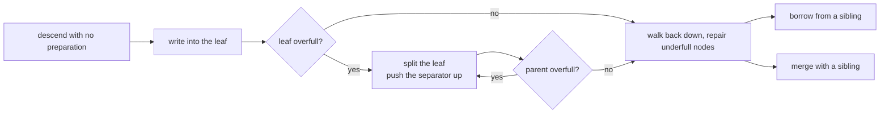
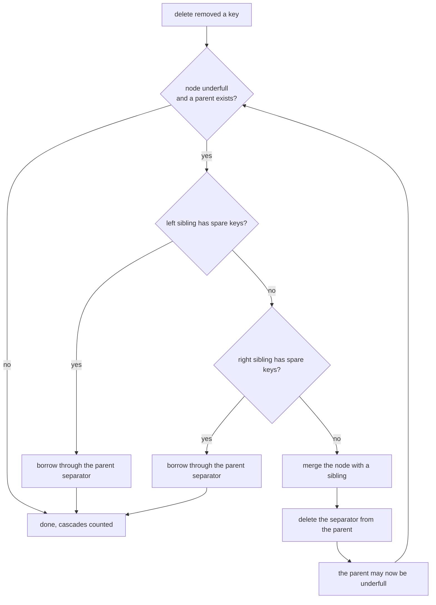
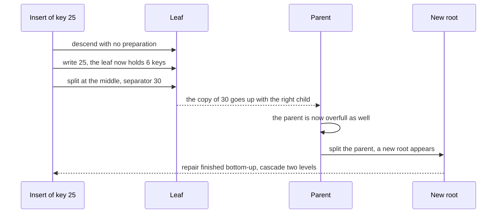

# 776 — Implement optimistic B-tree rebalancing algorithm sketch

> **Tier:** Expert · **CTCI chapter:** Ch 14 — Databases
> **Task spec:** [776-implement-optimistic-b-tree-rebalancing-algorithm-sketch.md](../../../tasks/expert/776-implement-optimistic-b-tree-rebalancing-algorithm-sketch.md)
> **Solutions:** [Python](../../../solutions/python/expert/776-implement-optimistic-b-tree-rebalancing-algorithm-sketch/solution.py) ·
> [Java](../../../solutions/java/expert/776-implement-optimistic-b-tree-rebalancing-algorithm-sketch/Solution.java) ·
> [JavaScript](../../../solutions/javascript/expert/776-implement-optimistic-b-tree-rebalancing-algorithm-sketch/solution.js) ·
> [C#](../../../solutions/csharp/expert/776-implement-optimistic-b-tree-rebalancing-algorithm-sketch/Solution.cs)

## 1. Problem restatement

**Optimistic** rebalancing means the structure is left alone until a change *actually* breaks it: an insert
descends without preparing anything, writes into the leaf, and only if that leaf now holds too many keys is a
split performed and propagated upwards. A delete removes the key and only then walks the recorded path back
up, borrowing from a sibling when one can spare a key and merging otherwise — which may underflow the parent,
so the fix propagates and each level is counted as one **cascade** step.

The opposite strategy — **pessimistic preemptive splitting**, where every full node met on the way down is
split whether or not the insert needs it — is implemented too, as the comparison baseline.


Concrete measurements from the solutions' printed summary:

- 250-op random workload (key span 45, seed `0x5EEDBEEF`): **33** keys, **10** splits, **10** merges,
  **16** borrows, **313** structural writes, `max_cascade == 2`.
- 60 ascending inserts: optimistic **23** splits against preemptive **38**, with **129** against **174**
  writes — and identical contents.
- A full root leaf plus updates: optimistic splits **0** (an update never needs a split), preemptive splits
  **≥ 1** (it splits the full root on the way down).
- Deleting the whole tree in sorted order forces real merges and borrows and collapses to `depth == 1` with
  an empty leaf root.

## 2. Intuition

The B-tree literature often splits preemptively: split a full child *before* descending, so the leaf can never
overflow. That is simple and always correct, but it pays for splits that the insert may never need — and it
pays most in exactly the workloads that are most common: appends and updates, where the leaf is full but the
key already lives there.

Optimistic rebalancing flips the order:

1. **Write first, repair later.** The descent touches nothing, the leaf is written, and only *then* is the
   overfull chain split bottom-up. A split happens only when a node really exceeded `MAX_KEYS`.
2. **Deletes repair on the way back up.** The path is recorded during the descent; after removing the key, each
   underfull ancestor is fixed by a borrow (cheap, no page disappears) or a merge (which removes a page and may
   underflow the parent, hence the cascade).
3. **The work is graded, not just counted.** Every node mutation increments `writes`, so the two strategies can
   be compared on how much *structural* work they do: 129 against 174 on the same 60 inserts.

Because this is a **B+ tree** (data only in the leaves, internal nodes hold routing separators), the rebalance
cases stay explicit: rotate a key through the parent, or merge two children and drop the separator.



Documented simplifications: **single-threaded** (the task's "optimistic" refers to the rebalancing, not to
latching), separators may **lag behind leaf minima** after deletions — they remain valid lower bounds, which is
why lookups compare keys instead of trusting a bound — and no sibling redistribution across more than one node
is attempted.

## 3. Algorithm

**Insert (`OptimisticBTree.insert`).**

1. Descend to the leaf recording the internal path; find the insertion position.
2. If the key is already there, update the value (`writes += 1`) and return `False`.
3. Otherwise splice the key in and loop while the node is overfull: pop the parent from the path, call
   `_split(node, parent)`, and continue with the parent — a **bottom-up** repair. When the path is exhausted the
   split creates a new root.

**Split (`_split`).**

4. `middle = len(node.keys) // 2`; the separator is `node.keys[middle]`. For a **leaf** the right node takes
   `keys[middle:]` and the left keeps `keys[:middle]` — the separator is a *copy* that stays in the leaf, the
   B+ convention. For an **internal** node the right takes `keys[middle + 1:]` and `children[middle + 1:]`, the
   left keeps `keys[:middle]` and `children[:middle + 1]`, and the median moves up.
5. With no parent, build a new root over `[separator]` and `[node, right]`; otherwise insert both at the
   parent's `index`.

**Delete (`OptimisticBTree.delete`).**

6. Descend recording `(parent, index)` pairs, remove the key from the leaf, and `writes += 1`. If the key is
   absent, return `False` **without touching anything**.
7. While the path is non-empty and the current node is underfull: pop the parent, call `_rebalance(parent,
   index)`, increment `cascade`, and move up. Track `max_cascade`.
8. If the root is internal and has no separators, replace it by its only child (the tree shrinks a level).

**Rebalance (`_rebalance`).**

9. **Borrow from the left** if it has more than `MIN_KEYS`: a leaf moves the left's last key/value to the front
   and updates the parent separator to the child's new minimum; an internal node rotates through the parent.
10. **Borrow from the right** symmetrically, updating the parent separator when the right's minimum moves.
11. **Otherwise merge**: absorb the donor into the other child, pulling the separator down for internal nodes
    or dropping it for leaves, then delete the separator and the donor child from the parent.

```text
function insert(key, value)
    path ← empty list, node ← root
    while node is not a leaf do
        append node to path
        node ← child of node chosen by key
    position ← first index in node.keys with node.keys[index] >= key
    if the key is already at position then
        node.values[position] ← value
        writes ← writes + 1
        return false
    insert the key and value at position
    writes ← writes + 1
    while length(node.keys) > MAX_KEYS do
        parent ← pop the last entry of path if any else none
        split(node, parent)
        if parent is none then break
        node ← parent
    return true

procedure split(node, parent)
    right ← new node with the same leaf flag
    middle ← length(node.keys) / 2
    separator ← node.keys[middle]
    if node is a leaf then
        right.keys ← node.keys from middle onwards
        right.values ← node.values from middle onwards
        node.keys ← node.keys before middle
        node.values ← node.values before middle
    else
        right.keys ← node.keys from middle + 1 onwards
        right.children ← node.children from middle + 1 onwards
        node.keys ← node.keys before middle
        node.children ← node.children up to middle
    splits ← splits + 1, writes ← writes + 2
    if parent is none then
        fresh ← new internal node with keys [separator] and children [node, right]
        root ← fresh
        writes ← writes + 1
        return
    index ← the position of node in parent.children
    insert separator into parent.keys at index
    insert right into parent.children at index + 1
    writes ← writes + 1

function delete(key)
    path ← empty list, node ← root
    while node is not a leaf do
        index ← the child index chosen by key
        append (node, index) to path
        node ← node.children[index]
    position ← the index of key in node.keys if present else none
    if position is none then return false
    remove the key and value at position
    writes ← writes + 1
    cascade ← 0
    while path is not empty and length(node.keys) < MIN_KEYS do
        parent, index ← pop the last entry of path
        rebalance(parent, index)
        cascade ← cascade + 1
        node ← parent
    max_cascade ← max(max_cascade, cascade)
    if root is not a leaf and root.keys is empty then
        root ← root.children[0]
        writes ← writes + 1
    return true

procedure rebalance(parent, index)
    child ← parent.children[index]
    left ← parent.children[index - 1] if index > 0 else none
    right ← parent.children[index + 1] if index + 1 < length(parent.children) else none
    if left is not none and length(left.keys) > MIN_KEYS then
        rotate the left sibling's last entry into child, updating parent.keys[index - 1]
        borrows ← borrows + 1, writes ← writes + 1
        return
    if right is not none and length(right.keys) > MIN_KEYS then
        rotate the right sibling's first entry into child, updating parent.keys[index]
        borrows ← borrows + 1, writes ← writes + 1
        return
    if left is not none then absorbed ← left, donor ← child, separator_index ← index - 1
    else absorbed ← child, donor ← right, separator_index ← index
    if absorbed is not a leaf then append parent.keys[separator_index] to absorbed.keys
    extend absorbed with the donor's keys, values or children
    delete parent.keys[separator_index] and parent.children[separator_index + 1]
    merges ← merges + 1, writes ← writes + 1
```



## 4. Worked example

The random workload (250 operations over a key span of 45, seed `0x5EEDBEEF`) and its shrink phase: the tree
ends the growth phase with 33 keys, 10 splits, 10 merges, 16 borrows and 313 structural writes, `max_cascade`
reaches 2, and deleting every key collapses it to one empty leaf at `depth == 1`.

The delete trace, with a borrow, then a merge, then the root collapse:

| Step | Situation | Action | Counter |
| --- | --- | --- | --- |
| 1 | leaf drops to 1 key, left sibling holds 4 | borrow the left sibling's last entry, the parent separator becomes the child's new minimum | `borrows += 1` |
| 2 | both neighbours later hold exactly 2 keys | merge the child into one sibling, drop the separator from the parent | `merges += 1` |
| 3 | the parent is now underfull | the loop continues one level up | `max_cascade = 2` |
| 4 | the internal root ends with no separators | `root = root.children[0]` | `writes += 1` |

Optimistic against preemptive on 60 ascending inserts: **23** splits and 129 structural writes against **38**
and 174, with identical contents. The full-root case is the clearest illustration: updating five existing keys in
a root leaf needs no new leaf at all, so the optimistic tree does no structural work, while the preemptive
strategy splits the root before it even knows whether the write will insert anything.



## 5. Complexity

Let `n` be the number of keys, `h = O(log n)` the height and `k = MIN_KEYS = 2` the minimum occupancy.

| Operation | Best | Average | Worst | Why the bound holds |
| --- | --- | --- | --- | --- |
| `find` | O(1) | O(h · MAX_KEYS) | O(h · MAX_KEYS) | one node per level, linear scan of at most 5 separators |
| optimistic `insert` | O(h) | O(h) | O(h) | descent plus a bottom-up split cascade of at most `h` levels |
| preemptive `insert` | O(h) | O(h) | O(h) | descent with a possible split at every level, needed or not |
| split | O(MAX_KEYS) | O(MAX_KEYS) | O(MAX_KEYS) | moves at most 5 keys and 6 children, then one parent splice |
| optimistic `delete` | O(h) | O(h) | O(h) | removal plus a cascade with at most one borrow-or-merge per level |
| `_rebalance` | O(MAX_KEYS) | O(MAX_KEYS) | O(MAX_KEYS) | one rotation or one merge of small nodes |
| `structure_ok` | O(nodes) | O(nodes) | O(nodes) | one pass, occupancy plus depth plus sortedness |
| Space | O(n / k) | O(n / k) | O(n) | every non-root node keeps at least 2 keys, so pages are `O(n / 2)` |

## 6. Pitfalls and edge cases

- **Deleting a missing key must be a complete no-op.** `delete(3)` on an empty tree returns `False`, and
  `delete(99)` on a one-key tree leaves `keys() == [4]` — the path must not be rebalanced for a delete that
  never happened.
- **Duplicate inserts only update the value.** `insert(4, "a")` then `insert(4, "b")` returns `True` then
  `False`, `find(4) == "b"`, one entry, and `splits == 0` — no split for an update.
- **Top-down versus bottom-up splitting.** The optimistic path splits only the nodes the write really
  overflowed; a preemptive implementation must split a full child *before* descending. Mixing the two rules (for
  example splitting on the way down but repairing on the way up) leaves overfull nodes, which `structure_ok`
  rejects.
- **Leaf and internal splits differ.** A leaf's separator is a **copy** that stays in the leaf
  (`right.keys = keys[middle:]`); an internal median **moves** (`right.keys = keys[middle + 1:]`). The B+
  convention is what allows the sibling-merge cases to be stated cleanly.
- **A merge may underflow the parent**, which is why `delete` loops while the current node is underfull and
  counts `cascade` levels; `max_cascade <= depth + 1` is asserted, and the measured value is 2.
- **Occupancy must be repaired, not merely permitted.** After a delete, no non-root node may hold fewer than
  `MIN_KEYS = 2` keys: the trimming experiment deletes every third key of `0..39` and asserts `structure_ok()`
  after each one.
- **The root is the exception.** It may hold fewer than `MIN_KEYS` keys, and when an internal root loses all its
  separators the tree shrinks by replacing the root with its only child — the step that brings the fully shrunk
  tree back to `depth == 1`.
- **Separators may lag behind leaf minima after deletions.** The header states it explicitly: they stay valid
  lower bounds, which is why `find` compares keys in the leaf instead of trusting a bound. A bound-based lookup
  could return the wrong leaf.

## 7. Variants and follow-ups

- **Make the rebalancing concurrent**: speculatively insert without latching and restart on conflict — see
  [775 — speculative B-tree inserts with conflict resolution](../../../tasks/expert/775-implement-speculative-b-tree-inserts-with-conflict-resolution.md).
- **Latch-free readers with version-validated reads**, where writers hold the path until the upward splits
  finish: [774 — concurrent B-tree with latch-free readers](../../../tasks/expert/774-implement-concurrent-b-tree-with-latch-free-readers-reader-write.md).
- **Copy-on-write pages** turn every mutation into a new page and make old versions readable — see
  [806 — fully persistent B-tree with copy-on-write pages and concurrency](../../../tasks/master/806-implement-fully-persistent-b-tree-with-copy-on-write-pages-and-c.md).
- **Write-optimised structures** trade the same read/write balance in the other direction — see
  [777 — write-optimized LSM tuning simulation for read/write tradeoffs](../../../tasks/expert/777-implement-write-optimized-lsm-tuning-simulation-for-read-write-t.md).

## 8. Check yourself

<details><summary>Show answer</summary>

**Q1.** What exactly makes preemptive splitting wasteful, and how does the demo show it?

It splits a full node *before* knowing whether the write will need the space. Updating a key that already
exists needs none, so preemptive splitting creates a page for nothing. The check builds a full root leaf
(`MAX_KEYS = 5` keys) and updates all five: the optimistic tree records **0** splits, the preemptive tree at
least one, and both end with the same contents.

</details>

<details><summary>Show answer</summary>

**Q2.** Why does a delete cascade to the parent at all?

Because a merge removes one child from the parent, and with it one separator: the parent may then hold fewer
than `MIN_KEYS` keys and become underfull itself. `delete` therefore walks the recorded path upwards while the
current node is underfull, counting one cascade level per repair — measured `max_cascade == 2` on the 250-op
workload, and asserted to never exceed `depth + 1`.

</details>

<details><summary>Show answer</summary>

**Q3.** Why is the separator of a *leaf* split a copy, while an internal median moves?

Because this is a B+ tree: all data lives in the leaves, so the key that separates the two halves must remain
searchable in the left leaf. The internal level only routes, so its median can leave the node entirely and live
in the parent. The code encodes both rules with `middle` and `middle + 1` respectively.

</details>

<details><summary>Show answer</summary>

**Q4.** After a series of deletions a separator may be smaller than the minimum key in the leaf below it. Is
that a bug?

No — it is the documented simplification. Such a separator is still a valid *lower bound*, and the search
compares keys inside the leaf rather than trusting the bound, so lookups remain correct. Repainting the
separators on every borrow adds writes to a hot path for no correctness benefit.

</details>
