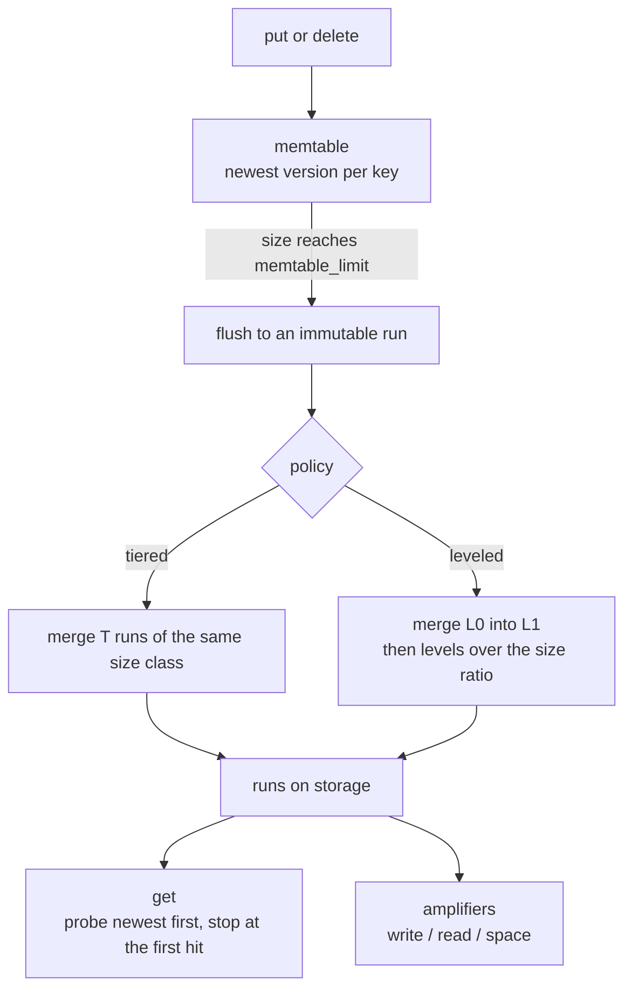
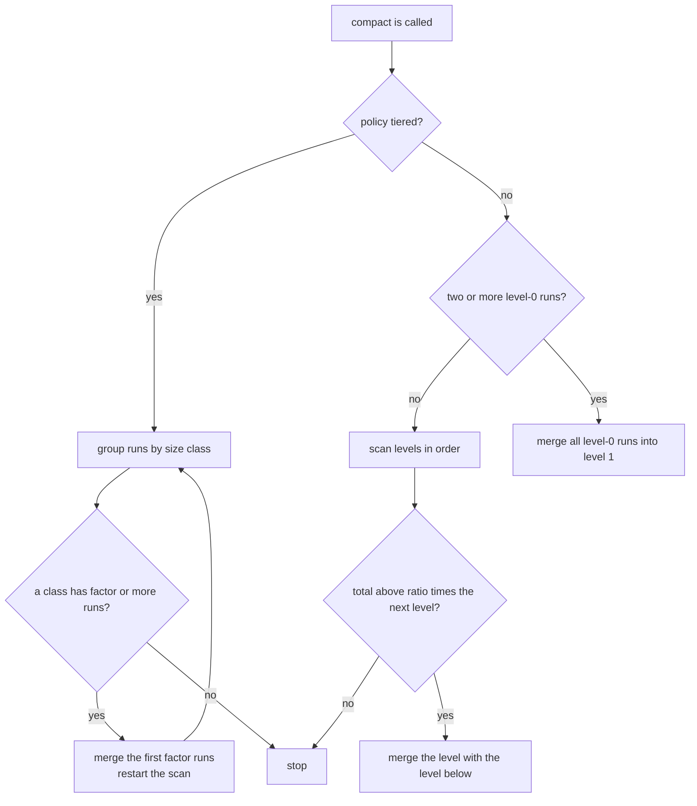
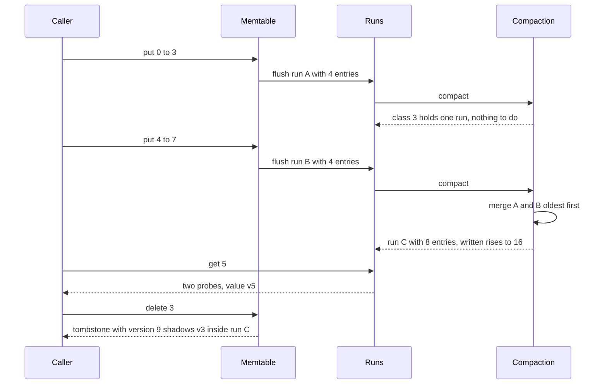

# 777 — Implement write-optimized LSM tuning simulation for read/write tradeoffs

> **Tier:** Expert · **CTCI chapter:** Ch 14 — Databases
> **Task spec:** [777-implement-write-optimized-lsm-tuning-simulation-for-read-write-t.md](../../../tasks/expert/777-implement-write-optimized-lsm-tuning-simulation-for-read-write-t.md)
> **Solutions:** [Python](../../../solutions/python/expert/777-implement-write-optimized-lsm-tuning-simulation-for-read-write-t/solution.py) ·
> [Java](../../../solutions/java/expert/777-implement-write-optimized-lsm-tuning-simulation-for-read-write-t/Solution.java) ·
> [JavaScript](../../../solutions/javascript/expert/777-implement-write-optimized-lsm-tuning-simulation-for-read-write-t/solution.js) ·
> [C#](../../../solutions/csharp/expert/777-implement-write-optimized-lsm-tuning-simulation-for-read-write-t/Solution.cs)

## 1. Problem restatement

An LSM tree turns random writes into sequential ones: every `put` lands in a **memtable**, a full
memtable is **flushed** to an immutable **run**, and background **compaction** merges runs. The task is
to simulate that machine at entry granularity and to *measure* the three classic amplifiers under two
compaction policies, so that the read/write trade-off becomes a number instead of folklore.

Inputs: a deterministic `put`/`delete` stream plus the tuning knobs `memtable_limit` (M), `factor`
(T, the tiering fan-in), `policy` (`tiered` or `leveled`), `level_ratio` and `max_levels`.
Outputs, all computed from the same correctness-checked run structure:

| Metric | Definition used by the solutions |
| --- | --- |
| write amplification | entries written to runs (every flush and every merge output) / entries written by the user |
| read amplification | run probes per point read, newest run first, stopping at the first hit |
| cold read amplification | the same, but with an empty memtable and every key read once |
| space amplification | entries stored in all runs plus the memtable / live distinct keys |

Concrete results the checks assert:

- an empty tree misses, has `inserted == 0` and `write_amplification() == 0.0`;
- `memtable_limit = 5` with five puts of keys `0..4`: `flushes == 1`, the memtable is empty,
  `written == 5` and `inserted == 5`, and all five keys are still readable;
- the stream `workload(24, 300, 0x5EED)` compacted by both policies: both compact,
  `tiered.written > tiered.inserted` (write amplification above 1), both policies flush the same number
  of times, tiered write amplification `<=` leveled write amplification, and leveled keeps at most one
  level-0 run alive;
- the tiering-factor sweep on that stream: factor 8 rewrites no more than factor 2;
- a memtable hit costs exactly **one** probe, and a flushed key costs at most `1 + len(runs)`.

## 2. Intuition

The naive design has two extremes, and both are bad:

- **No compaction.** Writes are free (append a run), but a point read has to probe every run that was
  ever created — read amplification grows without bound and stale versions pile up.
- **Keep one globally sorted run.** Reads become O(log N) lookups, but every insert rewrites the whole
  data set: write amplification O(N).

The LSM idea is to sit in between and *choose* where: writes are absorbed by the memtable, and a policy
decides how many runs to merge and when. The two classic policies trade the amplifiers against each
other:

1. **Size-tiered** — whenever `T` runs of roughly equal size exist, merge them into one. A byte is
   rewritten about `log_T(N/M)` times, so write amplification stays `O(T · levels)`, but every level
   keeps several runs, so a read probes many of them (high read and space cost).
2. **Leveled** — level 0 flushes are merged into level 1, and a level whose size exceeds `ratio` times
   the next level is merged into it. A lookup probes at most one run per level (`O(levels)`), but each
   byte is rewritten about `T` times per level, so writes are much more expensive.



Three details make the simulation honest rather than decorative: every run is a real sorted map from
key to `(version, value)`, so a merge can drop stale versions; deletes are **tombstones** (`None`
values) that must survive compaction or an older version would be resurrected; and recency is a
monotonic run **order** counter (`clock`), not the position in a list, so a merge that happens later
always wins.

## 3. Algorithm

1. `put(key, value)`: bump the global `version`, append to the memtable, and flush when
   `len(memtable) >= memtable_limit`.
2. `delete(key)` is `put(key, None)` — a tombstone, not a removal from the runs.
3. `flush()`: create a run of kind `flush` at level 0 with the memtable's entries, add its size to
   `written`, clear the memtable, then run `compact()`.
4. `compact()` dispatches on the policy. **Tiered**: group runs by size class
   `max(1, len(run).bit_length())`; if a class holds at least `factor` runs, merge the first `factor` of
   them and restart the scan (a merge can create a new group). **Leveled**: if two or more flush runs
   exist, merge them all into one level-1 run; otherwise, for each level, if
   `total(level) > level_ratio * max(1, total(level + 1))` and `level < max_levels`, merge that level
   together with the next one.
5. `_merge(selected)`: walk the selected runs **oldest first** into one map, so the newest `version` of
   each key overwrites the older ones; `written += len(merged)`, `merges += 1`, `compactions += 1`.
6. `get(key)`: probe the memtable (one probe), then the runs in recency order — tiered sorts by
   descending order number, leveled by `(level, -order)` — and return the first hit. Probing stops
   immediately, which is why the read amplification counts *scanned* runs, not all runs.
7. `contents()`: for every key keep the entry with the largest version across runs and memtable, then
   report it; this is the oracle the checks compare with.
8. `force_compaction()`: repeat `compact()` until nothing changes (at most 64 rounds) — the state a real
   system reaches once it goes idle.

```text
procedure put(key, value)
    version ← version + 1
    inserted ← inserted + 1
    memtable[key] ← (version, value)
    if length(memtable) >= memtable_limit then
        flush()

procedure flush
    if memtable is empty then return
    run ← new Run(copy of memtable, kind = flush, level = 0, order = nextOrder())
    written ← written + length(run)
    runs.append(run)
    memtable ← empty
    compact()

procedure compact
    if policy = tiered then
        while true do
            group ← the first size class holding factor or more runs
            if group is empty then break
            replaced ← merge(group)
            runs.append(new Run(replaced, kind = tiered, level = sizeClass, order = nextOrder()))
    else
        if there are two or more flush runs then
            replaced ← merge(all flush runs)
            runs.append(new Run(replaced, kind = level, level = 1, order = nextOrder()))
            return
        for level in sorted levels do
            below ← runs at level + 1
            if level < max_levels and total(level) > level_ratio * max(1, total(level + 1)) then
                replaced ← merge(runs at level plus below)
                runs.append(new Run(replaced, kind = level, level = level + 1, order = nextOrder()))
                return

procedure merge(selected)
    merged ← empty map
    for run in selected ordered by run.order ascending do     // oldest first
        for key, entry in run.entries do
            merged[key] ← entry                               // the newest version wins
    remove selected from runs
    merges ← merges + 1
    written ← written + length(merged)
    compactions ← compactions + 1
    return merged

procedure get(key)
    lookups ← lookups + 1
    probes ← probes + 1
    if key in memtable then return memtable[key].value
    for run in probeOrder() do
        probes ← probes + 1
        if key in run.entries then return run.entries[key].value
    return missing
```



## 4. Worked example

`LSMTree(memtable_limit=4, factor=2)` with the tiered policy, keys `0..7` inserted in order. Every run
detail below is produced by the same code path the checks exercise.

| Step | Operation | Memtable | Runs (order, entries) | `written` | `inserted` | flushes / merges |
| --- | --- | --- | --- | --- | --- | --- |
| 0 | — | `{}` | `[]` | 0 | 0 | 0 / 0 |
| 1 | `put 0..3` | `{}` (flushed) | `[A: 1, 4 entries]` | 4 | 4 | 1 / 0 |
| 2 | `put 4` | `{4}` | `[A]` | 4 | 5 | 1 / 0 |
| 3 | `put 5,6` | `{4,5,6}` | `[A]` | 4 | 7 | 1 / 0 |
| 4 | `put 7` | `{}` (flushed) | `[A, B: 2, 4 entries]` | 8 | 8 | 2 / 0 |
| 5 | compaction | `{}` | `[C: 3, 8 entries]` | 16 | 8 | 2 / 1 |
| 6 | `get(5)` | `{}` | `[C]` | 16 | 8 | 2 / 1 |
| 7 | `delete(3)` | `{3: tombstone}` | `[C]` | 16 | 9 | 2 / 1 |

Read the table as the two mechanisms of the design:

- At step 1 the memtable reaches the limit on the fourth `put`, so `flush` writes exactly its four
  entries: `written = 4`, `flushes = 1`. The tiered policy then looks at the size classes and finds a
  single class-3 run (`4.bit_length() == 3`) with one member — one short of `factor = 2` — so nothing
  merges.
- Step 4 flushes run `B`; now the class-3 group holds `A` and `B`, so `_merge` copies them oldest first
  and produces run `C` with the same eight entries (keys are distinct here). `written` doubles to 16,
  so `write_amplification() == 16 / 8 == 2.0`: each entry was written once by its flush and once by the
  compaction.
- Step 6: `get(5)` counts one probe for the memtable attempt and one for the first (and only) run, so
  the lookup costs `2` probes and returns `v5`. A memtable hit would have cost `1`.
- Step 7: `delete(3)` appends a tombstone with a newer version. `get(3)` now returns `None` from the
  memtable, although `v3` is still stored inside run `C` — dropping the tombstone here would resurrect
  it. `contents()` therefore reports seven live keys, while `space_amplification()` sees nine stored
  entries (eight in `C` plus the tombstone) over those seven keys, about `1.29`.

The leveled policy reaches the same state here but through the other branch: the two flush runs are
merged into a single level-1 run as soon as the second one exists, which is exactly the invariant the
checks assert (`leveled` keeps at most one level-0 run). Its probe order is `(level, -order)` instead of
`-order`, so a level-0 run is always consulted before a deeper one.



## 5. Complexity

Let `N` be the number of user entries, `M = memtable_limit`, `T = factor`, `R` the number of runs alive
and `L` the number of levels.

| Operation | Best | Average | Worst | Why the bound holds |
| --- | --- | --- | --- | --- |
| `put` | O(1) | O(1) | O(M) | one hash insert, amortised by the flush that copies at most `M` entries |
| `flush` | O(1) | O(M) | O(M) | the memtable is copied entry by entry and its size is added to `written` |
| `get` | O(1) | O(1) | O(R) | one probe for the memtable plus one per run until the first hit |
| tiered compaction | O(1) | O(T · S) | O(levels · N) | merging `T` runs of `S` entries each costs `O(T · S)` copies; a byte is rewritten about `log_T(N/M)` times, so write amplification is `O(T · levels)` |
| leveled compaction | O(1) | O(S) | O(N) per merge | each byte is rewritten about `T` times per level, buying read amplification `O(levels)` |
| `force_compaction` | O(1) | O(N) | 64 merge rounds | the loop is capped at 64 iterations of `compact()` |
| `contents` | O(N) | O(N) | O(stored) | every entry of every run is visited once, keeping the largest version |
| Space | O(N) | O(N) | O(N + stale versions + tombstones) | runs hold every entry ever flushed until a merge drops it; the space amplification metric measures the overhead |

Comparison with the alternatives:

| Design | Write amplification | Read amplification | Space |
| --- | --- | --- | --- |
| No compaction | 1 | O(R), unbounded | unbounded stale versions |
| Size-tiered (this task) | `O(T · levels)` | many runs per level | higher (several copies) |
| Leveled (this task) | about `T` per level | `O(levels)` | close to 1 |
| One fully sorted run | O(N) per insert | `O(log N)` | 1 |

The Java solution documents the measured curve for a larger fan-in sweep: the write amplification falls
from `7.5` to `2.4` while the probes per read rise from `4.8` to `13.3` — the same trade-off the Python
checks assert qualitatively with factor 2 versus factor 8.

## 6. Pitfalls and edge cases

- **Divide by zero.** `write_amplification()` returns `0.0` when nothing was inserted and
  `read_amplification()` when nothing was read — the empty tree is a checked boundary case.
- **Tombstone lifetime.** A tombstone shadows older versions and must not be dropped before the
  deepest level, or a compacted-away value reappears. `contents()` deliberately ignores `None` values
  when counting live keys.
- **Stale versions.** `_merge` must iterate runs oldest first; merging newest first would let an old
  value overwrite a new one. `version` is monotonic, so `contents()` can compare across runs.
- **Recency is not list position.** Runs are reordered by compaction, so recency lives in the `order`
  counter; sorting tiered runs by it descending keeps the newest copy first on the probe path.
- **Size classes for tiny runs.** The class is `max(1, len(run).bit_length())`, so an empty or
  single-entry run still lands in a class instead of being lost.
- **Leveled ratio test.** `max(1, next_total)` prevents a division by an empty next level, and
  `level < max_levels` prevents unbounded promotion.
- **Cold reads.** The workload's own lookups usually hit the memtable and would hide the structural
  difference, so `cold_read_amplification` flushes first and measures the run structure alone.
- **Probe accounting.** The memtable attempt is one probe, so a memtable hit has read amplification
  exactly 1 — the check asserts this delta precisely.
- **Determinism.** The stream comes from a 64-bit LCG and merges are ordered, so both policies can be
  run on the identical workload; the oracle is compared every seventh operation.

## 7. Variants and follow-ups

- **Add bloom filters.** Both docstrings list this as the simplification: a filter removes most of the
  probes for absent keys, turning the measured read amplification into an upper bound.
- **Grow the memtable.** A larger `M` lowers the number of flushes, the write amplification and the
  space amplification at the same time — the second knob of the tuning sweep.
- **Real sizes instead of entry counts.** Values of the same size make `len(run)` a faithful stand-in;
  with variable-size values the size classes must count bytes.
- **Related tasks.** [778 — cold-start heuristics for cache warming and prefetching](../../../tasks/expert/778-implement-cold-start-heuristics-for-cache-warming-and-prefetchin.md)
  attacks the same read path from the cache side;
  [781 — distributed join planning with cardinality estimation errors](../../../tasks/expert/781-implement-distributed-join-planning-with-cardinality-estimation.md)
  shows how the same deterministic-workload methodology is used to study a planner; and
  [795 — advanced LSH parameter tuning](../../../tasks/expert/795-implement-advanced-lsh-parameter-tuning-for-recall-precision.md)
  tunes the recall/precision side of the same index-and-measure loop.

## 8. Check yourself

<details><summary>Show answer</summary>
**Why does the tiered policy group runs by `len(run).bit_length()` instead of by exact size?** Merging
is only useful among runs of comparable size: merging a huge run with a tiny one rewrites far more
entries than it saves. The bit length is a cheap, tie-stable size class — runs of size 5 to 7 share
class 3 — so `factor` runs of roughly equal size accumulate before one merge touches them.
</details>

<details><summary>Show answer</summary>
**`get` counts one probe before it looks at any run. Why does that matter?** Because the checks assert
the exact cost of a lookup: a memtable hit costs exactly one probe and a run hit costs at most
`1 + len(runs)`, which proves the short-circuit really stops the scan. Without counting the memtable
attempt, a hit in the first run would be reported as one probe and the metric would no longer describe
the probe order.
</details>

<details><summary>Show answer</summary>
**A key is deleted and then its tombstone is dropped during a full compaction. What goes wrong?** The
older version of the key — often still present in a deeper run — becomes visible again, so the delete
silently undoes itself. That is why tombstones only disappear in the deepest level, once no older copy
can survive below them.
</details>

<details><summary>Show answer</summary>
**Why measure cold read amplification separately from the workload's read amplification?** The
workload's lookups hit the freshly written memtable very often, so the average probe count is dominated
by one-probe hits and looks nearly identical for both policies. Flushing first and reading every
distinct key once with an empty memtable exposes the run structure the compaction policy actually built.
</details>

<details><summary>Show answer</summary>
**What does `written` count, and why is `written > inserted` a correctness signal rather than a bug?**
`written` counts every entry reaching storage: the flush copies plus every merge output. Compaction
necessarily rewrites data, so once the workload triggers any merge the total exceeds the number of user
writes and the write amplification rises above 1. The check `tiered.written > tiered.inserted`
therefore proves compaction really ran; the open question is only how far above 1 each policy lands.
</details>
