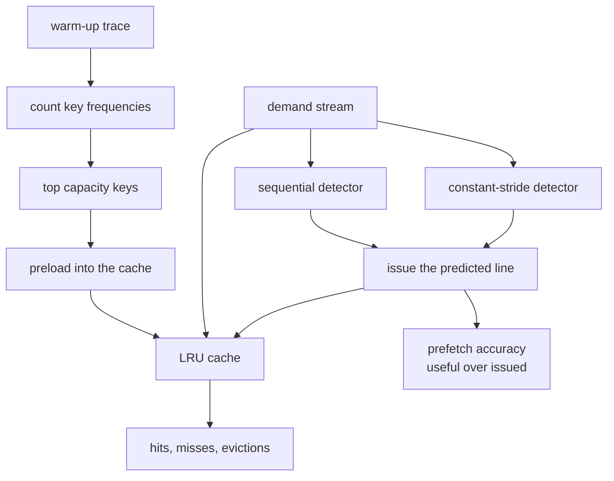
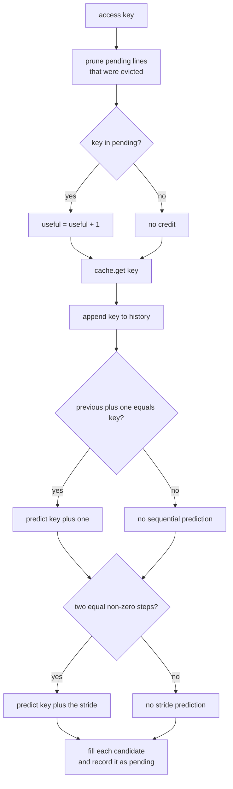
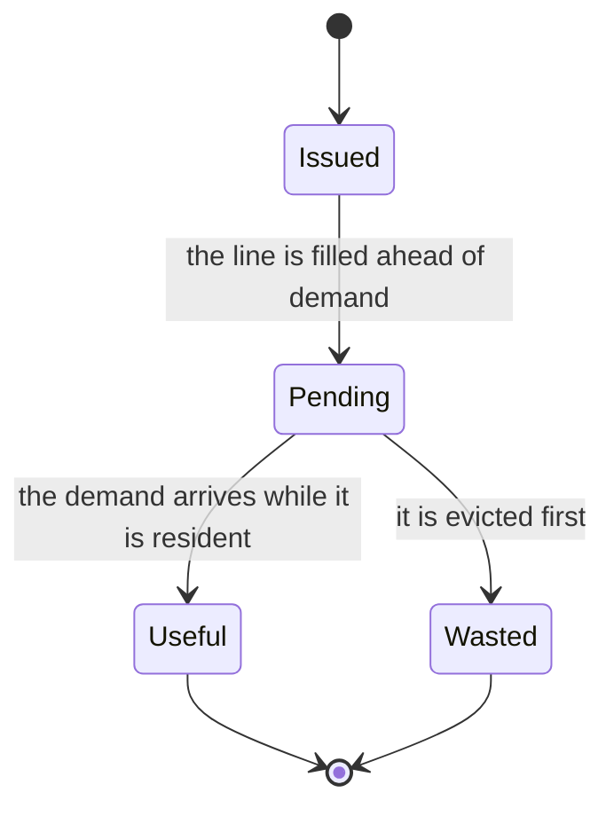

# 778 — Implement cold-start heuristics for cache warming and prefetching

> **Tier:** Expert · **CTCI chapter:** Ch 14 — Databases
> **Task spec:** [778-implement-cold-start-heuristics-for-cache-warming-and-prefetchin.md](../../../tasks/expert/778-implement-cold-start-heuristics-for-cache-warming-and-prefetchin.md)
> **Solutions:** [Python](../../../solutions/python/expert/778-implement-cold-start-heuristics-for-cache-warming-and-prefetchin/solution.py) ·
> [Java](../../../solutions/java/expert/778-implement-cold-start-heuristics-for-cache-warming-and-prefetchin/Solution.java) ·
> [JavaScript](../../../solutions/javascript/expert/778-implement-cold-start-heuristics-for-cache-warming-and-prefetchin/solution.js) ·
> [C#](../../../solutions/csharp/expert/778-implement-cold-start-heuristics-for-cache-warming-and-prefetchin/Solution.cs)

## 1. Problem restatement

A restarted server begins with an empty buffer pool, so its first accesses are **compulsory misses**
even though the workload's hot set is perfectly predictable. The task simulates two cold-start
heuristics on top of an LRU cache and measures them honestly:

- **warming** — run a warm-up trace, rank the keys by frequency and preload the top `capacity` of them
  before the demand stream starts (the static-frequency policy);
- **prefetching** — a *sequential* detector (two neighbouring accesses predict the next one) and a
  *constant-stride* detector (two equal steps predict the next step) issue speculative fills ahead of
  demand, and every issued prefetch is tracked until it is either demanded (useful) or evicted (wasted).

Inputs: a capacity, a warm-up trace, a demand stream (Zipfian, sequential or random) and the two
detector switches. Outputs: hit/miss/eviction counters, the resident set, `accuracy() = useful /
issued`, and the Belady optimum as an upper bound. Concrete results the checks assert:

- capacity 1: `get(1)` misses, the second `get(1)` hits, `get(2)` evicts the single resident entry
  (`misses == 2`, `hits == 1`);
- a stream shorter than the cache never hits: `[3, 4, 5]` in a capacity-8 cache gives `hits == 0`,
  `misses == 3`, three resident keys;
- preloading keys that never appear (`99`, `98`) leaves `hits == 0` — warming cannot invent locality;
- the LRU decisions equal an independently written brute-force LRU on `skewed_stream(600, 40, 1.1, 0x5EED)`
  with capacity 6, and `hits + misses == len(stream)`;
- warming with the hot keys of a warm-up trace never loses hits and never beats Belady
  (`warmed.hits <= optimum`), and a restarted cache misses all six distinct keys of its first window
  (`fresh.hits == 0`) while the warmed one converts at least two of them into hits;
- on `sequential_stream(400, 50, 0x2222)` with `prefetch=True` the accuracy is at least `0.9`, on
  `random_stream(400, 50, 0x3333)` at most `0.5`, and the bookkeeping balances:
  `issued == useful + wasted + len(pending)`;
- with both detectors off, `issued == 0` and `accuracy() == 0.0`.

## 2. Intuition

The naive ideas fail for opposite reasons. **Warm on every access** (prefetch whatever was just
requested) is useless: the demand already fetched it. **Warm from the whole warm-up trace** evicts the
hot keys, because the cache is smaller than the trace. **Assume sequential access** generates pure
garbage on random traffic, and a prefetch that is never demanded has already evicted something that was
wanted.

The key insight has three parts:

1. **Frequency beats order.** On a skewed workload a few keys carry most of the requests, so the
   `capacity` most frequent keys of a *training* pass are exactly the entries that would survive a long
   run anyway. Preloading them turns the cold-start window into hits.
2. **Predict, then verify.** A prefetch is a *bet*. Tracking each issued line until it is demanded or
   evicted yields an accuracy number — and on random traffic the honest answer is "the bet loses", which
   the check asserts instead of hiding.
3. **Measure against a bound.** LRU is validated against an independent brute-force implementation, and
   the warmed cache is compared with Belady's offline optimum (evict the key whose next use is farthest
   away), so "warming helps" is bounded from both sides.



## 3. Algorithm

1. **Generate the traces.** `skewed_stream(length, keys, alpha, seed)` builds a Zipf(`alpha`) table
   (weights `(i + 1) ** -alpha`, cumulative, binary search on a uniform draw), `sequential_stream` walks
   the key space with a deterministic restart every 40 steps, and `random_stream` draws uniformly. All
   of them use the `splitmix64` mixer, so every number in the tutorial is reproducible.
2. **Plain LRU** (`LRUCache`): a map plus an order list, least recently used first. A hit moves the key
   to the back; a miss inserts it and, if the store exceeds the capacity, pops the front and counts an
   eviction.
3. **An oracle.** `BruteForceLRU` re-implements the same policy with a plain last-use list; the checks
   compare `(hits, misses)` after every access of a 600-step stream.
4. **Warm set.** `top_keys(trace, capacity)` counts the training trace and returns the `capacity` most
   frequent keys, ties broken by key. `preload(keys)` calls `get` on `keys[:capacity]`, so a warm set
   larger than the cache is simply truncated.
5. **Detectors.** The prefetcher keeps `history`. On each access, if `history[-2] + 1 == key` the
   sequential detector predicts `key + 1`; if `history[-3]`, `history[-2]`, `key` form two equal non-zero
   steps, the stride detector predicts `key + stride`. Candidates are wrapped modulo the key space and
   skipped when already resident or already pending.
6. **Bookkeeping.** Every issued candidate is put in `pending`. On a later access, `_prune()` moves any
   pending line that is no longer resident to `wasted`, and a demanded pending line becomes `useful`.
7. **Optimum.** `belady_hits` precomputes each key's future use positions and evicts the Resident key
   with the farthest next use — the offline bound no online policy can beat.

```text
procedure access(key)
    prune()                                       // evicted pending lines are wasted
    hit ← cache contains key
    if key in pending then
        pending.remove(key)
        useful ← useful + 1
    value ← cache.get(key)
    history.append(key)
    issuePrefetches(key)
    prune()
    return hit, value

procedure issuePrefetches(key)
    candidates ← empty list
    if sequential detector is on and length(history) >= 2 and history[-2] + 1 = key then
        candidates.append(key + 1)
    if stride detector is on and length(history) >= 3 then
        step ← history[-2] - history[-3]
        if step != 0 and key - history[-2] = step then
            candidates.append(key + step)
    for candidate in candidates do
        candidate ← candidate modulo keySpace      // when the key space is known
        if cache contains candidate or candidate in pending then continue
        issued ← issued + 1
        cache.get(candidate)                       // fill the line ahead of demand
        pending.append(candidate)

procedure warm(cache, trace, capacity)
    counts ← frequency of every key in trace
    warmSet ← the capacity most frequent keys, ties by key
    for key in warmSet do
        if cache does not contain key then
            cache.get(key)
```



## 4. Worked example

Two traces on a capacity-2 cache, both fully deterministic.

**(a) Warming.** Warm-up trace `[5, 5, 5, 2, 2, 9]` → counts `5: 3`, `2: 2`, `9: 1`, so
`top_keys(trace, 2) == [5, 2]` and the preload fills both slots (`misses == 2` before any demand).

| Step | Demand `5, 2, 5, 9` | Cache contents after the step | Order after the step | Hits | Misses |
| --- | --- | --- | --- | --- | --- |
| preload | `5`, `2` | `{5, 2}` | `[5, 2]` | 0 | 2 |
| 1 | `5` hits | `{5, 2}` | `[2, 5]` | 1 | 2 |
| 2 | `2` hits | `{5, 2}` | `[5, 2]` | 2 | 2 |
| 3 | `5` hits | `{5, 2}` | `[2, 5]` | 3 | 2 |
| 4 | `9` misses | `{5, 9}` | `[5, 9]` | 3 | 3 |

Cold, the same four demands give `5` miss, `2` miss, `5` hit, `9` miss — one hit instead of three. The
check generalises this: on the real demand stream the warmed cache must not lose hits against the cold
one, and it may never exceed `belady_hits` (the offline optimum).

**(b) The cold-start window.** Take the first six *distinct* keys of the skewed stream — the worst case
for a restarted server, because every one of them is a first touch. The cold replay has
`fresh.hits == 0`; the warmed replay scores at least two hits, since two of the warm set's keys are
necessarily in that window. This is the difference between "the cache needs a long run to reach its
steady-state hit rate" and "the cache is warm from the first request".

**(c) Prefetching a scan.** `sequential_stream` visits `0, 1, 2, ...` until its deterministic restart.
With capacity 4:

| Access | History tail | Predictor | Issued candidate | Cache after | `issued` | `useful` | `pending` |
| --- | --- | --- | --- | --- | --- | --- | --- |
| `0` | `[0]` | none (history too short) | — | `{0}` | 0 | 0 | `{}` |
| `1` | `[0, 1]` | sequential: `0 + 1 == 1` | `2` | `{0, 1, 2}` | 1 | 0 | `{2}` |
| `2` | `[0, 1, 2]` | sequential: `1 + 1 == 2` | `3` | `{0, 1, 2, 3}` | 2 | 1 | `{3}` |
| `3` | `[0, 1, 2, 3]` | sequential: `2 + 1 == 3` | `4` | `{1, 2, 3, 4}` (evicts `0`) | 3 | 2 | `{4}` |
| `4` | `[1, 2, 3, 4]` | sequential: `3 + 1 == 4` | `5` | `{2, 3, 4, 5}` (evicts `1`) | 4 | 3 | `{5}` |

Every access after the first hit, because the line was fetched in advance: `accuracy() = useful / issued`
climbs to 1. The restarts are what ruin it — a wrong prediction is issued, then evicted before it is
demanded, `_prune()` counts it as `wasted`, and the check's `0.9` threshold measures exactly that
mixture. On `random_stream` the same machinery predicts nonsense, so accuracy stays below `0.5`; the
correct conclusion is that prefetching is a *workload-specific* optimisation, not a free win.



## 5. Complexity

Let `n` be the trace length, `C` the capacity, `P` the number of pending prefetches and `T` the length
of the warm-up trace.

| Operation | Best | Average | Worst | Why the bound holds |
| --- | --- | --- | --- | --- |
| `LRUCache.get` | O(1) | O(C) | O(C) | the Python solution keeps a list and calls `list.remove`, so a hit moves up to `C` entries; an intrusive list would make it O(1) |
| `BruteForceLRU.get` | O(1) | O(C) | O(C) | linear scan of the last-use list, which is the point: it is an independent oracle |
| warming (`top_keys`) | O(T) | O(T log T) | O(T log T) | one counting pass, then a sort of the distinct keys by `(-count, key)` |
| `preload` | O(1) | O(C²) | O(C²) | at most `C` inserts, each O(C) |
| `Prefetcher.access` | O(1) | O(P) | O(P) | two detector tests in O(1) plus `_prune` over the pending set |
| `belady_hits` | O(n) | O(n · C) | O(n · C) | each miss searches the resident keys for the farthest next use from precomputed position lists |
| Space | O(C) | O(C + P) | O(n) | the Belady helper stores the position list of every key |

Comparison:

| Policy | Cold-start hits | Steady-state hits | Extra work |
| --- | --- | --- | --- |
| Plain LRU from cold | 0 on the first window | the reference | none |
| Warmed LRU | `>= 2` of the first 6 distinct keys (checked) | never worse than cold | one training pass and `C` preloads |
| Belady offline | unbounded above | the optimum | needs the future |
| Prefetching on a scan | hits from the second access | `>= 0.9` accuracy | wasted fills on restarts |
| Prefetching on random traffic | no benefit | `<= 0.5` accuracy | pure overhead |

## 6. Pitfalls and edge cases

- **Capacity must be positive** — the constructor asserts `capacity >= 1`; capacity 1 is a checked case
  where the second access hits and the third evicts.
- **A stream shorter than the cache never hits.** `[3, 4, 5]` in a capacity-8 cache produces three
  misses and three residents; there is nothing to reuse.
- **Useless warm keys.** Preloading keys that never appear costs misses and creates no hits, which the
  checks assert to prevent "warming always helps" from being unfalsifiable.
- **A warm set larger than the capacity is truncated**, and the truncated set must still not hurt.
- **`accuracy()` is undefined with no issues** and returns `0.0`; with both detectors off `issued == 0`
  is asserted explicitly.
- **Bookkeeping must balance**: `issued == useful + wasted + len(pending)`, checked for both a scan and
  a random stream. A prefetch that is neither demanded nor evicted is still pending, not lost.
- **A prefetch never changes the answers**, only whether the next access hits — the check compares the
  value returned for every access against the plain cache.
- **Stride 0 is not a stride.** Two identical accesses must not predict another identical access,
  otherwise a hot single key would spam prefetches of itself.
- **Wrap-around.** Candidates are taken modulo the key space, so a scan that reaches the last key
  predicts key `0` instead of going out of range.
- **Hits cannot exceed the number of accesses** (`noise_cache.hits <= len(noise)`), and useful
  prefetches are always a subset of the demand hits.
- **Determinism.** All three stream generators are seeded `splitmix64` sequences; a repeated run must
  reproduce the same hit/miss counts.

## 7. Variants and follow-ups

- **Longer prefetch distance and multi-line blocks** instead of the fixed one-line lookahead: the
  detector logic is unchanged, only the candidate is `key + stride * depth`.
- **Adaptive thresholds** — enable the stride detector only after it has been confirmed twice, which is
  the standard way to protect random traffic from wasted prefetches.
- **Warm from a real log.** The solutions generate the warm-up trace with the same generator as the
  demand stream; a production system replays the tail of the previous run's access log.
- **Related tasks.** [777 — write-optimized LSM tuning](../../../tasks/expert/777-implement-write-optimized-lsm-tuning-simulation-for-read-write-t.md)
  measures the same read path at the storage layer, where the "cache" is the memtable and the number of
  probes is the read amplification;
  [780 — distributed sampling reservoir with merge](../../../tasks/expert/780-implement-distributed-sampling-reservoir-with-merge-operation.md)
  shows the same deterministic-simulation methodology for a sampling structure; and
  [795 — advanced LSH parameter tuning](../../../tasks/expert/795-implement-advanced-lsh-parameter-tuning-for-recall-precision.md)
  tunes the recall/precision counterpart of the prefetch accuracy metric.

## 8. Check yourself

<details><summary>Show answer</summary>
**Why is the warm set built from frequencies rather than from the most recent keys of the training
pass?** Because the demand is skewed: a long run ends up holding the most frequent keys, while the most
recent keys are determined by the tail of the training trace. Frequency ranking is exactly the ranking
LRU converges to, and the check confirms that the warmed cache never loses hits against the cold one.
</details>

<details><summary>Show answer</summary>
**A prefetch is never demanded and is never evicted. Is the bookkeeping still balanced?** Yes — it stays
in `pending`, and the check asserts `issued == useful + wasted + len(pending)`. The line was issued, has
not paid off yet and has not been thrown away, so it is neither useful nor wasted.
</details>

<details><summary>Show answer</summary>
**Why does the accuracy of the sequential detector fall below 1 even on a scan?** Because the scan
restarts every 40 steps: the prediction `key + 1` is issued just before the position jumps to an
unrelated key, so the line is never demanded and is eventually evicted, counting as wasted. On a
strictly monotone scan the accuracy would be 1 after the first access.
</details>

<details><summary>Show answer</summary>
**Why compare the warmed cache with Belady's algorithm instead of only with cold LRU?** Cold LRU shows
that warming helps; Belady shows it cannot help *too much*. Without the upper bound a bug that
accidentally serves hits from a resident set larger than the capacity (or that double-counts hits) would
look like a success, since any hit count above the cold one would pass.
</details>

<details><summary>Show answer</summary>
**The LRU is validated against a brute-force LRU on the same stream. What class of bug does that catch?**
It catches implementation bugs that change the *policy*: wrong recency updates on a hit, evicting the
most recently used key, or forgetting to insert on a miss. The oracle never uses the map-plus-order
representation, so a shared mistake is unlikely, and the check compares both counters after all 600
accesses as well as the final resident set.
</details>
